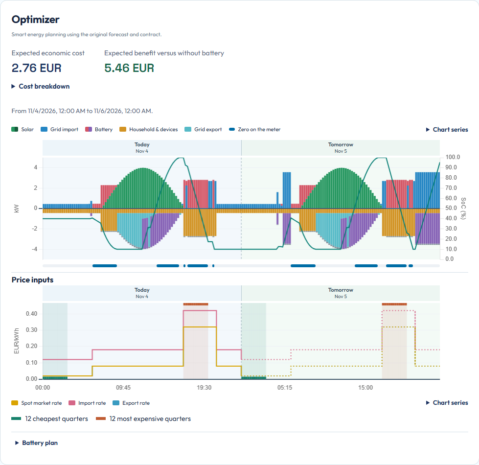
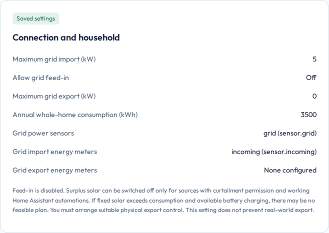
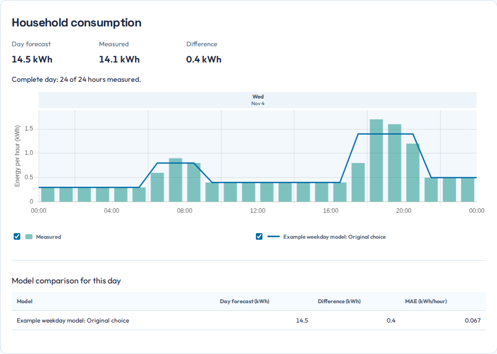
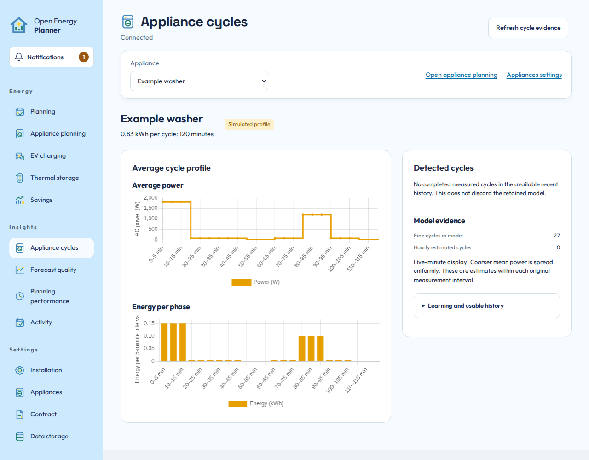
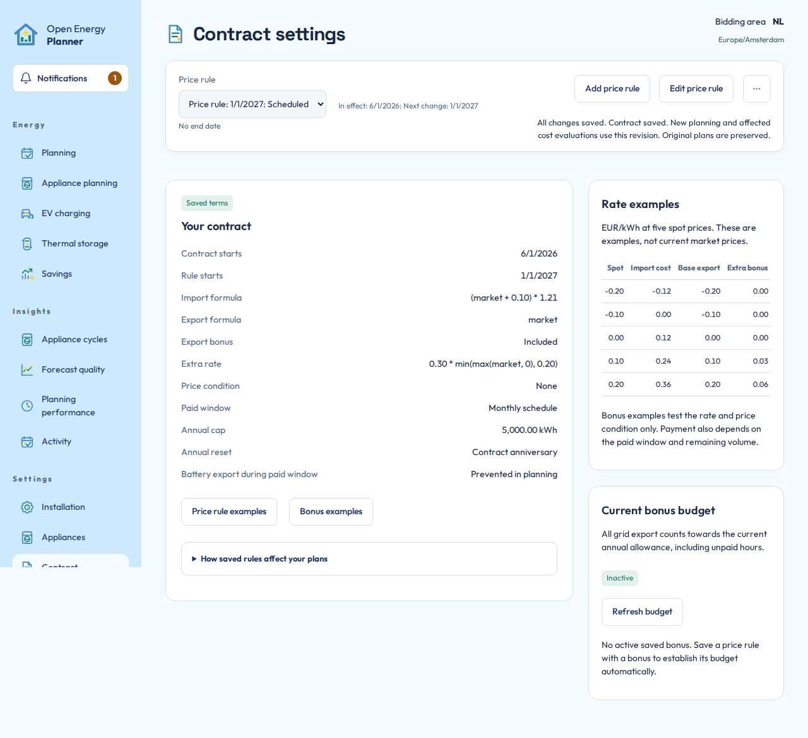

# Open Energy Planner

<p align="center">
  
</p>

**Understand your energy. Plan how to use it.**

Local energy planning for Home Assistant. Turn your existing Energy configuration, measured history, solar forecasts and electricity contract into a checked plan for batteries and supported appliances.

[Install in Home Assistant](#install-in-home-assistant) | [Set up your first plan](https://patrickvorgers.github.io/open-energy-planner/docs/users/first-plan/) | [User guide](https://patrickvorgers.github.io/open-energy-planner/) | [Optional demo](docs/users/demo.md) | [Developer guide](docs/development/README.md) | [Report an issue](https://github.com/patrickvorgers/open-energy-planner/issues)

[](https://github.com/patrickvorgers/open-energy-planner/actions/workflows/checks.yaml)
[](https://patrickvorgers.github.io/open-energy-planner/)

[](docs/assets/planning-example.png)

*Follow the same expected day through the optimizer, ordinary battery self-consumption and a without-battery baseline. All screenshots show the actual interface with synthetic examples. They do not demonstrate physical execution or measured savings. Click an image to inspect it at full size.*

> [!IMPORTANT]
> **Development preview.** OEP targets Home Assistant 2026.11 or newer. Install the integration through the built-in Marketplace and the matching planner through its separate app repository on AMD64 Home Assistant OS. These channels require a published tested release. Follow [Install OEP](docs/users/install.md) and its availability check. Physical control and equipment protection remain in your own Home Assistant automations and local controllers. See the [release boundaries](design/FIRST-RELEASE-SCOPE.md).

## Install in Home Assistant

OEP needs two parts: the **integration** connects to Home Assistant, and the **app** runs the planner and its interface. Install both using the steps below. You do not need HACS, Python, a source checkout or a manually created Home Assistant access token.

### Before you start

- Use **Home Assistant OS 2026.11.0 or newer on AMD64 hardware**, with administrator access. The current app package does not support ARM devices such as Raspberry Pi or Home Assistant Green. Home Assistant Container has no app store and requires a separately managed planner. A beginner installation guide for that route is not available yet.
- Have a **GitHub account** ready for Marketplace sign-in.
- Check the [releases page](https://github.com/patrickvorgers/open-energy-planner/releases). A stable release must include `open_energy_planner.zip`, `ha-app-repository.tar.gz`, `release-manifest.json` and `SHA256SUMS`. **If no stable release with these files is available, installation is not available yet. Stop here.**
- Configure your meters under **Settings > Dashboards > Energy** in Home Assistant. OEP reuses these sources. Solar panels and batteries are optional.

### 1. Install the integration

1. Open **Settings > Marketplace** in Home Assistant. Accept the community-content notice if prompted.
2. Choose **Add from link** and paste:

   ```text
   https://github.com/patrickvorgers/open-energy-planner
   ```

3. If prompted, follow the GitHub device-sign-in instructions and return to Home Assistant. Select **Add**. If asked for a type, choose **Integration** and select **Add** again.
4. Open **Open Energy Planner**, select **Install**, check the release version and confirm **Install**.
5. **Restart Home Assistant.** If an advanced standalone setup form opens, close it. The app will connect automatically.

### 2. Install the planner app

1. Open **Settings > Apps > App store**. Open the three dots menu and choose **Repositories**.
2. Add this URL, including `#ha-app-store`:

   ```text
   https://github.com/patrickvorgers/open-energy-planner#ha-app-store
   ```

3. Close the dialog and find **Open Energy Planner** in the store. Reload the store if it has not appeared.
4. Open the app, confirm its version matches the integration, then select **Install**. Wait for the build to finish. The first installation downloads the planner dependencies.
5. Leave the app options empty to use the default SQLite database. Enable **Start on boot** and, optionally, **Show in sidebar**. Select **Start**.

### 3. Open OEP and make your first plan

1. Check **Settings > Devices & services** in Home Assistant. The **Open Energy Planner** integration entry appears automatically after the app connects. No manual pairing is needed.
2. Select **Open Web UI** on the app page, or open its sidebar entry. Check that the connection is ready. Compare the app build shown in the sidebar with `release-manifest.json` from the release. In Home Assistant, open the **Open Energy Planner** device and check that its integration version matches the app version.
3. Complete the installation wizard. Review your detected sources, connection limits, optional solar and batteries, then choose **Save installation** on the final review.
4. In OEP, open **Settings > Contract**, enter and save your electricity contract rules. Check **Settings > Installation > Price sources**, then open **Energy > Planning** for your first plan.

The [first-plan guide](docs/users/first-plan.md) walks through configuration with screenshots. If the connection or plan does not appear, follow [troubleshooting](docs/users/troubleshooting.md). OEP provides planning advice. Your own Home Assistant automations and local equipment remain responsible for physical control and safety.

**Updating later:** back up Home Assistant and the OEP database, stop the planner, update both components to the same release, restart Home Assistant, then start the app. Disable independent automatic updates of either component. Keep the existing integration and data. See the [full installation guide](docs/users/install.md#updates-and-existing-installations) for update and recovery details.

## What makes OEP different?

OEP brings the following choices together in one Home Assistant workflow. These are implemented capabilities, not a claim that every other EMS lacks them.

| What you already have or need | How OEP uses it | What you can do with it |
|---|---|---|
| A configured Home Assistant Energy dashboard | Reuses selected grid, solar, battery and individual-consumer sources and supported panel metadata | Confirm detected sources and add planning limits instead of entering every meter again |
| Energy-sensor history | Reconstructs household use, builds weekday/hour demand patterns, learns supported appliance cycles and evaluates weather-sensitive candidates | Start with an annual estimate, then inspect predictions and their measured evidence as history becomes usable |
| A dynamic electricity contract | Applies dated import/export formulas, negative prices and separate conditional export bonuses | Model the marginal rates and bonus restrictions that actually influence your plan |
| Batteries and solar on different inverters | Models separate batteries, shared hybrid converters, AC/DC routes, losses, reserves and connection limits | Plan with your installation topology rather than treating every battery as an ideal energy bucket |
| A choice between cost and consumption | Offers **Minimize cost** and **Minimize consumption**, with explicit priorities and constraints | Choose the goal and inspect how it changes expected grid exchange |
| A need to check the result | Retains original plans and forecasts, independently checks balances and costs, and exposes comparisons and missing evidence | Distinguish proposed benefit, prediction accuracy and evaluated savings |

## Start with what Home Assistant already knows

OEP reads the sources you configured in Energy. It does not ask you to build a second energy dashboard. You confirm the information Energy does not define, such as permitted grid import/export, equipment ratings, inverter relationships and planning permissions.

[](docs/assets/installation-connection.png)

*Power limits use kW. Annual household demand uses kWh. The synthetic example disables feed-in. A zero-export plan still requires enough consumption, storage or explicitly controllable solar to handle surplus.*

Existing history can supply an annual-use estimate. Without enough usable history, you can confirm your own annual whole-home estimate and obtain a provisional demand profile. Solar and batteries are optional. See [installation settings](docs/users/installation.md).

## Forecast from measurements and inspect the evidence

Household and individual-consumer history inform expected demand. Supported weather-sensitive devices can learn from consumption and temperature history. Solar forecasting combines configured geometry and weather, with independently evaluated learned alternatives. Suitable evidence is required before a learned model is selected. Missing history does not become zero demand.

[](docs/assets/forecast-quality.png)

*Inspect where a prediction matched the measurement and where coverage is missing. This synthetic teaching example is not a measured model-performance claim.*

For cycle appliances, OEP can learn the shape and energy of completed runs from available measurements. You can inspect the average profile and recent activity before allowing supported scheduling.

[](docs/assets/appliance-cycles.png)

*The synthetic cycle example shows why an appliance needs a time-varying profile rather than only a nominal wattage. Following consumption does not authorize control.*

Read [forecasts](docs/users/forecasts.md) and [appliances](docs/users/appliances.md) for source selection, startup behavior and learning boundaries.

## Plan against your actual contract rules

A market-price feed alone does not describe your bill. OEP separates market prices, effective import/export formulas and additional qualifying export revenue. Rules have effective dates. Bonus conditions can include price gates, paid hours, an annual volume allowance, reset dates and battery-export restrictions.

[](docs/assets/contract-rule.png)

*Check negative, zero and positive market-price examples. Keep an extra bonus outside the base export formula so it is not counted twice.*

Worked Dutch examples cover Zonneplan, NextEnergy and Budget Energie bonus structures. They illustrate configurable rules, not automatic supplier integration or a guarantee that your current signed terms match. Measured export history can establish opening allowance usage. Proposed export does not consume that measured counter. See [contract configuration](docs/users/contract.md) and the [worked formulas](docs/development/CONTRACT-EXAMPLES-NL.md). Fixed subscriptions, annual netting and a complete supplier invoice are outside this marginal planning calculation.

## Read the plan, then decide how to act

The target horizon is 48 hours when inputs cover it. Planning compares the optimizer with ordinary battery self-consumption and a without-battery baseline under the same original inputs. It accounts for configured losses, wear and remaining stored-energy value. Separate **Savings** and **Forecast quality** views answer different questions using retained evidence.

The calculation app runs separately from Home Assistant. The integration exchanges measurements and publishes virtual advice. Your automation/controller implements physical actions. An accepted command proves receipt, not execution. Missing measurements remain unknown and expired commands become unavailable.

## Get your first plan

1. [Check availability and prepare Energy](docs/users/before-you-start.md).
2. [Install through Marketplace and the app store](docs/users/install.md), then [complete setup](docs/users/first-plan.md). Review detected sources, connection limits, solar, batteries and the final installation summary.
3. [Confirm contract rules and price sources](docs/users/contract.md), then add [optional appliances](docs/users/appliances.md).
4. Open **Energy > Planning** and [check your first result](docs/users/read-your-plan.md).

For a separate synthetic sandbox, use the [optional standalone demo](docs/users/demo.md). A [persistent simulated Home Assistant laboratory](docs/development/USER-TEST-ENVIRONMENT.md) is available for integration testing. Neither is a prerequisite for configuring an installed OEP app.

## Develop against real boundaries

The [developer guide](docs/development/README.md) explains checkout preparation, the matched CI package, the isolated Supervisor environment and focused tests. The [architecture overview](docs/development/ARCHITECTURE-OVERVIEW.md) maps code and ownership. Detailed contracts live in the [reference library](docs/development/REFERENCE-INDEX.md), with formal requirements and independent scenarios in `design/`.

Contributions use signed commits, Draft PRs, affected regression checks and a completed independent provider review before candidate CI. GitHub CI binds suite completion and artifacts to the exact tested source tree. See [Contributing](CONTRIBUTING.md) and [CI stages](docs/development/CI-STAGES.md) for the current procedure.

## Help, security and licence

For ordinary problems, follow [troubleshooting](docs/users/troubleshooting.md) and include sanitized build/context information in an [issue](https://github.com/patrickvorgers/open-energy-planner/issues). Follow the [security policy](SECURITY.md) for vulnerabilities. Do not publish tokens, real Home Assistant configuration or private measurements.

OEP uses [AGPL-3.0-only](LICENSE). Dependencies retain their [original notices](THIRD_PARTY_NOTICES.md). Public development began from a clean source snapshot. Its boundary is documented in [source provenance](docs/development/SOURCE-PROVENANCE.md).
