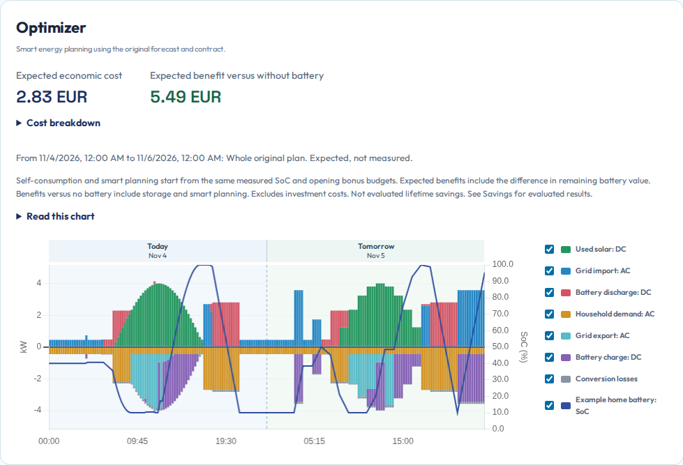

# Open Energy Planner

  

**Understand your energy. Plan how to use it.**

Local energy planning for Home Assistant, combining household and solar forecasts, electricity prices, batteries and supported appliances in one checked plan.

[User guide](https://patrickvorgers.github.io/open-energy-planner/) | [Developer guide](docs/development/README.md) | [Dev Container setup](https://patrickvorgers.github.io/open-energy-planner/provisioning/) | [Report an issue](https://github.com/patrickvorgers/open-energy-planner/issues)

*The actual app with synthetic teaching data. Forecasts and proposed actions are separate from measured results and physical execution.*

> [!IMPORTANT]
> **Development preview.** OEP has not reached a stable product release. Public HACS installation is not available yet. Start with the isolated examples, preserve your data and check the [release boundaries](design/FIRST-RELEASE-SCOPE.md). Physical control and equipment protection remain in your own Home Assistant automations and local controllers.

## Choose your route

| I want to use OEP | I want to contribute |
|---|---|
| [Understand how OEP works](docs/users/how-oep-works.md) | [Start developing](docs/development/README.md) |
| [Try a plan without connecting equipment](docs/users/first-plan.md) | [Prepare the Dev Container](https://patrickvorgers.github.io/open-energy-planner/provisioning/) |
| [Prepare Home Assistant and configure OEP](docs/users/configuration.md) | [Find the responsible subsystem](docs/development/ARCHITECTURE-OVERVIEW.md) |
| [Read a plan and understand costs](docs/users/read-your-plan.md) | [Run checks and prepare a PR](CONTRIBUTING.md) |
| [Troubleshoot a missing result or warning](docs/users/troubleshooting.md) | [Browse technical references](docs/development/REFERENCE-INDEX.md) |

## What goes into a plan?

1. **Your installation:** Energy sources from Home Assistant, measured starting state and confirmed equipment limits.
2. **Your expected day:** Household demand, solar production and published or forecast electricity prices.
3. **Your choices:** Dated contract rules, optimization goal, planning permissions and explicit appliance requests.
4. **A checked result:** Optimized flows, independent physical/cost validation and an immutable original plan.

The app runs separately from Home Assistant. Its integration exchanges measurements and publishes virtual advice. Native solver packages stay in the app. Missing inputs remain unknown, and a received command does not prove that a device followed it.

## Start with one complete example

[Try your first plan](docs/users/first-plan.md) runs the real planner with synthetic inputs and no Home Assistant connection. Then follow the user guide in order:

**[Understand](docs/users/how-oep-works.md) → [Prepare](docs/users/before-you-start.md) → [Configure](docs/users/configuration.md) → [Read Planning](docs/users/read-your-plan.md) → [Evaluate](docs/users/savings.md)**

Planning compares the optimizer, ordinary battery self-consumption and a without-battery baseline. Savings evaluates retained measurements against a separate continuous reference. Forecast quality compares fixed predictions with later comparable measurements. These are different questions and remain separately labelled.

## Develop against real boundaries

The [developer guide](docs/development/README.md) explains checkout preparation, the matched CI package, the isolated Supervisor environment and focused tests. The [architecture overview](docs/development/ARCHITECTURE-OVERVIEW.md) maps code and ownership. Detailed contracts live in the [reference library](docs/development/REFERENCE-INDEX.md), with formal requirements and independent scenarios in `design/`.

Contributions use signed commits, Draft PRs, affected regression checks and a completed independent provider review before candidate CI. GitHub CI binds suite completion and artifacts to the exact tested source tree. See [Contributing](CONTRIBUTING.md) and [CI stages](docs/development/CI-STAGES.md) for the current procedure.

## Help, security and licence

For ordinary problems, follow [troubleshooting](docs/users/troubleshooting.md) and include sanitized build/context information in an [issue](https://github.com/patrickvorgers/open-energy-planner/issues). Follow the [security policy](SECURITY.md) for vulnerabilities. Do not publish tokens, real Home Assistant configuration or private measurements.

OEP uses [AGPL-3.0-only](LICENSE). Dependencies retain their [original notices](THIRD_PARTY_NOTICES.md). Public development began from a clean source snapshot. Its boundary is documented in [source provenance](docs/development/SOURCE-PROVENANCE.md).
