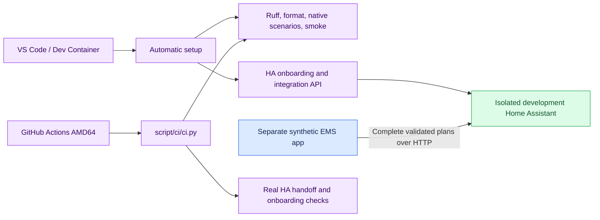

# Repository and development foundation

This foundation defines repository ownership, isolated development and validation under the DEV requirements.

The maintained repository is `patrickvorgers/open-energy-planner`. The source, HA integration, agreed design/release scope are versioned together. Git retains development history. The single maintained app solver remains direct highspy/HiGHS. Synced ChatGPT project sources are not changed or uploaded.

## Responsibilities and flow

The test HA/app network is internal. Only development loopback ports are exposed. Local developer credentials are generated and stored under ignored `.local/`. No production credentials or hardware integrations are provisioned. The app and HA retain separate Python runtimes. Highspy is not installed in HA. HA configuration and authentication are performed through HA APIs, without accessing its database.

Setup reuses its existing user and config entry. An interrupted user-creation setup recovers via normal login. Full CI tests the original independent planner outcomes and actual HA handoff, then first-run, repeated and interrupted provisioning. The same container-suite entry point is available locally. Each CI project has a unique name. Teardown removes only its own containers/network and ephemeral state. JUnit evidence is uploaded as a run artifact.

The Dev Container supplies Python, Git, SSH tooling, Ruff, pytest, debugging and the development services. Private signing keys are not copied into containers. Signing uses host credentials or a separately verified forwarded agent. All commits must show Verified on GitHub. CodeRabbit YAML configures supplementary review. Actual GitHub App installation/access and private branch protection must be verified separately. Desktop/mobile Playwright checks exercise applicable app flows against isolated APIs and stores. ARM publication remains subject to the existing native/practical gates.

The workflow builds and tests development artifacts. It does not publish an incomplete HACS/Supervisor/container release. AGPL-3.0-only and the installed standalone runtime's original third-party notices accompany the source. Keeping initial development private does not change the agreed open-source product release.

See [developer instructions](../docs/development/README.md) and [contribution rules](../CONTRIBUTING.md). Future implementation must continue to reference the agreed first-release scope. The foundation does not reduce that scope.
