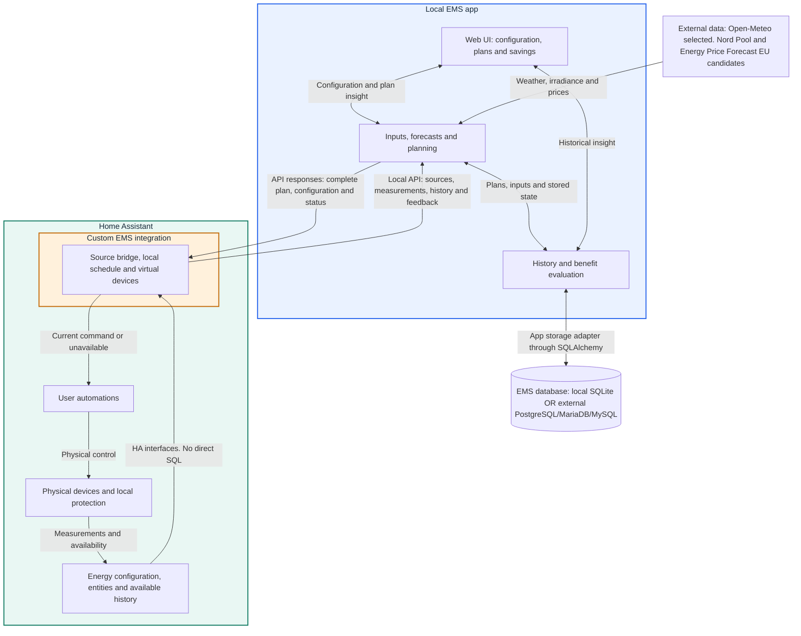
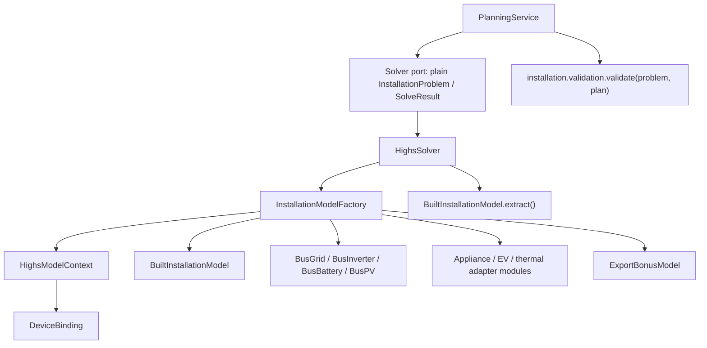

# Open Energy Planner: technical design

## Activity and module event ownership

`activities/` owns retained execution evidence, a current-state projection and
authenticated cursor subscriptions. Producers publish source-owned outcomes,
availability and known schedules. The collector does not infer business validity
from diagnostic logs or execution status and never retries domain operations.
`notifications/` retains cause, severity and recovery semantics independently.
The composition root connects these existing source readers to change signals.

History uses `oep_activities` on the shared active SQLAlchemy engine. One bounded
background writer prevents optional evidence from delaying planning. Normal
shutdown drains producers and that writer before engine closure. Seven-day
retention does not prune original plans, measurements or financial archives.
Read-only APIs reuse existing authentication. Live state uses a process-epoch
cursor and 512-event replay. An atomic snapshot/subscription boundary prevents
missed changes. Restart or expired replay causes an explicit snapshot reset.

The [activity guide](../docs/development/ACTIVITY-EVENTS.md) defines outcomes,
producer coverage, six-hour schedules, interrupted work, transport recovery,
notification separation and limits when storage is unavailable. The
[database dictionary](../docs/development/DATABASE-SCHEMA.md#oep_activities)
defines the transferable row contract. The app composition change is necessary
to connect the shared engine, existing notification owners and lifecycle ordering.
Domain calculations stay with their existing owners. Validation includes app,
browser, four-backend storage/transfer and affected platform lifecycle contracts.

The [plan evidence read model](../docs/development/PLAN-EVIDENCE.md) projects
original archived domain inputs and planned outcomes inside the app. The existing
authenticated plan-comparison response carries factual cards and interval identity.
The responsive UI only formats these facts. No HA integration, solver, configuration
write or database schema change is involved. Reached limits are observations,
never inferred economic causes. A separate specified future layer may test explicit
alternatives against frozen original inputs and preserve solver proof status.

*Local energy optimization for Home Assistant.*

The [release scope](FIRST-RELEASE-SCOPE.md) and [requirements](REQUIREMENTS.md) are authoritative. Milestones are implementation steps within that scope, not smaller product promises. Labelled proposals are not automatically confirmed requirements. Implement technical details within the agreed boundary. Changes to behaviour/user obligations need an explicit product decision. Solver/synthetic app/HA experiments exist. The full product does not. Experiments do not control production hardware. See [development foundation](DEVELOPMENT-FOUNDATION.md) for repository ownership, provisioning, CI and review limits. All project artifacts and names use English.

## 1. Structure

Published-price composition automatically prefers a uniquely compatible loaded
official HA Nord Pool entry. The integration owns discovery and public action
calls in an unloadable background task. The app owns authenticated bounded
request/response admission, source precedence, normalization, retry scheduling and
durable evidence. Request identities prevent old acknowledgements from satisfying
later corrections. The UI projects route/reason separately from cached coverage.
See [automatic route and publication timing](../docs/development/PRICE-FORECAST-SELECTION.md#automatic-published-price-route).

The [joint release identity](../docs/development/RELEASE-IDENTITY.md) binds both
installation artifacts to one version, CI run/attempt and source commit. Loaded
processes verify each other's identity. The sidebar reports the app build and
recent integration agreement. Deployment verification compares both processes
with the intended installation-bundle manifest.

Price-source composition adds the bounded Jeroen.nl JSON-RPC adapter for NL.
`SourceSelection` composes the existing pairwise `ForecastSelection` policy,
retaining original two-source storage and adding source-identified comparison
tables for additional pairs. Global automatic recommendations and versioned
manual preferences use the existing `prices` SQL document namespace. Manual
preferences change composition only. Published prices always take precedence.
The runtime serializes optimistic preference saves with refresh and the shared
financial persistence barrier. Installation Sources and models uses its existing
Edit/Save/Cancel controls and refreshes quality without overwriting drafts.
The engine consumes the same typed price timeline and has no provider-specific
logic. See the [detailed contract](../docs/development/PRICE-FORECAST-SELECTION.md).

The [Jeroen.nl interface comparison](../docs/development/PRICE-FORECAST-SELECTION.md#available-interfaces-and-transport-choice)
records the public MCP interface, keyed account download feeds and personal-account
MCP separately. As checked on 27 October 2026, a separate publicly documented REST
price-forecast contract has not been established. Keep the implemented public MCP
transport. The comparison links to the provider's API and usage documentation.

The [Energy mapping](../docs/development/ENERGY-DASHBOARD.md) defines the complete
HA-to-app ownership contract. All grid import/export and battery charge/discharge
counters feed their separate historical roles. Required normalized grid powers
are aggregated. Explicit Energy SoC and usable capacity replace inference/manual
overrides. The catalogue reconciles valid changes into new immutable installation
versions and rejects drift at save and planning boundaries. No additional helper
sensors, direct HA database access or parallel Energy editor are introduced.

Implementation update: [installation planning](../docs/development/INSTALLATION-PLANNING.md)
now connects physical settings, existing cached forecasts, prices/contracts and
measured independent battery states without an injected test basis. Separate grid,
PV, battery and converter components compose local DC buses around one household
AC bus in the existing HiGHS adapter. Independent validation precedes schema-2
per-device commands. The app owns the complete setup/editing wizard, settings, calculations and graph
compilation. The integration supplies read-only HA metadata/history, exposes an app
link and automatically reconciles capability-driven entities after its one-time
installation. No source, PV or battery wizard remains in HA. New calculations and HA execution require the current installation model and schema-2 per-device commands. Synthetic development inputs use the same model and projection. Original schema-1 plans remain immutable readable archive evidence. They are never reactivated as executable plans or retained as a second solver implementation.

Energy dashboard membership is authoritative. The HA metadata adapter supplies source identities independently of state/history availability. The app projects exactly those devices, preserving saved settings by Energy meter identity. New sources have stable `setup_required` virtual devices until their necessary ratings/bindings are confirmed. Removed sources disappear from the live catalogue automatically. The publication readiness gate rejects incompatible installation/household definitions. Immutable historical evidence remains untouched. Settings APIs validate membership as well as the wizard, and a production restart waits for initial Energy discovery.

Grid and virtual sources expose separate read-only diagnostic sensors for relevant configured properties, measurement bindings and inverter limits/efficiency/topology, with explicit units. These are last confirmed settings, readable without an active plan. Fixed PV has these device properties without an on/off command. Command capabilities and plan validation remain separate from descriptive metadata.

Configuration pages share `web/save-bar.js` and the workspace floating save-bar styles. One fixed viewport bar holds the current save state, Save and Discard actions. ResizeObserver reserves its actual height so the final fields remain accessible on mobile and desktop. Native form controls and a live status region are shared. Page adapters own their API payloads, validation and persistence confirmation. Disable editing during writes and reloads. A failed request keeps the draft and reports the error in the same bar. Read-only refresh refuses to replace an edited draft until the user saves or discards it.

Installation settings and optimization strategy share this page-level bar while retaining their independently versioned APIs. Strategy remains editable when initial Energy discovery is pending. Only changed sections are written. Successful section responses update their own saved baseline and compare-and-set revision. Partial failures retain the remaining edits without silently rebasing external changes. Appliance shifting permissions are staged together in the same pattern. Each accepted per-device write leaves the pending set, so retry does not repeat accepted changes. Task readiness/cancellation and bonus-counter confirmation remain explicit operations. Evidence filters and chart horizons are view controls, not pending configuration.

HA display text is separate from canonical protocol/state codes. Fixed categorical sensors use native enum options and `translation_key` metadata with explicit English labels in `strings.json` and `translations/en.json`. Human-readable statuses start with a capital letter and contain spaces rather than underscores. This preserves automation/template/API/history compatibility and lets UI wording evolve independently. Do not capitalize or rewrite domain state values in Python. Raw diagnostic data remains machine-readable. HA owns unknown/unavailable rendering.

Three components are developed/tested together:

| Component | Owns | Does not own |
|---|---|---|
| Local Python app | Configuration, normalized inputs, forecasts, plans, evaluations/archive and web UI | Physical device control |
| Custom HA integration | HA source bridge, virtual device/entity lifecycle, locally scheduled current commands | Optimization or fast power regulation |
| User HA logic | Translation of the virtual interface to desired applications/physical control | EMS-generated or prescribed execution workflows |

The app runs as an HA OS app or standalone container. Its UI is part of that app, not another service. Start with one app service and one solver worker, separated internally by Python modules. No required MQTT, external database server, broker or microservices.

### 1.1 Logical overview

This diagram shows responsibilities/data direction, not processes, imports or every API operation. HA fetches complete plans and determines current commands locally. Users retain physical execution.



In both diagrams blue denotes the app, green HA, orange the custom integration inside HA and grey external data/storage. Titles also identify boundaries without relying on colour. External storage means outside the app boundary, not necessarily cloud. SQLite is in the persistent app volume. PostgreSQL/MariaDB/MySQL may run separately, exactly one backend active. API arrows are data direction. HA initiates the connection.

### 1.2 Technical module overview

```mermaid
flowchart LR
    subgraph EXT["External sources"]
        W["Open-Meteo: weather/irradiance, selected"]
        M["Published market prices: Nord Pool candidate"]
        F["Price forecast: Energy Price Forecast EU candidate"]
    end
    subgraph HA["Home Assistant"]
        HC["Energy configuration, registries and location"]
        HS["Current entities and Recorder history"]
        subgraph INT["Custom Open Energy Planner integration"]
            BR["Source bridge: selection, measurements, history"]
            SY["API client: synchronization and reception"]
            EX["Local schedule and validity"]
            VE["Virtual devices, commands and EMS status"]
        end
        AU["User automations"]
        HW["Physical integrations, devices and protection"]
        HC --> BR
        HS --> BR
        BR --> SY
        SY -->|"Validated complete plan"| EX
        EX -->|"Current command or unavailable"| VE
        VE -->|"State changes"| AU
        AU -->|"User translation"| HW
        HW -->|"Measurements and availability"| HS
    end
    subgraph APP["Local EMS app/container"]
        API["Authenticated HTTP/JSON API"]
        CF["Installation configuration and input validation"]
        SRC["Replaceable external adapters"]
        ML["Local PV/demand forecasting"]
        CO["Coordinator: snapshots and replanning"]
        PL["Contracts, planning and independent validation"]
        SO["Worker: modular model classes, highspy, HiGHS"]
        EV["Evaluation and continuous self-consumption reference"]
        ST["Storage ports and SQLAlchemy adapter"]
        DB[("Local SQLite archive")]
        UI["Web UI: plans, savings, configuration"]
        API --> CF
        CF --> CO
        CF -->|"HA history and installation"| ML
        SRC --> ML
        SRC --> CO
        ML --> CO
        CO --> PL
        PL -->|"Typed problem and resource budget"| SO
        SO -->|"Candidate, status and quality"| PL
        PL -->|"Validated plan"| API
        CF --> ST
        CO --> ST
        ST -->|"Measurements and scenario history"| EV
        EV -->|"Versioned evaluations"| ST
        ST <--> DB
        UI <--> API
        API <--> EV
    end
    PG[("External PostgreSQL, MariaDB or MySQL")]
    ST <-->|"Alternative to SQLite: one active backend"| PG
    W --> SRC
    M --> SRC
    F --> SRC
    SY -->|"Sources, measurements, history, requests, receipts"| API
    API -->|"Configuration, history requests, plan, status in responses"| SY
    style APP fill:#eaf2ff,stroke:#2563eb,stroke-width:2px,color:#182a3a
    style HA fill:#e9f7f3,stroke:#147d64,stroke-width:2px,color:#182a3a
    style INT fill:#fff1dc,stroke:#c46b08,stroke-width:2px,color:#182a3a
    style EXT fill:#f1f5f9,stroke:#64748b,stroke-width:2px,color:#182a3a
```



Return arrows are responses, not inbound app callbacks. Internal arrows are data flows, not separate network services. The solver receives plain snapshots/results, not database connections/sessions. UI uses HA OS ingress or a tested Container sidebar route. Only the app accesses its archive. Neither component directly queries HA SQL.

### 1.3 Implemented history boundary

The optional HA Recorder adapter reads hourly energy statistics through the
in-process API, using Recorder's executor and unit conversion. It never opens a
database connection or exposes HA metadata to the app. The app requests only
missing bonus baselines and validates normalized typed history before deriving
and atomically persisting a counter revision. Existing seeds remain authoritative.
Stale request versions cannot overwrite concurrent manual changes. Missing hours
produce an actionable manual-fallback condition, never zero-filled export.
See [the history adapter](../docs/development/HA-HISTORY.md) for interfaces,
sampling semantics, limits and actual-Recorder tests. This is separate from the
future settlement archive and consumption-forecast training pipeline.

### 1.4 EV charging application slice

The [EV charging contract](../docs/development/EV-CHARGING.md) separates durable
application intent, fresh HA sessions and solver-neutral `EVWork`/`EVFlow` records.
The existing installation HiGHS adapter owns native variables. EV AC demand joins
the bus once, after removing its acknowledged individual forecast contribution
through the same residual-boundary preparation used by cycle appliances.
Identity, availability and intent have a hard revision distinct from ordinary
SoC changes, preserving publication anti-starvation rules.

`EVService` uses the existing SQLAlchemy document adapter and planning namespace.
Authenticated EV endpoints share the publication lock and durable-write drain.
HA supplies fresh typed measurements and per-connection nonces. Native controls
forward intent to the app. Separate virtual car and point devices share stable
opaque IDs, while display names follow linked HA devices. The integration gates
current permission locally by session, vehicle, SoC, expiry and enable state.
The supplied blueprint calls user-selected physical actions. No hardware driver,
vendor API, new database or competing forecasting model is introduced.

### 1.5 Forecast-quality application slice

The separate Forecast quality page implements FQ-01 through FQ-09 without changing
forecast models, solver decisions or model-selection policy. Its authenticated
`GET /v1/forecast-quality/days` index and `/v1/forecast-quality/days/{day}` read model
resolve one immutable midnight baseline for the selected HA calendar day.
`forecast_quality.daily` observes the transition independently of solver success,
freezing the last pre-midnight demand, component and solar references and metering
bindings. Its five-second observer allows at most a ten-second observation gap.
Missing capture is unavailable, never reconstructed from a later plan. Database
writes run off-loop and baseline/index commit together. Retries retain the same
captured context. Intraday control eligibility is separate from forecast identity.
The day is scored only after all comparable hourly measurements and the Recorder
delay are complete. Local date boundaries retain 23/25-hour DST days. Daily totals
and errors accompany hourly graphs that expose offsetting timing errors.
The legacy `GET /v1/forecast-quality/{plan_id}` read model remains available for
original-plan investigation, independently of daily scoring.
Component references are pinned when the household forecast is built, rather than
borrowed from the current consumer result. The view retains forecast versions,
issue times and original model labels. Plans without retained quality source
bindings return an explicit unavailable-evidence message. Current model readiness
and `/v1/models` selection evidence are separate observations, never replacements
for historical forecast metadata.

`forecast_quality.history.HistoryArchive` uses `SqlDocuments` in the existing
`demand` namespace on the app-owned active engine. Frozen source bindings include
`entity_id`, HA registry `device_id`, original source `unit` and a version of that
identity. Accepted normalized cumulative endpoints are grouped into immutable daily
blocks. Versioned receipts record the request and receipt time. A source/day pointer
selects the latest retained block without overwriting earlier block or receipt
versions. This data participates in the shared SQLite, PostgreSQL, MariaDB and
MySQL persistence and cross-backend migration contracts. No independent database
or direct Recorder SQL connection is introduced.

The existing integration HistoryBridge retrieves recent hourly Recorder sums and
meter values through the single trusted HA connection. Requests cover the recent
three days and the extra preceding endpoint needed to calculate the first delta.
The completion boundary allows ten minutes of Recorder delay. Successful sources
refresh with the next hourly cohort, while failed sources retry after fifteen
minutes without starving other meters. The authenticated
`POST /v1/forecast-quality/history` endpoint validates the pending request version,
source and range before completing the durable write. Selecting an older day
does not implicitly trigger arbitrary historical backfill. Only already retained
or recently retrievable actuals can be displayed.

`forecast_quality.evidence` integrates contiguous original forecast intervals into
complete UTC hours and calculates actual energy only from adjacent cumulative
hourly endpoints with matching frozen source bindings. It never interpolates
quarter-hour actuals or fills missing values with zero. An hour receives a paired
error only after completion and only if its forecast was issued before that hour
started. MAE, signed prediction-minus-measurement bias, RMSE and WAPE describe the
paired hours. WAPE remains unavailable when paired measured energy totals zero.
Coverage counts and per-hour exclusions explain why a displayed prediction and
measurement may not qualify for a score.

Household and device series preserve the original measurement boundary and identify
controlled EV or appliance operation that changes consumption timing. PV series use
the configured AC or DC boundary. Curtailed, hybrid and shared-inverter metering,
and clipped AC production, cannot independently establish available-production
accuracy. The view can retain these curves while withholding unsupported metrics.
The responsive Chart.js page provides day selection, daily totals and errors,
interactive graphs and interval tables. It distinguishes original forecasts from current active and
candidate model status, descriptive errors from simulated financial decision
windows, and both from measured savings evidence. No comparison claims causal
savings or promotes a model.

## 2. App modules and boundaries

| Module | Input/output |
|---|---|
| Configuration/HA sources | One installation model, capabilities/limits/source links. Configuration version and required inputs |
| External sources | Normalized weather/market/forecast series with receipt/provenance |
| Forecasting | Production/demand history and weather → interval forecasts with model/quality |
| Contracts | Prices/formulas/rules/initial counters → optimization costs and independent numeric evaluation |
| Planning/validation | Current state, installation, forecasts and contracts → checked feasible schedule/status |
| History/comparison | Compact actual measurements/continuous reference → non-overlapping evaluations and preserved plans |

A simple coordinator sequences these steps/coalesces requests. Use ordinary typed Python inputs/outputs, not a generic plugin platform. One concrete `HighsSolver` implements a small `Solver` contract hiding native types, not a user-selectable runtime.

| Layer | Owns | Forbidden dependencies |
|---|---|---|
| `domain` | Installation/routes/series/plans/rules/invariants | HA, HTTP, ORM, solver, ML and providers |
| `application` | Configure, assemble input, forecast, plan, archive, evaluate. Transactions | Concrete database/client/HA objects |
| `forecasting` | Explicit training/evaluation and normalized predictions | Fetching HA/weather/SQL or initiating replanning |
| `contracts` | Rule/counter meaning and independent costs | Supplier websites, database, HA, native solver |
| `planning` | Problem assembly and independent checks | Providers, persistence, HTTP/HA. Native objects outside adapter |
| `evaluation` | Continuous reference/comparison on fixed input | Fetching current sources or silently replacing old inputs |
| `ports` | Narrow typed storage/source/forecast/solver contracts | Implementations/platform libraries |
| `adapters` | Translate provider/ORM/solver/transport formats | Hidden business-logic routes through other adapters |
| `bootstrap` | Wire concrete implementations/lifecycle | Domain decisions applied only at startup |

Dependencies point inward to domain/contracts, with no cyclic imports or universal `utils`/base class. Data-flow arrows do not permit planner imports of storage. API authenticates/validates transport and invokes use cases. Adapters translate provider JSON, HA State, ORM and native variables to plain types. Translate errors at boundaries with causes. The application chooses retry/shortened horizon/stop, not hidden adapter fallback.

Use `typing.Protocol`, e.g. `WeatherSource`, `MarketPriceSource`, `PriceForecastSource`, `ForecastModel`, `Solver` and focused archive interfaces. An ABC is justified only for a real shared mandatory lifecycle, not field reuse. Compose devices from consumption/production/storage/control capabilities and routes/limits. A battery is not a solar/grid subclass. New types need bounded model/config/HA contributions and tests, not provider knowledge or physical drivers in existing classes. Replacing a price adapter or database changes bootstrap/storage implementation, not planner/domain meaning. A small built-in registry is sufficient.


### Current model composition inside the highspy adapter

The production solver accepts immutable `InstallationProblem` inputs and returns
plain `InstallationPlan` candidates through the common `SolveResult` contract.
The former single-network and shared-bus proof builders, route facades and
extraction wrappers are retired. Shared interval, battery, cost, status and
solve-option contracts remain in `optimization.domain`. Installation topology
and per-device flows belong to `installation.model`.

| Class / function | Module boundary | Owns |
|---|---|---|
| `InstallationProblem`, `InstallationPlan` | `installation.model` | Immutable intervals, converter connections, independent device states, aggregate grid limits, work, valuations and detached outcomes |
| `PlanningService` | `planning` | Snapshot admission, asynchronous solving, independent validation and accepted command mapping. It contains no native equations |
| `Solver`, `SolveOptions`, `SolveResult` | Planning/optimization ports and domain | Plain request, strategy/time budget, candidate, termination reason and separate financial/consumption proof status |
| `ProcessSolver` | `worker` | Spawned child-process lifecycle, parent timeout and bounded cleanup around `HighsSolver` |
| `HighsSolver` | `optimization.adapters.highs.solver` | Native options, common budget across construction and priority stages, status/bound mapping and extraction |
| `InstallationModelFactory` | `optimization.adapters.highs.installation` | Fresh context, deterministic components, financial expressions, aggregate export bonuses and terminal valuation |
| `HighsModelContext`, `DeviceBinding` | `optimization.adapters.highs.context` | One native model, interval grid and uniquely owned private bindings |
| `BusGrid`, `BusInverter`, `BusBattery`, `BusPV` | `optimization.adapters.highs.installation_components` | AC conservation, converter direction/rating/losses, battery stock and integer terminal watts, fixed or on/off PV |
| Appliance, EV and thermal adapter modules | `optimization.adapters.highs` | Work, energy contributions, timing/comfort/session constraints and detached extraction |
| `ExportBonusModel` | `optimization.adapters.highs.export_bonus` | Compiled aggregate-export eligibility and chronological quotas. Rule meaning stays in `contracts` |
| `BuiltInstallationModel.extract` | `optimization.adapters.highs.installation` | Detached per-device flows, starts, costs and bonus results. Extraction does not certify correctness |
| Reserve, consumption and thermal priority stages | `optimization.adapters.highs` | Ordered objectives under the same deadline, restoring native precision and objective state |
| `installation.validation.validate` | `installation.validation` | Independent identity, conservation, losses, bounds, reserve, control-group and financial arithmetic. It delegates EV/thermal checks without native imports |

Factory assembly declares device variables before adding constraints and
connecting AC/DC ports. Each device receives its own binding. Configuration
supplies validated data, never Python class paths. Adding a battery adds a
`BusBattery` and converter connection, not a `HighsSolver` branch. Components
share the context within one calculation and reject foreign bindings. Native
objects never escape through results, persistence or HA.

The same `InstallationModelFactory` builds optimized and bounded replay models
with independent contexts, states, bindings and counters. Replay fixes supplied
per-device actions and independently validates the physical result. Savings
reference state and bonus counters continue separately across decisions. A new
round does not reset reference inventory to measured EMS inventory.

`BusBattery` imposes integer terminal watts in the model. Command mapping checks
precision rather than rounding an unchecked candidate. Billing splits preserve
each original control group's decisions. Grid accounting still uses every
billing interval. Appliance starts, EV sessions and thermal comfort remain part
of the same problem with their independent validation/execution safeguards.



The diagram shows ownership, not network transport or a physical driver.
`installation.validation.validate` recomputes physics and costs from plain data,
without importing highspy, reading native expressions or calling the factory.
Solver feasibility alone does not authorize publication. Freshness,
configuration generation, command lifetime and current dispatch availability
remain independent planning/publication checks.

### Independent regression contracts

The [solver regression contracts](SOLVER-REGRESSION-MIGRATION.md) define current arithmetic and physical expectations. Independent expected quantities are preserved rather than adjusted to make tests pass. Source-specific bonuses, continuous PV curtailment without permission, asymmetric converter assumptions and zero-rated hardware do not follow from a scenario built under different contracts.

### Enforcing boundaries

CI must check forbidden/cyclic imports. Test use cases with simple fake ports and run planner/contract scenarios without HA/network/database. Give interchangeable source adapters the same timezone/unit/missing/error contract tests. Storage contracts run against real SQLite/PostgreSQL/MariaDB/MySQL with transactions/constraints/reconstruction. HA imports no app implementation. Keep wire types/examples small and test compatibility on both sides, without ORM/native objects in JSON or attributes.

## 3. Data model

One grid connection, zero or more PV systems/batteries/inverters and one household demand profile. Appliance tasks, EV charging and thermal storage compose through their dedicated device contracts. Virtual devices have stable ID/type/name/capabilities/source links. Routes specify AC/DC conversion/shared limits. A separate control relationship says a battery can help follow the grid target, without prescribing protocol/controller. The wizard derives topology from simple choices, validating Energy suggestions and requesting only missing essential properties. Presence alone does not identify capacity/rating/controllability.

### Time, units and immutable inputs

Use absolute interval start/duration internally in UTC. Display HA timezone. DST changes local-day interval counts. Normalize W/kWh, publish whole-watt commands, preserve energy precision. Grid positive means import. Battery positive means discharge. Preserve gross import/export/charge/discharge separately, not net substitutes. Every series has a measurement side: AC/DC energy is not interchangeable, and each route efficiency applies once.

A calculation freezes configuration, timed measurements, forecasts, prices, rule versions and scenario initial states. Mid-calculation updates cannot mutate it. Before acceptance the coordinator checks whether a known relevant change invalidated the result. Missing/unknown is not zero. Configuration explicitly defines required sources. Observed time and availability are distinct. Loading a historical value does not make it current.

### Plan

| Field | Meaning |
|---|---|
| Plan ID/release | Archive, transport and activation identity |
| Configuration/input references | Exact used versions |
| Strategy | This plan's actual cost/consumption strategy, shown in current/history views |
| Calculation time/horizon/validity | Coverage differs from maximum age |
| Solution status | Feasible, optimal within tolerance, or no usable result |
| Device schedules | Modes, power and applicable production control per interval |
| Expected flows/SoC | Insight/validation/comparison, not realization |
| Expected economics/reference | Separate cash, inventory value and optional wear |

The app supplies validity conditions. HA checks them locally during app loss. A connection timeout alone does not invalidate a still-usable plan. Known invalidity is handled immediately, outside ordinary replanning delays.

## 4. Local communication: proposal

Start with a small authenticated HTTP/JSON API, initiated by HA, without inbound app callbacks. One sequential delivery/receipt stream. Slow native work must not block HTTP or HA's event loop.

| Operation | Purpose |
|---|---|
| Status | Release/readiness/data availability/reasons |
| Installation get/update | Same model for wizard/later UI/virtual projection |
| Source/state synchronization | Energy proposal, metadata, measurements/relevant changes |
| History transfer | Requested bounded windows, outside per-sensor updates |
| Replan request | Coalesced asynchronous calculation |
| Complete candidate retrieval | One validated document |
| Activation acknowledgement | Plan/time receipt and activation, not physical execution |
| Enable-intent synchronization | HA switch and UI share one intent |

Exact routes are implementation details. Begin with periodic synchronization and relevant HA triggers, not another streaming protocol. Polling is not recalculation. HA schedules transitions itself.

### HA access without direct database access

| Data | HA interface | App exchange |
|---|---|---|
| SoC/power/energy/availability | State machine/events inside integration | Value/unit/source/time/availability, coalesced |
| Devices/entities/location | Registries/configuration | Validated source inventory/metadata |
| Energy preferences | Energy interface, externally `energy/get_prefs` | Source proposal, not all physical properties |
| Historical energy/statistics | Recorder, externally `recorder/statistics_during_period` | Bounded windows/resolution/missingness |
| Virtual devices/entities | Standard HA platforms/registries | App configuration/capabilities determine entities |

Use in-process HA helpers. No REST/WebSocket loopback is needed for local State access. Encapsulate Energy/Recorder interfaces in a small version-tested adapter. Listed WebSocket methods describe external access too, not mandatory transport for every read. The app gets HA information exclusively through our local integration API: no Recorder database name/password/shared file/SQL. Manage virtual devices through integration platforms, not database writes or mere REST-state writes.

Import configured sources/windows only, in bounded work outside HA's event loop without blocking current updates. Retention limits API resolution: hourly statistics do not reconstruct exact old quarters. Preserve required intervals from startup before fine history expires. Retain quality on recovered estimates.

### Product installation and pairing decision

The user installs the custom integration once through HACS. The HA OS calculation
app remains a separate Supervisor app installation, and Container users run the
same calculation module separately. The EMS app does not copy/update integration
files, mount the HA configuration directory for installation, or own HA restarts.

After installation, HA OS connects automatically through the authenticated Supervisor channel and exposes the app via HA ingress. No code, confirmation, address, token or separate app login is required. Standalone local discovery retains one explicit confirmation because no Supervisor trust channel exists. Manual settings remain an advanced network fallback. Public discovery never authorizes a connection. The private bootstrap binds the installation-scoped peer credential and persistent TLS identity. Test first connection, same-entry migration, restart, credential recovery and rejection of other owners. Never publish secrets in discovery advertisements, URLs or public assets.

All HA metadata, Energy preferences, measurements and Recorder history reach the
app through the integration. The app has no separate HA user access token, HA data client or Recorder connection. Its Supervisor client performs only the private bootstrap command. Integration-to-app HTTP still requires authentication.
The product goal removes manual token handling, not credentials. UI ingress/session
authentication remains separate from authentication of integration API calls.

The connection increment implements mDNS (`_oep._tcp.local.`), a Supervisor discovery
announcement/flow adapter, a separate pinned-TLS peer listener, app-owned bounded
consent requests and persistent installation credentials. HA OS uses an automatic Supervisor-authenticated private bootstrap and HA-ingress browser access. Standalone containers retain one explicit app confirmation. See the current [connection design](../docs/development/AUTOMATIC-PAIRING.md) for trust, persistence and recovery.


Only the integration's explicitly listed synchronization routes pass through the
peer listener. Pairing consent/reset and device/contract configuration remain on
the app administration interface. The app authenticates there using its existing
UI access mechanism. Peer credentials never grant app administration. HA OS ingress and Supervisor app metadata are implemented. Public distribution remains separately gated. Required developer and release tests use actual-Supervisor Docker acceptance. This is not full HAOS hardware verification. The existing advanced URL/token flow is retained
for development compatibility, not as the normal onboarding route. See
[pairing implementation and deployment boundaries](../docs/development/AUTOMATIC-PAIRING.md).

Exact component releases must match for new plan acceptance. Only loaded valid plans survive mismatch. Archive/receipt IDs do not require a concurrent-stream protocol. Use installation-scoped credentials, test discovery/manual URL fallback, never put backend secrets in browser URLs/assets. UI ingress does not authenticate arbitrary direct integration calls. Trust ingress headers only on the protected ingress route.

## 5. HA entities and execution

| Virtual device | Public interface |
|---|---|
| EMS | Enable intent, actual status/reasons, calculation status, key comparison results |
| Grid | Active/inactive zero-grid target. Only active numeric target is 0 W |
| Battery | Derived Fixed power/Follow grid target mode and applicable signed fixed W |
| PV | Only configured on/off or power-limit command capability |

Grid owns the authoritative zero-grid command. A configured follower's mode is derived, not a second independent command. Otherwise `fixed_power` publishes a usable signed numeric target. The app plans consistency. HA projects it. Users translate grid control physically and process fixed power only in the appropriate numeric mode.

| Situation | Mode/status | Fixed-power sensor |
|---|---|---|
| Planned charge/discharge | `fixed_power` | Signed W |
| Planned idle | `fixed_power` | 0 W |
| Following active zero-grid goal | `follow_grid_target` | `None` → HA `unknown`, `applicable: false` |
| No usable plan/explicit pause | Reason on EMS status | `unavailable` |

Keep the entity enabled and identity stable during mode changes. Registry `disabled` is configuration, not operating mode. A numeric sensor has no generic “not applicable” state, so mode/applicability explain empty numeric state. Valid fixed power has `applicable: true`. The UI may show `Not applicable - following grid target`. This is not unknown control. Zero would be real idle, an old number stale instruction, unavailable failure/pause. Measured power remains separate.

Shared internal projection does not make independent HA writes atomic. Test transitions both ways, unchanged values, faults/pause and coherent triggers. Never use `float(0)` to turn absent numeric commands into idle. Publication order/trigger design must prove the contract. References: [entity registry](https://contributors.home-assistant.io/core/entities/registry/), [sensor](https://contributors.home-assistant.io/core/entities/sensor/), [availability](https://contributors.home-assistant.io/core/entities/entity-class/).

Receive/check a full plan before one logical replacement. Cancel old transitions and publish changed desired commands only. No built-in physical automations, grid regulator or phase control. Pause immediately removes commands, while insight planning can continue. Enable intent persists. Explicit resume/restore needs a fresh plan. Ordinary restart may resume a validated compatible saved plan if enable intent is on. Data recovery is not implicit control authorization.

## 6. Planning round


### Shared physical and economic model: supplementary input

One model definition means shared reviewed source, not one mutable model object or identical initial states every round. The highspy adapter's `InstallationModelFactory` composes per-device components, connections, limits and cost expressions. It builds an optimized instance and a separate reference instance. Both use the same applicable physical parameters, external circumstances and contract definitions, while their independent battery contents and bonus counters may differ after the common initial start. New rounds do not reset the reference to measured EMS state.

The reference policy first determines ordinary self-consumption actions without price optimization. Fix all behavior that could otherwise affect its economic answer: battery charge/discharge, PV availability subject only to ordinary physical limits, relevant routes and any discretionary allocation affecting bonus eligibility. Shared equations derive and check energy states, net flows and chronological charges/bonuses. Fixing only net battery power is insufficient if hidden charge/discharge or routing freedom remains. A feasibility solve may complete/check determined quantities, but must not choose cheaper reference actions. If a fixed trace is inconsistent, reject the reference result and expose its failure. Do not unfix decisions to make it profitable or feasible.

Fully determined expressions can be evaluated without asking HiGHS to optimize. Unresolved shared balance equations may require a feasibility solve. This execution detail must not introduce a second implementation of the physical/economic model. Build reference and optimized instances separately at first, avoiding fragile fixing/unfixing on one live model. Represent fixed reference actions using explicit constraints or identical native lower/upper bounds. A policy label alone does not fix a decision. Any later reuse must satisfy the existing isolation and rebuild-equivalence tests.

The shared model provides the same economic component definitions in both modes. The `contracts` module owns validated, versioned rule meaning. The highspy adapter translates those rules into expressions and exact constraints. Outside that adapter, the independent evaluator computes numeric costs from plain energy routes and rule versions, never by reading a native objective/expression as its validation. Cross-check both implementations against independently justified fixtures. This deliberate independent arithmetic is retained even though mathematical model assembly is shared.

| Result | Meaning | Reporting rule |
|---|---|---|
| Contractual net cost | Import charges minus export income and applicable bonuses, with effective contract components | Keep distinct from battery wear and inventory valuation |
| Wear cost | Configured fee times equivalent full cycles, including partial cycles | Default remains zero. Preserve the agreed normalization |
| Terminal battery value | Estimated value of energy remaining beyond the horizon | Report separately. Not a cash receipt or invoice credit |
| Cost objective | Economic cost incorporating the agreed terminal treatment | Not automatically the amount paid to the supplier |
| Consumption objective | Gross import plus terminal stock replacement kWh first, financial cost second | Never label its primary objective as EUR |

Hard constraints remain hard in both scenarios. The attachment's soft reserve/comfort penalties, peak tariffs and startup-cost examples are illustrative, not additional accepted first-release features. Reserve recovery below the minimum follows the existing explicit rule, not a penalty permitting further discharge. Optional device capabilities can lead to different permitted actions in the two policies. The reference still does not perform price-driven PV curtailment, net charging or battery export.

For retrospective evaluation, use actual EMS energy volumes and applicable prices, and simulate the reference under the same observed external conditions, retaining estimated available PV where required. Do not subtract forecast EMS costs from retrospective reference costs. For example, reference net cost EUR 7.80 and actual EMS net cost EUR 6.62 give a net-cost difference of EUR 1.18. A forecast EMS cost of EUR 6.35 does not change that difference to EUR 1.45. These amounts are illustrative and exclude wear/inventory adjustments. The reference remains a counterfactual simulation, so the result is a calculated comparison rather than measured proof of what would have happened.

Archive model-definition version, reference-policy version, cost-rule/evaluator version, configuration, time grid, forecast/measurement provenance and applicable solver settings with each result through immutable references. Shared-model changes apply to new rounds. Historical outputs remain as stored. Existing explicit contract-correction reevaluation creates new evaluation versions without a historical optimization run. Do not force older periods to use the newest model or require an entire report to use one software version.

The application coordinates both paths through typed ports. The reference-policy module returns plain fixed-action data and does not import highspy. Only the adapter owns the two mathematical instances. Plain results return to independent validation and evaluation. Measure the cost of reference assembly/evaluation separately and include it in total cycle/resource budgets. Sharing definitions is a maintenance choice, not a measured speed improvement.


### EMS strategy and reference are different

Cost minimization selects the lowest expected economic cost including contracts/losses/wear/inventory. Sufficiently negative effective import can justify PV shutdown/grid charging. Consumption minimization first minimizes gross import plus per-battery grid-equivalent replacement of depleted initial stock, then cost among equivalent corrected-import plans. Export does not offset the primary metric. Use lexicographic stages, not a weighted tradeoff. The implementation solves corrected minimum import, then cost constrained to that result within 1e-8 kWh. Retain separate objective values/quality. An unproven primary optimum is not proven minimum import. Reserve recovery and both objective stages share the total budget. The independent evaluator checks detached import/end stocks against the primary result, with a separate 1e-7 kWh numerical allowance. One adapter supports both objectives. See [consumption strategy](../docs/development/CONSUMPTION-STRATEGY.md) for efficiency boundaries, manual activation, conservative assumptions and regression coverage.

Default to cost minimization and persist the choice. A later manual UI change requests a new plan. Active strategy remains the old plan's until full validation/acceptance. Show pending requested versus active strategy, preserve desired choice on failure, and never extend old validity. The reference/counters/history continue. No strategy select entity, automation action or automatic switching. Read historical strategy from immutable plan metadata. Test successful/failed changes and old-plan reading, using the normal transfer flow rather than another version protocol.

The fixed reference asks what the same installation would do without price planning: PV to household, surplus to storage, storage to cover deficits within physical limits. It never price-curtails PV, grid-charges or exports batteries for profit. Remaining PV exports even at negative prices, with the same reference under both strategies. With full storage/no demand/costly export the reference still produces/exports. Permitted EMS curtailment creates a legitimate difference, not a reason to modify the reference retrospectively.

### Calculation sequence and horizon

If required reserve recovery is enabled below minimum SoC, restore as soon as feasible before either primary objective. All battery/route/inverter/grid limits remain hard. Do not defer recovery for cheap prices or block it under consumption minimization. Normal strategy resumes after recovery. Keep the actually below-reserve initial measurement, forbid further discharge and report limiting capacity rather than relaxing limits. Physical control/protection remains HA's responsibility.

1. Coalesce ordinary measurements. Schedule on UTC quarters, with material deviations/new future inputs throttled to at most once per five minutes. Keep readiness recovery, explicit configuration/resume and hard invalidation immediate. Measurement freshness is checked on every report, not used as a solve timer. See [workspace and cadence](../docs/development/EMS-VISUALIZATION.md).
2. Validate current required state. Refresh only needed weather/prices/forecasts/contracts, not every download/training on each round.
3. Freeze input. Plan only remaining time from now, up to available 48-hour coverage.
4. Assemble/solve in one bounded worker while API/HA remain responsive.
5. Independently check physics/routes/limits/counters/costs and final commands. Time-limited feasible results need correct status.
6. Atomically archive inputs/result. Expose the complete still-valid candidate.
7. HA checks/accepts/acknowledges and publishes current commands. Local schedule controls transitions.

The price composition layer projects selected rates onto UTC quarters without altering raw provider archives or native-resolution metadata. The control grid keeps quarters through the first whole UTC hour at or after plan start plus 24 hours, then uses clock-hour controls and a clipped final block. The elapsed horizon remains exactly 48 hours. Whole-hour starts give 120 control groups. Other quarter starts give 121 to 123. Billing retains 192 quarters plus genuine non-quarter boundaries, linked to the original control groups. See [price timeline and control grid](../docs/development/PRICE-TIMELINE-AND-CONTROL-GRID.md). Existing fixtures compare a 192-quarter refinement for constant-within-hour profiles. This is not arbitrary subhour billing proof. Use UTC/actual durations, explicit partial first/edge intervals and a transition measured from planning time, not assumed local-day counts.

Hourly resolution does not change billing. Retain price/contract subintervals for charges/bonus timing/limits. Time-weight linear prices for constant power, respecting unequal durations. Averages cannot hide eligibility boundaries or physical deficits. Explicitly support or reject inexact aggregation. Test partial/mixed-resolution billing without more wizard options.

### Terminal energy value

Automatically value remaining energy by later avoided effective imports or feasible net sales with losses/limits, not acquisition cost alone. Both scenarios share method/price information but independent energy/counter states may produce different values. Forecast sales are uncertain. Do not count energy both as a planned sale and terminal inventory. Only remaining inventory is valued. Forty-eight hours still has an endpoint and does not supply prices beyond itself.

Validate the marginal value function/window with small independent cases before useful release. Taking the maximum visible price for every remaining kWh is not automatically valid given timing/power/committed-use limits. Show cash separately from estimated inventory. Likewise independently specify expected battery use in zero-grid mode. Deferring optimization is not permission to use free battery energy or omit terminal value.

The configured installation implements `bounded-average-v1`: one automatically
derived net rate and capped useful volume per battery, with no extra user field.
The [valuation guide](../docs/development/TERMINAL-VALUATION.md) specifies the
physical allocation, formula, source window, explicit repeated-profile fallback,
immutable provenance, separate cash/inventory reporting and independent checks.
Later cached prices are used only for valuation, not extra executable steps.
HiGHS owns one additional continuous variable per battery. The domain method and
independent arithmetic remain outside the solver adapter. This is a boundary
estimate rather than an optimized continuation or proven forecast improvement.

### Solver contract and responsibilities


### Selected stack: direct highspy + HiGHS

Direct highspy with native HiGHS is the confirmed stack, replacing Pyomo/APPSI. MILP remains the model class, with LP where no discrete decisions are needed. Python model classes use highspy's algebraic variables, expressions and constraints in memory. No intermediate LP/MPS file, user compiler, solver-selection menu, second production adapter or runtime fallback is required.

The [solver selection rationale](SOLVER-SELECTION.md) explains direct adapter ownership and the limits of performance claims. Independent regressions validate current physical and financial contracts. Native ARM admission and full product release remain separate gates.

| Concern | Selected implementation |
|---|---|
| Model construction | Focused Python component classes using highspy algebraic modeling |
| Solve | Native HiGHS through highspy, in memory |
| Model class | MILP. LP for continuous-only cases |
| Public boundary | Plain `InstallationProblem` / `SolveResult` through `Solver` |
| Validation | Independent `installation.validation.validate`, no highspy imports |
| Dependency license | HiGHS/highspy MIT. Retain all dependency notices |
| Delivery | One bundled, version-pinned and jointly tested release |

Version changes apply through the joint release and independent scenario gates. Historical plans and original measurements remain unchanged. Neither requires rerunning an old optimization.


### Planner versus solver

The solver is an internal replaceable calculation component, not part of HA or another user-installed service. The planner owns device/route/contract/terminal-value meaning. The solver searches the assembled problem. It does not choose providers, contract conditions, fallback or extra commands.

`InstallationProblem` carries the time grid, per-device state/connections, forecasts, limits, compiled aggregate-export rules, terminal valuations and appliance/EV/thermal work. Strategy and deadline enter through `SolveOptions`. Planning assembles/fixes inputs and validates results. Only the adapter constructs native variables/equations/objective through focused components and extracts plain results. Use highspy's algebra, not a new expression/matrix framework. Reject unsupported user rules instead of favourable approximations.

| Contract | Contents |
|---|---|
| Input | Immutable problem and deadline/gap/resource budget. No DB/HA/client objects |
| Output | Candidate if present, separate stop reason/solution quality, objective/bound/gap where reliably available |
| Provenance | Solver/model/settings/timing/diagnostics tied to input version. Unknown gap is not zero |


### Runtime packaging and measured optimization

The EMS remains Python code with its mathematical model expressed by the component classes through highspy's algebraic API. HiGHS performs optimization in native compiled code, reached directly through `highspy`. Pyomo/APPSI is not part of the selected runtime. Prefer the tested in-memory path. Model-file export may serve diagnostics, but is not required in the HiGHS runtime path. Users install the complete app/container, without a compiler or separate solver activation.

Prefer compatible binary wheels in controlled release builds. Verify Python version/ABI, CPU architecture and libc/base-image compatibility for every native dependency. If a source build is necessary, pin sources and toolchain in a build stage and ship only the required runtime artifacts. Custom compilation is a packaging option, not a presumed performance improvement. The checked highspy 1.15.1 release lists CPython 3.12 Linux glibc wheels for x86-64 and AArch64. File availability does not prove our container or native ARM runtime works.

Build AMD64 and any eligible experimental ARM64 image from the same source release and tested dependency versions, retaining architecture-specific hashes and image digests. Use a multi-platform manifest only for variants that pass their respective release gates. AMD64 remains primary. ARM remains experimental under DIST-07. QEMU can help builds, but does not substitute for the required native ARM CI or representative hardware performance validation. No central/cloud execution service or physical control layer is introduced.

Start with full model reconstruction as the correctness baseline, as in the current proof. Profile input preparation, forecasts, model construction, model transfer/update, native solve, result extraction, independent validation and total cycle time. If the interface exposes only combined transfer/solve time, report that combination explicitly. The modular proof's `solve_seconds` measures the wall time of native `run()`, excluding construction and extraction. Earlier archived Pyomo records used adapter-call wall time. Do not compare these stage labels as identical measurements. Measure repeated representative cases, documenting cold/warm conditions, sample size, p95, maximum, memory, objective, bound and status. Do not infer a performance guarantee from the tiny fixtures.

Only pursue persistent model updates or warm starts after measurements show practical benefit. They are separate optimizations: native coefficient/bound updates can reuse structure, while a warm start offers prior candidate or solver information. Neither guarantees a speedup. Initially keep rebuilding. Do not change the local proof as part of this documentation update.

Before enabling reuse, test updated price coefficients, forecasts, initial energy, bounds and contract counters against a clean rebuild. A changed device set, route, horizon structure or unsupported rule update requires rebuilding rather than silently keeping old constraints. Map any shifted warm-start candidate by absolute time and device ID, recheck it under current inputs and discard incompatible starts. Changing a domain value does not automatically update a native model. All affected coefficients, bounds and counters must be applied explicitly and checked against a rebuild. Only the sequential worker owns reusable solver state. Snapshots and archived results remain immutable, and every planning round still creates a new plan version.

First improve model formulation, finite bounds, numerical scaling and unnecessary discrete variables where equivalent behavior is proven. Never remove direction restrictions merely to obtain an LP: negative prices and losses can otherwise reward simultaneous charge/discharge, and favorable export prices can reward simultaneous grid import/export. Keep legitimate gross flows at their defined measurement point. The existing historical requirement to retain both import and export is separate from a model's simultaneous-flow restrictions.


### Status, deadlines and acceptance

Distinguish optimal within tolerance, feasible without proof, proven infeasible, unbounded, technical error and stopped without candidate. Time limit is a stop reason that may have a candidate. Independently recompute balances/limits/losses/SoC/counters/costs, including final representable power. Conversion cannot invalidate an accepted solution. Tolerances are explicit/tested, not hidden physical-limit relaxation.

Validated feasible timeout results may publish with honest status. Invalid/absent candidates produce no replacement. Old plans retain normal limits. Unboundedness is a model/input fault, not extraordinary profit. One supervised command-planning worker runs outside API/HA loops. Its coordinator coalesces, bounds cleanup/replacement and never queues parallel runs or activates hard-invalid results. Choose resource budgets from representative evidence, preserve responsiveness and a ceiling, and do not claim a universal runtime or untested automatic scaling. Warm starts remain optional. Continually test statuses, unknown gaps, faults, timeout/termination and new device/contract correctness. HA replacement tests do not prove solver outcomes. Native ARM gates remain.

## 7. Forecasts and household demand

Implementation update: [household demand](../docs/development/DEMAND-FORECASTING.md)
now has typed AC reconstruction and measured exclusions, startup and weekday/hour
models, a NumPy Ridge candidate and an explicit chronological decision-scoring
port. Startup remains active without history. Ridge requires demonstrated realized
planning benefit. Production historical settlement contexts are not fabricated.
Native HA options, Recorder transfer, optional Open-Meteo temperatures and archived
forecast evidence connect to the existing planning-basis port. The solar increment
below now supplies production-weather ingress, PV forecasts and native source
editing. Full topology onboarding/bootstrap, hybrid route projection and
flexible-device control remain separate work.

Synthetic series are allowed for the first closed round. Production needs the agreed automatic sources:

- PV: Open-Meteo plus HA production history. Use pvlib-python/PVWatts DC as the selected physical baseline, including the capacity/orientation startup estimate without history.
- Demand: one whole-house profile including baseload. Start from annual-demand or weekday history. Automatically enable local learning only after chronological planning benefit. No separate user-configured baseload model.
- Market: internal adapter/bidding area inferred when unambiguous. Contract formulas give effective prices.
- Extra prices: separate external forecast, with explicit published-price shortened horizon on absence.

Normalize learning to installation measurement boundaries. Battery charging/conversion losses are not accidentally learned as household load. Later planned flexible loads must be removed from residual demand to avoid double counting.

### Individual consumer forecasting and task execution: agreed next increment

This section defines the [individual-consumer requirements](REQUIREMENTS.md#individual-consumption-devices-confirmed-next-increment) and their acceptance boundaries. The shiftable-appliance task/control path is implemented as described in the [shiftable-appliance guide](../docs/development/SHIFTABLE-APPLIANCES.md). Source implementation alone does not establish full-chain execution acceptance. Preserve the existing forecast, installation, optimization and HA adapter boundaries.

- **HA metadata adapter:** read individual Energy consumers, energy/power links and upstream membership through the integration and supported HA interfaces. Normalize units and quantity semantics before passing typed observations to the app. Do not access the HA database. Membership does not grant control permission.
- **Forecast module:** reuse household history ingestion, feature construction and chronological evaluation patterns for device forecasts. Separate weather/calendar demand prediction from cycle extraction. A cycle profile contains interval durations and mean power/energy relative to its start, total energy, duration, sample count and evidence/version. One average profile per device suffices. No programme classifier is required. Detect completed cycles only where measurements support it. Retain uncertainty and avoid learning incomplete cycles as complete runs.
- **Task application service:** accept a device, readiness timestamp and absolute completion deadline through an authenticated integration action. Return a stable task identity and validation result. Keep outstanding work durable in the app's active SQLAlchemy database. Retries of the same request must be idempotent, while distinct runs remain distinct. Reject ambiguous overlapping tasks for a single appliance rather than generating duplicate starts. Concrete action names and request schemas are implementation details, not an already available API.
- **Planning:** replace the task's ordinary device-use forecast with its cycle profile, within the accepted time window. Keep unscheduled future-use expectations distinct from acknowledged tasks. Select a contiguous start and preserve profile energy across the mixed quarter/hour planning grid. Once execution is confirmed, freeze the actual start and carry only the remaining profile through later plans. Changes in prices or forecasts must not restart or interrupt it. The independent validator checks energy, timing, deadline, shared power limits and residual-household accounting.
- **Execution feedback authority:** require authenticated integration feedback for shiftable devices: started, not started and completed, carrying device/task/attempt identity and event time. HA automations may derive feedback from reliable device state or sustained power. The app's measured power remains supporting evidence, not an implicit replacement for missing feedback. Persist accepted transitions and provenance in the app. Sending a command, zero power or missing readings never proves the physical outcome.
- **Start-attempt lifecycle:** retain one open task and a distinct identity per start attempt. Publish each start request with an expiry bounded by its confirmation window and latest feasible start, allowing for cycle-duration uncertainty. Check expiry inside the actual durable claim worker after lock/queue waits. Return strict authorization, matching task/attempt IDs and `expires_at`, the earlier plan/attempt deadline. This is a transient response, not a new stored timestamp. The integration validates it after synchronization, and the blueprint checks remaining validity after response delivery immediately before the physical action. Persistence and transport delays never extend the lease. The automation rejects expired or superseded requests, including after reconnect/restart. Use immediate, non-queued actions without intervening waits. An expired response retains unknown execution rather than granting retries. Started records actual execution and freezes its start for remaining-profile planning. Completed closes the run and allows quality-checked measured-cycle learning. Neither transition means sending another physical command.
- **Failed versus unknown execution:** accept not started only as the automation's confirmation that execution never began and all delayed/queued execution of that attempt has been cancelled or invalidated. OEP cannot infer that guarantee from command expiry or a transport acknowledgement. Close the failed attempt and allow a new attempt for the same task in the next planning round. Mark the task Deadline not achievable without start commands if its window cannot fit the cycle. Other tasks continue. Without feedback by expiry, withdraw the start request, persist unresolved execution, publish Start not confirmed and raise an actionable notification. Block new attempts until feedback resolves the uncertainty. Do not require a new task submission after confirmed failure. An expired start request is not a stop command for an actually running cycle.
- **Feedback ordering and recovery:** identical repeats are idempotent. Reject contradictory/invalid transitions with an explicit response and retain evidence. Late started/completed feedback for an unresolved expired attempt can reconcile actual execution without making its command valid again. Match the exact attempt. Feedback cannot regress terminal state or modify a newer attempt/task. On restart, restore unresolved/active task and attempt state before exposing commands, preserving existing plan validity/pause rules. Do not turn missing completion feedback into permission to start again. Concrete timeouts and power-detection defaults require practical tests. No guessed universal threshold is specified here.
- **HA projection:** expose relevant available measurements and forecast status for all supported consumers, and task status, planned start and applicable current commands only where shifting is permitted. Do not expose fictitious measurements or require helper entities. HA automations submit readiness/feedback and implement physical commands. The integration performs boundary validation and forwards them to the app.
- **Residual balance and evidence:** remove disjoint selected consumption from historical household training and add separate forecasts/schedules once. Respect upstream meters to prevent parent/child double subtraction. Missing evidence blocks unsupported separation rather than silently reducing the forecast. Archive the actual input/profile/task versions used by each plan. New durable contracts must join the shared schema, database dictionary and four-backend migration tests when implemented.

Acceptance scenarios must cover forecast-only versus shiftable capabilities. Known cycle energy/duration. Weather-sensitive demand. Insufficient/coarse history. Upstream overlap and no double counting. Deadline feasibility. Non-interruption and remaining work after replanning/restart. Command without actual start. Automation feedback based on sustained power with low-power pauses/missing readings. Mandatory started/not started/completed feedback. Confirmed cancellation of delayed execution before not started. Replan of the same task after confirmed failure. Missing feedback blocking retries. Expiry/latest-start boundaries. Late confirmation without command reactivation. Duplicate, contradictory and stale feedback. Recovery of unresolved attempts after restart. Missing completion feedback. Unaffected unrelated tasks. And desktop/mobile task visibility without helpers. Include independent solver outcomes and lifecycle tests separately. No thermal-comfort optimizer is introduced by this increment.

#### Blueprint and simulated dishwasher acceptance

Ship one execution/feedback automation blueprint with the jointly versioned release. Use HA's native device, trigger and action selectors: required inputs are the virtual OEP device, physical start action, actual-start trigger and actual-completion trigger. Put optional cancellation action and cancellation-confirmation trigger in a collapsed advanced section. Explain that idle/zero power or a successfully submitted start command is insufficient evidence. Where an available appliance-state trigger is unsuitable, a user may select reliable sustained-power triggers with meaningful durations. No handwritten templates/helpers are required. Reuse Energy metadata for known measurement links. Readiness/deadline submission is a separate integration action, not a fixed recurring task embedded in the blueprint.

The blueprint contains internal request/feedback plumbing and validation before calling the physical start action. The app/integration issues and durably tracks task/attempt identity, expiry and accepted transitions. Any internal blueprint templates remain supplied implementation, not user inputs. Integration feedback actions correlate observations only with the matching eligible execution, reject ambiguous/stale observations and return explicit errors. Do not depend on an automation context or an in-memory variable surviving a separate status trigger, automation reload or HA restart. Reconcile current state after restart without replaying an unconfirmed physical start. Keep matching/timeout decisions in the existing task application service rather than duplicating a second state machine in YAML. Support independent status feedback while start actions are waiting. Automation concurrency must neither discard completion events nor issue duplicate starts.

The optional failure path first cancels/invalidates delayed execution, then waits for positive cancellation assurance, and only then sends not started for that exact attempt. If cancellation is unsupported, fails or cannot be confirmed, leave execution unknown. The integration cannot revoke an already accepted third-party command merely by clearing a virtual entity. Distinguish withdrawing an unexecuted start from stopping an already running dishwasher.

Extend the existing test-only appliance/energy fixture rather than creating a production dishwasher driver or a second planning engine. Register the simulated dishwasher's cumulative kWh meter and power/status entities in HA and its individual consumer in Energy, preserving other test sources/history. Include the dishwasher exactly once in household totals. Expose test-only start/cancel actions and reliable running/completed/cancelled observations. Support controlled delay, failure, withheld feedback and unavailable measurements. Persist simulated execution/cancellation state so HA/app restarts cannot resurrect cancelled work. Scope fixture installation to the isolated real-Supervisor Docker developer environment. Use normal integration transport, app/solver and the shipped blueprint.

Use an independently specified two-hour profile, for example eight 15-minute mean powers of 1800, 80, 80, 0, 80, 1200, 80 and 0 W: total 0.83 kWh. This is synthetic scenario data, not a universal dishwasher profile. Zero-power phases before completion must not close the task. Generate native measurement/history samples at sufficient resolution to preserve these phases and explicit appliance states. Do not interpolate hourly totals into fictitious observations. Profile extraction tests may use multiple completed synthetic cycles. Retain their synthetic provenance and exclude incomplete cycles.

Record independent expected results and actual observations for these end-to-end cases:

| Scenario | Required observation |
|---|---|
| Normal task with a known uniquely cheapest feasible start | Energy discovery and average profile are visible. Planner selects the independently calculated start. One physical start, started feedback, 0.83 kWh completed cycle and completed feedback. No demand double counting. |
| Confirmed failed attempt with time remaining | Cancelled attempt cannot execute later. The same task receives a new attempt in a later plan and completes without another readiness submission. |
| No feasible start before deadline | Task reports Deadline not achievable, no dishwasher start. Other devices continue to receive valid plans. |
| Withheld start feedback or unavailable readings | Request expires, Start not confirmed is visible and no second attempt is issued. No false not started/completed feedback. |
| Delayed queued start and cancellation | Simulator confirms cancellation before not started. Advance beyond the old queue time and prove the old attempt never executes. |
| Late, repeated or contradictory feedback | Late true start reconciles an unresolved expired attempt without reactivating its command. Duplicate feedback has no extra effect. Invalid/stale feedback cannot mutate another attempt. |
| Low-power pause and missing completion feedback | A zero-power phase does not complete the cycle. No new cycle is authorized without explicit completion. |
| Restart/reload during pending or running execution | Task/attempt and simulated cancellation survive. No duplicate start. Feedback resumes against the original attempt and remaining demand is retained. |

Run deterministic planner/lifecycle tests separately from real HA blueprint acceptance. Run applicable durable-state contracts against SQLite, PostgreSQL, MariaDB and MySQL. Verify the complete HA chain in the real-Supervisor Docker developer environment and desktop/mobile task views. Capture task/attempt identifiers, timestamped commands and physical-fixture events, meter differences, plan inputs and final statuses as evidence. The [shiftable-appliance guide](../docs/development/SHIFTABLE-APPLIANCES.md) describes implemented task, solver, integration and blueprint behavior. Record each acceptance run separately. A specification or source implementation alone does not prove deployed execution.

### Selected physical solar baseline

Implementation update: [solar forecasting](../docs/development/SOLAR-FORECASTING.md)
now supplies the pvlib/PVWatts baseline, per-source shadow gain regression,
Energy-prefilled native source editing, separate inverter/shared-cap estimates,
versioned normalized weather/history and AC planning projection. Hybrid route
compilation now follows the installation-basis implementation. Production learned-model
activation follows [automatic model selection](../docs/development/MODEL-SELECTION.md),
including its explicit available-PV evidence limitations.

Use pvlib-python's PVWatts DC implementation behind a narrow forecast-model
adapter. Weather retrieval, source normalization, model calculation and planning
remain separate responsibilities. Pvlib/provider objects do not escape into
planner contracts. Open-Meteo supplies the forecast horizon, while local
irradiance projection and a temperature model provide the PVWatts inputs.
Version assumed tilt, temperature/loss parameters and any initial east/west
capacity split with the installation configuration. Preserve the existing
minimal-input requirement. No detailed panel catalogue or extra HA forecast
integration is required.

The versioned PVWatts input contract is explicit: `pdc0` is the source's entered
panel Wp (half per orientation for the initial equal east-west split), never an
unknown inferred default. `gamma_pdc` is -0.004/C. Open-Meteo mean GHI/DNI/DHI are
transposed with pvlib's isotropic model and midpoint solar geometry to plane-of-array
irradiance. The startup approximation passes that POA value as
`effective_irradiance`, with IAM=1 (no additional reflection/AOI loss correction)
and no spectral correction. Geometric incidence is included by transposition.
This does not claim that reflection losses are measured or fully modeled.
`temp_cell` comes from Faiman with weather air temperature/wind and the recorded
u0=25/u1=6.84 assumptions. Model version `pvwatts-v1` and archived assumptions
identify this exact startup convention. Independent arithmetic tests cover the
input mapping. A future change to IAM/defaults requires a new model version.

Use HA Energy's separate solar production entries to suggest independently
measured PV installations. Preserve stable per-installation source/history and
configuration references, link them to inverter instances, and apply a separate
forecast/calibration instance before aggregating production. Multiple inverters
must retain their own ratings, conversion behavior and applicable shared limits.
Do not infer a one-to-one source/inverter mapping or add an aggregate meter to
its component meters. Aggregate-only history cannot establish separate
per-inverter corrections. Where only one aggregate measurement covers multiple
modeled inverters, the future aggregate-calibration path must first aggregate
their physical predictions and apply exactly one group correction to the total,
not the same correction independently to each source and again to the total.
That group-measurement mapping is not implemented by the current per-source
editor. Retain physical baselines rather than inventing per-inverter history.
One source without usable
history keeps its physical baseline while other sources may use learned models.
The learning layer corrects the physical baseline from normalized measured
production and weather/model features. The first implemented candidate is a
bounded regularized through-origin per-source gain. Activation still requires
the independent chronological decision-benefit evidence in FORE-04–06.

Output available DC production at the declared installation boundary. Apply each
conversion, inverter clipping and shared limit exactly once only when a route
crosses that boundary. Hybrid PV/battery AC flows use the applicable shared AC
bound. Direct PV-to-battery DC flows bypass AC throughput but retain battery
terminal, capacity and applicable DC route limits.
Historic AC measurements cannot be compared directly with DC predictions without
accounting for that boundary. Model/library choice does not demonstrate local
accuracy, runtime, dependency footprint or platform installation. Those require
the solar implementation tests and dependency review.

Use one ordered normalization path for fitting and future prediction: canonical
DC production, declared inverter efficiency, one shared inverter AC cap, then
proportional source attribution for comparison with disjoint AC production meters.
Compare interval energies on the selected side, never invert clipped AC samples
to invent available DC. A declared DC production meter compares directly with
canonical DC at that same production boundary. Hybrid AC history cannot identify
available DC yield without the contemporaneous direct-DC/battery/AC route context.
The current calibration therefore reports `hybrid_route_history_required` and
does not fit it. Future hybrid evaluation must use the same route compiler as
runtime planning: direct PV-to-battery flows bypass AC throughput, while paths
reaching AC cross the applicable conversion/shared limit once.

Usable existing HA production history may inform local learning immediately.
An archive of old OEP forecasts is not required to begin training. Historical
realized weather can support fitting, but it must not be presented as weather
forecasts available at an earlier planning decision. Activation still requires
chronological decision-relevant evidence under FORE-04–06. The first implemented
candidate is a bounded regularized per-source gain around the physical baseline.
It is not a guarantee of improvement. Production activation now uses immutable
forward shadow decisions and independently settled realization, as documented in
[automatic model selection](../docs/development/MODEL-SELECTION.md). Keep the
physical baseline available when history, observable available-PV evidence or
learned-model inputs are insufficient.

References: [PVWatts DC model](https://pvlib-python.readthedocs.io/en/stable/reference/generated/pvlib.pvsystem.pvwatts_dc.html),
[pvlib project and BSD-3-Clause licence](https://github.com/pvlib/pvlib-python).

### Available versus controlled PV

The yield model estimates weather/physically available production without EMS curtailment, not a constant nameplate output. Both scenarios use it: reference does not price-curtail, optimizer may within permissions. Actual curtailed production is separate. Preserve model/input/source/interval/quality with evaluation. Reproducible estimates are not measured counterfactuals. Corrections append evaluations, not old plans.

Use known curtailment when selecting training data. Low controlled production is not proof of weak sun/model failure. A planned command does not prove physical execution. Use available feedback/measurements and retain uncertainty. Training selection is technical work, not another wizard.

| Source | Role | Status/access |
|---|---|---|
| Open-Meteo | Weather/irradiance/historical inputs | Selected default, HA location. Validate fields/history/limits/terms |
| Nord Pool | Published bidding-area prices | Public-portal adapter implemented and NL format read-checked. Product coverage/distribution rights remain unconfirmed |
| Energy Price Forecast EU | Prices beyond publication | Forecast-only adapter implemented and NL native hourly format read-checked. Product access/terms and broad market coverage remain admission work |
| EpexPredictor | Public price-forecast API through 72h | Adapter implemented. Hourly keyless fair-use access, no local model dependency. Provider availability/terms remain release admission work |
| DAO/DAP | Research references | No operational dependency |

### Price source composition and refresh

The [forecast-selection increment](../docs/development/PRICE-FORECAST-SELECTION.md) adds per-market/24-hour-lead-bucket paired MAE assessments, 10% plus 0.1 ct/kWh switching thresholds over three consecutive daily assessments, and visible preferred versus actually used sources. Published prices always lead, including beyond 24h. Epex later coverage supplies terminal valuation without extending commands. Selection policy uses a typed port. A SQLAlchemy adapter owns atomic evidence/assessment persistence on SQLite, PostgreSQL, MariaDB or MySQL. The planning basis requests normalized timelines and never chooses providers. `planning_policy.py` owns the horizon and derived grid/coverage. `prices/policy.py` owns named source-selection thresholds/intervals. Durable configuration and archives use the shared active SQLAlchemy database.

Use two typed input ports, `MarketPriceSource` and `PriceForecastSource`, feeding one provider-neutral `PriceService`. Each adapter maps its request/response format into immutable `PriceSeries`/`PricePoint` data. Only the composition root selects providers. The app and planner never inspect provider JSON, URLs, area aliases or response field names. Keep raw wholesale EUR/kWh separate from effective contract import/export prices and bonuses.

Published final prices take priority per interval/market/currency. Forecasts fill the uncovered part of the rolling 48-hour horizon. Retain price kind, native resolution, source version and actual issue/receipt timestamps. A one-hour forecast is not a genuinely quarter-hour forecast if repeated over four planner steps. Source resolution, forecast freshness, delivery horizon and planner step size are distinct. A gap produces explicit shortened/unavailable coverage, never zero.

The agreed market refresh policy is daily 13:05 in `Europe/Amsterdam`. Missing/incomplete publication retries every 30 minutes until complete, plus one 16:05 correction check. Startup loads cache and immediately requests missing expected coverage. Account for 23/25-hour delivery days. Forecast fetching is provisionally hourly and independent of plan computation: each plan uses cached valid inputs. Fetching is not a solver trigger by itself. Identical price content does not create another semantic price version. Actual price/coverage/classification changes do. The current planner's cadence and PLAN-15 bound are unchanged by this source increment.

The [price-input implementation boundary](../docs/development/PRICE-INPUTS.md) documents the optional live bootstrap, public-provider translations, original-version archive, source-fault behaviour and tests. Production HTTP price adapters are implemented there. Contract formulas, solar/demand forecasting and onboarding compose through the installation basis. Exact supplier coverage remains limited by the supported contract grammar. Source access observations do not settle product redistribution/commercial rights.

Diagrams distinguish selected versus candidate sources, not promised free/keyless access. ENTSO-E was discussed as local-model input, not independently selected. Supplier bonuses are versioned rule examples, not selected live APIs. Realized historical weather is not equivalent to forecasts available at the time. Archive received forecasts and use appropriate historical runs for evaluation. Open-source code does not imply unlimited free data access.

## 8. Storage and benefit calculation

### Settlement and visual overview

The [savings boundary](../docs/development/SAVINGS.md) now composes native Recorder capture, retained original plan/advice chronology, independent reference physics, measured billing and versioned corrections. The app owns the full calculation. HA supplies only bounded normalized evidence. All records join the active database and complete cross-backend transfer. Period totals/daily charts aggregate indexed numeric columns in SQL. At most 96 interval JSON documents enter the UI. Counterfactuals, reconstructed intervals, battery value and gaps are identified explicitly. Existing development plans are retained without inventing old activation times. Older descriptions below that call settlement/reference/UI entirely unimplemented are superseded by this bounded implementation, not by a product-release claim.


### Plan archive

The [active database](../docs/development/PLAN-ARCHIVE.md) stores original plans,
shared inputs, current state, all durable configuration/rules/counters and
price/weather/history/model archives through SQLAlchemy on SQLite, PostgreSQL,
MariaDB and MySQL. Typed store classes preserve validation and immutable versions.
SQL document transactions commit versions and current pointers together. The app
owns one engine, borrowed by all stores and source-selection workers. Authenticated
history reads never reactivate or reoptimize old plans.

No OEP version has been released: development JSON files and older development
schemas have no migration/conversion path. Test installations are reconfigured
manually. Supported migration transfers all current-schema OEP tables between
backends, verifies content and permits restarting with the source unavailable.
Bootstrap connection settings, access tokens, certificates and technical logs stay
outside the database. Settlement ingestion and continuous reference/savings use the same active database. Full backup/restore acceptance remains a separate release gate.

### Backend and abstraction

An external database is required as a deployment option, not conditional on bad SQLite benchmarks. Use **SQLite local by default, PostgreSQL, MariaDB or MySQL externally, through SQLAlchemy 2.x**. Specify supported server/driver versions, not every dialect.

SQLite can atomically recover after crashes/power failure under correct storage/configuration. Unclean shutdown is not automatic corruption. An external server separates storage/operations/failure boundary but guarantees neither no corruption nor no loss. One app writes the persistent local archive. Worker only receives plain input/results and integration uses the API. Short single-application writes/readers suit SQLite. Years of retention alone do not demand a server. Measure full plan/input/index/query/concurrency workloads. Compact measurement layouts alone do not establish a full-system performance budget.

Keep ORM/sessions inside the storage adapter. Application use cases own transactions through focused ports. Calculations never fetch data themselves. Use explicit transactions/schema versions (e.g. Alembic), test migrations with old data/references on all backends and never delete history to simplify migration. SQLAlchemy does not erase differences in transactions/numeric/time/JSON/constraints/locking/migrations. Isolate necessary dialect SQL. A changed URL neither migrates data nor proves support.

### SQLite robustness

- Local filesystem volume, not SMB/NFS database files. Backups may be remote.
- WAL with one serialized writer/short transactions. Solve/train/network outside transactions.
- Proposed initial `synchronous=FULL`, foreign keys per connection and bounded busy timeout. Explicit SQLAlchemy/Python transaction behaviour rather than accidental legacy autocommit. Pin/test actual settings/version.
- Bound blocking work outside async loops. No shared sessions/connections across independent tasks/processes. Short paginated reads must not indefinitely block WAL checkpoints.
- Commit plan and references before acceptance. Storage failure preserves only a normally valid old plan and raises an explicit fault. Never claim successful archiving after failure.
- Test transaction crashes/restarts, disk full/locks, referential integrity, migrations and consistent restore. Benchmark representative multiyear plans/inputs/measurements with background writes/UI reads, reporting latency/growth/locks/WAL on AMD64.

Durability still depends on hardware/filesystem sync. Servers also retain physical dependencies.

### External storage

Use MariaDB InnoDB/utf8mb4. Test schema-failure recovery separately. DDL rollback differs from ordinary data transactions. MariaDB support does not automatically support MySQL.

Local setup asks no DB questions. Expose optional `External database` during setup and later in the same settings. Request only needed connection/secrets/TLS. Users provide a reachable server, dedicated EMS database/schema and limited privileges, never Recorder tables even on the same host. Deployment secrets never enter logs/plan archives/frontend. They are not versioned contract rules.

Check connection/privileges/schema before use. Bound timeout/pool/retries. Never fall back silently to another empty SQLite archive: one active backend/counter history. On outage publish no plan whose required inputs/result failed commit. HA may run a previously loaded valid plan. Resume with fresh input. Do not assert exactly-once recovery of lost measurements.

Changing backend with data is explicit maintenance: consistent backup, stop writes, copy/check content/references, activate only afterward, retain source until confirmed success. An empty archive after URL change is not migration. Document coordinated HA/app/external DB backup via existing tools. External DB is not automatically included by HA. Restore still requires a fresh plan. CI runs equivalent real-backend storage/migration/correction/reconstruction contracts plus external network recovery and SQLite crash/locking. This does not permit multiple active app instances.

### Archive and corrections

The integration stores only connection, needed enable intent and last accepted plan, not another archive/configuration owner.

| Group | Data |
|---|---|
| Configuration versions | Installation/source/rules/effective/recorded times |
| Input versions | Prices, provider/local forecasts, model/method identity |
| Measurement intervals | Gross directions, required SoC/power, side/quality/corrections |
| Plans/activations | Original schedules/input refs/status/receipt/activation |
| Evaluations/scenario state | Independent reference SoC/counters, actual counters and non-overlapping economics |

Reuse unchanged blocks with base references/deltas/periodic full snapshots. Ordinary tables/transactions suffice. No event-sourcing platform. Prove reconstruction before compression. Keep archive indefinitely, rotate technical logs. Corrections append versions. History display never resolves with new forecasts/solver. Exactness concerns saved resolution, not unmeasured subquarter fluctuations.

Contract correction reprices the same saved times/routes/volumes/forecasts/installation using corrected rule versions, without solving or changing plan. Store new evaluation with plan/rules/counter states/calculation time. UI separates `Original estimate`, `Revalued estimate - contract updated` and `Evaluated actuals`. Default to latest successful repricing with `Contract updated` and time, preserving original details. Pending/failed repricing is not labelled completed, and repriced expectation is not actual savings or proof of new optimality.

Chronologically propagate bonus changes with correct initial balances, including later affected periods. Never grant every plan a fresh budget or mutate actual counters/original input from a candidate valuation. Example S01 remains a 1-kWh charge/export cycle: correcting buy price .12→.50 changes cash -.28→+.10 EUR without changing the historical plan. Doing nothing may now be cheaper but history remains. Test both valuations/unchanged flows.

Automatically schedule impacted plan/actual/reference re-evaluations in background, coalesce corrections, preserve live delivery responsiveness, publish only consistent fully stored evaluation versions. Never combine updated EMS costs with stale reference costs. On failure retain visibly older results and normal diagnostics. A new round/report period/pause does not restart independent reference states.

### Hardware transitions and benefit

At the recorded change time both scenarios use the new devices/routes/limits, without resetting comparison period/existing independent battery states/counters or rewriting earlier configuration. Added/replacement batteries initialize both scenarios with the same measured energy. Remove devices in both from that moment. Use normal configuration/measurements, no comparison wizard.

Treat introduced/removed energy and necessary capacity-state corrections as external installation inventory movements, never EMS charge/discharge/savings. Added empty capacity creates no energy. Keep each existing scenario's independent contents within new limits. Record any forced adjustment. Book real introduced energy at zero EMS acquisition cost and removed energy as write-off, but preserve its economic value separately. Correct value change by the movement's value under the same method. Generate no grid exchange/bonus/cycle from it. Keep quantity/reason/configuration link. Test add/remove/capacity cases without a general reset or historical solve.

Evaluations retain grid cash, optional wear, separate inventory change, method/inputs/time. Sum non-overlapping intervals. Inventory uses selection endpoints, not every interim valuation. Never add overlapping forecast savings. Financial benefit is reference minus EMS economic cost. Avoided gross import is reference minus EMS import, with no export offset. Show negative differences and same coverage/expected-versus-actual distinction. Example S01 yields +.28 EUR but -1 kWh avoided import: profitable export requires extra imports.

Use HA OS backups, preferably the simplest tested controlled-stop or consistent snapshot hook. Arbitrary live file copies are insufficient. Document standalone-volume consistency and test app/HA linkage after restore without activating old plans. External DB needs its own coordinated backup.

## 9. UI and setup

One English responsive app UI, proposed `Overview`, `Plan`, `History`, `Settings`. Plan aligns prices/forecast/actual demand/PV/SoC/modes. History reads saved content. Settings reuses the short wizard's model/validation.

Historical day defaults to a stitched command timeline from original accepted plans/activation times, with separate measurements. Cut at replacements. Do not show the last plan as active all day or include rejected candidates. Pause/unavailability are visible gaps, not invented zero commands. Open original plan versions with IDs/calculation/activation/strategy/then-known forecast and original horizon. Distinguish stitched day versus original plan. Never re-solve/use current configuration. Advice and measurement are not proof of execution. No second plan copy is required.

HA supplies bounded read-only entity metadata, complete Energy electricity preferences and two shared UTC Recorder sum endpoints per balance meter to the app. A configured complete Energy dashboard is mandatory. The app blocks setup when missing, incomplete or disconnected. The app computes end sum minus start sum for each household-balance channel over the same period. A 365-day period supplies measured annual consumption for the startup scale. A shorter period is annualized from its total and actual duration, requiring at least seven days, and labelled as an extrapolation with possible seasonal bias. Intermediate counter corrections are included in that net difference. A complete year needs only two targeted Recorder boundary reads. Incomplete histories require a bounded search for common references, while only two points per meter cross the app boundary. Neither source replaces learned forecasting. With insufficient history it reuses a saved estimate or asks for one annual total. Known sensors/time zone/estimates are shown as detected rather than asked again. Remaining sensor selectors filter the connected catalogue by quantity, device class and units. Field help explains meaning, units and expected values. The app owns every setup/editing screen, asks only missing essentials and uses one shared validation model. The integration's only native form establishes the one-time app connection. Its options and device links open the app. No competing native source/device wizard remains. HA OS uses ingress/sidebar. Standalone Container uses the same UI/sidebar entry with tested browser authentication/reachability under HTTPS/Companion. An arbitrary insecure iframe URL is not proven integration. Select frontend technology after this bounded access test, not a separate HACS dashboard product.

## 10. Repository and development

One repository with `.devcontainer/`, standalone `custom_components/open_energy_planner/`, `src/open_energy_planner/`, tests, `design/`, documentation and `script/`. Target module names are domain/application/forecasting/contracts/planning/evaluation/ports/adapters/bootstrap. Actual promoted code is documented in the README. Proposed future frontend/app-packaging directories are implementation choices, not claims of existing product code. Separate unit/scenario/integration/UI coverage. HACS cannot depend on the app source being installed. Keep wire examples small and test both sides without a code generator platform.

Automatic VS Code setup uses pinned compatible runtimes, simulated HA and no production secrets/hardware. CI requires Ruff/pytest/applicable Playwright. CodeRabbit supplements. See development foundation for the actual setup, one-click developer page, private visibility and account protection limits. Equal app/integration releases, AMD64 primary/native-gated experimental ARM, AGPL-3.0-only with notices/dependency review. No mixed-release matrix or publication before all artifacts are ready.

## 11. Build order and acceptance

[Independent scenarios](PLANNER-SCENARIOS.md) specify cheap/expensive cycles, negative prices, partially consumed bonus caps and terminal energy, with loss/wear/reserve/power/curtailment/order/future-use variants. [Coverage](TEST-COVERAGE.md) traces planner versus HA/storage/forecast/UI work. Other EMS projects inspire categories only, not copied tests/oracles or implicit soft-SoC/inter-battery prohibitions. [Arithmetic audit](scenario-arithmetic-audit.json) uses exact amounts/small enumeration. Hand arguments establish continuous optimality, not discretization alone. These audit receipts are not automatically executed EMS/HA tests or proof of automatic terminal-value derivation. Reference PV keeps producing. EMS-curtailed actual production needs a provenance-marked available-PV estimate.

| Step | Result | Acceptance |
|---|---|---|
| 1. Chain | Dev Container, minimal app/test HA/virtual grid and battery, fixed plans | Full reception/replacement/timer cancellation/no retrigger. Unknown/zero/unavailable/modes/coherent commands |
| 2. Model/selection | Independent small AC/DC/rule cases and bounded solver comparison | Correct costs/limits/terminal/following. AMD64 timing/memory/install/licence evidence |
| 3. Closed round | Forecasts/prices/current state → independently accepted plan | Changed SoC/prices yield usable new plans. Invalid candidates never activate |
| 4. Real onboarding | Energy proposal, essential sources/limits, later editing | New test setup reaches a plan. Extra devices later, no required helpers/automations |
| 5. Forecasts/contracts | Weather/start/learned models/prices/rules/horizon | Chronological benefit and exact bonus tests. Reject unsupported rules. Clear data rights |
| 6. History/comparison | Permanent archive/reference/plan and savings UI | Exact old-plan reconstruction, date selection preserves reference, visible corrections |
| 7. Release | Mobile/desktop flows, restore and both installable artifacts | All gates/joint versions pass and both artifacts are available |

Current planning uses the installation path for measured device states, cached forecasts, contract inputs, joint device work and schema-2 publication. The milestone matrix is a delivery framework, not a claim that an old one-battery proof is the current runtime. Storage, validity, versioning, restore and data-rights gates remain acceptance requirements. Every feature needs applicable tests and a release criterion. Source implementation alone does not establish full-chain acceptance.

## 12. Maintenance and release validation

Current installation, source discovery and responsive configuration compose through one app-owned model. Validate contract coverage, source terms, forecast promotion, deadlines and runtime budgets against the current domain guides. Full backup/restore, platform admission and physical execution require their own evidence. Routes, polling defaults and class/UI layout are implementation decisions unless they change product behavior.

## 13. References

These references support mechanisms, not untested performance guarantees:

- [HiGHS/highspy](https://ergo-code.github.io/HiGHS/stable/interfaces/python/), [wheel files](https://pypi.org/project/highspy/1.15.1/#files), [multi-platform builds](https://docs.docker.com/build/building/multi-platform/).
- [HA ingress](https://contributors.home-assistant.io/apps/guides/ingress/), [custom panels](https://contributors.home-assistant.io/frontend/custom-ui/panel/), [HACS](https://www.hacs.dev/docs/publish/integration/), [HA WebSocket](https://contributors.home-assistant.io/core/internals/websocket-api/), [Energy](https://github.com/home-assistant/core/blob/dev/homeassistant/components/energy/websocket_api.py), [Recorder](https://github.com/home-assistant/core/blob/dev/homeassistant/components/recorder/websocket_api.py). Test stable HA, not assumptions from development sources. Support relative ingress paths.
- [SQLite selection](https://sqlite.org/whentouse.html), [WAL](https://sqlite.org/wal.html), [PRAGMA](https://sqlite.org/pragma.html), [atomic commit](https://sqlite.org/atomiccommit.html), [corruption causes](https://sqlite.org/howtocorrupt.html), [Python backup](https://docs.python.org/3/library/sqlite3.html#sqlite3.Connection.backup).
- SQLAlchemy [SQLite](https://docs.sqlalchemy.org/en/20/dialects/sqlite.html), [MariaDB](https://docs.sqlalchemy.org/en/20/dialects/mysql.html), [sessions](https://docs.sqlalchemy.org/en/20/orm/session_basics.html).
- [Open-Meteo](https://open-meteo.com/en/docs), [price-forecast product API](https://energypriceforecast.eu/en/api-for-business/), [EpexPredictor](https://github.com/b3nn0/EpexPredictor). Confirm chosen service terms.

## 14. Runtime and platform boundaries

The app owns the sole highspy/HiGHS adapter and independent validator. HA imports neither highspy nor SQLAlchemy. Use current lock files and image pins for supported versions. Compare 120 mixed-step and 192-quarter fixtures only when their within-hour inputs and control assumptions are equivalent. Native ARM checks are required before publishing an ARM artifact. Emulation alone does not establish native performance.

Measure native-inclusive resident/private memory rather than Python heap alone. Worker measurements do not establish whole-container sizing. Retain all dependency notices. Dependency upgrades do not reoptimize stored plans.

## Measurement-source implementation increment

The integration's `measurements.py` defines immutable bindings, readings and issues without framework or transport imports. Its `measurement_sources.py` owns in-process HA state lookup and normalization. The app has no direct HA REST client, origin or HA credential. This establishes the CONFIG-05-07 and ARCH-09-10 foundations. See the [source boundary](../docs/development/HA-MEASUREMENT-SOURCES.md). Selected observations now travel through the existing connection into typed snapshot assembly with core-data invalidation. Explicit synthetic mode remains separate. HA mode requires independent future inputs and never fabricates them.

## Observation transfer and future inputs

The app-owned installation wizard configures source selection, physical routes and limits. The integration forwards normalized observations with capture/sample provenance over the authenticated connection. The app validates readiness, versions and deadlines before snapshot assembly and invalidates known-bad inputs. Production solar, demand, prices and effective contract rules enter through the typed planning-basis port. Missing required inputs block planning. See the [measurement boundary](../docs/development/HA-MEASUREMENT-SOURCES.md) and [installation guide](../docs/development/INSTALLATION-PLANNING.md).

The [effective-contract-price increment](../docs/development/CONTRACT-PRICES.md) implements bounded base formulas, dated immutable revisions, previews and the measured-state planning-basis connection. Wholesale and effective prices remain separate. Snapshots reference original rule versions and retain tariff/source evidence. Separate aggregate-export bonus rules support price/time gates, dated versions and chronological measured counters. Billing segments retain exact tariffs while equal-power control groups preserve the original command intervals. See the [bonus module boundary and tests](../docs/development/BONUS-RULES.md). Historical repricing is described in [savings](../docs/development/SAVINGS.md). Production forecasts are described in the [solar](../docs/development/SOLAR-FORECASTING.md) and [demand](../docs/development/DEMAND-FORECASTING.md) guides. Exact supplier coverage remains bounded by the supported contract grammar.


### Aggregate-export bonus scope

Base import/export formulas produce per-kWh cost/revenue coefficients. A separate bonus rule owns its extra-rate formula, price/time gate and chronological period counter. Do not fold conditional/capped bonus amounts into the base sell coefficient. Production bonus rules use aggregate grid export, without PV/battery source attribution. This keeps the confirmed contract scope smaller while retaining physical route equations for balances, losses and inverter limits.

A contract that excludes selected export sources cannot be represented exactly by aggregate-export rules. Supplier examples must disclose that boundary. Independent tests cover combined PV/battery export, cap exhaustion and chronological settlement. Stored scenarios and plans retain their original definitions.


### HA OS automatic connection and ingress

The default route uses the Supervisor-supplied token for one authenticated bootstrap command over its HA WebSocket proxy. The app sends a private process-scoped proof and persistent TLS identity. The integration replies over pinned TLS and creates/updates the same config entry without a progress dialog or approval. Only an authenticated HA administrator can invoke this command. Public discovery carries no proof. The app retry loop waits for the integration/HA and renews the same owner after credential loss. HA reads and entity publication remain in the integration. The bootstrap client performs no HA data reads.

Each app lifetime includes a fresh public `announcement_id` in Supervisor discovery metadata. Supervisor otherwise suppresses identical publications and omits stopped apps from HA startup discovery, which can leave a later app start without an HA integration handler. The announcement ID is not a credential or persisted installation identity. Retain the same app UUID, TLS certificate and HA peer. Diagnose an unknown command as integration not loaded with file installation unknown, separately from a recognized pairing failure and Supervisor transport failure. Only the authenticated pairing exchange establishes ownership. See [readiness diagnostics](../docs/development/AUTOMATIC-PAIRING.md#readiness-diagnostics-and-manual-fallback).

The HA app manifest enables `homeassistant_api`, default-role `hassio_api`, discovery and ingress, exposes no administrative HTTP port and offers only the optional `database_url` and `migrate_database` settings. Ingress trusts the actual Supervisor peer address and a validated ingress prefix, never forwarded client-IP headers. HTML assets and API calls retain the prefix. Browser code receives no internal token. The startup wrapper prepares only the app-private directory, then drops root. `script/release/package_ha_app.py` assembles a self-contained source build from the same release. Publication remains separately gated. Required automated installation and lifecycle checks use actual-Supervisor Docker acceptance. Hardware and host-kernel evidence is added when relevant.

The default persistent Docker developer environment runs the actual Supervisor and Core. Real HA login and ingress enforce UI access, and Supervisor authenticates bootstrap. Automated acceptance covers installation, warm provisioning, restart, update, retained state and loaded app/integration identity. Measurement/history fixtures remain synthetic. This does not establish physical hardware or host-specific HAOS kernel behavior. Standalone mDNS consent remains separately covered.

Development example provisioning follows foundation setup and uses existing
consumer, appliance-cycle, EV, thermal and contract APIs. Simulator powers and
synthetic bootstrap cycle profiles share one fixture JSON. A private technical
bootstrap journal records section ownership and completed steps, preventing warm
starts from restoring deleted examples or overwriting user edits. It is separate
from database-owned product configuration. Native HA registry identities resolve
virtual controls for six shipped-blueprint instances. Native Supervisor panel
configuration enables the sidebar entry once. Neither HA storage files nor
Recorder measurements are rewritten for appliance configuration. Interrupted
writes reuse stable identities and saved cycle evidence. No task is submitted.


### Installable artifacts and multi-device control projection

The [HA OS acceptance route](../docs/development/HAOS-ACCEPTANCE.md) uses matching app/integration artifacts from one verified source tree. Preserve their original numbered manifests and hashes. The repository is public, but public HACS installation remains a separate release gate. Development-preview acceptance uses the matched integration ZIP and packaged app. The app never installs integration files.

The [virtual-device contract](../docs/development/VIRTUAL-DEVICES.md) adds per-battery enum modes, an explicit grid mode and retained non-applicable power sensors. Optional `can_follow_grid` defaults false. Canonical omission of false preserves existing immutable configuration hashes/files. Only validated zero-import/export intervals can select this permission-gated execution mode. Nominal flows/costs remain unchanged. HA rejects follower commands without the configured capability or an active grid goal. Physical execution remains user-owned.

### Energy discovery and missing evidence

The Energy preferences are the source of configured device presence even before current states or statistics exist. Discovery must not equate missing measurement evidence with an absent grid/PV device. The existing metadata bridge retains all structurally valid Energy channels, publishes missing sensor identities without inventing units, and resolves the Energy-selected normalized power sensor before same-device inference. The app treats discovery, preview unit validation, current measurement readiness and historical forecast readiness as separate checks. Batteries absent from Energy are not invented. See the regression cases in the actual HA chain and responsive setup suite.

### Application lifecycle logging

Application lifecycle diagnostics are emitted by the app bootstrap at INFO level,
with explicit UTC timestamps including milliseconds: starting, started, stopping
and stopped. Started follows initialization. Stopped follows resource and planner
cleanup. Supervisor/container stdout owns transport
and retention. No lifecycle event is invented after hard termination or power loss.
The native and simulated app entry points share this implementation. Routine HTTP
polling remains excluded from INFO access logging.

The shared `UTCFormatter` prefixes every physical line, including chained exception
tracebacks and stack information, without mutating the record seen by other handlers.
Use module loggers and the common bootstrap for app diagnostics. Publication rechecks
live inputs while holding the repository lock. A changed/expired input rejects the
candidate through `PublicationSuperseded`: the coordinator reports INFO and preserves
any newer invalidation reason. Ordinary measurement, forecast and price updates do
not discard a usable active result: publish it with its original evidence, then
calculate the newest coalesced input. Continuous soft updates must not starve
publication. Revalidate against the newest observations even when the five-minute
scheduling limit did not queue them. Only missing/unusable core input, changed
configuration/strategy, expired input/first interval, or an infeasible remaining
battery dispatch blocks publication. Check each battery's measured reserve/capacity
using validated internal-energy changes (including losses) through command expiry.
Do not require the entire 48-hour forecast to remain exact or invent a SoC percentage
threshold. If no newer generation exists, hard rejection becomes not ready. Genuine
publication/storage failures remain ERROR with traceback and retain rollback behavior.


### Cross-backend archive transfer

SQLite is the default. The [archive adapter](../docs/development/PLAN-ARCHIVE.md)
implements explicit offline migration to/from PostgreSQL, MariaDB and MySQL using
SQLAlchemy metadata, transactions and bounded batches. Source plans are immutable.
All rows and references are verified before switching the private active connection
record. Target OEP archive tables are rebuilt with explicit overwrite permission.
Source history remains available after failure. Plan history and forecast-selection evidence share the same engine and schema.
All OEP tables move together. No conversion of unreleased development formats is implemented. After switching, startup/runtime no longer require
the source database. Durable configuration/provider/model versions share the database. Only connection
settings, credentials, certificates and technical logs remain in the app volume. CI exercises all four real backends
for existing/new database contracts and every ordered migration pair.

### Indexed source-selection reads

The shared schema defines the forecast-pair index as `(area, bucket, target)` to
support equality on market/lead time and a bounded delivery-time range. Latest
source decisions use the `(area, bucket, day)` primary key with one descending,
limited read per bucket, independently of retained history length. Startup
reconciles only the named scoring index when its older definition is present.
Evidence and historical plan content are unchanged. Four-backend five-year
regression tests capture native query plans and warmed timing evidence. See
[price storage](../docs/development/PRICE-FORECAST-SELECTION.md#indexed-reads-with-indefinite-retention).

### Interactive workspace

[EMS visualization](../docs/development/EMS-VISUALIZATION.md) records the researched chart selection, local Chart.js dependency, navigation, accessibility, units, missing-coverage rules and scheduling ownership. Original plan content and financial evaluations remain authoritative. Browser exploration never changes control state. Command lifetime is separate from input admission age, with a central next-quarter-plus-five-minute deadline and immediate hard revocation.

### Active notification center

Home Assistant sensor timestamps are provenance, not implicit heartbeats. The
integration re-reads current selected states into a complete authenticated capture.
Ordinary power, energy, SoC and thermal readings expire with this capture rather
than their last value update. Explicit device sample timestamps are retained
without an age-only rejection as well. Snapshot validity still ends after five minutes without a
new capture. EV report validity remains two minutes. Thermal capture validity
remains five minutes. Original sensor timestamps remain unchanged in evidence.
The combined live export-counter view uses capture time as its checked endpoint,
with original member timestamps retained separately. Missing or unavailable
values, invalid units/numbers/ranges and counter resets are still rejected.
An available state does not assert physical connectivity.

Measurement explanations are owned by `home_assistant/notifications.py` and read
accepted source configuration and current reports without I/O or state changes.
The existing planning explanation hook shares exact source identities and safe
cause wording with transition logs and notification projection. Optional faults
are not labelled required blockers. Bridge expiry names the OEP integration,
not an allegedly stale sensor. Both notification views render inert explanatory
paragraphs, including actionable identities. Raw diagnostic `detail` remains
private diagnostic material and is never blindly rendered.

The authenticated notification projection supplies both the shared navigation
center and the detailed notice on its recovery page. The desktop sidebar and
mobile header host one bell, hidden after a successful empty read. A native
popover owns list dismissal and keyboard interaction. Selecting a notice uses
normal document navigation and the existing SaveBar unload safeguards.

Embedded documents retain authentication and polling. They send only validated
display data through their owning iframe element. The shell accepts the current
document only and renders one center outside the iframe. An uninitialized
replacement document clears previous private notices. The full explanation is
rendered inside the content document only when its path matches the recovery
destination. Both views retain stale status explicitly and clear only after fresh
confirmed recovery. The coordinator retains the original recovery destination
while calculating. No notification database or credential storage is introduced.
The shared `notifications/` package owns validated presentation, startup source
registration and authenticated read-only collection. Domain modules own cause
recognition and recovery evidence. The collector deduplicates stable cause/resource
keys and prefers the authoritative source over a dependent fallback. It retains
failed or unknown sources as stale without preventing healthy sources from
updating. A fresh empty source confirms resolution. The browser retains known
owner evidence when a restarted source is unknown and never interprets cause codes.
Severity and blocked operations remain independent. Planning recovery requires
successful publication, rather than merely repaired inputs or a started solve.
See [planning notifications](../docs/development/PLANNING-NOTIFICATIONS.md).

## Implemented reserve recovery

The [reserve-recovery increment](../docs/development/RESERVE-RECOVERY.md) keeps
measured energy below reserve valid, forbids further discharge, and applies the
optional per-battery priority in successive proved HiGHS stages before financial
optimization. All stages share one solve budget and the existing isolated model.
No physical regulation or optimization policy moves into the HA integration.
App diagnostics and frozen inputs expose the policy and current reserve need.

### Reference chart projection and price inputs

The authenticated comparison read adds `scenarios.without_battery` and
`scenarios.self_consumption`, each with comparison costs and a frozen physical
chart projection, or an explicit issue. The savings boundary owns both deterministic
simulations and reuses the existing dispatch physics. The browser only renders
signed balances. Replay of legacy reference physics must match retained grid and
stock outcomes before showing bars. This does not reset continuous reference state
or call the optimizer. No schema or historical plan rewrite is required.

The browser defaults to without-battery comparison and reuses shared balance/chart
helpers for both references, shown simultaneously. Full-horizon original spot, import and export prices
come from retained tariff segments, independently of control resolution. Do not
substitute current/repriced tariffs into explanation charts. The existing evaluated
Savings view remains explicitly continuous self-consumption. See
[plan evidence](../docs/development/PLAN-EVIDENCE.md) for scope and valuation policy.

Only the chart renderer projects validated physical series onto UTC quarters.
Weight powers by covered milliseconds, preserve invalid quarters as gaps and
expose partial opening/closing coverage. Never modify the input plan or its
accounting intervals. Keep original SoC points and inspector indices intact.
The shared value-axis plugin unions visible signed stacks for the three scenario
charts and refreshes their bounds and ticks together. Other charts remain independent.

The planning page shows all three scenario balances without a comparison selector.
Each graph identifies its original expected economic cost, net grid cash, wear and
inventory change. Self-consumption and OEP also show expected benefit versus the
same no-battery baseline. Negative benefit remains negative. These are horizon
expectations, not summed overlapping savings. All planning graphs share the
6-hour, 24-hour and full-horizon selection.


Contract configuration implementation: the app-owned [Contract page](../docs/development/CONTRACT-PRICES.md#contract-page) edits dated import/export formulas and separate bonus versions, previews negative/zero/positive prices, reports measured remaining budgets and confirms missing baselines using HA meter provenance. Current database revisions drive source selection and background revaluation. Original plans and expectations remain immutable. No supplier-origin exclusions or tax/subscription engine were added.


### Automatic forecast model preference ownership

The app's `forecast_selection` module consumes existing typed demand/solar forecasts
and immutable original plan evidence. Its policy/store/runtime classes retain
paired shadow decisions and derive conservative model preferences. Existing forecast
runtimes keep their baseline and challenger, archive selected output, and remain
independent of contract/provider dictionaries and ORM sessions. Native recourse
extends the existing HiGHS installation model inside its adapter. Independent
physical validation and existing financial settlement remain separate. The shared
spawned-worker lifecycle bounds native failure/transport without sharing the app's
SQL engine or credentials. Selection never publishes physical commands or cancels
a usable real plan. All new evidence lives in the shared planning document namespace.
Matched backend migration transfers it. The integration needs no new provider or
training logic. Read-only `/v1/models` status feeds the app's existing settings UI.
See [the implementation guide](../docs/development/MODEL-SELECTION.md).

### Forecast timing ownership

The demand projection owns energy-conserving minmod reconstruction of hourly
model means. The pvlib adapter owns quarter-midpoint geometry and instantaneous
shared AC clipping. Hourly calibration aggregates the same quarter estimates.
Chart code only renders recorded intervals. Model identifiers advance to v2,
invalidating selection-family reuse without modifying original forecasts/plans.
No new provider, database, dependency or user setting is introduced.

Diffuse irradiance also needs within-hour timing: sun geometry alone leaves
overcast hours flat. The shared bounded hourly-slope helper reconstructs
GHI/DNI/DHI at quarter midpoints while preserving each hourly irradiance mean.
Temperature and wind retain their hourly means. This estimates a trend between
hour means. It does not predict measured quarter cloud changes. Missing adjacent
weather uses a zero boundary slope. No extra provider request is made.

### Confirmed implementation order: individual consumers

Phase 1 discovers Energy individual-consumer meters and their upstream links, lets users select forecast-only devices and weather sensitivity, trains component/residual models and compares the whole-house composition with the incumbent. It has no physical device commands, cycle scheduling or readiness/feedback obligation. Its synthetic test appliance is a heat-pump consumer in the persistent Docker developer environment.

Phase 2 adds shiftable cycle tasks and mandatory started/not started/completed feedback through the blueprint specified above. The simulated dishwasher acceptance chain belongs to phase 2. Complete phase 1 before implementing that task/control path. Neither forecast separation nor a successful synthetic test proves actual forecast benefit. Automatic activation remains subject to the existing decision-evidence gate.


### Shiftable-appliance implementation

The appliance increment implements explicit Energy-owned shift permission, completed-cycle profile learning, durable task/attempt state, joint solver scheduling, mandatory execution feedback, helper-free HA actions and the supplied execution blueprint. See [shiftable appliance contracts and acceptance](../docs/development/SHIFTABLE-APPLIANCES.md) for exact behavior, defaults and remaining validation boundaries. Source implementation is distinct from passed full-chain acceptance. No production appliance is controlled by development tests.

### Helper-free appliance dashboard intent

A permitted shiftable Energy device exposes native HA Finish date (date) and Finish time (time)
and Ready for planning (button) controls. The app persists the draft deadline.
Setting it never submits readiness or changes accepted work. Pressing Ready
submits one task through the authenticated integration. Controls are unavailable
while work is unresolved. The app independently rejects concurrent submissions
and deadline edits. Draft edits do not invalidate or trigger plans. See the
[colored execution flow](../docs/development/SHIFTABLE-APPLIANCES.md#from-dashboard-intent-to-physical-execution)
for dashboard/automation input, app optimization, claimed physical start and
mandatory feedback boundaries.

### Planning cancellation and physical execution are separate

The existing task cancellation operation closes the task at any execution stage.
Under the app mutation lock it clears schedule/current-plan linkage, retains the
attempt and recorded physical observations, and changes the planner revision.
Ticks, late feedback and later plan acceptance cannot reopen the cancelled task.
Claims and request projection cannot authorize its old start. A subsequent normal
plan omits remaining cycle work. Retained historical plans are unchanged.

HA offers Cancel planning for every open task. A transition to Cancelled emits
open_energy_planner_appliance_cancelled with device/task/attempt correlation and
the previous task status. Startup does not replay archived cancellations. The user
may act on this event or Task status. The integration does not send a physical stop
or assume that an accepted/queued command is revoked. Automatic retry still needs
positive nonexecution. Explicit cancellation plus new readiness is user intent.


UI presentation: Home Assistant installation timezone is authoritative and is not
editable in OEP. Calendar contract/bonus dates use local-midnight date pickers.
Execution deadlines retain time input. Annual bonus reset is calendar year or
original contract anniversary. Visible option labels start with a capital letter
and use spaces. Internal enum identifiers remain stable. Monetary displays use
exactly two decimals without rounding calculation/storage inputs. See
[contract presentation](../docs/development/CONTRACT-PRICES.md#calendar-dates-reset-choices-and-presentation).


A contract has at most one active bonus rule at any instant. Select the latest
rule whose effective start has been reached, across all bonus identities. A newer
rule supersedes the previous rule exactly at its start. Future rules do not apply
early and rules never stack. Preserve historical definitions, frozen plan inputs
and counter provenance. Reject ambiguous equal effective dates across identities.

Export bonus price eligibility uses an optional immutable comparison of a bounded price expression and an exact Decimal EUR/kWh threshold. All six comparisons are supported before float conversion. No epsilon or executable rule engine is used. The UI hides disabled conditions. Rate, time window and chronological quota remain separate responsibilities.

Price rules expose only an effective start. A rule applies until its replacement starts. The last rule never expires independently. Internal half-open interval boundaries are derived from adjacent starts and validated for continuous coverage. No tariff is invented before the first configured start.

Use native details/summary elements for dated contract rows. Saved activation comes from the loaded/saved revision, independently of draft edits. A sticky toolbar previews and atomically saves the complete revision. The plan price chart adds the frozen compiled per-interval bonus rates to the frozen base export price. Eligibility remains owned by the existing compiler. The browser does not evaluate contract formulas or cap accounting. Missing evidence stays null and existing plans never consult current rules.

The contract editor hides the bidding-area input when the Home Assistant country identifies one area and displays that automatic value as information. Multi-area countries offer only their country-specific zones, with an explicit empty initial choice and guidance to check the grid operator or energy supplier. Unknown countries and saved country/area mismatches show a blocking explanation, never silently rewrite stored rules. Preview and save also reject a zone outside a recognized HA country. Source coverage remains a separate check. Coordinate-based boundary lookup is not implemented.

After a 600 ms typing pause, the editor validates the complete draft through the existing authenticated preview endpoint. Examples appear directly below the formulas and optional bonus inside their shared price rule. Saving remains explicit and is allowed only for the validated current revision. New edits immediately clear examples and disable save. Delayed responses cannot validate newer edits. Manual Preview rates runs the same check immediately. Validation failures do not schedule retry loops or create contract revisions.

Each unsaved bonus rule also previews its current reset-period budget: maximum, actual export, remaining kWh, reset date and measurement time. This sums all required Energy Dashboard export counters, excluding import and battery counters. The existing authenticated snapshot/history protocol fetches missing annual history for the latest draft after saved-rule evidence takes priority. Draft rules and derived baselines remain in a bounded in-memory preview cache, expire after five idle minutes and never activate planning or write contract/counter revisions. The browser refreshes a pending history preview every three seconds. Changed drafts invalidate old requests and incomplete history remains explicitly unknown. Stored confirmations remain authoritative. Current-period figures do not predict future exports. Future-rule displays identify the measured period. Actual saving still initiates the ordinary durable baseline flow.


The Contract page has one list of complete **Price rules**. Each effective date activates the import formula, export formula and optional bonus together. A replacement copies the preceding rule and supersedes it without resetting bonus usage. Disabling an existing bonus emits a zero-rate continuation with its existing internal counter identity. Re-enabling it retains that identity and annual period. The user never names a Bonus rule ID. Existing source identities remain internal evidence rather than being rewritten.

Each complete price rule stores two independent dates: **Contract starts**, the original start with that supplier, and **Price rule starts**, when these terms take effect. A replacement within the same contract inherits its contract start. A supplier switch can use a new contract start. Price rule starts must be on or after that row's Contract starts, enforced by both UI and domain validation. Contract-anniversary reset uses that row's contract start. Opaque bonus counter IDs are generated per supplier contract. Changed terms retain the ID and used volume, while a new supplier contract starts its own budget. Its first counter period excludes exports before the contract start, including when the annual reset is 1 January. Future contracts are not assigned fabricated measured volumes: their not-yet-started budget is separate from current measured evidence, and planning starts the new period at zero at the actual boundary. The editor pre-fills an older revision's missing contract start from its earliest rule for explicit user confirmation. It does not modify the stored revision during loading. Existing independently dated price/bonus definitions are displayed on their union of boundaries, preserving each effective value until an explicit save. Original archives/plans retain their original content and version identities. Internal tariff and bonus compilation stay separate.

The single-contract editor asks for neither a contract name nor technical contract/bonus IDs. OEP assigns a stable internal identity to new configuration and preserves identities already present in saved rules, counters and archives. Changing a price-rule effective date or tariff within the same supplier contract does not create a new counter identity. A different contract start does. Display headings use readable rule dates rather than internal IDs.

Contract help uses native modal dialogs with independent supplier tab lists in contract.js and labelled static panels in contract.html. Native Escape/focus containment and return focus are retained. Tabs implement Left/Right/Home/End and roving tabindex. Example field values use a block monospace element and a following prose block. These explanatory examples never feed the calculation or mutate a draft.


### Current price inputs and frozen plan prices

The authenticated read-only `/v1/prices/inputs` endpoint composes the accepted cached
market-price timeline with the saved contract through TariffCalculator and
BonusCompiler.preview. It does not read plans, consumer forecasts or annual bonus
counters. Rule and paid-window edges remain exact. The potential total export
rate is the base export rate plus the eligible additional rate, before volume
caps. Missing location/window evidence produces an explicit unknown bonus while
known base tariffs remain available. Missing price coverage is never filled with
zero. No request fetches provider data or writes configuration/history.

The UI has one Price inputs chart. A selected plan supplies its frozen tariff
evidence, original contract and prepared bonus rates. It shares that plan's time
range. Only without a selected plan, read the current tariff preview independently
of plan or bonus-volume availability. Label this fallback explicitly and use the
current containing quarter and selected 6/24/full-hour range. Late preview reads
cannot replace a plan chart. A deferred preview starts with its own bounded
read timeout, so a timed-out archive listing cannot cancel a healthy preview.
The overview JSON reader replaces network and parser exceptions with owned
recovery messages while preserving fixed authentication and HTTP-status advice.
An empty preview is unavailable evidence, never a normal saved-rate result.
Failed plan updates retain the complete previous
comparison and its original price inputs until a usable replacement is loaded. The browser uses
recorded end timestamps instead of reconstructing them from floating duration
hours when checking coverage. This prevents microsecond daylight boundaries from
becoming false gaps after conversion to JavaScript millisecond precision.

Daylight bonus eligibility uses complete minutes. The shared solar-window policy
rounds sunrise up to the next whole minute and sunset down to the preceding whole
minute. An already exact minute is unchanged. Boundary generation and bonus-rate
evaluation use this same policy. Ordinary 15-minute market prices remain unchanged.
Old immutable plans retain their original precise boundaries. Their chart uses the
recorded end timestamp, avoiding false gaps when legacy microsecond timestamps are
rendered at browser millisecond precision.

Value-axis bounds use visible data, including signed stack totals. The three
planning comparisons share time windows, joint y extrema and identical ticks.
Other charts retain independent value scales. Unrestricted ends retain
ten percent of the displayed axis height as clearance. Physically nonnegative
consumption, production, appliance power/energy and forecast-quality charts have
a fixed zero lower bound and only upper clearance. Signed balances, net power,
prices and savings retain their negative domain. SoC remains fixed at 0–100%.

### Physical reference and financial settlement separation

Run a bounded counter-free physical replay before financial evaluation. Both use
`savings/physical.py` for measured load/PV reconstruction and independent stock
transitions. Persist the physical cursor/stocks/capacities in the shared savings
SQLAlchemy document namespace. Bootstrap once from an existing successful stock
continuation, then advance only contiguous original measured frames. Financial
replay has its own revision cursor and cannot reset physical progress.

Future reference projections use this physical checkpoint and the existing bounded
retained-forecast bridge. Use financial counters only from a matching successful
contract/counter revision at that checkpoint. Missing bonus provenance yields null
reference costs and benefit while retaining reproducible physical flows and an
explicit financial issue. Frozen plans and measurements remain immutable.

The native Recorder bridge looks back one hour for historical SoC. Unknown or
unavailable spans up to one hour require identical valid percentages before and
after plus unchanged configured charge and discharge sums over enclosing
five-minute boundaries. Accepted frames carry `estimated_soc` quality, including
when energy endpoints require hourly interpolation. Never use current SoC or
integrate guessed flows. Normalize negative counter deltas within `1e-9` kWh
to zero for unit-conversion roundoff only. Other decreases and missing evidence
stop the contiguous prefix and log the source and boundary for diagnosis.

### Historical bonus evidence

`savings/bonus.py` owns historical opening usage. It combines immutable captured
export deltas with confirmed per-member counter anchors, or reuses `BonusHistory`
and the native `HistoryBridge` for missing historical periods. Inside-interval
anchors require an unchanged physical counter across that interval. Full-frame
Recorder deltas can cross meter resets. Current confirmations override archived
context. A source identity is never substituted for its physical meter members.
Historical automatic books use `savings-bonus-counters` through the active
SQLAlchemy engine and existing `CounterStore` validation. The original
`bonus-counters` book, raw frames and independent reference checkpoint are not
modified. The worker publishes a versioned `settlement_bonus_request`, accepted
only by the authenticated historical-history endpoint for that contract and
current confirmation revision. HA performs bounded read-only transport through
a separate optional bridge. Missing evidence pauses financial replay, without
holding control publication or inventing zero quota.


### Bonus opening provenance and central view

`CounterStore` persists optional immutable `<seed-digest>.origin.json` documents
in its existing SQLAlchemy namespace. Their exact normalized seed identity binds
them to the stored volume, source members and measurement instant. Book hashes
and frozen seed JSON remain unchanged. Seed, origin and current pointer commit in
one transaction. Newly derived history and explicit confirmations record their
own origin through dedicated store methods. Unchanged seed origins survive book
revisions and backend transfer. Older or unreadable metadata displays unknown
origin without changing financial arithmetic.

The budget endpoint reuses `BonusCompiler.current_evidence` and exposes the
opening separately from subsequent measured export. The Contract page shows only
the active supplier budget, outside the price-rule form. Meter details are native
HTML disclosures and refresh does not alter unsaved contract inputs. Confirmation
uses server-owned fresh HA readings. The UI sends their timestamp, aggregate value
and a fingerprint of configuration plus every member's physical value/sample
instant. A changed fingerprint yields HTTP409 before persistence. Receipt-only
timestamp changes do not invalidate unchanged physical evidence. Older API clients
may continue their original current-reading confirmation request, including a
missing opening for an upcoming bonus in an already-started contract. Both request
formats reject replacement of an already usable opening. Counter initialization
does not mean the bonus's payment rule is already active.

History provenance retains the period start, end, preceding anchor hour, count,
start/end cumulative statistics sums, request digest and normalized history digest.
The volume is the difference of the stored statistics sums. Reset-aware sums differ
from physical meter readings and must remain labelled accordingly. Full historical
hour rows are not copied into this metadata. Existing archived raw settlement
frames remain separate and immutable.


### Shared bonus payment windows

`contracts/windows.py` owns one rate-independent `BonusWindow` resolver for
Always, Clock, Daylight and Monthly schedule. `BonusRule` composes payment edges
with dated activation, contract start and annual reset edges. The existing
compiler continues to pass plain rate/cap/period arrays to the optimizer.
Monthly schedule adds twelve opening-month clock ranges, with null for disabled
months, without another optimizer implementation. Exact UTC boundaries include
both folds and eligibility-changing offset transitions. Solar full-minute
rounding remains unchanged. See [bonus configuration](../docs/development/BONUS-RULES.md).

## Generic thermal storage

Thermal storage implements THERMAL-01 through THERMAL-10. Implementation does not establish complete release acceptance. The generic contract represents stored heat, a heat source,
thermal demand and service limits. Its first concrete source is a fixed-power
on/off electric water-boiler element. Manufacturer-specific APIs, heat-pump COP,
space-heating dynamics, stratification and variable-power thermal actuators are
outside this increment. Existing weather-sensitive device forecasts do not
acquire thermal command permission automatically.

### Domain and physical equations

`appliances/thermal/model.py` defines immutable `ThermalWork` and detached `ThermalFlow`.
`InstallationProblem.thermal_work` retains each device independently, and
`InstallationFlow.thermal` retains AC intake, final temperature, physical comfort
deficit and commanded watts. No native optimizer expressions cross this boundary.
Configuration is bounded to four stores and maps each to an Energy consumer,
temperature source and separate electrical-power source. The initial resistive
implementation uses thermal efficiency `eta = 1`.

For effective water volume `V` litres, use heat capacity
`C = V * 4.186 / 3600` kWh per degree Celsius. Let `K` be the configured heat-loss
coefficient in W/K, `A` the fixed ambient temperature, `h` the active interval
duration in hours, `E_ac` the electrical heater intake in kWh and `D` the declared
thermal extraction in kWh. Define:

```text
x = (K / 1000) * h / C
d = exp(-x)
g = (1 - d) / x       when x > 0
g = 1                when x = 0
0 <= unmet_draw_kwh <= D
unmet_draw_kwh > 0 implies T_end = 0
served_draw_kwh = D - unmet_draw_kwh
T_end = A + (T_previous - A) * d + (eta * E_ac - served_draw_kwh) * g / C
E_ac = heater_w * on * h / 1000
comfort_deficit_kwh = max(0, minimum_c - T_end) * C
ending_target_c = max(initial_c, minimum_c)
ending_deficit_kwh = max(0, ending_target_c - final_c) * C
```

This solves a single lumped thermal balance exactly under constant heating and
heat-draw rates within each segment. It does not model individual instantaneous
taps or stratified tank layers. The native adapter uses `expm1` for stable gain
calculation. The independent validator uses its own arithmetic and a small-loss
series expansion, rather than sharing the adapter's gain helper.
The first water model excludes freezing. Ambient temperature must be between
zero and the lower of 60 °C and the planning maximum. Thus an idle store remains
inside its hard bounds under passive exchange, even with no electrical headroom.

The 24 configured draw values are thermal kWh per local clock hour. The service
multiplies the applicable Home Assistant local-hour value by active segment
duration. A repeated DST hour repeats its configured rate over the real elapsed
time. A skipped local hour has no segment. The evidence names this source
`configured_heat_draw_profile`. No history-derived or learned draw is implied.
Disabling a store permits an unfinished zero profile, but enabling one requires
nonzero declared daily demand.

The service refines at its future dispatch boundary and UTC quarter boundaries,
while retaining pre-existing battery, appliance and EV control groups. It
prorates physical forecast quantities and preserves bonus rate/cap/period identity
across billing subdivisions. `state_at` marks model initialization at capture.
The original HA report timestamp remains in the evidence, without replaying
elapsed history. Passive draw and loss advance from capture, even before
`ready_at`. New starts wait for the full solver budget plus one publication
minute. An already-running heater, measured at least half its rated power, uses
capture as its dispatch boundary so rolling rounds do not interrupt continuous
heating. Its state still advances through the independently checked equation.
Each active UTC quarter owns one binary heater control, including all refined
bonus or EV-stop segments within that quarter. Additional tariff detail cannot
manufacture a shorter physical heater pulse.

### Forecast boundary, telemetry and objective ownership

`ThermalService` validates settings against HA catalogue metadata and Energy
consumer membership. Configuring a boiler adds its ordinary consumer forecast
selection when necessary. Its meter cannot also belong to a controllable EV or
shiftable appliance cycle. Eligibility rechecks ownership and Energy membership
after configuration, so later changes withdraw permission.

Preparation uses the existing EV/appliance chain to exclude controlled electrical
baselines once. `ApplianceService.prepare` validates freshness and full-horizon
coverage of the excluded prediction and baseline, plus retained residual
components, using `EnergySeries.integral`. Missing or gapped component evidence
retains the original household boundary and omits thermal work. The snapshot
retains original component references and frozen thermal settings, observations
and configured draw-source evidence. Planned heating then enters the shared AC
bus once, alongside stationary storage, PV, EV and appliance demand.

Individual forecast readiness is independent. Fit each selected component using
its own history. Construct the remaining-household baseline by subtracting only
components with valid forecasts. Unavailable consumers remain inside that
measured residual. Their absence withholds the composite challenger, but does
not erase ready component records or a valid residual baseline needed for
controlled-load replacement. Incomplete or inconsistent residual evidence still
withholds control through the existing boundary checks.
Ready records retain individual status and fitted parameters. The demand store
freezes partial component evidence inline in the existing immutable household
quality binding. The quality reader accepts that form independently of a
complete composite archive. Current selection status never rewrites the original
component evidence.

HA reads actual temperature and electrical power through explicit source bindings.
`water_heater.current_temperature` is an observation, while its setpoint is not.
The integration normalizes supported temperature and power units before sending
bounded readings. Each combined observation uses the oldest contributing HA
report time and expires after 300 seconds. Neither process restarts nor missing
reports restore telemetry as fresh. Invalid or backwards observations are rejected.
Observation freshness withdraws thermal permission locally in HA. It does not
shorten the accepted plan's command lifetime or become a periodic solver trigger.
Configuration/admitted-device revisions withdraw obsolete thermal permission.

The shared solver budget includes model construction and every priority stage.
Mandatory stationary-battery reserve recovery remains first. Thermal service then
proves minimum total unserved thermal draw, minimum total
`comfort_deficit_kwh * interval_hours`, followed by minimum total ending-stock
deficit. These are lexicographic objectives, fixed within
`1e-7` absolute tolerance before appliance service, EV departure service and the
selected consumption/cost strategy. Hard zero/maximum temperature, electrical
ratings and grid/converter limits remain binding throughout. No weighted monetary
penalty can buy a larger comfort deficit. A positive interrupted optimum without
proof produces no candidate. A feasible zero deficit proves the nonnegative
objective's lower bound within tolerance. Every stage restores native solver
options and the financial objective before returning.

`appliances/thermal/validation.py` independently recomputes the thermal equations from plain
problem/plan values. It verifies exact device membership, finite quantities,
zero-or-rated heater commands, UTC-quarter consistency, readiness, AC integration,
temperature bounds, bounded unserved draw and actual comfort shortfall. Extraction computes comfort shortfall from the
returned temperature, rather than exposing arbitrary native slack. The
unserved-draw variable is bounded by declared demand and is positive only at an
empty modeled store. This prevents rejecting an earlier physical withdrawal in
order to reserve its heat for later. The adapter omits exhaustion variables when
a zero-heating/full-draw lower temperature trajectory proves depletion impossible.
This exact monotone bound removes unnecessary binaries without changing feasible
physics. The existing installation validator additionally checks shared-bus conservation, converter and
grid limits and financial settlement.

### Virtual controls, presentation and durable evidence

The authenticated `/v1/thermal` boundary reuses existing application authorization,
durable-write handling and the planning lock. The app owns configuration and
calculations. The integration provides stable virtual thermal devices with an
enabled switch, comfort-minimum number, requested/measured-heating binary sensors
and temperature, planned-power, predicted-temperature and comfort-deficit sensors.
Changing a control updates app-owned intent through the same settings validator.
No extra HA helpers are required. Device labels come from the associated HA
device/entity metadata and retain user naming support.

`custom_components/open_energy_planner/blueprints/thermal.yaml` follows current
heating permission using user-selected immediate, idempotent physical actions.
Restart mode replaces superseded actions. Off, unknown and unavailable permission
select the stop action. Local source freshness, configured maximum temperature,
Energy membership, frozen source bindings and accepted-plan validity are checked
before exposing permission. OEP does not bypass native thermostat, overheating
protection or hygiene programmes. Requested on/off and measured heater operation
remain separate. A thermostat may decline a request, without proving a failed
optimizer calculation or granting permission to bypass it.

Settings > Appliances is the common configuration entry for consumption/cycle
devices, electric boilers and EV charging. Shared category navigation opens
`/appliance-settings`, `/appliance-settings/thermal` and `/appliance-settings/ev`.
Each uses the existing type-specific editor, API, immutable configuration and
SaveBar. Dirty drafts or active writes block category navigation. Source choices,
volume, hard limits, losses and assumed heat draw belong to the boiler editor.
Vehicle capacity, source bindings and charge-point capabilities belong to the
EV editor. This is presentation composition, not a new device registry or model.

The existing categories and routes remain the configuration entry. Boiler and
EV editors select one appliance and share saved-summary presentation through
`web/public/appliance-settings-detail.js`. Their own fields and versioned APIs
remain authoritative. Edit locks selection. Typed Add and staged removal retain
Save/Cancel recovery. Cancel restores the original selection only after a
successful confirmed reload. No second registry, generic form or solver model.
`appliances/cycles`, `appliances/ev` and `appliances/thermal` own the specialist
implementations. `appliances/forecasting.py` owns individual-consumer forecasting
and reuses demand's statistical/reconstruction modules. `appliances/sources.py`
owns common Energy membership validation. Household/residual demand remains in
`demand`. No persisted document/schema changes or module-name serialization.
See [shared appliance structure](../docs/development/APPLIANCE-ARCHITECTURE.md).

Energy routes `/appliances`, `/thermal` and `/ev` retain their existing addresses
and monitoring purpose. Daily comfort/enabled requests and EV target/departure
requests use the existing single-field intent APIs. Read-only evidence refresh
preserves unapplied requests. Rejected requests retain input and show an error.
Changing a selected device updates its controls and visible evidence from the
known snapshot synchronously, before requesting fresh evidence.
Standalone configuration links on virtual HA devices target the relevant
Appliances editor. Native HA app deep links remain unchanged and open the app
with its common Settings entry.
Future types follow this boundary while retaining appropriate physical models.
Interactive Chart.js power bars and a temperature line show the entire retained plan, with
current measured evidence and service/stock deficits separately labelled.
Predicted temperature is never presented as a measured tank trajectory.

Current settings and immutable digest-addressed revisions share the existing
`planning` SQL document namespace. Archive and pointer writes commit together.
Original snapshots, thermal context and per-device expected flows remain
immutable through later configuration changes. No new SQL table or unreleased
format migration is required. Existing backend transfer includes these documents
with all other OEP data. Deployment must retain existing configuration, device
identities and history in the persistent Docker developer environment.

Acceptance requires independent exponential-loss/draw arithmetic, impossible
comfort targets, hard ceilings under negative prices, terminal-stock restoration,
joint PV/battery/EV/appliance limits, bonus/EV refinement, forged-flow rejection,
complete forecast guards and stale/restarted telemetry withdrawal. Exercise
immutable SQL round trips on SQLite, PostgreSQL, MariaDB and MySQL, responsive
desktop/mobile flows and the supplied HA blueprint with simulated boilers in the
real-Supervisor Docker developer environment. These checks establish software behavior, not physical thermostat
or hygiene safety. See [thermal storage implementation](../docs/development/THERMAL-STORAGE.md)
for concrete setup and verification evidence.


### Automatic cycle detection and manual fallback

The [automatic appliance learning contract](../docs/development/APPLIANCE-LEARNING.md)
extends the individual consumer increment. Energy owns both energy and optional
power sensor bindings. The HA adapter transports bounded five-minute Recorder
statistics and discovers older paired hourly coverage using public daily
aggregates. App-owned seven-day core requests and atomic checkpoints drive a
cancellable background backlog scan. Separate fine and hourly models use a
90-day recency half-life. After initial completion, a labelled hourly estimate
can be used automatically until two fine cycles or an explicit manual fallback
take precedence. The UI shows actual examined and usable coverage, accepted
counts, weights and resumable progress without replacing pending settings edits. The application detects complete cycles, archives source-bound evidence
and admits a learned average after two complete cycles. No manual cycle timestamps
or detection controls are required. A user-entered duration/kWh estimate provides
a clearly labelled fallback and remains saved after learning becomes usable.
Accepted tasks retain their frozen profile. Detection never grants readiness,
issues physical commands or resolves unknown execution.


## Planning performance insight

The calculation list follows the compact Activity history presentation described
under [large read-only lists](../docs/development/CONFIGURATION-UI.md#large-read-only-lists).
The existing complete daily summary response remains authoritative. The browser
renders 25 rows per page without additional reads or changing chart evidence.
Rows retain chronological order and open the existing calculation dialog by
record ID. Paging does not rebuild the chart or change the selected day. Day
changes and explicit refresh reset to page one. Pending reads disable page
navigation, obsolete responses retain their existing generation guard, and
failed reads clear the list rather than leaving another day's rows visible.

The duration chart groups tooltip entries by calculation index, so either
stacked section shows all its visible timing stages together with the total
duration and publication outcome. The existing locale-aware seconds formatter
limits tooltip and dialog times to one decimal place without changing saved
timings, plotted values or the monetary precision of progress observations.

The HiGHS adapter observes only the final financial search, after all service and optional consumption priorities. Solver-neutral `SolveSample` values carry elapsed seconds, financial incumbent objective and finite lower bound through the existing bounded worker. At most 256 samples preserve the first and latest while compacting intermediate observations. Final extraction adds an observation without inventing a first-candidate time when callbacks are absent. The actual solver start instant aligns observations with the whole calculation, including worker startup.

The planning service retains the result alongside validation outcome. The serial coordinator invokes its optional observer after publication disposition, including failed and discarded attempts. Callback and persistence faults remain contained and cannot change priorities, the shared solver budget, independent validation or commands. Existing process deadlines remain authoritative.

`optimization/performance.py` owns `CalculationHistory` and authenticated `GET /v1/planning-performance?day=YYYY-MM-DD`. It reuses the planning namespace in `oep_documents`, with atomic `calculations-<UTC-start-date>.json` arrays. Daily reads directly address three adjacent UTC partitions and filter start instants in the HA timezone, including 23-hour and 25-hour days. Missing HA timezone is a setup conflict. Each daily array contains summaries only. Individual `calculation-<id>.json` records retain the bounded curve and original metadata. The authenticated detail endpoint loads one calculation when its dialog opens, avoiding full-day curve transfers and rewrites. Both documents commit atomically. Existing database transfer includes these documents without a new SQL schema. Retention follows original plan evidence: no automatic deletion or arbitrary age cutoff is introduced. Original plan archives remain unchanged and are never replayed to reconstruct progress.

The frontend reuses OEP navigation, type, palette, Chart.js and date/money/percentage formatters. Insights defaults to HA today with another-day selection. The largest chart answers which calculations took longer. Blue candidate-finding, amber continuation and purple unknown-time segments share a zero baseline. The chart defaults to calculations starting in UTC quarter-hour minutes. Checking the option reveals calculations between those minutes without inferring their trigger cause. Unchecking it hides them from the chart. All calculations remain in the accessible list. Repeated local minutes have occurrence suffixes in labels, action names, tooltips and calculation details, while original instants remain unchanged. Checkbox legends match Planning. The time axis spans the first existing instant of the selected installation-local day to the first instant of the next day, including 23-hour and 25-hour DST days. A wholly skipped calendar date shows an explanatory empty state. Bars occupy 90 percent of a quarter-hour width. Forecast quality uses its archived day boundaries. Hourly bars are centered on their visible interval within that day and partial edge bars are narrowed to fit. Original hourly timestamps, values and tooltip intervals remain unchanged. Neither chart adds time-axis offsets. The actual solver budget is a reference, not a total-round target. The native accessible dialog restores focus and day selection when closed, and becomes full-screen on phones. Details distinguish candidate costs, proof bounds, independent checks and publication. No raw provider messages or invented causal explanations are shown. Costs between different input horizons are not comparable as realized savings.

Synthetic mode uses UTC for calculation history when no discovery timezone is available. Home Assistant mode requires its discovered timezone and never substitutes the demo fallback.

First observed candidate means the first finite incumbent observed in the financial stage, including a feasible seed retained from an earlier service stage. It does not claim a newly discovered solution or independent publication validation. Financial objectives are never mixed with earlier service objective values. The one-shot calculation query parameter is consumed after a successful daily load, preserving the day, embedded shell parameters and URL hash.


Optional calculation recording uses one serialized background writer. The coordinator only captures a detached summary and at most 256 samples, then enqueues without waiting for SQL. Up to 32 pending observations bound memory. Queue saturation logs an unrecorded observation rather than delaying planning or fabricating a history row. Individual write failures are contained and later writes continue. Normal shutdown stops planning, drains queued observations and only then closes the shared archive engine. Forced termination or storage failure cannot guarantee retained diagnostics. This changes no device command, solver budget or existing history.
