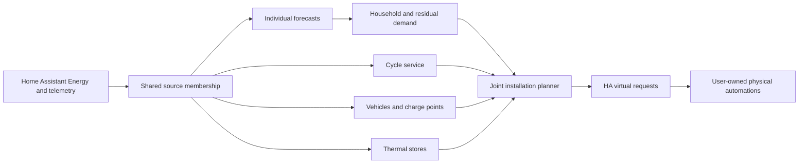

# Shared appliance structure

Individual forecast sensors accept the daily model-selection states, including
`collecting_forward_accuracy`, `accuracy_validated` and baseline-retention states.
Collecting comparison evidence does not make an otherwise usable baseline
forecast invalid. The HA adapter still rejects unknown states and malformed,
expired or non-finite forecast quantities.

Settings > Appliances retains its existing categories, routes and device editors.
Consumption and cycles, Electric boilers and EV charging use the same interaction:
select an appliance, inspect saved configuration, then explicitly choose Edit.
Add, removal, Save and Cancel remain available. There is no replacement tile
landing page and no second device registry. Home Assistant Energy remains
responsible for consumer identities, sources, names and upstream relationships.

Consumption devices, charge points and electric boilers share the same Energy
source dialog. It searches display names and meter IDs and offers Available,
Already added and All sources filters. Assigned meters are disabled across all
categories. Specialized additions create their typed draft only after a source
is chosen. The Energy-defined meter and optional power link travel together.
Charge points lock that measurement pair and require a missing power link to be
corrected in Energy before Save. Other appliance types retain their existing
source validation. No registered device or vendor
integration is required, and no connection, car identity or temperature is
inferred. Cancel closes the chooser without changing the saved configuration.

The app checks source ownership under the existing shared settings lock before
configuration writes. A concurrently claimed meter is rejected even if it was
available when the chooser opened. Existing appliance-ID and meter pairs remain
editable. Generic selection retains specialized forecast memberships and cannot
enable a charge point or boiler as a shiftable cycle appliance. These rules use
existing identities and archives without adding another device registry.

Unreadable consumer choices mean ownership is unknown. The shared chooser keeps
every source unavailable, and the consumer selection owner rejects replacement
writes from every category until the saved database is restored. It never
interprets the empty fallback selection as proof that a source is free.

EV and boiler settings settle both their configuration and consumer reads before
applying either result or releasing the shared save lock. Failed reads retain
the draft and the existing bounded, sanitized request behavior.

## Independent dimensions

| Dimension | Existing ownership and meaning |
|---|---|
| Identity and sources | Energy owns consumer meters and hierarchy. Vehicles have separate OEP UUIDs and SoC sensors. Charge points retain separate identities. |
| Behavior | Normal consumption, a complete cycle, EV charging or thermal storage. Their physical work types remain distinct. |
| Forecast | Individual consumption reuses demand's historical and weather-sensitive statistical models. Requested weather sensitivity is not proof that weather features were usable. |
| Control | Measurement only, cycle start requests, on/off or variable power, according to the existing model. A configured interface is not evidence of physical execution. |
| Usage | Forecast-only selection, explicit cycle-shift permission, EV control mode or thermal planning permission. Permission does not establish readiness or relax hard limits. |
| Daily request | Cycle readiness/deadline/cancellation, vehicle target/departure or boiler comfort/pause. Existing intent endpoints and native HA controls own these actions. |

A heat pump or air conditioner can use weather-sensitive consumption forecasting.
It is not a non-shiftable dishwasher cycle. Prediction does not authorize climate
control. A future climate model must define its own supported physics and
comfort constraints. This refactor does not implement that model.

## Code ownership

The `src/open_energy_planner/appliances/` package contains:

| Module | Responsibility |
|---|---|
| `sources.py` | Shared source-assignment, disjoint Energy membership and upstream validation. |
| `forecasting.py` | Existing individual-consumer selection and forecasting, reusing demand's statistical models and reconstruction. |
| `weather_model.py` | Bounded CPU XGBoost adapter for selected weather-sensitive consumers. Native objects remain private. Portable archives contain JSON and fixed ordered features. |
| `weather_learning.py` | Retained research comparison helper that can write `consumer-weather-*` archives. Production selection does not call it. |
| `cycles/` | Complete profiles, learned/manual evidence, tasks, attempts and mandatory execution feedback. |
| `ev/` | Vehicles, charge points, explicit assignments, SoC, departures, charging limits and loss assumptions. |
| `thermal/` | Electric-boiler heat stock, draw, losses, comfort and hard temperatures. |

Production demand and device admission belongs outside this package in
`forecast_selection/accuracy.py`. It owns local-day comparison evidence and
control-aware admission.

`demand/` retains household reconstruction, total/residual demand and shared
statistical models. It is not another appliance category. Existing admission and
replacement rules prevent planned device consumption from being added twice.
`InstallationProblem` retains independent typed cycle, EV and thermal work. The
common HiGHS installation builder optimizes them jointly with PV and batteries.
No all-optional universal model, base service class, plugin system or form engine
is introduced.

## Consistent editors

The approved proposal retains `/appliance-settings`,
`/appliance-settings/thermal` and `/appliance-settings/ev`. There are no new
configuration routes or mutation APIs. Boiler and EV settings show one selected
appliance with a saved summary. Editing reveals the existing fields and locks
selection. The sticky SaveBar remains the single save state. Add opens a typed
draft. EV addition explicitly distinguishes a vehicle from a charge point.
Removal is staged for Save and can be undone with Cancel. Cancel restores the
original selection as well as confirmed configuration, including after an Add
or removal draft. Failed saves and optimistic-concurrency conflicts retain edits.
Visible labels also supply the accessible names of selectors and action buttons.
Do not override them with different technical labels for screen-reader or speech users.

The shared `web/public/appliance-settings-detail.js` renders saved fact groups
as text. Existing editors retain their own fields and validators. It does not
create a generic form or configuration store. Existing advanced options,
charging preferences, thermal loss/draw assumptions and Check saved settings
remain accessible. These controls are retained beyond the concise prototype
screens so existing functionality is preserved. Electrical EV inputs show kW
with a 0.001-kW step. APIs, archives and calculations retain whole watts.
The shared browser `identity.js` retains UUID v4 generation using
`crypto.getRandomValues` for configuration identities and cycle request IDs.
Readiness does not depend on secure-context-only `crypto.randomUUID`.
Consumption/cycle editing retains EV/boiler forecast membership while hiding
those specialized meters from the generic source picker.

Energy routes `/appliances`, `/thermal` and `/ev` retain their monitoring and
daily-request purpose. The average cycle profile and cycle evidence belong with
the appliance under Energy, including detected runs when shifting permission is
off. Settings retains a concise planning-readiness summary, shift permission,
manual fallback configuration and a link to the detailed evidence. Weather-sensitive
model analysis remains in Forecast quality.
Missing measurements remain unknown. No hardware actions move into the app.

## Weather-dependent consumption learning

Only a consumer with `weather_sensitive` enabled enters the nonlinear candidate
path. Residual household forecasting and consumers without that flag keep the
existing profile/Ridge behavior. The device candidate uses the existing time,
weekday, season, preceding-24-hour mean and outdoor-temperature features. It
adds no climate transport or control API. Historical temperatures available at
training time can support fitting. Later realized weather never becomes a
backdated weather forecast for evaluation.

The XGBoost CPU adapter uses 96 depth-three histogram trees on one thread.
The native model is non-executable JSON with an exact feature order, schema,
configuration version, training cutoff, measurement digest and model digest.
Loading checks archive size, objective, tree count and node bounds before native
parsing. Prediction refuses missing weather, past cutoffs and temperatures
outside the training range. No statistical trimming removes unusual but valid
cold days or defrost cycles. Existing meter reconstruction alone determines
usable energy samples and leaves Recorder data unchanged.

Training coverage retains measured source-hour and used-row counts. Consecutive
excluded hours retain their UTC start/exclusive end and the reason: incomplete
preceding-day measurements or temperature unavailable at training time. The
initial preceding-day warmup is visible under the same rule. A valid high load
is never itself an exclusion reason.

Production admission uses the shared preserved local-day accuracy policy in
[automatic forecast model selection](MODEL-SELECTION.md). The measurement
boundary and candidate algorithms identify the comparison family. Financial
shadow comparisons do not gate household or device-model admission.

Current status and waiting reasons appear beside the fixed daily device graph.
The component model label does not claim household activation. Startup profiles
are never labeled as active ML models.

## Persistence and authorization

No SQL schema changes. Existing `consumer-settings.json`,
`appliance-state.json`, `ev-state.json` and `thermal-state.json` pointers and
immutable archives retain their namespaces, IDs and meanings. Python module
paths are internal ownership, not serialized class references. Backend transfer
continues to include every OEP table and document.

The demand namespace retains the historical `consumer-weather-model-*`,
`consumer-weather-window-*`, `consumer-weather-assessment-*` and
`consumer-weather-selection-*` documents. The retained `weather_learning.py`
comparison helper can still write these research archives. Production component
selection uses `forecast_selection/accuracy.py` and its `accuracy-pending-*` and
`accuracy-day-*` evidence instead. Old weather pointers cannot authorize production
selection. See the [database dictionary](DATABASE-SCHEMA.md) for retained contracts.

Cycle start claims check expiry when the durable operation actually executes,
after both the application-lock wait and any worker queue wait. An expired
attempt must not authorize physical execution. The claim remains single-use.
Its response includes the earlier plan/attempt expiry without extending it for
persistence or transport delay. The integration validates the matching lease
after synchronization, and the blueprint checks expiry immediately before the
physical action. An expired or lost response never implies confirmed failure.

Removing a vehicle cannot leave a charge point without allowed vehicles. Settings
blocks that removal before changing the draft and identifies dependent points.
Edit their allowed vehicles or remove those points first. No dependent point is
silently deleted.

## Verification boundary

Independent tests cover expiry during lock/worker waits and successful timely
claims. Responsive browser checks cover typed Add, saved summaries, selected
editing, kW-to-watt persistence, Cancel, staged removal, retained IDs, failed
writes, concurrent changes, category navigation and HA ingress. Existing solver,
four-backend, HA and provisioning suites protect unchanged physical models,
original plans and retained stores. Screenshots use synthetic development data.
They do not establish physical equipment behavior or climate-control support.
