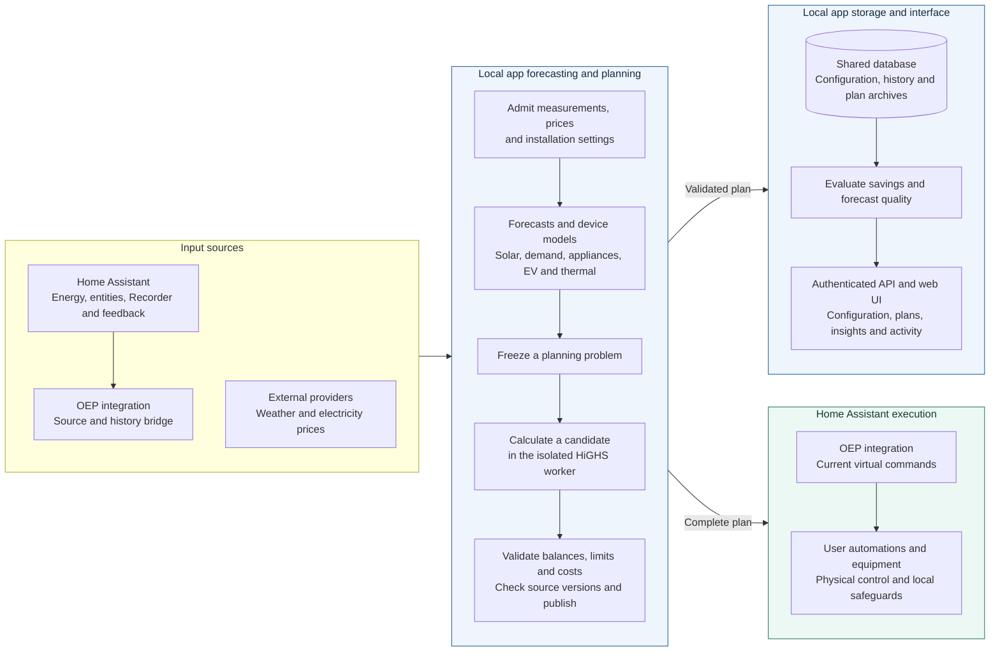
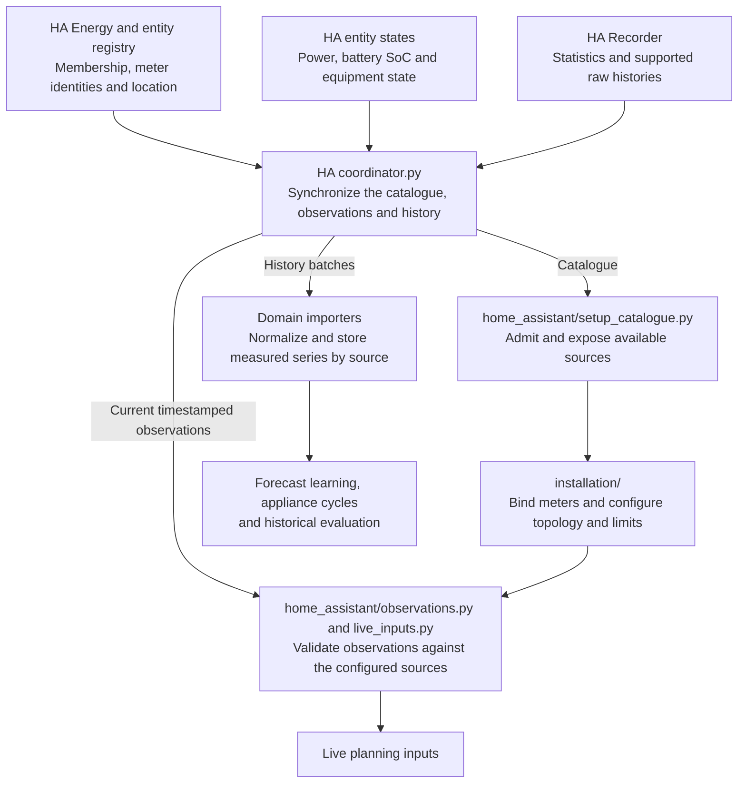
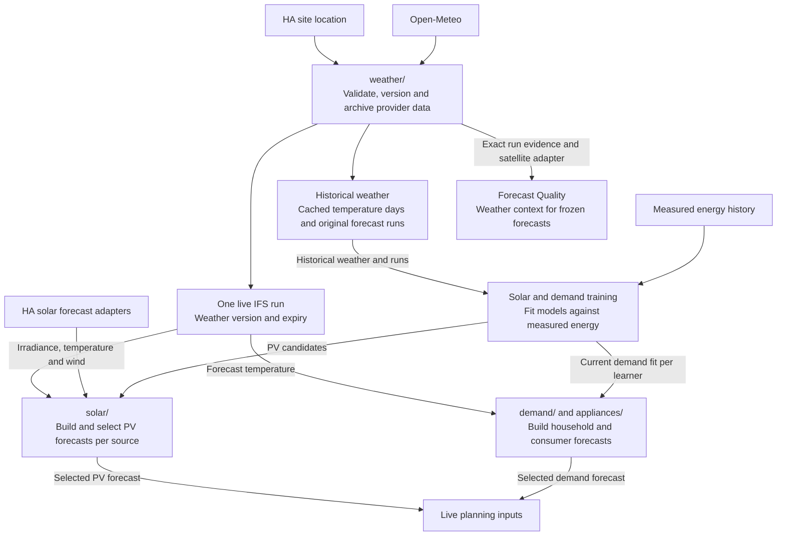
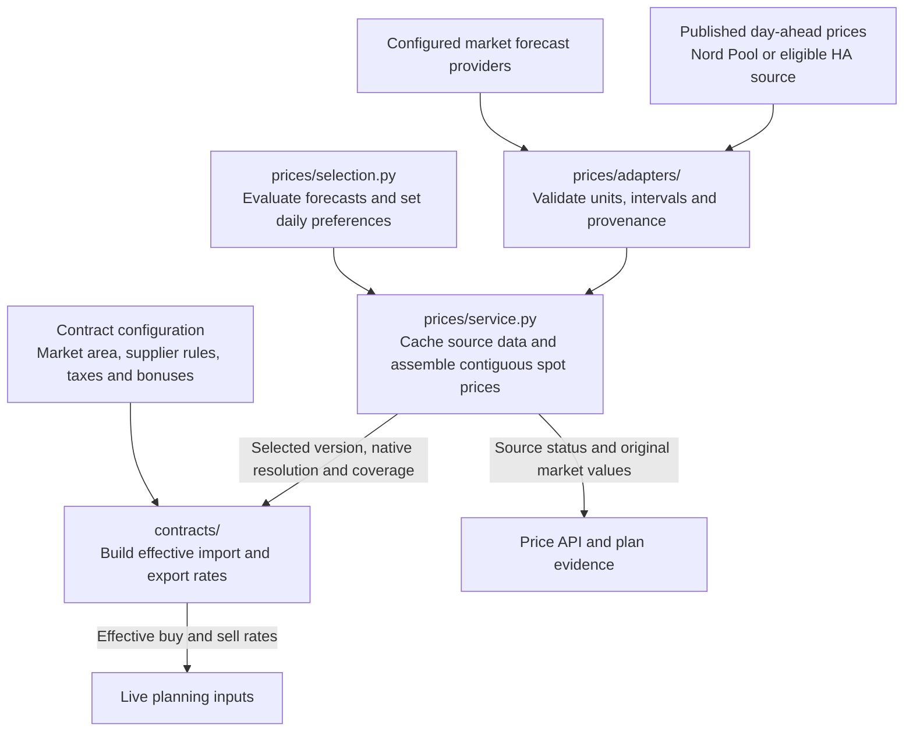
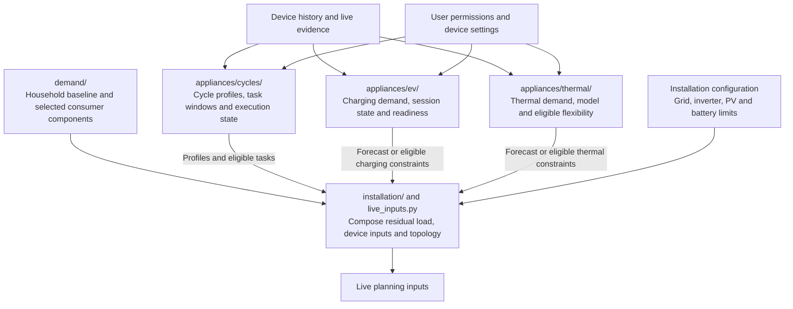
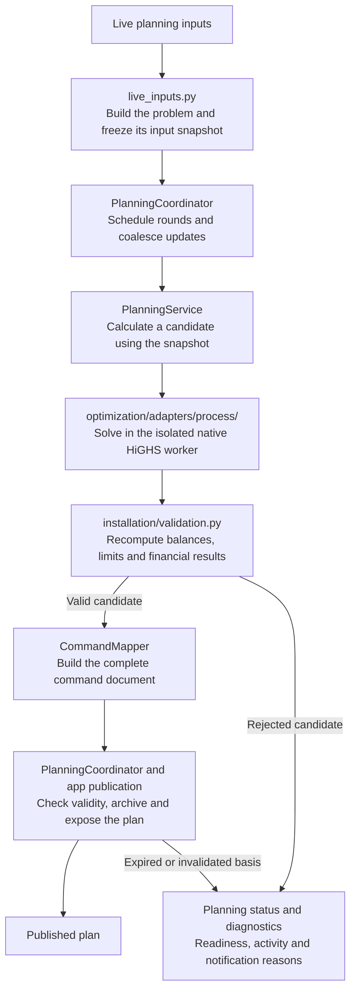
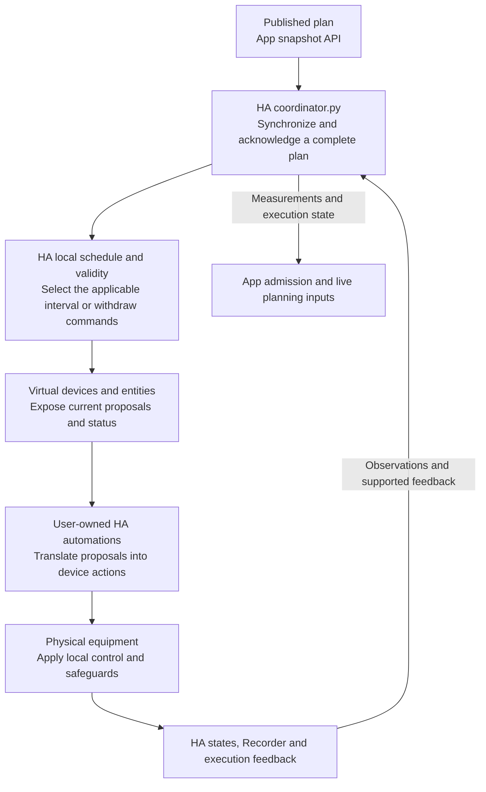
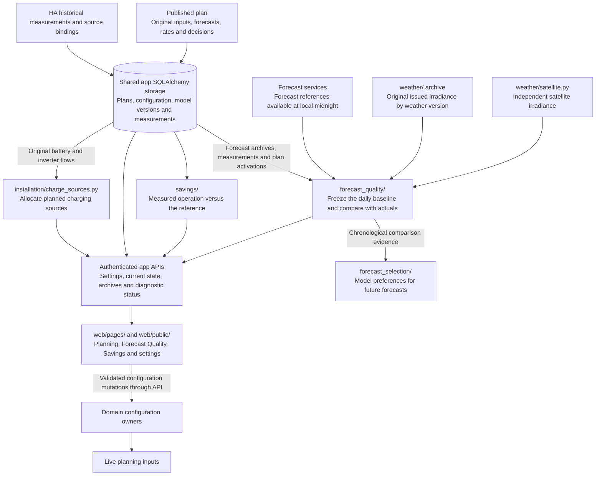

# Architecture overview

OEP consists of a local calculation app and a thin Home Assistant integration. Start here to choose the responsible layer before changing code. Use the [technical design](../../design/TECHNICAL-DESIGN.md) for complete contracts and the [user explanation](../users/how-oep-works.md) for product concepts.

## Application at a glance

The local app connects input sources to validated plans, historical evaluation
and the web interface. The arrows show data flow. The Home Assistant integration
appears twice to show its roles as an input bridge and as the publisher of
current virtual commands. Equipment measurements and execution feedback return
through Home Assistant on subsequent synchronization.

## Internal module and data flows

Follow **Live planning inputs** from the input diagrams into the planning round
and **Published plan** from planning to execution and evaluation. Boxes name the
responsible module or service. Arrows show the direction of data and decisions.
App paths are relative to `src/open_energy_planner/`.

- [Home Assistant source discovery and measurements](#home-assistant-source-discovery-and-measurements)
- [Weather, forecasts and learning](#weather-forecasts-and-learning)
- [Market prices and contract rates](#market-prices-and-contract-rates)
- [Consumption and controllable equipment](#consumption-and-controllable-equipment)
- [Planning, validation and publication](#planning-validation-and-publication)
- [Home Assistant execution and feedback](#home-assistant-execution-and-feedback)
- [Historical evaluation, storage and the web UI](#historical-evaluation-storage-and-the-web-ui)

### Home Assistant source discovery and measurements

Home Assistant owns source membership. The app owns the planning role of each
source and its electrical constraints. The integration reads Recorder through
HA, then passes normalized data to the app. Missing measurements remain unknown.
See [measurement contracts](HA-MEASUREMENT-SOURCES.md) and
[installation planning](INSTALLATION-PLANNING.md).

### Weather, forecasts and learning

The app shares one accepted live run for the site, including when demand uses
weather and no PV is configured. Historical training uses completed observation
hours and, for PV backtests, original provider forecast runs. Demand learners
share cached temperature days for the site. Each learner replaces its stored fit
after validated training. The demand archive keeps the original forecast values
and weather reference. Demand can fall back to calendar profiles.
An eligible demand issue is reused as the planner advances within its compatible
quarter-hour coverage. A weather-backed issue retains its original weather
reference and uses that run's deadline for live admission.
See [solar](SOLAR-FORECASTING.md), [demand](DEMAND-FORECASTING.md) and
[model selection](MODEL-SELECTION.md).

### Market prices and contract rates

Published prices take precedence over forecast prices where they overlap. The
first gap ends usable coverage. Contract rules translate market prices into the
rates the solver uses. A new fetch with unchanged price content and usable
coverage does not by itself require replanning.
See [price inputs](PRICE-INPUTS.md) and [contract prices](CONTRACT-PRICES.md).

### Consumption and controllable equipment

The installation basis keeps modeled device demand and residual household load
consistent. Separately modeled consumption must have compatible source ownership
and coverage before replacing part of the baseline. The appliance modules own
their readiness and task rules. Forecast inclusion alone grants no control.
Cycle scheduling clips the demand series to its window while preserving the
source quarter-hour boundaries within that window.
See [appliance architecture](APPLIANCE-ARCHITECTURE.md) and
[installation planning](INSTALLATION-PLANNING.md).

### Planning, validation and publication

Ordinary incoming updates are coalesced into the next round while a valid round
can finish. Hard invalidation and expiry can prevent publication. Failure to
publish never extends a previous command's validity. See
[installation planning](INSTALLATION-PLANNING.md) and the
[technical design](../../design/TECHNICAL-DESIGN.md).

### Home Assistant execution and feedback

The integration checks local validity independently of the app. Expiry and
pause withdraw virtual commands. A receipt proves delivery. Measurements,
claims and execution feedback provide separate evidence of device behavior.
See [virtual devices](VIRTUAL-DEVICES.md).

### Historical evaluation, storage and the web UI

Forecast Quality captures the original forecast for the local day independently
of solver runs and compares it with matched measurements. Its weather view
resolves forecast irradiance from the original weather reference and shows
satellite irradiance separately. Savings compares settled measured operation
with its reference. The shared database also retains the frozen daily baseline,
measurement evidence and settings changes. `app.py` composes these services and their authenticated
routes. See [plan archive](PLAN-ARCHIVE.md),
[Forecast Quality](FORECAST-QUALITY.md), [Savings](SAVINGS.md) and
[database ownership](DATABASE-SCHEMA.md).

## Follow data through the system

| Stage | Owner | Boundary to preserve |
|---|---|---|
| Discover Energy sources and capture observations/history | `custom_components/open_energy_planner/` | Read through HA APIs and normalize units. No native solver or app imports. |
| Admit measurements and construct future inputs | App `home_assistant/`, `installation/`, demand/solar/price owners | Missing evidence remains missing. Provider/framework objects stay inside adapters. |
| Freeze a planning problem | Installation basis and planning use case | Retain source/configuration versions and coherent physical topology. |
| Optimize | `optimization/adapters/highs/` in the isolated native worker | One responsible adapter, bounded work, detached results. |
| Validate independently | Pure physical and financial evaluators | Recompute balances, limits and costs without using solver expressions as their own oracle. |
| Publish and archive | Planning/application lifecycle and shared SQLAlchemy stores | Reject invalidated candidates. A failed round cannot replace or prolong the last valid plan. |
| Expose virtual advice | HA integration entities and events | Complete, current, applicable commands. Receipt is separate from physical execution. |
| Operate equipment | User-owned HA automations and local controllers | Existing physical safeguards and supported claim/feedback protocols remain authoritative. |

There is no physical-device driver hidden in the HTTP UI. The app's static pages call authenticated APIs. Supervisor ingress and standalone administration retain different authentication entry points.

## Keep calculation work outside the interface loop

Snapshot reads capture immutable settlement source definitions under the state
lock, then await historical database I/O outside that lock. The handler reacquires
the lock afterward to refresh validity and read current state. A pause or source
change therefore remains responsive and cannot be hidden by an older captured
screen state. Historical transfers also read outside the state lock and reject
source changes made during validation before admitting a write. Financial
mutations retain their separate serialization lock. Concurrent readers publish
the cached historical plan identity and its bindings as one pair and use their
own local bindings. Cancellation drains the historical reader before its handler
finishes.

Enable and pause responses acknowledge persisted control intent only. They do
not fetch a snapshot or wait for historical readers. The app composition owns
this mutation boundary. The HA client validates the receipt against the exact
boolean, request identity and paired build. The coordinator clears only the
confirmed current intent, never an intent superseded during the exchange or
after shutdown. Local pause withdraws commands before waiting for the HA
synchronization lock. Its confirmation can wait for an in-flight synchronization
to finish, but the control receipt does not start another historical read.
Its next periodic synchronization retains the complete snapshot,
catalogue, observation and history flow. Resume still requires a plan generated
after the local resume boundary, so a receipt cannot revive older commands.

The shared PostgreSQL engine also bounds each native driver I/O wait to thirty
seconds. Server statement timeouts alone cannot bound an answer stalled in
transit. An operational wait failure closes the connection before propagating
the error, so cleanup cannot wait again on that connection. PostgreSQL connection
timeout applies per address attempt, not to DNS or the full multi-address process.
Pool admission and MariaDB/MySQL read/write waits remain separate limits.
A sequence of database operations can take longer than
one wait. Cancellation still drains the worker before releasing mutation
ownership or disposing its engine.

Appliance editors request `/v1/consumers?view=settings`. This projection retains
selection versions, Energy choices and specialized-meter ownership without
transferring model forecasts that these editors do not use. The default consumer
response retains complete forecast evidence for existing clients.

Live HTTP and background refresh owners await `LiveInputs.refresh_async` or
`receive_async` while retaining the application state lock. The event loop first
captures the coherent nonblocking installation and price basis. Price caches
publish on that loop outside the application lock, so their values, versions and
expiry cannot be read across a worker handoff. A thread prepares the appliance,
EV and thermal snapshots from the captured immutable input. Coordinator
invalidation, snapshot installation and submission remain on the event loop.
Cancellation drains the preparation worker before releasing the state lock,
including repeated cancellation. Installation rechecks measurement and future
input expiry after the worker finishes. A closed coordinator discards completed
preparation without submitting more work. The synchronous domain entry points
remain available for isolated callers and startup without observations.

Component coverage and balance checks integrate ordered target windows with a
single sweep through each source series. Gaps, overlaps, duplicate ownership and
replacement limits still reject invalid inputs. Task candidate windows are
computed once per preparation, and boundary lookup does not rescan every device
series for every planning interval.

The native solver runs in its separate process. Independent validation,
consumption evaluation and command-document construction run outside the event
loop. Historical repricing, retention and compression remain background workers.
Repricing reads only hash-checked contract-version leaves before deciding whether
a full original plan needs recalculation. Archive reconstruction reads all value
leaves for each record together and verifies the complete reconstructed hash.

Off-loop execution prevents synchronous interface stalls. It does not reserve
CPU or eliminate contention on small machines. Diagnose input preparation,
native solver phases, publication and archive maintenance separately. A battery
below its reserve invokes the reserve-recovery phase. Comparing those rounds
with rounds above reserve does not establish a solver regression. Preserve
reserve safety, numerical precision and historical evidence when optimizing.

## Keep the important dimensions separate

- **Identity versus configuration:** Energy owns source membership. The app owns equipment ratings, topology and planning settings.
- **Forecast versus control:** Selecting a forecast consumer does not grant scheduling permission or prove readiness.
- **Publication versus execution:** A received plan or virtual setpoint does not establish physical action.
- **Original expectation versus later evaluation:** Repricing and measured history create separate evidence rather than rewriting the original plan.
- **Description versus decision quality:** Forecast-error metrics do not replace the chronological decision gate for automatic model selection.
- **Data versus deployment secrets:** OEP tables share one active database. Connection settings, certificates, tokens and recovery bootstrap files stay outside it.

## Find the source owner

Use the [domain ownership rules](../../design/TECHNICAL-DESIGN.md#domain-ownership)
to decide which module owns a data contract, an OEP endpoint or a provider
adapter.

| Area | Source location | Start with |
|---|---|---|
| Shared planning and publication | `planning.py`, `live_inputs.py`, `planning_policy.py` | [Technical design](../../design/TECHNICAL-DESIGN.md) |
| Physical installation and commands | `installation/` | [Installation planning](INSTALLATION-PLANNING.md) |
| Native optimization and pure models | `optimization/` | [Solver selection](../../design/SOLVER-SELECTION.md) and [independent scenarios](../../design/PLANNER-SCENARIOS.md) |
| Live and historical weather | `weather/` | [Domain ownership](../../design/TECHNICAL-DESIGN.md#domain-ownership) |
| Demand, solar and forecast quality | `demand/`, `solar/`, `forecast_quality/` | [Reference library](REFERENCE-INDEX.md#forecasts-planning-and-financial-interpretation) |
| Prices, contracts and evaluated savings | `prices/`, `contracts/`, `savings/` | [Contract prices](CONTRACT-PRICES.md) and [Savings](SAVINGS.md) |
| Appliance forecasts, cycles, EV and thermal | `appliances/` | [Shared appliance structure](APPLIANCE-ARCHITECTURE.md) |
| Durable archive and lifecycle | `storage/` and domain storage adapters | [Database dictionary](DATABASE-SCHEMA.md) and [archive](PLAN-ARCHIVE.md) |
| Page rendering and browser behavior | `frontend/`, `web/pages/`, `web/public/` | [Configuration workspaces](CONFIGURATION-UI.md) and [visualization](EMS-VISUALIZATION.md) |
| HA platform integration | `custom_components/open_energy_planner/` | [Measurement contracts](HA-MEASUREMENT-SOURCES.md) and [virtual devices](VIRTUAL-DEVICES.md) |
| Suite selection and proof | `script/ci/` | [CI stages](CI-STAGES.md) |
| Example-data provisioning and Supervisor lifecycle | `script/provisioning/`, `script/supervisor/`, `test_environment/` | [Developer environment](DEVELOPER-ENVIRONMENT.md) |

Paths within the app are relative to `src/open_energy_planner/`. Check actual imports and callers as well as the directory map. Shared composition and lifecycle changes can require broader proof than a domain calculation.

## Preserve storage and test ownership

Every OEP table belongs to the shared schema and active app-owned engine. A new store must participate in the dictionary and real SQLite/PostgreSQL/MariaDB/MySQL transfer contracts. A private domain connection or file-based configuration archive would break this ownership.

The HA solar-feedback adapter may use exactly `from sqlalchemy import select` to construct its bounded native Recorder read. That read uses only Home Assistant's existing read-only session and Recorder schema. It does not create a connection, engine, ORM session or OEP store. Other direct SQLAlchemy imports remain prohibited in the integration. Native Recorder timestamps and normalized observations cross the app boundary, not database objects.

Tests are grouped by behavior and required environment. App-side HA contracts can run without starting HA. Actual integration/Recorder behavior needs real HA tests. Installation and lifecycle changes need their provisioning and Supervisor evidence. Splitting a test file or moving production code does not authorize dropping those contracts.

Before implementing a change, identify the affected sources, consumers, durable formats, API boundaries and test groups. Use [review and CI stages](CI-STAGES.md#change-based-candidate-matrix) to understand the immutable whole-PR matrix. The selector complements semantic review. It does not prove every dynamic dependency.

**Next:** [Prepare a development environment](README.md#first-start), or choose the subsystem in the [reference library](REFERENCE-INDEX.md).
