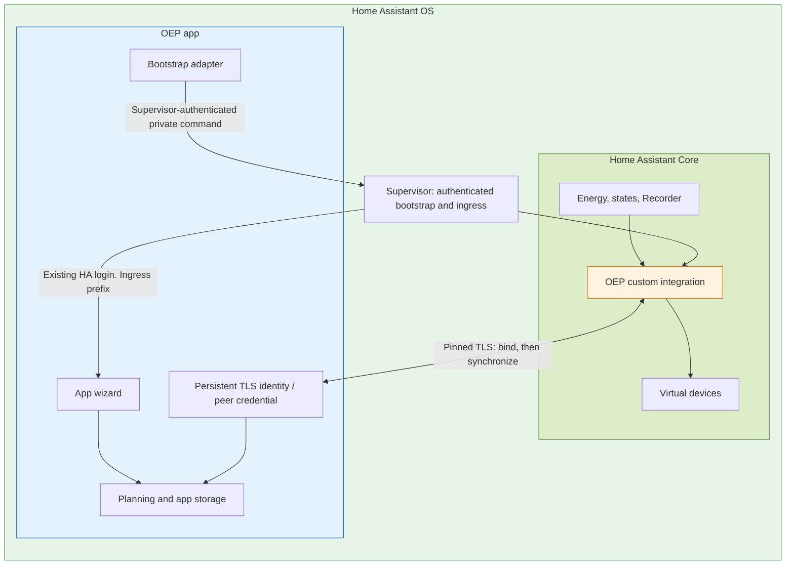

# Automatic HA OS connection

HA OS is the default installation route. After installing the app and the HACS integration, **no pairing code, approval, address, token or extra app login is required**. Installation settings still belong to the app wizard. Physical control remains in user-owned HA automations.

## Trusted connection

1. Supervisor supplies its credential to the app. The app announces its service to load the integration and opens Supervisor's authenticated HA WebSocket proxy.
2. The app sends only `open_energy_planner/supervisor_link`, including its UUID, persistent certificate fingerprint, local endpoint and a fresh private bootstrap proof. This bootstrap client never reads HA configuration, measurements or Recorder data.
3. The integration requires an authenticated HA administrator. It calls the app's pinned-TLS `/pair/supervisor` endpoint with that private proof and the HA instance identity. Public mDNS metadata alone cannot invoke automatic authorization.
4. The app durably creates a separate peer credential, or retains the credential of the same HA owner. It refuses a different owner. The integration creates/migrates the same config entry and retains its entity identities. A changed certificate is rejected.
5. The app retries startup failures every ten seconds. Successful idempotent handshakes run every thirty seconds. App/HA restart and lost peer credentials recover without user action. Existing plan validity rules remain unchanged.
6. Subsequent HA data reads and virtual-device management run through the integration. The TLS peer listener forwards only the explicit synchronization routes to the app. It cannot edit app settings or authorize peers.

## Readiness diagnostics and manual fallback

The integration files must be installed and loaded by HA, and the OEP app must
be running, before automatic connection can complete. Restart Home Assistant
Core after first placing or replacing custom integration files. A stopped app
cannot register itself automatically. Adding the integration manually opens an
explicitly labelled advanced standalone fallback. Its description directs HA OS
users to cancel that form and start the app, without entering a URL or token.
The fallback and its existing validation remain available for standalone setups.

Supervisor suppresses identical app/service/config announcements. Its startup
discovery list also excludes stopped apps. If HA restarts while OEP is stopped,
an unchanged announcement on the next app start would never load the integration.
Each app lifetime therefore announces a fresh public `announcement_id`. This is
delivery metadata, not a credential or authorization proof. The same Supervisor
discovery record, OEP installation ID, TLS certificate and stored HA peer remain
unchanged. The existing authenticated bootstrap still establishes ownership.

An HA `unknown_command` response means the OEP handler is not loaded. It cannot
establish whether integration files are absent or simply not loaded yet. The
warning reports this uncertainty and explains installation/restart steps. A
`link_failed` response proves the handler is loaded but pairing did not complete.
Other rejected responses retain unknown loaded status. Transport/authentication
failures have a separate Supervisor warning. An accepted request is logged
without claiming that credentials were persisted or the installation wizard is
complete. Retries never install files, start the app or restart HA automatically.
Only confirmed peer ownership and a loaded config entry establish pairing.

## App access and packaging

The manifest in `ha_app/config.yaml` enables `homeassistant_api`, default-role `hassio_api`, discovery and ingress on port 8099. It offers only the optional database URL and migration settings, with no published administrative HTTP port or writable HA configuration mount. `script/release/package_ha_app.py NEW_DIRECTORY` generates a new self-contained HA app repository build context, using the same release sources and locked dependencies. It excludes ignored credentials, fixtures and caches. Product publication remains separately gated. Required automated acceptance uses the actual-Supervisor Docker environment. AMD64 is the currently enabled architecture.

The app generates its internal administration secret once in private storage. Browser users do not see it through ingress. Authorization requires the **actual socket peer** to be the standard Supervisor ingress address `172.30.32.2` and a valid `X-Ingress-Path`. Forwarded-IP headers grant no trust. HTML assets and API requests retain the ingress prefix. The canonical HA UI link comes from Supervisor's own app slug. An advanced standalone `--ui-url` / `OEP_PUBLIC_UI_URL` override avoids publishing an unreachable container hostname.

The startup wrapper prepares only its `/data` directory and drops root before the app begins. Back up the internal administration secret, `pairing.json`, TLS certificate/key and app data consistently with the HA config entry. Identity changes are never silently accepted.

## Standalone containers

Without Supervisor there is no pre-established trusted channel. `_oep._tcp.local.` remains an untrusted address/identity hint. The standalone path therefore retains one explicit app confirmation with matching verification codes. The admin token stays separate from the generated HA peer credential. Pending requests expire after five minutes and are bounded to eight candidates. Manual URL/token configuration remains an advanced fallback. It is not the default lab or HA OS onboarding path.

Crypto uses `cryptography==50.0.1`. MDNS uses `zeroconf==0.151.5`. Original license notices remain in `THIRD_PARTY_NOTICES.md`. Optional multicast/address-discovery failure does not stop the app's HTTP API or UI.

## Verification boundary

Native tests verify ownership/proof rejection, restart persistence, ingress source/prefix trust, Unicode authorization rejection and optional discovery failure. Actual HA tests run the real config flow and TLS callback, including same-entry migration, credential recovery and non-admin rejection. Desktop/mobile Playwright tests traverse a real prefixing HTTP proxy and reach the wizard without login/approval clicks. Solver scenario expectations are unchanged.

The default [real Supervisor developer environment](DEVELOPER-ENVIRONMENT.md) runs actual app installation, authenticated bootstrap and HA ingress login. Automated acceptance covers clean/warm setup, outer restart, Supervisor update and preserved state. It uses a private inner Docker engine and simulated meter/history inputs. It does not establish physical equipment or host-specific HAOS kernel behavior. No personal VM is a required test or deployment target.

Official references: [Supervisor communication](https://developers.home-assistant.io/docs/apps/communication/), [ingress](https://developers.home-assistant.io/docs/apps/presentation/), [HA WebSocket extension](https://developers.home-assistant.io/docs/frontend/extending/websocket-api).

The HA status entity exposes non-secret `connection_type` (`supervisor` or `standalone`). Automatic lab provisioning requires exactly one integration and a Supervisor projection without a connection issue, including for retained legacy entries. An active manual connection cannot satisfy this check. Host commands require a validated local Docker endpoint before staging or Compose operations. Malformed JSON secrets are rejected without server errors.
