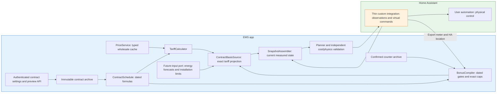

# Effective contract prices

The contract boundary implements base import/export formulas and separate aggregate-export bonus rules, connected to the planning-basis port under PRICE-02–11. The app-owned Contract page edits these same validated rules. Production demand and solar adapters provide energy forecasts independently.

## Responsibility boundaries



`contracts/calculation/formula.py` owns the arithmetic grammar. `contracts/model.py` owns effective periods, version identity, previews and tariff calculation. Neither imports a provider, HTTP client, database or native solver. `contracts/planning_basis.py` composes typed cached prices, current rules and a separate future-input port into `PlanningBasis`. `contracts/wire.py` translates JSON. `contracts/storage.py` owns immutable rule revisions over the shared `contracts` SQL document namespace. The HA integration does not evaluate formulas or acquire supplier details.

## Supported formula language

See the [Dutch recipe and bonus catalogue](CONTRACT-EXAMPLES-NL.md) for available building blocks, runnable import/export examples and the separate [bonus rule, window and counter API](BONUS-RULES.md). Runnable bonus rate kernels do not implement their full supplier conditions.

The only variable is `market`, already normalized to the contract currency per kWh. Supported syntax is decimal literals, parentheses, addition, subtraction, multiplication, division, unary signs, `min(a, b[, c, d])`, `max(a, b[, c, d])` and `abs(a)`. This finite grammar is interpreted through validated AST nodes. No `eval`, compilation, imports, attributes, indexing, exponentiation, comparisons, arbitrary functions or executable scripts are accepted. Unknown configuration fields are rejected, including source-route bonus filters.

Limits are 512 characters and 128 AST nodes per formula, decimal-literal magnitude at most 1,000,000 and decimal-literal exponent between -100 and 100, 64 non-overlapping ordered rule periods and effective result magnitude at most 1,000,000. Decimal calculations use 28 significant digits. Final rates convert once to the existing solver's double precision. This is not invoice rounding or a promise of arbitrary-precision billing. Undefined or non-finite arithmetic is a visible error, never a zero rate. A preview cannot prove all possible future market values are defined, so actual values are validated again.

Example synthetic formulas, **not supplier-specific contract advice**:

| Market EUR/kWh | Import `(market + 0.10) * 1.21` | Export `market - 0.02` |
|---:|---:|---:|
| -0.10 | 0 | -0.12 |
| 0 | 0.121 | -0.02 |
| +0.10 | 0.242 | 0.08 |

Import is the cost paid for a grid kWh. Export is revenue received for a grid kWh. A negative import rate pays for consuming. A negative export rate charges for returning energy. Tax, fees and multipliers are explicit formula constants, without maintained country tax tables. Parentheses determine their ordering. `max(market, 0)` supports an explicit price floor. It is not a chronological or volume cap.

## Configuration API

All endpoints use the existing installation Bearer token:

- `GET /v1/contracts`: current original rules, effective/recorded instants, version, preview and any cache issue. No configuration means `not_configured`. No tariff is invented.
- `POST /v1/contracts/preview`: validate a proposed schedule and return examples at -0.1, 0 and +0.1 currency/kWh per period, without writing anything. The Contract page requires this preview before the user can save settings.
- `PUT /v1/contracts`: validate/preview again and durably save a new revision. Supply `expected_version` matching the current revision. Initial configuration uses `null`. A stale edit returns 409. Invalid/unsupported rules or a contract identity outside the active price runtime return 400 before any archive write. New live planning uses the persisted revision. A previously accepted plan is retained during a valid replacement calculation within normal validity. Unusable required inputs follow existing invalidation behavior.

Example request:

```json
{
  "expected_version": null,
  "contract_id": "my-contract",
  "market_area": "NL",
  "currency": "EUR",
  "periods": [{
    "effective_from": "2027-01-01T00:00:00+01:00",
    "effective_until": null,
    "import_formula": "(market + 0.10) * 1.21",
    "export_formula": "market - 0.02"
  }]
}
```

Effective periods are half-open and converted to UTC. Absolute timestamps require explicit timezone offsets, including DST. Date-only values resolve at 00:00 in the discovered Home Assistant timezone. Without that timezone, date-only input is rejected. Adjacent periods can apply different taxes or contract terms. Coverage is continuous from the first rule start. The final rule has no expiry. No tariff is inferred before the first start. `recorded_at` is assigned by the app. The content hash identifies formula text, effective boundaries and recorded time. A correction creates a new immutable revision, including for a past effective period.

### Measured bonus budgets

- `GET /v1/contracts/budgets`: current contract/counter versions and a row per configured bonus family, including upcoming rules. Each row contains the selected rule's effective date, current counter period, cap, measured used/remaining kWh and issue. Missing evidence gives `null` used/remaining values, never zero. An unsupported reset instant also leaves the period unavailable and reports its reason per row rather than failing all budgets.
- `POST /v1/contracts/budgets`: confirm total used export for one unavailable active counter period. The body contains exactly `rule_id`, `used_kwh`, `contract_version`, `counter_version`, `measured_at`, `meter_kwh` and `measurement_version`. The three measurement fields must match the `confirmation` anchor returned by the budget view and the current authoritative HA readings. Extra/missing fields are rejected. The app supplies fresh grid-export meter provenance and preserves other seeds. The response is the refreshed budget view, with the same explicit unavailable semantics if evidence becomes unusable.
- HTTP 400: malformed body, unknown rule, invalid/nonfinite/negative volume, invalid reset or missing/invalid fresh export-meter readings. HTTP 409: stale contract/counter version, changed measurement anchor, ineligible/future budget or unavailable configuration/recovery state. Counter corruption is never silently replaced. Future rules cannot receive a manual opening before they become active.

## Planning and preserved evidence

When live price inputs are configured, the app wraps its independent future-input provider with `ContractBasisSource`. A caller-supplied energy forecast/physical basis cannot supply effective rates through its placeholder price fields: both coefficients are replaced from contract evaluation. It cannot inject a separate undeclared bonus either. Missing rules, market data or energy forecasts expose readiness reasons and do not activate a synthetic fallback. Normal HA-mode startup follows the saved contract bidding area automatically. Production energy forecasts and required measurements must also be ready.

The adapter intersects current price coverage, forecast coverage and source expiry. Missing tail prices shorten the available problem. There must be coverage at the current instant. Source freshness is distinct from the future delivery horizon. The stable effective-price version includes the semantic wholesale version and exact contract revision. Selected tariff values/provenance are included so issue-time precedence changes cannot hide different effective rates. Receipt-only refreshes and ordinary rolling first-segment starts do not churn that version. Original per-segment evidence retains market price, effective buy/sell rates, published/forecast kind, native duration, source/version and selected rule period. Input snapshots retain this evidence and reference the immutable contract archive. Existing independent cost evaluation uses these effective coefficients rather than bare market prices.

**Exact billing projection:** split delivery intervals at tariff, contract and bonus boundaries, retain original control groups, and enforce equal terminal battery power within each group. Commands are merged back to the original 120-step control horizon. No tariff is silently averaged. See [billing and control resolution](BONUS-RULES.md#billing-and-control-resolution) for forecast-resolution assumptions and tested limits.

## History, recovery and remaining scope

Immutable rule documents and their current pointer live in the shared SQLAlchemy database (`contracts` namespace). Confirmed counters use `bonus-counters`. Source archives remain separate namespaces in the same active database. All four supported backends and cross-backend transfer share this schema. No user-facing file conversion is needed.

## Contract page

Open **Contract** from Planning or Installation settings. HA ingress supplies authentication. Standalone installations use the existing app administration token, held only in page memory. The page edits the existing strict API, not a second formula engine. Preview at -0.10, 0 and +0.10 EUR/kWh is mandatory before saving. Any edit invalidates the preview. Delayed responses cannot validate a newer draft. Save uses the loaded version and preserves unsaved edits on a concurrent-update conflict.

Known single-area HA countries show the automatic area and hide the input. Multi-area countries offer only their own areas. Unknown countries and saved country/area mismatches block editing. No area is guessed or silently rewritten. Prices are currently admitted in EUR only. The normal live startup opens the established source adapters from the saved area, changes the complete source service after an area change and preserves source archives. Missing/corrupt configuration selects no guessed area or synthetic price. An explicit developer `--market-area` remains a fixed-area override. Provider coverage and readiness remain visible independently from valid formulas.

Existing price periods retain exact offset-aware ISO timestamps, including intraday changes, until their date is changed. New or changed dates resolve to installation-local midnight. Unchanged timestamps are never reinterpreted in the browser timezone. End timestamps are exclusive and derived from the next start. Adding a period closes an open preceding period. The server rejects overlap or unsupported syntax. Bonus versions retain stable rule IDs, yearly reset definitions, clock/daylight windows, conditions and caps. Removing a draft rule creates a new current revision. All original archives/plans survive. Use a later zero-rate bonus version to end payment without resetting its historical volume.

Current bonus budgets reuse the planner's measured counter-continuity checks. Missing evidence is unavailable, never zero. HA history is requested automatically. If unavailable, the user may confirm total export since the reset. The app binds it to fresh authoritative cumulative grid meters, including all component meters. The browser cannot supply meter provenance. Both contract and counter versions protect confirmation against concurrent edits. A correction creates a new confirmed revision and triggers existing chronological cost revaluation, without rewriting plans or original expectations.

Supplier examples remain explanatory, not guaranteed presets: [Dutch examples](CONTRACT-EXAMPLES-NL.md). The selected aggregate-export semantics cannot enforce battery-origin exclusions. The page states that limitation explicitly. No new supplier-specific scripting language, energy-route filter or fixed-fee accounting is introduced.


## Calendar dates, reset choices and presentation

The app obtains its timezone from the Home Assistant installation. Change it there,
not in OEP. Contract and complete price-rule starts use date pickers and resolve to installation-local
00:00, with DST-aware UTC conversion. Price rules have no editable end date:
the next start supplies the exclusive internal boundary, and the final rule
remains active indefinitely. Equal or unordered starts and gaps are rejected. Existing absolute rule timestamps are preserved until their date is
changed. The app does not silently truncate historical intraday rules.

Annual reset offers **Calendar year (1 January)** or **Contract anniversary**.
The anniversary uses the separately stored original contract start, never the
start of a later price or bonus replacement. A retained custom reset is shown explicitly as an
existing value and preserved until a supported choice is selected. It is never
silently changed. Leap-day anniversaries must satisfy the existing valid-every-year
rule. Paid windows show **Always**, **Clock** and **Daylight**, with stable internal
values. All visible selection labels use sentence case and readable spaces.

Monetary amounts and rates use exactly two displayed decimal places throughout the app.
Formulas, solver inputs, stored prices and accounting retain full precision.
Charts, datetime inputs and date-range boundaries use the HA timezone even when
the browser is in another zone. DST gaps are rejected and a repeated wall time
selects its first occurrence. A Home Assistant timezone change synchronizes the
load model clock and creates a new contract revision for changed bonus clocks.
Original plans remain frozen and separate cost revaluation follows the existing
contract-revision policy.


## Missing continuous reference evidence

The battery self-consumption forecast continues its own historical stock and bonus
counters. It cannot reset to actual SoC merely to fill a chart. If recent settlement
is missing, the plan response retains the precise reason and the UI shows it in
place of an empty zero-looking balance. The no-battery reference remains independent.
Original plan versions retain their original reference availability and expectations.
Recovery produces a complete reference in a new plan, without rewriting old advice.

A laboratory-specific import defect caused the simulator's seeded `sum` to use the
absolute counter origin while native Recorder statistics used an independent origin.
The resulting downward jump blocked settlement at the handoff. Simulator history
version 3 aligns both imported five-minute and hourly sums to the latest native
`sum - state` offset, leaving counter states and interval differences unchanged.
On first import the final seeded state anchors sum zero, matching a new native
counter. No production sensor history is repaired, no negative flow is invented,
and OEP's settlement validation is retained. Native HA tests independently verify
1500.1/1500.2/1500.3 counter states map to .1/.2/.3 sums at the handoff.


The UI presents a complete dated **Price rule** with import/export formulas and an optional bonus. Internally bonus definitions remain separate for compilation and counter provenance. Across the complete contract, exactly one bonus
entry applies at an instant: the one with the latest effective start not later
than that instant. Its predecessor stops applying at that boundary. A future
entry cannot replace it early. Replacement never deletes the original rule or
rewrites frozen plans. Equal effective starts are invalid, including across different IDs. Different IDs retain counter provenance. They do not permit simultaneous payments.

Simulator history version 3 deliberately realigns both retained hourly and fine sums to the same native Recorder origin. The dashboard-initialization flag controls Energy configuration initialization, not whether hourly evidence needs alignment. Existing meter states, interval differences and configured Energy sources are retained. Skipping hourly alignment would leave the two resolutions inconsistent. This is confined to simulated test history.

The contract transport and immutable archive retain `effective_until` as a derived interval boundary for existing calculation/evidence consumers. The editor derives each boundary from the next start and sends null for the final rule. It is not an independent user setting. The domain rejects gaps, overlaps and a finite final expiry. Removing a rule reconnects adjacent rules at the remaining next start.

Price and bonus edits are drafts until the user explicitly chooses Save contract after a successful Preview rates. A sticky action bar keeps Preview rates, Save contract and Discard edits and reload visible while editing. It reports unsaved changes, validated-but-unsaved drafts and successful saves. Saving atomically publishes one immutable revision containing all price and bonus rules. Adding/editing a row never saves it automatically.

Complete price rules use one native expandable list with effective date and saved status. No bonus identity is entered by the user. The currently active saved rule opens automatically. Superseded and scheduled rules start collapsed. New rules open for editing. Explicitly opening an older row supports inline editing and keyboard navigation without another screen. Draft changes are marked unsaved and do not change saved activation. Summaries refresh after a successful save or reload.

The original-plan price chart retains spot, import and base export lines and adds a purple total export price including bonus when the frozen input contains compiled bonus rules. It adds the original per-interval compiled rates to the original base export rate, so selected-rule, expression and time-window eligibility remain exactly those used in that plan. Annual caps, used volume and planned export quantities are deliberately ignored for this indicative line. It is not guaranteed income or a settlement result. Missing per-interval bonus/tariff evidence remains a gap. Original plans never use current edited contract rules. The series shares the same range controls, quarter-aligned axis, legend and two-decimal tooltips as other prices.

The contract editor hides the bidding-area input when the Home Assistant country identifies one area and displays that automatic value as information. Multi-area countries offer only their country-specific zones, with an explicit empty initial choice and guidance to check the grid operator or energy supplier. Unknown countries and saved country/area mismatches show a blocking explanation, never silently rewrite stored rules. Preview and save also reject a zone outside a recognized HA country. Source coverage remains a separate check. Coordinate-based boundary lookup is not implemented.

After a 600 ms typing pause, the editor validates the complete draft through the existing authenticated preview endpoint. Examples appear directly below the formulas and optional bonus inside their shared price rule. Saving remains explicit and is allowed only for the validated current revision. New edits immediately clear examples and disable save. Delayed responses cannot validate newer edits. Manual Preview rates runs the same check immediately. Validation failures do not schedule retry loops or create contract revisions.

Each unsaved bonus rule also previews its current reset-period budget: maximum, actual export, remaining kWh, reset date and measurement time. This sums all required Energy Dashboard export counters, excluding import and battery counters. The existing authenticated snapshot/history protocol fetches missing annual history for the latest draft after saved-rule evidence takes priority. Draft rules and derived baselines remain in a bounded in-memory preview cache, expire after five idle minutes and never activate planning or write contract/counter revisions. The browser refreshes a pending history preview every three seconds. Changed drafts invalidate old requests and incomplete history remains explicitly unknown. Stored confirmations remain authoritative. Current-period figures do not predict future exports. Future-rule displays identify the measured period. Actual saving still initiates the ordinary durable baseline flow.


The Contract page has one list of complete **Price rules**. Each effective date activates the import formula, export formula and optional bonus together. A replacement copies the preceding rule and supersedes it without resetting bonus usage. Disabling an existing bonus emits a zero-rate continuation with its existing internal counter identity. Re-enabling it retains that identity and annual period. The user never names a Bonus rule ID. Existing source identities remain internal evidence rather than being rewritten.

Each complete price rule stores two independent dates: **Contract starts**, the original start with that supplier, and **Price rule starts**, when these terms take effect. A replacement within the same contract inherits its contract start. A supplier switch can use a new contract start. Contract-anniversary reset uses that row's contract start. Opaque bonus counter IDs are generated per supplier contract. Changed terms retain the ID and used volume, while a new supplier contract starts its own budget. Its first counter period excludes exports before the contract start, including when the annual reset is 1 January. Future contracts are not assigned fabricated measured volumes: their not-yet-started budget is separate from current measured evidence, and planning starts the new period at zero at the actual boundary. The editor pre-fills an older revision's missing contract start from its earliest rule for explicit user confirmation. It does not modify the stored revision during loading. Existing independently dated price/bonus definitions are displayed on their union of boundaries, preserving each effective value until an explicit save. Original archives/plans retain their original content and version identities. Internal tariff and bonus compilation stay separate.

The single-contract editor asks for neither a contract name nor technical contract/bonus IDs. OEP assigns a stable internal identity to new configuration and preserves identities already present in saved rules, counters and archives. Changing a price-rule effective date or tariff within the same supplier contract does not create a new counter identity. A different contract start does. Display headings use readable rule dates rather than internal IDs.

| Contract starts | Price rule starts | Interpretation |
|---|---|---|
| 2026-05-01 | 2026-05-01 | Supplier A starts. The first bonus period cannot include earlier export. |
| 2026-05-01 | 2027-01-01 | Changed terms with supplier A. Its remaining bonus budget is retained. |
| 2027-03-01 | 2027-03-01 | Supplier B starts with its own contract and bonus budget. |

### In-page examples

The information buttons beside **Price rule** and **Export bonus** open native modal dialogs, not hover-only tooltips. They support keyboard activation, Escape, a Close button, contained focus and return focus to the opener. Examples never fill, edit or save settings. The price example separates wholesale, illustrative fees/taxes, VAT and base export. The bonus example shows the separate extra rate, daylight window, annual cap/reset, partial remaining quota and total export income. The documentation records Zonneplan's [price explanation](https://www.zonneplan.nl/energie/informatie-over-energiecontracten/terugleververgoeding-bij-zonnepanelen) and [bonus explanation](https://www.zonneplan.nl/energie/salderen), checked on 24 October 2026. Neither information popup includes an external supplier-explanation link. Sources remain in this document. Its import formula uses published 2026 Dutch tax and purchase-fee amounts. It is not updated automatically when terms change. The export example illustrates the supported structure rather than promising an exact supplier preset: users must confirm their signed terms, VAT basis and eligibility. OEP's all-grid-export counter cannot reproduce supplier-specific source exclusions.

The 2026 import example is `(market + 0.09161) * 1.21 + 0.02`: 0.09161 EUR/kWh is the tax excluding VAT for annual consumption up to 10,000 kWh, from the government's [2026 tax parameters, Table 30](https://open.overheid.nl/documenten/c3d48c04-1009-4ffe-a54b-cebf13427ab5/file). [Rijksoverheid confirms 21% VAT including energy tax](https://www.rijksoverheid.nl/documenten/vraag-en-antwoord/energie-thuis/opbouw-energierekening). Zonneplan publishes its 0.02 EUR/kWh purchase fee including VAT. This is therefore added after multiplying wholesale plus tax by 1.21. At market 0.10 EUR/kWh, the unrounded rate is 0.2518481 EUR/kWh and the displayed rate is 0.25 EUR/kWh. Coefficients and formula explanations retain necessary precision. Calculated money displays keep two decimals. These are per-kWh marginal costs, excluding fixed fees, tax reduction and annual netting. Verified on 24 October 2026. No configuration or saved formula is changed by opening this example.

Both information dialogs have independent Zonneplan and NextEnergy tabs using the ARIA tab pattern: click, Left/Right arrows, Home/End, one tab stop and correctly labelled panels. Each example value uses a separate monospace line. Its explanation is a following prose block. Both bonus examples use explicit price conditions. The dialogs do not present formula-only alternatives because those omit the time window and cumulative volume cap of the complete bonus rule. The NextEnergy import example uses the 0.0219 EUR/kWh fee from its [2026 comparison](https://www.nextenergy.nl/dynamisch-energiecontracten-vergelijken). Actual contract fees can differ. Its [bonus FAQ](https://www.nextenergy.nl/veelgestelde-vragen/ik-ben-al-klant-bij-nextenergy-hoe-krijg-ik-de-zonnebonus) specifies a contract-year cap, so the bonus tab uses Contract anniversary. Sources checked on 24 October 2026. These explanations never overwrite configuration.

At the actual start of a new supplier contract, a current counter baseline still requires measured evidence. A first meter report received after the boundary cannot prove that no energy was exported since midnight. OEP does not assign that reading a zero used volume. Until a complete boundary-aligned HA history report or an explicit confirmed starting volume is available, new bonus planning remains unavailable under the existing evidence rules. The hourly history endpoint includes a compilation delay, so this can span the first hours after a new period starts. A future projected period starting at zero in a candidate plan is not an actual measured baseline. Existing commands remain usable only within their normal validity. Retired rule identities never cause additional history requests, even if their older evidence is incomplete. Matching already-confirmed seeds and immutable archives are retained.

The export examples show executable base formulas rather than placeholders: Zonneplan `market + 0.02` and NextSolar `market`. At a spot price of 0.06 EUR/kWh, their base incomes are 0.08 and 0.06 EUR/kWh respectively. The NextSolar example follows its [published exchange-price illustration](https://www.nextenergy.nl/nextsolar) and [Zonnebonus explanation](https://www.nextenergy.nl/zonnebonus), checked on 25 October 2026. It does not promise a zero sales deduction for every legacy NextEnergy contract. The supplier's [2026 explanation](https://www.nextenergy.nl/einde-salderen-uitgelegd) describes a fee deduction, so the popup explicitly tells users to subtract any sales fee in their own signed contract rather than treating the import fee as an export fee. Base export and extra bonus remain separate. The bonus rule retains price eligibility, daylight/clock windows and the annual cap/reset. These marginal examples exclude annual netting and energy-tax refunds. Opening either example never changes a saved tariff.


The central **Bonus budget** panel displays opening volume, HA measurement date (shown as
**Opening as of**), origin, subsequent measured export, used/remaining quota and
measurement freshness. Its **Opening evidence and grid export meters** disclosure
shows source meters and reproducible arithmetic. See [bonus rules](BONUS-RULES.md#central-bonus-budget).
This panel follows the active supplier contract. It does not create a new opening
for every price rule. Missing history exposes explicit used-volume confirmation
against the displayed HA measurement date. Budget refresh preserves unsaved rules.
