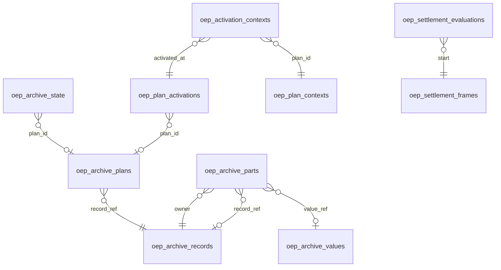

# Database schema and data dictionary

This guide describes the implemented app database, not Home Assistant Recorder.
The authoritative SQLAlchemy Core registry is
[`storage/adapters/lifecycle/schema.py`](../../src/open_energy_planner/storage/adapters/lifecycle/schema.py).
All registered tables use the same app-owned engine: SQLite by default, or PostgreSQL,
MariaDB or MySQL. The HA integration exchanges API messages and never reads SQL.
See [the plan archive guide](PLAN-ARCHIVE.md) for deployment, backup and cross-backend transfer.

## Storage conventions

- `PK` identifies every component of a primary key. `FK` identifies an enforced
  SQL foreign key. All columns are non-null unless explicitly marked **nullable**.
- Hashes are SHA-256 hexadecimal strings, up to 64 characters. Content-addressed
  plan blocks contain canonical finite JSON without numeric rounding. Hashes are
  identities, not encryption, and JSON payloads can contain installation/entity data.
- `String(n)` is bounded text. `Integer` stores integers. `Double` stores approximate
  numeric values. JSON uses `Text`, with `LONGTEXT` on MariaDB/MySQL. Tables use
  InnoDB/utf8mb4 there. Keys declared with `text_key(...)` use binary collation
  there to preserve case-sensitive comparisons. Ordinary `String` columns retain
  the backend's ordinary collation, including forecast-selection versions in
  `oep_price_pairs.primary_version`, `oep_price_pairs.alternative_version` and
  `oep_price_actuals.version`, even though these contain source-version hashes.
- Indexed plan and settlement timestamps are fixed-width UTC ISO 8601 strings
  with microseconds. Price-comparison evidence uses its adapter's UTC ISO strings.
  Decision `day` is a UTC calendar date. Original JSON timestamp strings are retained.
- Energy is kWh. Power fields declare W or kW through their `_w`/`_kw` suffix.
  Market prices and MAE are
  EUR/kWh. Settlement money is in the evaluation's currency. Negative prices and
  negative financial results are valid. Missing evidence is not replaced by zero.
- JSON payload columns accept plain original JSON or the versioned `oep:gzip:1:`
  lossless envelope. Hashes always cover decoded original canonical JSON. The
  shared bounded decoder verifies the envelope before domain validation. See
  [compression and retention](PLAN-ARCHIVE.md#retention-and-payload-representation).
- The schema is shared by runtime and backend transfer. There is no ORM object
  graph, database per module or direct connection to HA Recorder. A test-only
  selection-store constructor can create isolated SQLite. App runtime does not use it.

## Capacity read model

Settings > Data storage reads the active engine through authenticated
`GET /v1/storage`. It adds no tables, writes, pruning or migration.
The separate authenticated `/v1/storage/migration` maintenance API manages
cross-backend transfer from the same page. It adds no tables or columns. It copies
and verifies the complete shared registry with writers stopped, then validates
metadata, state and a rolled-back write before releasing the candidate runtime.
Private connection selection and the migration journal stay outside the moving
database. See [database maintenance](STORAGE-MIGRATION-UI.md) for ownership,
startup, interruption and recovery rules.
`database_bytes` is the logical file size including existing WAL and shared-memory
sidecars for file-backed SQLite. These files can change during measurement.
PostgreSQL uses `pg_database_size(current_database())`. MySQL and MariaDB sum
`information_schema.tables.data_length + index_length` for the connected schema.
Those table/index statistics are estimates and depend on the user's visibility.
External sizes include non-OEP tables and exclude server-wide storage overhead.

`disk_total_bytes` and `disk_free_bytes` measure the SQLite file's containing
volume. They are not reserved OEP capacity or quota information. Symbolic links
are resolved before measuring SQLite files and their volume. In-memory SQLite,
SQLite URI connections and external databases return null volume metrics.
The volume probe uses the database file itself so a file mount cannot report
its parent directory's unrelated capacity. If the file is missing, the probe
uses its containing directory while retaining the failed file-size measurement.
No remote failure falls back to application-host disk space. Null means unknown,
never zero. A measurement failure preserves independently available metrics and
sets `measurement_failed`. Exception messages, credentials, paths and database
names are excluded from the response. Reads run in a worker without the planning
state lock. Existing engine connection and SQL timeouts apply.

`status` is `low` when measured free bytes are below 1 GiB or below 5.0% of the
volume. Equality passes. A low reading takes precedence over partial measurement
failure. Otherwise status is `unavailable` on measurement failure, `unknown` when
capacity cannot be measured, or `ok`. This is an on-demand warning in the storage
page, not background monitoring or an HA notification. Refresh retries failures
and removes stale evidence. This read endpoint deletes no data. Independent
background plan/Savings retention follows the archive policy. No blocking
automatic database-file compaction is performed.

## Activity history table

### `oep_activities`

Owned by `storage/adapters/activities.py`. Retains seven days of execution evidence with
no foreign keys. Shared backend transfer copies and verifies this table.

| Field | Type / key | Meaning and use |
| --- | --- | --- |
| `id` | String(128), PK, binary collation | Opaque execution identity. Intermediate and terminal updates retain one row. |
| `started_at` | String(40) | Aware UTC ISO start timestamp. Indexed with `id` by `oep_activity_chronology` for day paging and retention. |
| `owner` | String(128), binary collation | Business producer identity. Price owners include adapter and bidding area. |
| `kind` | String(128) | Activity type used by the history filter. |
| `state` | String(128) | `running`, `completed`, `failed`, `interrupted`, `cancelled` or `skipped`. Restart marks running records interrupted. |
| `payload` | Text / LONGTEXT | Detached finite JSON with ID, owner, kind, title, state, aware UTC start, nullable finish, safe detail, recovery flag, terminal usability, optional process-local terminal sequence and optional display `context`. Context allows a single-line label (160 characters maximum), paired aware UTC `start`/`end` and `waiting_start`/`waiting_end` ranges with end after start, an aware UTC `plan_generated_at`, and `plan_strategy` limited to `minimize cost` or `minimize consumption` when creation time is valid. Optional `plan_id` is one to 128 ASCII letters, digits, underscores or hyphens identifying an existing immutable plan. A referenced archive can subsequently be unavailable. Terminal enrichment preserves the captured work horizon. Invalid fields are omitted independently. No credentials, navigation URLs or raw provider payloads. |

`finished_sequence` orders outcomes sharing a finish timestamp. Startup resumes
above its retained maximum while creating a new live-subscription epoch.
`recovered` marks the first usable completion after a producer/type failure.
Completed requires `usable` to be true. Writes and startup prune records whose
start is over seven days old. Hourly housekeeping also prunes idle installations.
Reads enforce the rolling boundary. Upsert
and pruning share a transaction. Live replay, availability, schedules and
notification projections remain process-local. See [activity events](ACTIVITY-EVENTS.md)
for asynchronous-write limits and subscription recovery.

## Relationships with plans

Solid relationships below are SQL foreign keys. Other references, such as a
contract version inside JSON or an evaluation revision in a document, are
application-validated logical references rather than SQL constraints.

Parts have exactly one child reference: either a value or another record. Plans,
active state and activation events share plan identities. Settlement evidence is
separate from plans. An evaluation uses activation chronology and recorded context
to determine which advice and installation applied. Source-selection pairs join
published actuals logically on `(area, target)`. Published price events refer
logically to source versions retained in the `prices` document namespace.

## Immutable plans and execution state

Owned by [`SqlPlanRepository`](../../src/open_energy_planner/storage/adapters/lifecycle/sqlalchemy.py).
Publishing commits missing blocks, the immutable plan, activation history and
the current state in one transaction. Reading a historical plan reconstructs and
hash-checks its original content. It does not rerun the solver or apply today's rules.

Daily forecast quality projects `forecast_quality_controlled` through the existing
plan, parts and values keys for enabled activation identities. It reads no solver
inputs and verifies each distinct control leaf's content hash and list of entity
IDs. Missing plans and missing or corrupt referenced values fail the read. An
absent optional field contributes no controls, matching older full-plan reads.
This projection verifies the selected leaf rather than the complete plan hash.
After deliberate full-plan thinning, the separately hash-checked control list in
`oep_plan_contexts` supplies the same ownership evidence. Activation identities
resolve through `oep_activation_contexts`. Missing or corrupt evidence still fails
closed rather than making previously controlled loads appear uncontrolled.

### Current plan JSON and archived evidence

The SQL archive schema remains version 1. The execution document's `schema: 2`
is a separate JSON protocol version. It does not imply a SQL table migration.
Current calculations freeze an `InstallationProblem` under
`input_snapshot.problem` and publish per-device installation flows:

| Member | Current meaning |
| --- | --- |
| `intervals` | Contiguous absolute start/duration, buy/sell prices, household/PV energy, per-source PV quantities and optional original `control_group`. Billing splits retain each original control decision. |
| `inverters` | Stable converter identities, AC ratings, efficiency and topology. |
| `batteries` | Per-device `device_id`, `inverter_id`, nested battery capacity/initial stock/reserve/terminal limits/cell losses/wear/recovery state, DC efficiency and grid-following permission. |
| `pv_sources` | Source identity, converter connection and on/off curtailment capability. |
| `grid_import_limit_w`, `grid_export_limit_w` | Aggregate installation connection limits. |
| `export_bonuses` | Aligned compiled aggregate-grid-export rules with chronological counters and quotas. No inert singular `bonus` member or source-attribution bonus contract. |
| `terminal_valuations` | Per-device bounded usable inventory, reserve and terminal rate. |
| `appliances`, `ev_work`, `thermal_work` | Immutable work/session/comfort inputs governed by their independent validators. |
| `reserve_checkpoints` | Original interval boundaries used for ordered reserve recovery after billing/command refinement. |

Common `Interval`, `Battery`, `Costs`, `Status`, `SolveOptions` and `SolveResult`
Python contracts remain shared. Former single-network/shared-bus problem builders
and source-to-sink flow facades are not an alternate current JSON contract. Each
`expected_flows` entry retains aggregate grid import/export and identified
battery, inverter, solar, EV and thermal outcomes. Original `independent_costs`,
bonus results, immutable input hash and version evidence remain auditable.

Schema-2 `steps[].devices` contains authoritative typed per-device commands.
There is no scalar `battery_power_w` execution fallback. Original billing flows
remain separate from merged control steps. Appliance schedules, EV session
context and thermal context retain their execution safeguards.

Previously stored plans keep their exact original JSON, hashes, IDs, activation
history and measurement/configuration evidence. Archive reconstruction and
read-only history can return those documents without recreating old solver
classes, rerunning optimization or converting them to today's shape. Unsupported
old execution schemas are not sent as executable advice. This cleanup requires
no table, column, index or data migration and never rewrites historical plan
content. Archive schema version 1 remains unchanged.

### `oep_archive_meta`

Schema compatibility marker. Normal operation uses the singleton row `id = 1`.
An unsupported version fails startup. This is not a released-schema migration ledger.

| Field | Type / key | Meaning and use |
| --- | --- | --- |
| `id` | Integer, PK | Singleton metadata identity. |
| `version` | Integer | Implemented archive schema version, currently 1. |

### `oep_archive_values`

Reusable leaf values: scalars, arrays and unsplit objects. Unchanged plan/input
blocks are stored once and referenced from many plan versions.

| Field | Type / key | Meaning and use |
| --- | --- | --- |
| `digest` | String(64), PK | SHA-256 identity of canonical JSON content. |
| `payload` | Text | Exact canonical finite JSON value, verified during reconstruction. |

### `oep_archive_records`

Reusable objects whose individual fields live in the parts table. The record hash
represents the reconstructed object, not a separate payload row.

| Field | Type / key | Meaning and use |
| --- | --- | --- |
| `digest` | String(64), PK | SHA-256 identity of the complete reconstructed object. |

### `oep_archive_parts`

The field map of each content-addressed record. Nested input/problem records can
reuse unchanged fields independently of changing measurements. Arrays remain blocks.

| Field | Type / key | Meaning and use |
| --- | --- | --- |
| `owner` | String(64), PK, FK → oep_archive_records.digest | Record containing this field. |
| `field` | String(128), PK | Exact case-sensitive JSON member name. |
| `value_ref` | String(64), nullable, FK → oep_archive_values.digest | Leaf value. Null when the child is a record. |
| `record_ref` | String(64), nullable, FK → oep_archive_records.digest | Child record. Null when the child is a value. |

The `oep_one_part_reference` check requires exactly one non-null child reference.
Reconstruction also checks hashes and the adapter's maximum nesting depth.

### `oep_archive_plans`

Immutable plan identities and lightweight list metadata. Reusing an ID with
different content fails. Metadata avoids loading full plan JSON for history lists.

| Field | Type / key | Meaning and use |
| --- | --- | --- |
| `plan_id` | String(128), PK | Stable plan identity used by APIs and acknowledgements. |
| `record_ref` | String(64), FK → oep_archive_records.digest | Full original plan: commands, grid, inputs, assumptions, expected flows and economics. |
| `generated_at` | String(40) | Normalized UTC creation time for history ordering. |
| `strategy` | String(128) | Original optimization strategy, retained independently of the user's current setting. |
| `solution_status` | String(128) | Solver outcome stored with the original plan. |

### `oep_archive_state`

Mutable singleton runtime checkpoint. It is not an additional historical plan.

| Field | Type / key | Meaning and use |
| --- | --- | --- |
| `id` | Integer, PK | Singleton state identity, normally 1. |
| `payload` | Text | Canonical runtime state excluding the plan object: `instance_id`, boolean `enabled`, `last_control_id`, `acknowledged_plan`, and `measurement_config` once sources are stored. Invalidation clears the separate `plan_id` and records an activation, rather than adding a payload flag. |
| `plan_id` | String(128), nullable, FK → oep_archive_plans.plan_id | Current retained plan, or null when no plan is retained. Its presence alone does not establish current command validity. |

### `oep_plan_activations`

Append-only chronology of changes in the retained plan or enabled state. Generation
time and activation time serve different purposes. Settlement needs activation time.

| Field | Type / key | Meaning and use |
| --- | --- | --- |
| `activated_at` | String(40), PK | UTC time the app commits the change. Not proof of physical execution or an HA acknowledgement. |
| `plan_id` | String(128), nullable, FK → oep_archive_plans.plan_id | Complete plan associated with the change. Null for removal/invalidation or after deliberate thinning. Durable logical identity then remains in `oep_activation_contexts`. |
| `enabled` | Integer, default 1 | Boolean flag encoded as 0/1. Whether execution was enabled. |
| `context_hash` | String(64), default empty string | Hash of comparison bindings to detect installation/source changes. Empty when no plan. |

Settlement's `context_plan()` skips null-plan rows and resolves the most recent
non-null archived plan at or before the interval for its physical/evaluation
context. Clearing commands therefore does not erase that historical context.
This does not make the preceding advice active: `active_advice()` reads the full
activation timeline, including null/disabled rows, and clips advice to plan validity.
An interval without active advice can still be settled from its measurements.

### `oep_plan_contexts`

Owned by `SqlPlanRepository`. Independent historical calculation projections and
permanent control ownership. This is not a reconstructed original plan API.
Existing complete plans are hash-verified before bounded backfill. New publication
writes its projection in the original plan transaction.

| Field | Type / key | Meaning and use |
| --- | --- | --- |
| `plan_id` | String(128), PK, binary collation | Original logical plan identity, independent of full-plan retention. |
| `generated_at` | String(40) | Fixed-width UTC generation time. Indexed with plan ID by `oep_plan_context_chronology`. |
| `controls` | Text / LONGTEXT | Permanent finite JSON list of controlled consumer entity IDs for Forecast Quality. |
| `controls_hash` | String(64) | Canonical decoded control-list SHA-256. |
| `payload` | Text / LONGTEXT, nullable | Temporary independent calculation projection: identity, strategy, names/bindings, commands, appliance schedule, physical problem, expected flows and original tariff evidence. Null only after daily finalization permits expiry. |
| `payload_hash` | String(64), nullable | SHA-256 of the original decoded projection. Retained after payload expiry. |

### `oep_activation_contexts`

Preserves historical advice and configuration identity when the old full-plan
foreign key must be cleared before deleting an intermediate original plan.
Logical resolution coalesces the full-plan ID and this preserved context ID.

| Field | Type / key | Meaning and use |
| --- | --- | --- |
| `activated_at` | String(40), PK, FK → oep_plan_activations.activated_at | Exact original recorded activation time. Never regenerated during backfill. |
| `plan_id` | String(128), FK → oep_plan_contexts.plan_id, binary collation | Permanent logical context identity. Does not reactivate disabled or expired advice. |

## Durable documents

Owned by [`SqlDocuments`](../../src/open_energy_planner/storage/adapters/documents.py)
and each typed store. Document names ending in `.json` are database keys, not files.
The adapter permits updates. Immutability and payload validation belong to the owner.

### `oep_documents`

| Field | Type / key | Meaning and use |
| --- | --- | --- |
| `namespace` | String(128), PK | Validated module namespace from the list below. |
| `name` | String(128), PK | Flat document key, such as `current.json`, a version or an evaluation pointer. |
| `payload` | Text | Finite JSON object, array, scalar or null, decoded and validated by its typed owner. |

| Namespace | Owner / payload contents | Version and pointer use |
| --- | --- | --- |
| `contracts` | `ContractStore`: effective-dated purchase/sale formula and bonus rule books. | Immutable `<version>.json`. `current.json` selects a book. |
| `bonus-counters` | `CounterStore`: confirmed historical counter seeds, period context and optional origin evidence. | Immutable `<version>.json` books and `<seed-digest>.origin.json` provenance. `current.json` selects a book. Scenario continuation is in settlement state. |
| `savings-bonus-counters` | `CounterStore` via `HistoricalBonuses`: automatically derived historical bonus seeds and optional origin evidence. Confirmed planning books remain in `bonus-counters`. | Immutable `<version>.json` books and `<seed-digest>.origin.json` provenance. `current.json` selects a book of at most 64 seeds. |
| `installation` | `InstallationStore`: Energy-bound virtual devices, limits, relations and settings. | Immutable `<version>.json`. `current.json` selects settings. |
| `demand` | `DemandStore`: selected consumption sources/settings. Forecast values and fitted model parameters. | `configuration-<version>.json`, `forecast-<version>.json`. `current.json` selects configuration. |
| `solar` | `SolarStore`: per-source configuration, forecasts/models, weather/history blocks and receipt times. | Content-addressed kind/version documents. Unchanged daily `block-<hash>.json` reused by manifests. `current.json` selects configuration. |
| `prices` | `PriceStore`: normalized source series with original receipt/issue/expiry times, published/forecast flags and resolution. | Immutable `<version>.json`. `current.json` is the list of current series references. No raw provider payloads or API secrets. |
| `planning` | `StrategyStore` in `optimization/storage/__init__.py`: requested optimization strategy. `SelectionStore`: immutable forecast-decision captures/evaluations and current model preference evidence. `CalculationHistory` in `optimization/performance.py`: original calculation summaries and bounded progress observations. | `current.json` remains the strategy scalar. `model-selection.json` indexes families. `model-capture-<hash>.json` and `model-evaluation-<hash>.json` preserve content-addressed decision evidence. `calculations-YYYY-MM-DD.json` indexes summaries by UTC start date. `calculation-<id>.json` retains each full observation. |
| `savings` | `SavingsRuntime` and `PlanValuations`: capture cursor, evaluation metadata, repricing queue, retained valuation results and pointers. | `capture.json`, `physical-reference.json`, `head.json`, `working.json`, `evaluation-<revision>.json`, `repricing.json`, `valuation-<identity>.json`, `planvalue-<hash>.json`, `valueissue-<hash>.json`. Current pointers/queue can change. Retained evaluations/valuations preserve original evidence. |

Demand additionally owns `accuracy-pending-<family>.json` and immutable
`accuracy-day-<family>-<YYYY-MM-DD>.json` documents. Each envelope contains a
content digest and a capture with family, local day, timezone, aware issue time,
ordered UTC comparison hours, per-model hourly kWh predictions and original
forecast documents. The mutable pending key keeps the latest next-day forecast
before midnight. A frozen day cannot be overwritten. The family binds the
measurement boundary, algorithms and daily-selection policy. Publication history
supplies control exclusions, so no duplicate intervention archive is introduced.

New plan snapshots can contain `load_components`. Each component retains an
optional Energy `entity_id` (null for household remainder), `forecast_version`,
original `forecast_steps`, remaining `steps` and `unseparated_entities` on the
household remainder. Every step has an aware `start`, positive `duration_h` in
hours and nonnegative AC `kwh`. Remaining steps integrate to physical interval
`load_kwh`. Separate appliance/EV/thermal schedules are added once by the solver.
Component forecast documents also retain `separated_entities`, the exact set
of ready Energy meters subtracted from residual training. Planning rejects a
changed or incomplete set. EV evidence additionally retains the charge point's
`energy_entity` for final ownership validation. Existing settings and hashes are unchanged. Historical
plans without attribution retain their original aggregate presentation.
Household-only publication may omit components. New cycle, EV and thermal control
requires complete component ownership. EV source evidence must match the point,
vehicle and session. Thermal source evidence must match the store. Missing,
duplicate or unmatched bindings cannot authorize publication.
An omitted optional cycle emits no schedule and does not block household-only
publication. Its original work evidence remains in the snapshot.

Bonus rule JSON includes optional boolean `prevent_battery_export` (default false).
The false default is omitted from serialized rules and canonical version hashes,
so pre-option bonus contracts retain their original immutable identities.
Compiled `export_bonuses` retain an aligned boolean tuple under the same name in
immutable plan input snapshots. True forbids simultaneous battery discharge and
grid export for that billing segment while quota remains at its start. Exhausted
quota releases later segments until a reset or cap increase restores quota.
It does not change settlement source
attribution. The first dated bonus activation starts the first counter period.
Later revisions preserve that activation and the configured annual reset.

These are module-owned JSON contracts, not additional SQL columns. Follow the
typed stores and wire models for nested fields: the database adapter does not
interpret devices, formulas or model coefficients. Database URLs, tokens,
certificates, Supervisor options and technical log files remain outside this table.

Solar `configuration-<version>.json` source objects may contain `panels`, a bounded
list of exact planes with `panel_id`, `capacity_w` in Wp, `azimuth` in degrees
clockwise from north and `tilt` in degrees. Plane capacities must sum to the source
capacity. They describe geometry behind the existing source meter, not new meters
or physical inverter connections. Empty planes retain the manual orientation
convention. `ha_imports` retains the accepted normalized snapshots separately from
the active planes. Each contains adapter identity, HA config-entry identity, original
planes and optional `inverter_limit_w` in W. This limit is provider model metadata,
not proof of physical wiring. Credentials are excluded. Immutable configuration
versions preserve original provenance. `current.json` changes after explicit save
or accepted HA panel reconciliation. Empty optional geometry/provenance fields are omitted from the
canonical version input so unchanged saved manual definitions retain their identity.
Each plane may also contain a display `name` of at most 200 characters. Missing
names default to empty text and empty names are omitted from canonical version
input, preserving existing archived identities. Names are retained in editable
planes and original HA snapshots. They do not change stable `panel_id` values or
the source accuracy family. Manual renaming requires an explicit save. HA-owned names
follow accepted discovery with the rest of the geometry.

The HA catalogue's optional `suggestions.solar_configurations` list associates each
Energy production `entity_id` with normalized `providers` and an availability
`issue`. Complete unambiguous groups seed new drafts and reconcile saved geometry.
Nonempty persisted `ha_imports` preserves HA ownership during missing or stale
discovery and restart. Only an explicit absent-link result from fresh complete
discovery clears it, retaining the last planes for manual editing. Incomplete links
remain read-only and never invent geometry. Relinking replaces manual planes and
archives a new configuration. Physical converter settings remain independent. This discovery metadata belongs to the existing
catalogue contract and does not add tables, columns or a second source registry.

Solar source objects also contain `forecast_source`, one of `automatic`, `pvwatts`,
`ha` or `ml`. Its default `automatic` is omitted from the canonical configuration
hash. Optional `curtailment_entity_id` links a sensor or binary sensor whose
actual state describes curtailment. An absent value is omitted from both the
configuration document and canonical hash. A present value participates in
configuration and source-family identity. The original optional
`unrestricted_history_start` and `unrestricted_history_end` fields remain readable
and versioned for immutable archive replay. Their former manual interval does
not override the observed-feedback policy and is no longer edited in setup.
Without a feedback link, and before the first valid linked feedback observation,
otherwise eligible production is assumed unrestricted. After the first valid
observation, active or unknown control excludes the affected measurement interval.
No command, price or statistical anomaly establishes actual control state.
Forecast documents may contain `valid_until`, an exclusive aware UTC provider
freshness deadline. Null leaves the existing OEP forecast age policy authoritative.
Selected HA forecasts must pass both deadlines. `weather_version` is `none` when
an explicit all-HA forecast was built without independent weather.

The optional source `learning_start` is an aware UTC ISO instant. The UI edits a
calendar date beginning at midnight in the Home Assistant installation timezone.
Future cutoffs are rejected. An absent value is omitted from canonical hashing.
Unset `learning_start`, `curtailment_entity_id`, `unrestricted_history_start` and
`unrestricted_history_end` are omitted from the saved configuration document.
Saving the same current configuration reuses its exact immutable document.
Setting or clearing a learning date retains the other versions. No conversion of
earlier development document layouts is provided.
A present value participates in the configuration and comparison-family identity
and limits admitted training, validation and accuracy cohorts. Earlier raw
history, original plans, models and evidence remain stored. This setting is
independent of the source's curtailment feedback.

The `solar` namespace additionally owns these JSON contracts:

| Document | Meaning |
| --- | --- |
| `curtailment-current-<sensor hash>.json` | Mutable checked receipt and its SHA-256 reference for one exact sensor. The receipt contains `entity_id`, exclusive aware UTC `checked_until`, segment `count` and final content hash `tail`. Empty refreshes advance only this cursor. |
| `curtailment-segment-<sensor hash>-<index>.json` | Immutable append of original timestamp/boolean-or-null observations and explicit null coverage boundaries, source identity, sequence `index` and preceding content hash `previous`. A null at a requested start can mark missing retained Recorder coverage. It is not a backdated physical observation. Appends do not rewrite or hash preceding observations. In-memory ancestors retain chunks and small metadata, without retaining materialized lookup arrays for every earlier prefix. Existing training snapshots remain unchanged. Restart reads known segment names in batches of at most 128, validating source, ordering, every hash-chain link and the receipt's final tail. The retained first valid observation survives Recorder purging. |
| `curtailment-history-<hash>.json` | Immutable copy of a checked receipt, archived when model or historical-fit evidence references it. Earlier referenced receipts remain replayable against their original observation prefix. Ordinary empty polling does not retain another unreferenced receipt or full-history manifest. |

The peer route `/v1/solar/feedback` binds each response to the active configuration,
exact linked sensor and preceding checked cursor. Each range is at most 367 days
and each transfer has at most 10,000 observations. Dense transfers end exclusively
at the first omitted observation, which is retained by the next query. Native
Recorder state-change queries enforce a 10,001-row SQL limit before materializing
the result. A separate indexed native Recorder query reads at most one earliest
retained observation in the requested range, including an attribute-only update
whose original state change was purged. Its original timestamp is preserved.
Float timestamp bounds match the serialized microsecond cursor so resuming
cannot omit that observation. Later attribute-only updates do not change the
control state. A second indexed single-row query checks retained coverage at or
before the start. If that anchor is absent and no actual observation occurs at
the exact start, a null boundary marks the unchecked gap from that start. It
consumes one transfer slot and cannot extend an earlier off observation through
the gap. The policy before the first valid observation remains unchanged.
These reads share the same executor ownership and transfer budget. The
Recorder commit barrier and query share one 20-second deadline and run outside
command synchronization. A timed-out native read retains ownership until its
executor finishes, preventing overlapping retries for that sensor while other
sensors can continue. Restore failures remain fail-closed and retry through the
background lifecycle at a five-minute minimum interval. Status rendering does
not perform those reads. Diagnostics retain bounded failure types and stack
locations without private exception values. Newer observations cannot be applied
backward. Training and historical assessment record feedback
versions alongside the existing weather and production identities. Source
selection uses a distinct feedback-policy family. These documents use existing
tables and participate in the existing all-namespace database transfer.

Forecast-quality plan and day views copy source-bound immutable feedback snapshots
under the application lock. A snapshot must match the source, production meter and
feedback sensor, and its checked boundary cannot be in the future. Active missing
or unreadable feedback stays excluded without an archive fallback. Historical
source, meter and sensor bindings absent from the current configuration use the
retained archive reader, even if the same healthy feedback sensor remains linked
elsewhere. A known unavailable sensor cannot be bypassed this way. Configuration
changes retain healthy feedback for unchanged sensors. New, failed or time-invalid
sensors are restored in the existing cancellation-safe configuration writer,
before the caller releases its application lock.

Solar daily-series writers compare the expected manifest and every referenced
block in one active-database transaction. Reads use batches of at most 128 block
identities. Reusing an existing manifest does not bypass immutable-content or
missing-block checks. Valid matching blocks from an earlier incomplete write may
complete an absent manifest. New blocks and the new manifest commit or roll back
together. Document names, payloads and cross-backend transfer contracts remain
unchanged.

Original forecast runs under `forecast-weather-*` supply historical forecast
training and assessment. Retained `weather-cache-*` reanalysis is diagnostic
evidence only; its receipt is not a forecast issue or publication time.

The public learning report distinguishes `training_hours` (unique physical
production hours) from `training_samples` (forecast/measurement pairs). Pairs
sharing a measured hour share that hour's total training weight of one.
Its `historical_assessment` retains status (`eligible`, `insufficient_history`
or `not_improved`), policy, weather model, predetermined run
initializations, per-origin scores, simulated windows, matched-pair and unique-hour
counts, actual creation time and owned issue. Each window binds run initialization,
simulated origin/exclusive end, origin delay, matched hours and baseline/model/
served-forecast MAE in kWh per hour, training end, actual model creation time,
training reference and original weather-run reference. `per_origin` retains the same errors and
matched-pair count for each delay group. Simulated origins are not publication
timestamps. A complete assessment has 384 pairs over 288 unique production hours.
For a shared inverter, evidence identity also binds the neighboring source
definitions and relevant production histories because their predictions share a
conversion limit. A source on an independent inverter does not reset this proof.

`source_selection.admission_basis` distinguishes `historical_forecast_backtest`
from `captured_forecasts`. Historical admission has `required_days` zero;
`complete_days` still counts only actual captured days. The current
`weather_service` exposes model, newest-available selection, nullable run
initialization, actual receipt, nullable provider publication and policy without
inventing missing provider metadata.

`SolarStore.transaction()` acquires the shared store instance's reentrant write
lock before opening the SQL document transaction. Weather-cache, history-import,
configuration, model and assessment writes use that ordering. Nested immutable
archive writes reuse the lock and transaction. This serializes those workers in
one app instance; it is not a distributed lock between app processes. Provider
HTTP requests and native fitting run outside the write lock.

| Document name | Contents and semantics |
| --- | --- |
| `ha-first-<version>.json` | First normalized observation of exact provider configuration and native AC `steps` with aware `start`, `duration_h` in elapsed hours and `kwh`. Partial sunrise/sunset and native quarter intervals are retained. Contains `observed_at`, nullable `provider_issued_at` and nullable `provider_refreshed_at`. Content identity excludes observation and refresh times. The first record is never rewritten by cache reads. |
| `ha-receipt-<hash>.json` | Immutable meter `entity_id` and normalized prediction including actual observation/refresh times. Credentials and raw provider payloads are excluded. New real refreshes retain separate provenance. |
| `source-day-<family>-<local-date>.json` | First forward capture for one measured source/local day. Retains exact UTC `hours`, HA timezone, original configuration/baseline/ML references, original `ha_versions` and per-model hourly kWh values. The family scopes physical source/inverter definitions and location, excluding requested source preference. Nonlinear model families additionally bind the learning policy, including library/features, cleaning, fitting and gain thresholds. Earlier scalar captures cannot admit a tree candidate. |
| `ml-weights-<hash>.json` | Immutable direct-production solar `schema` (`solar-xgboost-production-v2`) and bounded native XGBoost CPU `model_json`. The target is measured hourly kWh, not a PVWatts correction factor. Native inference provides mean kW for integration over shorter intervals. The model metadata retains its SHA-256 checksum. Native JSON is structurally validated before loading. No pickle or executable Python objects are stored. |
| `ml-training-<hash>.json` | Per-source training report with original configuration/location, weather/history references, optional model metadata and `weights_reference`. Metadata binds source/inverter/site, `capacity_kw` in kWp, `measurement_boundary` (`ac` or `dc`), `max_power_kw`, training cutoff, actual creation time, library/policy/features, training digest and model checksum. An optional model `time_trend` stores its selected log-rate per solar year and aware reference instant. The summary retains `training_start`, exclusive `training_end`, `training_hours`, `validation_hours`, `training_days`, `validation_days` and UTC validation bounds. Training and validation use equal observation weights. Summary `time_trend` retains status (`active`, `insufficient_history`, `not_improved` or `unstable`), selected `annual_change` and attempted `candidate_annual_change` as fractions, reference, fixed reason and chronological `folds`. Each fold stores training end, validation start/exclusive end, baseline/trend MAE in kWh/hour, fitted annual change, admitted hours and days. A trend selected inside ML does not establish that ML is the current forecast. PVWatts/direct-production XGBoost MAE is in hourly kWh. Status, excluded reason counts and coalesced UTC exclusion intervals remain auditable. `diagnostic_counts` and coalesced diagnostic periods mark irradiance/yield anomalies or possible production limitation without removing admitted observations. Insufficient training and insufficient validation have distinct statuses. Raw history/weather are unchanged. |
| `history-import-discovery-<hash>.json` | Immutable Recorder availability observation with `entity_id`, optional explicit UTC `learning_start`, `statistics_identity` (`metadata_id`, `source`, original `unit`), nullable `available_start` and actual `captured_at`. Availability is month-level metadata, not an exact first complete hourly reading. |
| `history-import-chunk-<hash>.json` | One bounded annual source transfer with entity/statistics identity, `year`, inclusive request `start`, exclusive `end`, `alignment` (`nearest_utc_hour_64s`) and compact original `hours` triples of epoch seconds, cumulative `statistics.sum` kWh and physical `statistics.state` kWh. Missing or nonfinite cells are null. Finite raw timestamps, sums and states remain unchanged, including duplicates and the one-hour read margin. Only normalized endpoints inside the original request enter learning. The 9,000-row and 367-day request bounds remain. Empty years are completed transfers. Equal duplicate sums count once. Conflicting sums exclude that normalized endpoint across overlapping chunks. Physical state is provenance, not an admission requirement or target. Earlier immutable transfers remain archived after refresh. |
| `history-import-<hash>.json` and `history-import-current-<cohort-hash>.json` | Immutable source import state and its atomically advanced current pointer. State retains entity/statistics identity, optional explicit UTC `learning_start`, coarse `available_start`, discovery time, sorted annual chunk descriptors with year/start/end/reference and `conflicts` pairs of normalized epoch seconds/original accepted sum kWh. A changed or removed accepted sum excludes only its endpoint until a compatible refreshed sum restores the original anchor. Repeating a revised value cannot silently admit it. The default cohort hash identifies the entity alone. An explicit cutoff binds entity and normalized UTC start, allowing new identity discovery without rewriting the original cohort. Annual imports retain one cumulative endpoint before the first complete learning hour. Restarts resume missing/current chunks and deterministic exclusions from the active database. Clearing the date selects the original cohort again. The aggregate has no fixed year-count cutoff. Public `history_import` status reports available month, loaded years, admitted endpoint count, loaded-through request boundary and issue. Transfer coverage does not imply that every hour contains a measurement. |
| `history-import-fault-<hash>.json` and `history-import-quarantine-<cohort-hash>.json` | Immutable incompatible-source evidence reference and durable blocking pointer for one meter/regime. A fault retains `entity_id`, optional UTC `learning_start`, fixed `issue`, `incoming_kind` and `incoming_reference`. Identity changes retain both originals and incoming evidence and prohibit mixing sources. Restart preserves the block. A compatible recheck clears the pointer to JSON null only after the original identity agrees again. Local sum conflicts use endpoint exclusions instead. Explicitly selecting a different learning date uses a separate cohort. Clearing the date restores its earlier block. Cached closed years are not periodically reread, so this detects contradictions when evidence is read rather than continuously auditing Recorder. |
| `weather-cache-data-<hash>.json` | Complete normalized historical weather month prefix in the existing daily-block manifest format. Values omit receipt timestamps and reuse immutable daily `block-<hash>.json` documents. The reference binds the complete logical query and normalized values. A month contains at most 744 hours and may require 32 daily blocks because end-labelled radiation normalizes to the preceding hour. Missing or malformed hours cannot establish complete cache coverage. |
| `weather-cache-receipt-<hash>.json` | Immutable historical weather cache provenance with logical prefix `query`, `data_reference` and ordered actual `requests`. Every actual request retains its exact endpoint/query dates/parameters, normalization revision, normalized units and original `received_at`. A suffix-only extension remains a separate actual fetch. Old normalized values and receipt times do not change when a prefix extends. Receipt time is actual retrieval, not historical issuance. |
| `weather-cache-index-<family-hash>.json` | Atomically advanced pointer for one provider, site, parameter, normalization and calendar-month family. A valid complete prefix can extend only through missing calendar dates. Complete closed months are reused across restart. Endpoint, model/run metadata when present, field, unit, timezone or site changes select a different family. Failed, partial, conflicting or corrupt input cannot advance coverage. Current forecast transport is separate. |
| `forecast-weather-data-<hash>.json` | Original normalized ECMWF IFS Single Runs weather in the shared immutable daily-block manifest format. Content identity binds the complete normalized query and original hourly values. Values omit receipt times; the separate receipt restores them. Complete runs can be reused by different simulated origins without duplicating the physical weather. Reanalysis is not substituted. |
| `forecast-weather-receipt-<hash>.json` | Immutable exact `query`, `data_reference`, model, `initialized_at`, actual `received_at`, nullable `available_at`, location version and forecast policy version. Historical publication can be unknown. Simulated origins never replace initialization or real receipt times. Model creation also retains its actual timestamp. |
| `forecast-weather-index-<query-hash>.json` | Atomic first-accepted pointer for the full endpoint/model/site/run/query/normalization identity. Retraining and restart reuse original accepted data and receipt. Read/write validates original values, complete coverage and query agreement. Incomplete or changed responses cannot silently replace accepted evidence. |
| `historical-fit-<hash>.json` | Immutable chronological replay fit with actual model metadata, separate `weights_reference`, training summary, simulated-origin cutoff and original forecast-run references. Model creation retains its actual clock. The original fit and weights are not relabelled as a model created in the past. |
| `historical-assessment-<hash>.json` | Immutable typed assessment for one source/model-policy family and predetermined run schedule. Retains original windows, training/model/run references, actual creation time and issue. Restore validates the checksum and rederives status, matched-pair/unique-hour counts and per-origin scores from the window evidence. A stored eligibility flag cannot independently admit a model. Invalid retained evidence causes learning failure and physical fallback, rather than publishing a fourth assessment status or overwriting the original. |
| `historical-assessment-current-<input-digest>.json` | Atomic pointer to an assessment, keyed by source/configuration/site/model-policy family, deterministic origins, relevant earlier production history and original run references. Changes after the last test horizon do not alter the assessment's input identity. Restart can reuse matching immutable evidence; changed inputs select another identity. |
| `source-choice-<forecast-version>.json` | Original source-selection statuses, requested/active source, matched comparison days, common-cohort per-model MAE in kWh per hour, required/completed day counts, measurement history version, policy and HA observation references. Choices do not rewrite earlier forecasts or selections when Recorder history changes. |

Selected forecast documents also retain their source selection and HA observation
references. Raw HA observations are AC production evidence, not independently
observable available DC. Source-day windows are immutable. Rankings may be derived
again from corrected measured sums, while earlier choices retain their original
history version. All documents use the shared SQLAlchemy engine, existing namespace
and namespace/name index, and participate in four-backend transfer. No new SQL
columns, table, file store or retention deletion is introduced.

HA prediction observations additionally retain `configuration_revision`, an opaque
hash of HA's public entry ID and modification timestamp. Options and subentry
updates change it without storing or hashing credentials. Source-day documents
retain the sorted `ha_configuration_versions` for their HA candidate. Comparisons
require the current revisions, even when predicted values happen to be unchanged.
Source-day captures are written only once every currently usable model covers the
whole comparison window. Malformed or unreadable optional comparison records
disable automatic promotion and remain retained. They do not block valid physical
forecast publication. Manual HA and legacy scalar choices keep their existing
accuracy semantics. Nonlinear candidates always require their own complete forward
evidence and material gain before activation.

Thermal storage uses the existing `planning` namespace. `thermal-state.json`
selects the complete configuration. Immutable `thermal-state-<digest>.json`
documents retain each saved configuration before its pointer changes. A store
retains its opaque UUID, Energy consumer, temperature and power entity bindings,
litres, minimum/maximum/ambient temperatures, W/°C loss coefficient, whole-watt
heater rating, enabled intent and 24 local-hour thermal draw rates. These are
model assumptions. Current observations are not restored as fresh after restart.
Original plan documents retain `thermal_work`, `thermal_evidence`, execution
`thermal_context` and interval `thermal` flows, preserving source reports,
configuration, declared draw, AC intake, temperature, bounded unserved draw
(`unmet_draw_kwh`) and comfort deficit. The existing
namespace/name key serves point reads. No new table, column or index is needed.
Backend transfer includes all of these documents and plan archives.
Thermal work also retains `state_at`, the model initialization time, and
`initially_heating`, its measured-running admission classification. Original HA
report timestamps remain in `thermal_evidence`. Each thermal reading also retains
`captured_at`, the integration's current-state capture time. Admission expires
from that capture, not from an unchanged HA sensor timestamp. It is runtime
evidence frozen into the original plan, never a fabricated physical sample time.
General measurement evidence similarly retains original `observed_at` and
`reported_at` alongside the complete report capture. Explicit device sample metadata is retained
without an age-only rejection. The combined export-counter view uses its verified capture
time with internal `timestamp_kind = ha_capture`, while retaining original component
readings. This tag identifies a checked HA view, not a new physical device sample.
The incoming sensor-report contract still uses its original provenance kinds.
These fields distinguish passive
state evolution from the permission boundary for starting new heat.

The `installation` JSON additionally retains Energy-owned battery
`charge_energy_entity` (the cumulative charging meter) alongside `energy_entity`
(discharging), `soc_entity`, normalized `power_entity` and usable `capacity_kwh`.
`additional_grid_power_entities` is an ordered list of normalized grid power
sensors after the first `grid_power_entity`. All participate in the same required
measurement generation. `additional_grid_export_entities` similarly retains all
cumulative export meters after `grid_export_entity`, with separate required kWh
readings. Empty additional lists and absent charge links are omitted
from records so older immutable hashes remain readable. New HA catalogues supply
the complete links. The setup API rejects overrides. Valid changes create new
archived definitions instead of rewriting old documents or plan snapshots.
Household demand retains all signed cumulative meters in its own `terms`. Grid
settlement retains separate import/export channels rather than subtracting them
before billing. See [Energy mapping](ENERGY-DASHBOARD.md) for ownership and units.

Multi-meter bonus seeds additionally retain `component_meters`: ordered
`[entity_id, cumulative_kwh]` pairs at their baseline. The aggregate `entity_id`
is a stable internal identity derived from the exact sorted physical meter set.
It is not a new HA entity. `meter_kwh` equals the component sum. These endpoints
prevent a reset in one meter from being masked by growth in another. Empty
component evidence is omitted from legacy seed documents/hashes. Compact history
responses carry the same endpoints. Aggregate histories require common complete
hourly coverage. Counter archives and backend transfers retain the whole seed.

### Annual statistics counter document extension

`bonus-counters` seed JSON additionally stores `statistics` for annual Recorder
sum accounting. It contains aware UTC `reference_at` and `latest_at` completed
hour endpoints, `series` with each `statistic_id`, integer `metadata_id`, `source`,
native `unit`, normalized kWh `reference_sum` and `latest_sum`, nullable
`prefix_kwh`, nullable `confirmed_at`, SHA-256 `history_digest`, boolean
`physical_available`, nullable `issue` and nullable SHA-256 `rejected_digest`.
An unknown prefix is null. It is never an implicit zero. The only persisted issue
is `bonus_statistics_revalidation_required`. Sum values may be signed. The
nonnegative annual volume equals prefix plus the sum of nonnegative component
differences. Negative endpoint differences contribute no measured export, while
raw signed sums retain their original values and the fixed reference never moves.
The history digest binds the accepted identity and reference/latest endpoint pair.
Intermediate rows are not continuity evidence for this annual sum route.

`used_kwh` retains that volume at `observed_at = statistics.latest_at` and is null
until a required prefix is confirmed. Physical
`meter_kwh` and `component_meters` remain endpoint evidence for settlement only.
When physical state is absent, `meter_kwh` is null, `component_meters` is empty
and `physical_available` is false. They never become synthetic zero readings.
Annual planning uses the sum basis.
The source identity equals the exact series membership. Each series is checked
independently. A negative difference is floored separately per meter before addition.
New latest-sum corrections are accepted. Changed reference identity/value or
missing endpoints still invalidate the counter. Previous book documents remain immutable.

Immutable origin documents contain `statistics`, `recorded_at`, `source`
(`home_assistant_history` or `manual_confirmation`) and nullable `supersedes`
(the predecessor book version). These retain original and rejected correction
provenance. Books, origins and the current pointer use one existing document
transaction. No SQL table, column, index or external store is added. The shared
four-backend transfer includes all of these documents. See
[annual statistics counters](BONUS-STATISTICS.md) for validation and API semantics.

### EV document extension

The existing `planning` namespace stores `ev-state.json` and immutable
`ev-state-<sha256>.json` archives. Their JSON contains `vehicles`, `points` and
`assignments`. Vehicle records contain opaque ID, HA percentage-SoC entity,
usable `capacity_kwh`, AC `maximum_w`, `target_soc`, local `departure_time` and
optional aware `departure_override`. Point records contain opaque ID, Energy
`energy_entity`, AC `power_entity`, binary `connected_entity`, active
`minimum_w`/`maximum_w`, `control` capability and allowed `vehicle_ids`.
The point's meter/power pair must match its current Home Assistant Energy device.
`minimum_w` is the variable-control lower bound. On/off work instead uses the
lower vehicle/point maximum as its fixed active rate, including for slower cars.
Assignments link point IDs to explicit vehicle IDs and current connection
`session_id` nonces. They are intent, not fresh measurement evidence. A restart
requires new HA readings and matching connection identity before use.

Each accepted mutation archives the complete state and updates its pointer in
one SQLAlchemy transaction. No SQL column/index/table is added. Queries use the
existing document primary key. Cross-backend transfer includes every pointer and
archive. Credentials and technical logs are excluded.

Original plan JSON adds `input_snapshot.ev_revision`, `ev_evidence` and typed
`problem.ev_work`. It freezes session/point/vehicle IDs, aware readiness/departure,
usable capacity, measured/target SoC and physical power/control limits.
EV evidence also freezes the SoC source entity, optional device timestamp
attribute, original sample/report timestamps and the versioned delivered-power
loss curve. `problem.reserve_checkpoints` preserves the original stationary
reserve-priority boundaries when EV stop events refine billing intervals.
`expected_flows[].ev` stores `session_id`, AC `ac_kwh`, useful `stored_kwh` and
active `power_w` for that billing segment. `steps[].devices` has EV commands with
kind, finite nonnegative AC power in watts, vehicle and session identity. `ev_schedule` retains
per-session required/planned useful kWh, departure, predicted SoC and shortfall.
All are immutable original evidence, transferred with the plan archive.

## Price forecast selection

Owned by [`SqlAlchemySelectionStore`](../../src/open_energy_planner/prices/storage/adapters/selection_store.py).
Paired forecasts are frozen before published prices are known. Scoring joins only
matched target hours, averages errors across cohorts per hour and weights hours
equally. Daily decisions are per market area and lead-time bucket, not global.
See [price source selection](PRICE-FORECAST-SELECTION.md) for policy thresholds.

### `oep_price_pairs`

| Field | Type / key | Meaning and use |
| --- | --- | --- |
| `area` | String(32), PK | Market/bidding area. Keeps evidence from different markets separate. |
| `bucket` | Integer, PK | Zero-based forecast lead bucket defined by price policy. |
| `cohort` | String(40), PK | UTC receipt hour shared by both as-received forecasts. |
| `target` | String(40), PK | UTC delivery hour being predicted. |
| `primary_price` | Double | Primary source's original hourly EUR/kWh prediction. |
| `alternative_price` | Double | Alternative source's prediction for the same hour/cohort. |
| `primary_version` | String(64) | Logical reference to the normalized primary source version. |
| `alternative_version` | String(64) | Logical reference to the normalized alternative source version. |

The composite key prevents overwriting an original pair on repeated receipt.
Provider identities are supplied by composition. They are not stored per pair.

### `oep_price_actuals`

| Field | Type / key | Meaning and use |
| --- | --- | --- |
| `area` | String(32), PK | Market area matching forecast pairs. |
| `target` | String(40), PK | Complete published UTC delivery hour. |
| `price` | Double | Mean published hourly EUR/kWh price used as scoring truth. |
| `version` | String(64) | Normalized published source version. Newer published observations can update this projection. |

This hourly scoring projection is distinct from native-resolution settlement prices.

### `oep_price_decisions`

| Field | Type / key | Meaning and use |
| --- | --- | --- |
| `area` | String(32), PK | Market area assessed. |
| `bucket` | Integer, PK | Forecast lead bucket assessed. |
| `day` | String(40), PK | UTC assessment date (`YYYY-MM-DD`). One assessment per day. |
| `preferred` | String(128) | Selected source ID after this assessment. |
| `challenger` | String(128), nullable | Source accumulating evidence to replace the preference. |
| `streak` | Integer | Consecutive qualifying daily assessments for that challenger. |
| `primary_mae` | Double, nullable | Primary mean absolute error in EUR/kWh. Null without scored evidence. |
| `alternative_mae` | Double, nullable | Alternative MAE on the same matched evidence. |
| `hours` | Integer | Number of matched target hours in the scoring window. |
| `days` | Integer | Number of distinct settled target dates represented. |
| `reason` | String(64) | Machine-readable outcome, such as insufficient evidence, pending challenger or switch. |

## Published price projection and correction events

Owned by [`prices/storage/adapters/published.py`](../../src/open_energy_planner/prices/storage/adapters/published.py).
Saving normalized sources also updates these tables in the same transaction.
Only published facts enter them. Forecast prices never become measured settlement truth.

### `oep_published_prices`

| Field | Type / key | Meaning and use |
| --- | --- | --- |
| `area` | String(32), PK | Market area. |
| `currency` | String(32), PK | Currency, currently EUR in the market adapters. |
| `start` | String(40), PK | UTC delivery interval start at native published resolution. |
| `end` | String(40) | Exclusive UTC delivery interval end. |
| `received_at` | String(40) | Receipt time of the retained projection. Older receipts cannot replace it. |
| `version` | String(64) | Logical normalized source-version reference. Original versions remain in price documents. |
| `price` | Double | Published wholesale price per kWh, before contract formulas/bonuses. |

This is the current projection. Corrections may replace its values. Evaluations
retain the exact tariff/source evidence they used, so old results remain explainable.
Daily snapshot replay selects each frame with the same canonical UTC string
overlap predicate as SQL before billing validates selected timestamps. A malformed
candidate rejects its own interval without invalidating unrelated prices.

### `oep_published_price_events`

| Field | Type / key | Meaning and use |
| --- | --- | --- |
| `sequence` | Integer, PK | App-assigned increasing ingestion sequence. Not database auto-increment or provider time. |
| `area` | String(32) | Market area for correction scans. |
| `currency` | String(32) | Currency for correction scans. |
| `start` | String(40) | Delivery interval whose price/coverage changed. |
| `version` | String(64) | Source version that introduced the change. |

Insertion records new prices and semantic changes to price or interval end.
A version-only refresh creates no event. Consumers retain a sequence cursor so
a later-received correction with an old delivery timestamp is still noticed.
There is no SQL FK to a projection row or JSON source version.

## Measurements and continuous savings

Owned by [`SettlementStore`](../../src/open_energy_planner/savings/storage/adapters/sqlalchemy.py),
with calculation in `savings/accounting.py` and orchestration in `savings/runtime.py`.
Only selected settlement evidence is copied from HA, not every sensor state.
See [savings](SAVINGS.md) for the reference scenario, valuation and quality policy.

### `oep_settlement_frames`

Immutable measured/estimated evidence at up-to-quarter-hour intervals, including
fragments at configuration boundaries. Conflicting replacement fails explicitly.

| Field | Type / key | Meaning and use |
| --- | --- | --- |
| `start` | String(40), PK | UTC interval start, inclusive. |
| `end` | String(40) | UTC interval end, exclusive. Not necessarily a whole quarter. |
| `payload` | Text | JSON `{frame, context}`: selected source evidence plus its binding/counter/location context. |

Inside `frame`: `start`/`end`, `channels` (non-negative AC kWh deltas by HA
entity ID), `battery_start`/`battery_end` (internal kWh by virtual battery ID),
`meter_start` (cumulative start readings for counter initialization), and `quality`
(`recorded`, `estimated_hourly`, `estimated_boundary` or `estimated_soc`).
`estimated_soc` marks bounded historical unavailable-SoC reconstruction with
equal valid bounding percentages and unchanged charge/discharge counters. It
may also include estimated energy endpoints. It never resets the independent
reference stock or replaces existing immutable evidence. Direction comes from
source bindings. Absent channels remain absent. Context retains bindings, counter seeds and location. The applicable plan is
resolved separately through activation history and the immutable plan archive.

### `oep_settlement_evaluations`

Immutable interval result per evaluation revision. Repricing produces a new
revision rather than modifying the original result. Typed numeric projections
support SQL period aggregation without loading years of JSON.

| Field | Type / key | Meaning and use |
| --- | --- | --- |
| `revision` | String(64), PK | Logical identity of this continuous evaluation and its assumptions. |
| `start` | String(40), PK, FK → oep_settlement_frames.start | Measured interval evaluated. |
| `payload` | Text | Full interval result: end, quality, both scenarios, tariff evidence and evaluation details. |
| `actual_purchase` | Double | Actual scenario's signed grid purchase cost. |
| `reference_purchase` | Double | Reference scenario's signed grid purchase cost. |
| `actual_sale` | Double | Actual scenario's signed export revenue. |
| `reference_sale` | Double | Reference scenario's signed export revenue. |
| `actual_bonus` | Double | Actual scenario's earned bonus. |
| `reference_bonus` | Double | Reference scenario's earned bonus, with independent period counters. |
| `actual_grid_cash` | Double | Actual purchase minus sale minus bonus. |
| `reference_grid_cash` | Double | Reference purchase minus sale minus bonus. |
| `actual_wear` | Double | Actual configured proportional battery cycle cost. |
| `reference_wear` | Double | Reference proportional cycle cost under the same settings. |
| `actual_inventory_change` | Double | Actual closing minus opening stored-energy value. |
| `reference_inventory_change` | Double | Reference closing minus opening stored-energy value. |
| `actual_economic_cost` | Double | Actual grid cash + wear − inventory value change. |
| `reference_economic_cost` | Double | Reference grid cash + wear − inventory value change. |
| `actual_import_kwh` | Double | Actual grid import energy. |
| `reference_import_kwh` | Double | Reference grid import energy. |
| `actual_export_kwh` | Double | Actual grid export energy. |
| `reference_export_kwh` | Double | Reference grid export energy. |
| `savings` | Double | Reference economic cost minus actual economic cost. Savings can be negative. |
| `avoided_import_kwh` | Double | Reference minus actual grid import. Avoided import can be negative. |
| `estimated` | Integer | 0/1 flag: non-recorded frame quality, estimated available PV or estimated subinterval reconstruction. |
| `duration_h` | Double | Interval duration in hours, used for coverage rather than assuming one row equals one quarter. |

`actual` derives import/export from measured channels and wear from measured
battery discharge with configured losses and cycle costs. Contract and inventory
valuation assumptions determine the financial amounts. Recorded advice is
retained for provenance and curtailment/reference reconstruction. It does not
replace measured quantities or prove that physical devices followed the plan.
`reference` is the continuous
self-consumption scenario with unrestricted PV. Battery states and bonus counters
evolve independently from a shared starting point. A date filter reads these
continuous results. It does not restart the reference battery or bonus budgets.

### `oep_settlement_state`

Mutable continuation checkpoint, committed with its interval result to prevent
double-counting after retries or restart.

| Field | Type / key | Meaning and use |
| --- | --- | --- |
| `revision` | String(64), PK | Logical evaluation identity shared with evaluations/documents. No SQL FK. |
| `payload` | Text | Continuous actual/reference battery inventory, bonus counters and other continuation state used by the evaluator. |

### `oep_savings_days`

Owned by `savings/daily.py` and `SettlementStore`. One HA local calendar day per
UTC start key. Publication updates provisional reports only. A non-null
`finalized_at` makes the row immutable. Its report/checkpoint and ingestion cursor
commit together. There is no dependency on a complete original plan or raw frame.
All monetary columns use `currency`. Energy is kWh and coverage is elapsed seconds.
Null costs mean unavailable, while a measured/evaluated zero is stored as zero.

| Field | Type / key | Meaning and use |
| --- | --- | --- |
| `start` | String(40), PK | Inclusive fixed-width UTC start of the original local day. |
| `end` | String(40) | Exclusive fixed-width UTC end, including 23/25-hour DST days. |
| `day` | String(40) | HA local ISO calendar date, used for daily/monthly SQL chart bins. |
| `timezone` | String(128) | HA timezone defining this historical calendar identity. |
| `currency` | String(32) | Financial currency. Mixed-currency period totals are rejected. |
| `market_area` | String(32) | Historical bidding area used by billing. |
| `finalized_at` | String(40), nullable | UTC closure time after three complete recovery dates and finalized predecessors. Null means provisional. |
| `payload` | Text / LONGTEXT | Compact report and continuation described below, optionally compressed. |
| `payload_hash` | String(64) | SHA-256 of the decoded canonical report, checked before reuse or detail expiry. |
| `actual_purchase` | Double, nullable | Actual accepted-interval grid import cost. |
| `actual_sale` | Double, nullable | Actual export income before bonus. |
| `actual_bonus` | Double, nullable | Actual bonus income with its own chronological counter. |
| `actual_grid_cash` | Double, nullable | Actual purchase minus sale minus bonus. |
| `actual_wear` | Double, nullable | Measured battery discharge wear cost. |
| `actual_inventory_change` | Double, nullable | Actual closing minus opening battery value, excluding installation movements. |
| `actual_economic_cost` | Double, nullable | Actual grid cash plus wear minus inventory change. |
| `actual_import_kwh` | Double, nullable | Gross actual grid import on financially accepted coverage. |
| `actual_export_kwh` | Double, nullable | Gross actual grid export on financially accepted coverage. |
| `actual_coverage_seconds` | Double, nullable | Duration of accepted actual-cost intervals. Zero when unavailable. |
| `reference_purchase` | Double, nullable | Simulated self-consumption import cost. |
| `reference_sale` | Double, nullable | Simulated self-consumption export income before bonus. |
| `reference_bonus` | Double, nullable | Self-consumption bonus income with its independent counter. |
| `reference_grid_cash` | Double, nullable | Self-consumption purchase minus sale minus bonus. |
| `reference_wear` | Double, nullable | Simulated self-consumption battery wear cost. |
| `reference_inventory_change` | Double, nullable | Independent reference inventory-value change excluding installation movements. |
| `reference_economic_cost` | Double, nullable | Self-consumption grid cash plus wear minus inventory change. |
| `reference_import_kwh` | Double, nullable | Gross simulated self-consumption import on accepted coverage. |
| `reference_export_kwh` | Double, nullable | Gross simulated self-consumption export on accepted coverage. |
| `reference_coverage_seconds` | Double, nullable | Duration of accepted self-consumption-cost intervals. Zero when unavailable. |
| `without_battery_purchase` | Double, nullable | Simulated import cost without storage, using the same measured load and available-PV basis. |
| `without_battery_sale` | Double, nullable | Simulated without-battery export income before bonus. |
| `without_battery_bonus` | Double, nullable | Without-battery bonus income with its independent counter. |
| `without_battery_grid_cash` | Double, nullable | Without-battery purchase minus sale minus bonus. |
| `without_battery_wear` | Double, nullable | Zero on accepted without-battery intervals. Null if unavailable. |
| `without_battery_inventory_change` | Double, nullable | Zero on accepted without-battery intervals. Null if unavailable. |
| `without_battery_economic_cost` | Double, nullable | Without-battery grid cash. |
| `without_battery_import_kwh` | Double, nullable | Gross simulated without-battery import on accepted coverage. |
| `without_battery_export_kwh` | Double, nullable | Gross simulated without-battery export on accepted coverage. |
| `without_battery_coverage_seconds` | Double, nullable | Duration of accepted without-battery-cost intervals. Zero when unavailable. |
| `savings` | Double, nullable | Sum of self-consumption minus actual economic cost on pairwise matching quarters only. |
| `avoided_import_kwh` | Double, nullable | Self-consumption minus actual gross import on those matching quarters. |
| `comparison_seconds` | Double | Pairwise accepted actual/self-consumption duration, or zero. |
| `battery_savings` | Double, nullable | Without-battery minus actual economic cost on pairwise matching quarters. |
| `battery_comparison_seconds` | Double | Pairwise accepted actual/without-battery duration, or zero. |
| `self_consumption_savings` | Double, nullable | Without-battery minus self-consumption economic cost on matching quarters. |
| `self_consumption_comparison_seconds` | Double | Pairwise accepted self-consumption/without-battery duration, or zero. |

The report contains each scenario's `complete`, `partial` or `unavailable` status,
cost breakdown, accepted and estimated seconds, coalesced missing UTC ranges with
owned reasons, and opening/closing battery stock and value. `energy` retains
measured gross import/export, household and AC solar kWh with independent coverage
even when the original accounting context or financial prices are missing.
Associations are validated before any metric in a frame is added. Invalid
associations cannot partially contribute energy or coverage. Captured installation definitions,
contract/counter versions, published price versions, policy versions, evaluation
time, recovery deadline and optional retained daily-plan ID remain permanent.

`checkpoint` contains independent physical stock/readiness, financial reference
state/readiness, actual inventory, and separate actual/reference/without-battery counters. An unknown
continuation is explicit. The public daily overview omits this internal checkpoint.
Missing physical coverage never initializes a replacement reference from actual SoC.

`counter_seed_evidence` retains the opening counter records keyed by content hash.
`inventory_movements` retains timestamped external battery additions, removals and
capacity corrections with their kWh and value. `display_sources` maps frozen device
identities to Energy source identities for current-name display without rewriting
the archived day. The actual inventory checkpoint includes stored kWh, capacities,
valuation curves and closing value independently of reference availability.

## Indexes and query ownership

Primary keys provide the lookup/order prefixes below. The schema also declares
the secondary indexes listed here. No per-JSON-field or speculative index is implied.

| Key / index | Query it supports |
| --- | --- |
| Plan PK `plan_id` | Exact original plan lookup and activation/state references. |
| `oep_plan_chronology(generated_at, plan_id)` | Newest-first plan summaries and stable keyset pagination, including equal timestamps. |
| `oep_plan_record_reference(record_ref)` | Indexed incoming plan edges for shared-block garbage collection. Added explicitly to existing archives at startup if missing. |
| `oep_part_record_reference(record_ref)` | Indexed incoming nested-record edges. Prevents quadratic graph collection. |
| `oep_part_value_reference(value_ref)` | Indexed incoming leaf edges. Referenced values never expire. |
| `oep_plan_context_chronology(generated_at, plan_id)` | Historical cursor lookup and bounded detailed-context expiry. |
| `oep_savings_day_finalization(finalized_at, start)` | Provisional/final calendar checkpoint selection. |
| Value/record PK `digest`. Parts PK `(owner, field)` | Batched block reuse and field reconstruction of one retained plan. |
| Document PK `(namespace, name)` | Exact configuration/version/current-pointer reads. |
| Activation PK `activated_at` | Last activation at/before an interval, subsequent changes and configuration-boundary scans. |
| Pair PK `(area, bucket, cohort, target)` | Idempotent forecast-pair insertion. |
| `oep_price_pair_targets(area, bucket, target)` | Bounded scoring window without scanning every retained receipt cohort. |
| Actual PK `(area, target)` | Published-hour join during matched scoring. |
| Decision PK `(area, bucket, day)` | Latest daily preference per area and lead bucket. |
| Published price PK `(area, currency, start)` | Delivery-period settlement price reads. |
| Event PK `sequence`. `oep_published_event_area(area, currency, sequence)` | Global committed ingestion sequence and per-area/currency correction cursor scans. |
| Frame PK `start` | Bounded chronological evidence capture/replay. |
| Evaluation PK `(revision, start)` | Interval detail and SQL sums within one revision/date range. Day/month chart bins. |
| Settlement state PK `revision` | Resume a specific continuous evaluation. |

These support implemented access patterns. A filtered activation scan or grouped
aggregate can still examine rows in its selected range. An index is not a guarantee
that every arbitrary multi-year query is constant-time. Backend-specific implicit
indexes for constraints are implementation details. Add performance proof when a
new query shape or materially larger payload is introduced.

## Lifecycle and maintenance

- One app instance shares an engine-owned reentrant lifecycle guard across plan
  publication, document transactions, activity writes/retention/restart, settlement
  writes, price-selection updates, lazy context creation and background backfill.
  Price-selection schema and index initialization also use one guarded connection.
  Initialization is acknowledged only after that transaction succeeds.
  The guard starts before the first SQL and covers commit or rollback, so collection
  cannot delete a known block while publication is preparing its new references.
  Competing lazy readers and backfill writers cannot insert the same context twice.
  Existing context rows are read and hash-verified without taking the lifecycle
  guard. A lazy miss acquires the guard and rereads the row before any insertion.
  Borrowed settlement connections retain the caller's complete transaction instead
  of opening another. Ordinary reads and repeatable daily read snapshots do not
  take the writer guard. Async callers execute guarded writes off the event loop.
  Daily replay borrows one repeatable-read connection for its initial physical
  context ID, bounded activation chronology and published price rows. The same
  snapshot pattern protects provisional report details/totals. Per-frame overlap
  resolution and context decoding are local to that replay. The next replay
  rereads corrections and receipt identities. No retained document format changes.
  A Contract save preserves its immutable revision and current pointer together
  while waiting for another participating writer to finish. A failed save rolls
  both back and leaves the in-memory current contract unchanged.
  The guard coordinates one process and engine. It cannot serialize external
  writers or multiple application processes. No retry layer or larger database
  timeout is implied. Archive startup and unpublished migration-candidate checks
  finish before ordinary runtime workers use their engine.
  SQL transactions preserve publication and
  result/checkpoint boundaries. SQLAlchemy does not make arbitrary concurrent app
  writers safe. SQLite uses WAL, full synchronization, enabled foreign keys and
  a bounded busy timeout. External database failures never silently select SQLite.
  External engines bound connection/pool waits to five seconds. PostgreSQL applies
  a 30-second statement timeout and five-second lock timeout. MariaDB/MySQL use
  30-second socket read/write timeouts. Runtime and backend migration share these
  limits per operation, rather than a timeout for the entire migration.
- Plan thinning follows the fixed age policy. Temporary financial frames,
  interval evaluations and detailed contexts expire only behind a verified final
  day. Referenced shared content, active state and permanent daily reports remain
  protected. Historical plan reconstruction and revaluation are distinct operations.
- Cross-backend transfer rebuilds the target's OEP tables only after explicit
  consent, copies **every registered table** in dependency order, and verifies
  retained data. The stopped source is retained. After successful switching the
  runtime uses only the target. Connection/bootstrap files remain outside SQL.
- Back up the database consistently, including all related tables, and the
  required private bootstrap files. HA's app-data backup can include SQLite.
  An external server requires its own consistent database backup. Do not copy
  a live SQLite main file alone while ignoring WAL/transaction consistency.
- This guide describes schema version 1. Every database change requires updating
  this dictionary, including semantic, index/query, JSON-contract and ownership
  changes even when the registry does not change. Update the applicable
  four-backend contract/transfer tests when their contract or transfer behavior
  changes. Tests check table
  and column coverage. Explanations, JSON contracts and query suitability still
  require review.

### Plan comparison chart projections

New plans retain `reference_forecast.reference_start.status` as
`measured_common_start`, `stored` as null, empty `counters` and `estimated` false.
Null stock means use the measured battery `initial_kwh` in the same plan, not
unknown or zero energy. Both strategies also use the plan's opening bonus budgets.
The forecast does not read or reset the continuous historical settlement checkpoint.
Legacy archived starts and their outcomes remain unchanged and replayable.

New `reference_forecast.reference` interval JSON can include deterministic
`inverters` (converter ID, AC import/export kWh) and `solar` (source ID, used DC
kWh) alongside retained grid/battery outcomes. These optional facts use the same
immutable plan archive and introduce no tables, fields or indexes. Old reference
rows remain readable. Chart replay must match saved grid/stock outcomes first.
`scenarios` in the comparison API is a read-only projection, not another database
or a reset of continuous settlement state. Both forecast references and original
spot/import/export tariff evidence are described in [plan evidence](PLAN-EVIDENCE.md).

An optional `reference_forecast_issue` stores fixed owned recovery advice when
the original plan could be published without its comparison forecast. New writes
never store arbitrary exception values in this field. Older archived values stay
unchanged for hash-checked reconstruction and transfer. Public plan responses
project unrecognized issue text to safe advice, including nested comparison and
forecast-quality context. This projection changes no financial or physical data.

## Forecast model decision documents

`planning/model-selection.json` has `policy` and `families`. Each family is keyed
by a digest of installation, demand, solar, contract, confirmed-counter and strategy
definitions, location and model/feature mode. A family retains `windows` (up to three
chronological evaluation hashes), `pending` (a capture hash or null), optional
`retry_after`, `issue` and `last_failure` evaluation reference. Preferences are
derived from checked financial evidence rather than an editable activation flag.

`model-capture-<hash>.json` retains policy, original plan ID, issue/start/end times,
family/kind/source, strategy/contract reference, equal projected opening stock and
counter positions, and baseline/candidate forecast references, model IDs and frozen
command steps. The original plan ID is a logical reference to `oep_archive_plans`.
No additional SQL FK or duplicated topology archive is introduced. Forecast/model
references point to existing demand/solar documents. kWh, W and currency conventions
are unchanged. Both native solutions are independently checked before retention.

`model-evaluation-<hash>.json` retains capture/family references and evaluation time.
Successful records include the realized window, measured common opening battery
stock and each scenario's purchase/sale/bonus/wear, inventory change, economic cost,
corrected import, end stocks, independent counters and exact tariff versions.
Failed records retain the reason, never fabricated numeric scores. Captures,
evaluations and referenced original plans are retained indefinitely. Only the
current bounded reference index changes transactionally. All documents are copied
by complete cross-backend transfer. Names use the existing namespace/name primary
key. Frame/price reads use their existing time/area indexes. No extra index is
needed for three point-read evaluations and one pending capture per family.

Forecast documents retain their original model identity. Quarter-projection
algorithms use `startup-v2`, `weekday-hour-v2`, `ridge-v2`, `pvwatts-v2` and
`pvwatts-calibrated-v2`. V1 evidence remains immutable/readable. The JSON shape,
tables and cross-backend migration contract are unchanged. Selection families
include these identities and cannot reuse v1 decision windows for v2 preferences.

### Individual forecast documents in `demand`

Phase-1 consumer forecasting uses the existing `documents` table and its `(namespace, name)` primary key. No new table, index or backend-specific query is added. `consumer-settings.json` contains a bounded list of `{entity_id, weather_sensitive}` choices. Each save also retains `consumer-settings-<sha256>.json`. Energy source membership and upstream hierarchy arrive separately through HA metadata, not user-editable meter definitions. The optimistic settings version includes the current source catalogue.

Individual-consumer ownership now lives in `appliances/forecasting.py`. Cycle,
EV and thermal services live in `appliances/cycles`, `appliances/ev` and
`appliances/thermal`. The shared selected-device settings presentation does not add another table,
document or index. EV inputs display kW while persisted power fields remain
whole watts. Display conversion does not change the JSON contract. Existing demand/planning
namespaces, pointer/archive names and payloads are unchanged. Module paths are
not serialized. See [shared appliance structure](APPLIANCE-ARCHITECTURE.md).

`consumer-forecast-<forecast-version>.json` stores the complete composite household forecast and its `components`: source identities, per-device forecast intervals (UTC start, duration in hours, kWh), residual forecast, settings version and fitted profile/Ridge parameters. Forecasts and parameters retain their original issue/training identities. No executable estimator pickle is stored. The composite has no excluded devices because residual plus device demand is already recombined. A missing component cannot be archived as zero. Selection/evaluation references stay in the existing planning documents. History streams are transient training inputs. The archived forecasts/parameters are the evidence used for planning. All these rows join existing all-table database transfer and backup procedures automatically and must be covered by the four-backend document contracts.

Ready component records expose `model_selection` with the daily policy, selected
model ID, readiness, completed/required days, improvement thresholds, matched-day
MAE and daily energy errors in kWh, pending end and original evidence digests.
Weather candidates additionally retain training coverage and excluded periods
with unavailable-input reasons. `weather_features_used` reports actual temperature
feature use. Component `status` reflects its daily selection readiness.

The same `demand` namespace retains these research weather-learning JSON contracts through
the existing `oep_documents` namespace/name primary key. No new SQL table,
column, index or database engine is introduced:

| Name | Immutable content or pointer contract |
|---|---|
| `consumer-weather-model-<digest>.json` | Configuration and measurement-training versions, timezone, UTC training cutoff, preceding-day mean in kWh/hour, observed Celsius support, ordered feature names, schema, source/training hour counts, excluded UTC periods/reasons, native non-executable XGBoost JSON and its digest. Native JSON is bounded to 2 MiB and checked before native parsing. |
| `consumer-weather-window-<digest>.json` | Family, configuration/training/model archive identities, model digest, known-at-issue weather digest, UTC issue/start/exclusive end, and 24 hourly kWh predictions from candidate, simpler model and weekday profile. Issue precedes the first forecast hour and training does not extend past issue. |
| `consumer-weather-assessment-<digest>.json` | Original window identity and UTC bounds, original issue time, later actual kWh values and their timestamp/value digest, each model's hourly MAE and the derived improvement result. Source corrections append different assessments without replacing original predictions or earlier assessments. |
| `consumer-weather-selection-<family>.json` | Mutable bounded pointer to at most three disjoint completed window digests and one pending digest, plus the latest excluded interval/reason. Family binds meter configuration, selection policy, feature schema and simpler algorithm. No stored promotion boolean grants activation. Reads validate referenced immutable evidence and recompute scores against available actual history. |

The retained `appliances/weather_learning.py` research helper still writes these
documents using its original UTC-window comparison policy. Production component
selection no longer calls it. Production uses `forecast_selection/accuracy.py`
and the `accuracy-pending-*` and `accuracy-day-*` contracts described above.
See [automatic model selection](MODEL-SELECTION.md) for current admission rules.
Old weather pointers and financial shadow preferences do not authorize admission.
Retained immutable source/model evidence is not rewritten or statistically trimmed.
These documents participate in the existing four-backend
restart and cross-backend transfer contracts without depending on the old source
engine afterward.

The component JSON additionally retains `baseline_forecast` per consumer and
`residual_baseline`, using the existing historical weekday/hour algorithm. These
are frozen inputs for a changed measurement boundary when explicit cycle work
replaces a device-use expectation, not approval of an ML challenger.
Transient consumer results may retain ready device records and a residual
baseline while another selected consumer lacks history. That baseline excludes
only the ready records, retaining unavailable consumers in household demand.
No incomplete composite archive is written. Plans retain the actual boundary
and component evidence through their existing immutable input documents.
Each ready device record has its own forecast status. Current activation labels
do not overwrite the original archived component records.

`quality-components-<household-forecast-version>.json` retains either the existing
`{version, selected}` reference to a complete composite archive, or
`{selected: false, components}` with the original ready-device predictions and
fitted parameters inline when composition is incomplete. Both forms are
immutable. Inline evidence lets historical quality views retain valid device
forecasts independently of an unrelated meter's missing training history.

### Appliance documents in `planning`

No new table or SQL index is needed: active work is bounded to sixteen selected devices.
Retained records for removed devices do not count against that limit or appear
in the live device projection. Historical records remain durable. Active work is
restored once and accessed by the existing `(namespace, name)` primary key. App
HTTP actions and plan publication serialize mutations with the application lock.

| Document key | Fields / meaning |
| --- | --- |
| `appliance-state.json` | Current pointer document: `devices` keyed by Energy entity, explicit `shiftable` permission, average `profile`, optional aware ISO `finish_before` draft for HA dashboard controls. `tasks` keyed by entity containing the latest task. |
| `appliance-state-<sha256>.json` | Immutable model/task state version for each accepted transition, excluding mutable history progress. Old versions are retained. |
| `appliance-progress.json` | Mutable `devices` map containing each source-bound `learning_history` and `history_import` described below. Coverage and checkpoint-only refreshes do not create immutable task/model versions. Startup joins this document with the current state for the live device projection. |
| `appliance-task-<uuid>.json` | Latest durable task: ID, source entity, readiness request ID, aware `ready_at`/`deadline`, frozen average profile, task status, scheduled start, accepted plan ID, attempt and ordered evidence events. Earlier revisions remain in state archives. |
| `appliance-request-<sha256>.json` | Exact readiness request and resulting task ID. Prevents a transport retry from creating another runnable cycle. |
| `appliance-cycle-<sha256>.json` | Completed-cycle identity, source entity, actual start/end, fine cumulative kWh points (`at`, `kwh`) and synthetic provenance. Prevents duplicate learning or reuse with different evidence. |
| `appliance-hourly-<sha256>.json` | Hourly estimated run identity from source entities and UTC bounds. Stores `id`, `entity_id`, `power_entity`, `started_at`, `completed_at`, original cumulative kWh `points`, `synthetic` and `quality: hourly_estimate`. Atomically committed with the hourly checkpoint. Retained separately from fine detected cycles. |
| `appliance-detected-<sha256>.json` | Automatic cycle identity from energy/power entities and detected UTC boundaries. Stores `id`, `entity_id`, `power_entity`, `started_at`, `completed_at`, measured `energy_kwh`, `synthetic` and cumulative kWh `points`. Existing keys prevent duplicate learning. |

Profiles contain `power_w` (consecutive quarter-hour mean AC W), `samples` (positive
completed-cycle count, or one placeholder sample for manual estimates) and `evidence` (`measured`/`synthetic`/`manual`/`hourly_estimate`). Device settings may retain `manual_profile` (`duration_minutes`, `energy_kwh`), `learned_profile`, `learning_source` (Energy power entity), `last_detected_end` (UTC watermark rejecting overlapping ranges) and up to twelve `recent_cycles` summaries. The effective `profile` switches to automatic learning after two complete samples. Original manual values and detected archives remain retained. Power binding changes withdraw learned evidence and restore the manual fallback. Additional source-bound JSON fields in `devices[entity]` are:

| Field | Meaning and units |
| --- | --- |
| `learning_weight`, `first_detected_start` | Fine automatic aggregate weight at `last_detected_end` and first accepted aware UTC start. Weight uses the fixed 90-day half-life. Legacy aggregates recover weights from retained fine archives on the next accepted run. |
| `learning_history` | Latest validated fine upload: `power_entity`, `synthetic`, received `start`/`end` (exclusive), `expected_intervals`, `usable_intervals` and detected candidate count `detected_cycles`. Initial counter baseline and missing/reset intervals are not usable deltas. |
| `hourly_profile`, `hourly_weight` | Separate aggregate with `evidence: hourly_estimate`, raw accepted sample count and recency weight at `hourly_last_end`. Quarter-hour phases uniformly spread each measured hourly kWh. They are estimates, not finer measurements. |
| `hourly_first_start`, `hourly_last_end`, `hourly_synthetic` | First accepted run start, latest accepted completion and whether simulated evidence contributes to the hourly aggregate. |
| `history_import.power_entity`, `phase` | Owning power entity and `discovering`, `processing`, `complete`, `unavailable` or `failed`. Missing `start` means discovery has not found a paired range. |
| `history_import.start`, `end`, `cursor` | Aware hourly UTC initial examined boundary, target boundary and exclusive committed core checkpoint. No cursor means no bounded range yet. Failed work resumes this checkpoint. |
| `history_import.expected_intervals`, `usable_intervals`, `detected_cycles` | Cumulative core hours examined, usable paired nonreset hourly deltas and accepted hourly cycles. Retries and read overlap never add to these totals twice. Missing hours count only toward examined hours. |
| `history_import.last_batch` | Last committed core `start`, exclusive `end`, expected/usable interval counts and accepted cycle count, excluding detector overlap. |

Prefix archive reads remain namespace-bound and reuse an active transaction,
including its uncommitted rows. Numeric measurement faults are excluded from
usable-interval counts, not written as nonfinite JSON or admitted into profiles.

`learning_history` and `history_import` are stored only in the mutable progress
document, not in the current state pointer or immutable state versions. Model
and task changes retain their normal immutable versions. Progress, accepted
cycle archives and any changed state pointer commit in the same SQL transaction.
Failure rolls back every participating document before live state changes.
Backend transfer copies progress with the rest of the planning namespace.

Progress and inactive hourly candidates do not change `appliance_revision`.
Activating/replacing the effective profile does. API-only `history_request` projects
the next seven-day core from the cursor, together with app-owned `read_start` and
`read_end` including detector overlap. `learning_half_life_days`, `profile_kind`
and `learning_status` are projections, not additional persisted policies. Historical
planning uses `provisional` status. Fine readiness still requires two fine cycles.
The hourly profile activates after initial completion only without a ready fine
model or manual fallback. New models never rewrite frozen accepted tasks.

See [automatic appliance learning](APPLIANCE-LEARNING.md). Task profiles are copied
at submission. Later learning cannot change acknowledged work. An attempt has a
UUID, status, planned/actual start, issue/expiry time and optional actual completion.
Events contain attempt ID, outcome, aware observation time and cancellation assurance.
Settings, task changes, cycle/request evidence and the current state pointer commit
in one SQLAlchemy transaction before live state changes. Unknown execution survives
restart. All these documents transfer with the existing all-table backend migration.
The source database is not needed afterward. No automatic retention cleanup is added.

Plan snapshots add `appliance_revision`, exact `appliance_evidence` baseline inputs
and immutable `problem.appliances` (task ID/entity, window, profile and optional fixed
actual start). The revision excludes plan publication IDs/timestamps so ordinary
publication cannot itself trigger another solve. Refinement preserves the original
`demand_evidence` forecast/configuration references. Derived residual loads belong
to `problem.intervals`. `appliance_evidence` retains copies of the input baseline
forecasts used to calculate them, not the resulting interval loads or a fabricated
forecast archive ID.
Original plan output retains
`appliance_schedule`, chosen start/end, complete cycle kWh and exact interval kWh.
These are logical references to original plans/tasks and are never recomputed in
place. Technical credentials and physical control configuration remain outside
these app-owned documents, as before.

Appliance planning cancellation retains the original `attempt` and execution
events, clears task schedule/plan linkage and sets task `status` to `cancelled`.
Later matching observations may update execution evidence without changing that
closed planning status. Immutable transition versions retain the prior schedule.
No physical stopped/completed measurement is manufactured by cancellation.

Split HA inputs additionally retain `finish_date` (local ISO calendar date),
`finish_time` (local ISO clock time, without offset), and `finish_time_zone` (IANA
HA timezone). `finish_before` is the resulting aware timestamp or null while the
draft is incomplete/invalid. These fields never change accepted tasks or planner
revision. Readiness still requires a valid future deadline in the supported window.

`appliance-feedback-<sha256>.json` is an immutable complete snapshot of a cancelled
historical task after late correlated physical feedback. Its canonical
`appliance-task-<uuid>.json` is updated in the same transaction. The current task
pointer/revision are unchanged, so late evidence cannot affect replacement work.

Contract calendar dates are a transport/UI convenience only: stored period and
bonus `effective_from`/`effective_until` values remain canonical timezone-aware
instants. The HA installation supplies the conversion timezone. Changing a bonus
clock through HA creates a new contract revision rather than mutating stored plan
inputs. Monetary presentation rounds to two decimals, without changing numeric
storage or calculation precision. No table, field or backend migration is added.

Contract bonus JSON stores optional `price_condition` as null or `{expression, operator, threshold}`. Threshold is a decimal string, expression is bounded arithmetic text and operator is one of the six stable comparison identifiers documented in BONUS-RULES.md. ContractStore owns validation and immutable content identity. No SQL columns or relationships change. The shared document table and all-backend transfer include this payload.

Price-period JSON `effective_until` is a derived exclusive boundary equal to the next rule start. The final value is null. ContractSchedule validates continuous coverage and unique increasing starts. The UI exposes only starts, so there is no independently editable expiry or new SQL schema. No price rule applies before the first start.

Contract document JSON can include `periods[].contract_start`, each price rule's timezone-aware original supplier contract start, independent of `periods[].effective_from`. It is not a document-level field. Changed terms keep their supplier start. A supplier change can use a different start and opaque bonus counter identity. Bonus first-period boundaries are clamped to that start, so previous suppliers' exports do not consume the new budget. It is owned by `ContractStore`, used by the editor's anniversary reset, included in new revision identity and transferred with the existing `contracts` namespace across all database backends. Older documents without this optional metadata retain their original content hash. Displaying a confirmation default does not rewrite them. There is no SQL column/index change. Preview drafts and temporary derived bonus baselines are bounded in-memory UI state, not committed configuration or historical evidence, and are never transferred or used for planning.

New browser-created contracts obtain an opaque UUID from the app. The editor does not supply a name as `contract_id`. The initial bonus counter identity is also system-managed. There are no contract-name or rule-name fields/columns in the durable contract document. Existing technical identifiers in immutable versions are retained to keep original references verifiable.

### Original forecast-quality evidence

The same `demand` namespace now owns immutable `quality-day-YYYY-MM-DD.json`
midnight baselines. `day` and `timezone` define the original HA calendar day.
`start` and `end` are its exclusive UTC bounds. `captured_at` is the actual
post-transition capture time and `observed_at` is the last pre-midnight
observation, not a backdated plan timestamp. `context` freezes source bindings,
display names, original comparison names, initial controlled-consumer identities
and `input_snapshot.demand_evidence` / `solar_evidence`. These entries reference
existing immutable forecast/configuration documents and retain `forecast_version`,
`configuration_version`, `model`, `issued_at` and PV `source_ids` where applicable.
They contain no new solver inputs or invented observations. `capture_issue` and
null `context` explicitly represent an unobserved midnight. `version` hashes the
record. A missing day record is absent evidence, never a zero-energy day.

`context.expected_sources` retains configured source IDs and display titles so
missing household, component or PV forecasts remain explicit even when another
family had usable midnight evidence.

`quality-days.json` is the descending retained date index. Baseline and index
commit atomically through the existing namespace/name primary key. Day listing
returns at most 20 dates per page and does not prune history. Controlled-consumer
eligibility reuses the existing atomic activation history and immutable original
plan fields. Publication time assigns controls to the day, including the plan
already active at midnight. No second eligibility write can fail after publication.
Read failure withholds the comparison. Daily totals, errors and
scores are derived read results in kWh or percent, not stored as measurements.
These documents participate in all four backend persistence/migration contracts
without new SQL columns, tables, indexes, relationships or external stores.

The existing `demand` document namespace additionally owns `quality-history-<binding-sha256>-YYYY-MM-DD.json` daily pointers. A pointer contains `block`, `received_at` and `request`. The binding hashes `entity_id`, HA registry `device_id` and source `unit`. `quality-block-<sha256>.json` is immutable and contains `entity_id` plus `hours`, tuples of UTC hour start, cumulative normalized kWh and meter kWh. `quality-receipt-<sha256>.json` retains each admitted pointer revision. Requests retain source, UTC start/end, configuration binding and request version. Daily addressing uses the existing namespace/name primary key. No global listing or new SQL index is required.

The same namespace owns immutable `quality-components-<household-forecast-version>.json` references to the same-issue individual composite forecast archive. This preserves component evidence when a different household model was selected. Existing forecast documents remain the prediction authority.

Original plan JSON adds `forecast_quality_sources`, `forecast_quality_names` and `forecast_quality_controlled`. These freeze metering identities, bounded display names and controlled consumer entity IDs at publication. Optional `display_sources` maps stable planning device/source IDs to HA entity IDs for presentation. Daily forecast contexts retain the same mapping for their solar sources. Historical views use these frozen links, or existing `comparison_bindings`, to overlay current Energy names in response copies. Forecast-quality views also resolve source identities from the retained original forecast configuration, including older daily captures. Removed sources retain archived names. These labels and links are outside the original solver input hash. No existing archived document is rewritten for a rename. Reads use original forecast/configuration versions. Missing bindings in older plans remain explicitly unavailable. Values use kWh, UTC timestamps and registered HA units. These documents and plan fields transfer with every table through the existing cross-backend transfer. They introduce no separate database, credentials, executable models or source-backend dependency. See [Forecast quality](FORECAST-QUALITY.md) for admission, corrections, eligibility and query bounds.

The `solar` namespace additionally retains immutable `quality-source-models-<forecast-version>.json` maps from source ID to the actual predictor used at forecast creation. A mixed calibrated/physical PV forecast therefore retains the correct model per roof independently of later model selection. These maps use the same namespace/name key and shared cross-backend transfer.

Forecast-quality reads snapshot the bounded daily-pointer set in one SQL statement through `SqlDocuments.read_many`. Referenced blocks are immutable, so a concurrent Recorder baseline correction cannot mix old and new cumulative endpoints across midnight. This avoids holding the app's planning lock while rendering a quality page. Missing pointers remain absent. The existing namespace/name key supports the bounded lookup on all four backends.

### Counter-free physical checkpoint

The legacy `savings` document `physical-reference.json` persists one chronological physical
continuation independently of evaluation revisions. `end` is the ISO interval end.
`reference_stored` and `actual_stored` map battery IDs to kWh. `capacities` maps the
same IDs to usable capacity in kWh. Original measurement frames and activation
chronology establish its provenance. It has no contract foreign key or bonus budget.
Existing successful continuation supplies its initial independent stock once.
Each validated measured frame advances it atomically under the settlement lock.
Financial corrections cannot rewind it. Missing physical intervals cannot be skipped.
The daily worker instead stores separate physical and financial continuation in
`oep_savings_days.payload.checkpoint`. Known physical progress can outlive a
financial outage, while a finalized physical gap leaves an explicit unknown state.
The normal document archive and backend transfer include it on SQLite, PostgreSQL,
MariaDB and MySQL. No additional table or database connection is introduced.

### Historical bonus counter documents

The `documents` table additionally permits the `savings-bonus-counters` namespace.
`CounterStore` owns immutable `<version>.json` books and the transactional
`current.json` pointer using the existing `(namespace, name)` primary key.
Books retain `recorded_at` and `seeds`. Each seed stores `rule_id`, `period_start`,
`used_kwh`, `meter_kwh`, `entity_id`, `observed_at` and `component_meters`.
Energy values are kWh. Times are aware UTC instants. The rule/period/source link
is logical, validated against the current contract and frozen measurement
bindings rather than a SQL foreign key. Component readings sum to the aggregate
meter. These automatically derived historical anchors initialize old settlement
intervals. Historical statistics seeds also use the existing optional
`statistics` JSON described in the annual counter extension, including Recorder
identities, reference/latest sums, physical availability, confirmed prefix and
history digest. Their immutable origin documents retain the same statistics
and confirmation provenance. Validation against the live counter-book version
is process-local. Restart re-requests HA evidence before cached reuse. They never replace confirmed planning books in `bonus-counters`.
Backdated anchors and their provenance are also retained in immutable settlement
results as `counter_seeds`. No new table, column or index is needed. Complete
backend transfer includes both namespaces, their immutable books and pointers.
The active historical book retains up to the shared 64-seed limit. New requested
periods always survive admission, including older periods. Remaining slots retain
the most recently observed other periods. Replaced/evicted immutable books remain
archived. This bounded cache does not prune current planning confirmations.

### Bonus opening origin documents

Both `bonus-counters` and `savings-bonus-counters` may additionally contain immutable
`<seed-digest>.origin.json` records owned by `CounterStore`. These use the existing
`oep_documents` primary key and active SQLAlchemy engine. There is no SQL schema or
index change. Complete database-backend transfer includes these documents.

The digest identifies normalized exact seed content. `seed` repeats that identity
for validation. `source` is `home_assistant_history` or `manual_confirmation` and
`recorded_at` is an aware timestamp. A missing or unreadable origin is unknown.
It never changes the seed, counter book hash, original plan or calculation result.
Original documents and previously recorded origins are not rewritten.

Automatic origin fields are `history_start`, `history_end`, `anchor_hour` (aware
instants), `hourly_rows` (count including the pre-boundary anchor),
`start_sum_kwh`/`end_sum_kwh` (cumulative reset-aware HA statistics),
`request_version` and `history_digest` (SHA256 references). Their difference
reproduces the seed's used export kWh. Source meter IDs, physical cumulative
readings, period start and opening measurement date remain in the attached seed.
The metadata contains summary evidence, not all transferred hourly rows. A digest
supports content comparison and is not independent proof of provider authenticity.
Seed, origin and pointer writes share one document transaction on all backends.

## Additional identified price comparisons

The original `oep_price_pairs` and `oep_price_decisions` retain the initial
EnergyPriceForecast/Epex history. Additional pairs have explicit source identities.
Both tables belong to the active engine and every verified backend transfer.
There are no database foreign keys to immutable normalized price documents.
Version fields are logical references into the `prices` document namespace.

### `oep_price_comparison_pairs`

| Field | Type / key | Meaning and use |
| --- | --- | --- |
| `area` | String(32), PK | Market bidding area. |
| `bucket` | Integer, PK | Receipt-to-delivery lead bucket, zero based. |
| `cohort` | String(40), PK | UTC collection hour of the first matched original receipt. |
| `target` | String(40), PK | UTC delivery-hour start, used for scoring and joining published truth. |
| `primary_price` | Double | Original complete-hour primary forecast in EUR/kWh. |
| `alternative_price` | Double | Original complete-hour challenger forecast in EUR/kWh. |
| `primary_version` | String(64) | Immutable primary normalized source version. |
| `alternative_version` | String(64) | Immutable alternative normalized source version. |
| `primary_source` | String(128), PK | Explicit ordered primary provider identity. |
| `alternative_source` | String(128), PK | Explicit ordered alternative provider identity. |

The composite primary key prevents another receipt from replacing an original
pair. `oep_comparison_targets` indexes area, primary source, alternative source,
bucket and target. Equality predicates precede the bounded target range.
The shared `oep_price_actuals` key `(area, target)` supports the truth join.

### `oep_price_comparison_decisions`

| Field | Type / key | Meaning and use |
| --- | --- | --- |
| `area` | String(32), PK | Market bidding area. |
| `bucket` | Integer, PK | Independent forecast lead bucket. |
| `day` | String(40), PK | Completed daily assessment date in UTC. |
| `preferred` | String(128) | Pair-local statistical preference after assessment. |
| `challenger` | String(128), nullable | Pending pair-local challenger. |
| `streak` | Integer | Consecutive qualifying UTC daily assessments. |
| `primary_mae` | Double, nullable | Primary mean absolute error in EUR/kWh. Null without matched evidence. |
| `alternative_mae` | Double, nullable | Alternative error on exactly the same samples in EUR/kWh. |
| `hours` | Integer | Number of equally weighted matched delivery hours. |
| `days` | Integer | Number of distinct settled delivery dates. |
| `reason` | String(64) | Stable policy outcome code. |
| `primary_source` | String(128), PK | Ordered primary source identity for this assessment. |
| `alternative_source` | String(128), PK | Ordered alternative source identity for this assessment. |

`oep_comparison_latest` indexes area, primary source, alternative source, bucket
and day. The latest-decision lookup uses equality filters and descending day with
limit one. Retention is indefinite. Scoring still reads only the completed
30-day window and does not rewrite historical assessments.

### Price selection document contracts

Within `oep_documents`, namespace `prices`, `SourceSelection` owns
`source-selection-<area>.json` and daily
`source-selection-<area>-<UTC-date>.json` snapshots. They map lead-bucket strings
to global automatic decisions, including preferred source, challenger, streak,
assessment date, reason, assessment-pair source identities and available matched
scores. Those identities travel with the scores, including retained preferences.
Pair-local decisions alone
do not establish the global recommendation among three sources.

`source-preferences-<area>.json` stores `preferences`, a three-element array of
source IDs or null for Automatic, and `version`, a SHA-256 digest of area plus
preferences. `source-preferences-<version>.json` preserves the immutable revision.
Registered source IDs that are no longer market-eligible remain unchanged in
these documents and their digest. Runtime treats them as Automatic until the
source is eligible again or the user explicitly saves a replacement. Restoring
does not rewrite the pointer or immutable revision. New choices must be
market-eligible and support the selected window's horizon. A save may retain an
ineligible value only unchanged in its original bucket. Effective API preferences
remain distinct from exact stored preferences, so editing another bucket cannot
implicitly clear an inactive choice. Selecting Automatic explicitly clears it.
Optimistic saves check the current durable revision inside the transaction.
Runtime manual preferences change only after commit. Normalized price documents,
the existing `current.json` list, old hashes and historical plans are unchanged.

### Monthly bonus window documents

The `contracts` namespace in `oep_documents` additionally accepts bonus JSON with
`window: "monthly_schedule"` and `monthly_schedule`, an ordered twelve-element
January-to-December array. Each entry is null (disabled) or exactly
`{start_time: "HH:MM", end_time: "HH:MM"}`. Endpoints use the contract timezone,
include the start and exclude the end. An overnight range belongs to its opening
date even across month/year boundaries. Other strategies omit this array.
`ContractStore` validates and versions this immutable configuration. The shared
window resolver compiles it into exact billing edges and payment eligibility.
The existing SQL document table owns persistence and all-backend transfer.
There are no new SQL tables, columns, indexes, relationships or migrations.
Existing counters, identities, historical plans and archived bytes are retained.

The private `archive-backend.json` bootstrap binding is written by
`storage/adapters/lifecycle/files.py` during retained repository startup.
It is technical connection identity outside the active database. Moving this
writer changes ownership only and preserves its atomic replacement and private permissions.

## Read-only latest-decision ownership

`prices/storage/adapters/queries/selection.py` reads the latest decision for each
lead bucket through an existing SQLAlchemy connection. It preserves area and
provider-identity isolation, descending decision-day ordering and a one-row
limit per bucket. `SqlAlchemySelectionStore` retains initialization, index repair,
atomic ingestion and decision writes. This ownership change does not alter any
table, column, type, index, row representation, unit or archived JSON contract.
The functional migration suite remains responsible for transfer of every table.

### Planning calculation history

`CalculationHistory` in `optimization/performance.py` owns `planning` keys `calculations-YYYY-MM-DD.json` in `oep_documents`. The date is the UTC start date. Each atomically appended array row stores opaque `id`, aware `started_at` and `finished_at`, whole-round `duration_seconds`, nullable actual `time_limit_seconds`, original `snapshot_id`, `strategy`, `intervals` count, publication `reason`, nullable native `stop_reason`, published `plan_id` and contract `currency`. No credentials or raw provider failures enter the document.

`calculations-<UTC-date>.json` arrays retain summary rows without `progress`. Each separate `calculation-<id>.json` document retains the full observation, including its bounded `progress` curve. Both writes share one transaction. The authenticated daily endpoint returns summaries. The detail endpoint loads one record by validated opaque ID when requested.

Nullable `build_seconds`, `solve_seconds` and `financial_started_seconds` are worker-relative durations. Nullable `worker_start_seconds` aligns the worker with the coordinator. Nullable `first_candidate_seconds` is whole-round elapsed time and requires an observed finite incumbent during final financial search, including a retained service-stage seed. `progress` contains up to 256 observations with whole-round `elapsed_seconds`, finite currency-valued `objective` and nullable finite `best_bound`. Service priorities are already fixed. Native feasibility is distinct from publication. No old archives are rewritten or backfilled.

The existing composite primary key supports direct daily lookup. Local days read adjacent UTC partitions and filter aware starts. No new table, index or foreign key is introduced. `plan_id` is descriptive evidence. Shared database transfer retains and verifies these documents with all other data. Restart and source-independent transfer regressions use the shared SQLite, PostgreSQL, MariaDB and MySQL matrices.

Retention is explicit: completed calculation evidence remains in the active database alongside original plans, without automatic deletion. This preserves requested historical day lookup. There is no additional retention setting. Separating curves from the index bounds ordinary daily response/write size by summary count rather than sample count. Database transfer preserves both the index and individual observations.

Optional calculation recording uses one serialized background writer. The coordinator only captures a detached summary and at most 256 samples, then enqueues without waiting for SQL. Up to 32 pending observations bound memory. Queue saturation logs an unrecorded observation rather than delaying planning or fabricating a history row. Individual write failures are contained and later writes continue. Normal shutdown stops planning, drains queued observations and only then closes the shared archive engine. Forced termination or storage failure cannot guarantee retained diagnostics. This changes no device command, solver budget or existing history.

### Forecast comparison and satellite irradiance documents

The existing `demand` and `solar` document namespaces retain
`quality-candidates-<selected-forecast-version>.json`. Demand entries contain
`forecasts`, an array of `{version, model}` references. Solar entries contain
`forecasts`, an array of immutable forecast-version references. They identify
same-issue alternatives to the original selected forecast. Original configuration,
issue time and per-source predictor maps remain authoritative. These documents
add no model-selection policy or solver input.

The `solar` namespace owns `quality-satellite-<sha256>.json` latest pointers and
immutable `quality-satellite-receipt-<sha256>.json` observations. Both payloads
contain `location` from the archived forecast, aware UTC `start`/`end`, named
`dataset`, actual UTC `received_at`, and `hours` entries with UTC interval `start`
and mean `ghi` in W/m². The pointer hash binds location, window and dataset.
Receipts retain their original values when a pointer advances. Null or absent
provider hours remain absent. The existing `(namespace, name)` key supports
bounded reads. Both writes commit in one transaction. These documents transfer
with the shared document table on SQLite, PostgreSQL, MariaDB and MySQL.

### Demand training-history JSON contracts

The existing `oep_documents` namespace `demand` now retains the same immutable
history-import documents as `solar`. No table, column or external file store is
added. The history owner manages the bounded importer and source continuity.
Solar retains its existing namespace, wire names, content hashes and cohorts.

| Document name | Meaning and usage |
|---|---|
| `history-import-discovery-<hash>.json` | One meter's monthly availability result with `entity_id`, Recorder `statistics_identity` (`metadata_id`, `source`, original `unit`), nullable aware UTC `available_start` and actual aware UTC `captured_at`. |
| `history-import-chunk-<hash>.json` | Immutable annual cumulative endpoints. Fields are `entity_id`, `statistics_identity`, integer `year`, aware UTC inclusive `start`, exclusive `end`, raw `hours` triples of Unix seconds, kWh sum and physical state, and `alignment`. Transfers retain at most 9000 rows over at most 367 days. Missing physical state does not invalidate an otherwise usable training sum. |
| `history-import-<hash>.json` | Immutable source checkpoint containing `entity_id`, `statistics_identity`, nullable `available_start`, aware `discovered_at`, annual `chunks` descriptors (`year`, `start`, `end`, immutable `reference`) and `conflicts` endpoint/value anchors. Conflicting endpoints are excluded individually without rewriting originals. |
| `history-import-current-<meter-hash>.json` | Mutable pointer to the last committed immutable source checkpoint. Chunk/checkpoint writes precede pointer advancement within the import transaction. Hashes use the existing Solar canonical JSON SHA256 representation. |
| `history-import-fault-<hash>.json` and `history-import-quarantine-<meter-hash>.json` | Original incompatible-source receipt and durable fault pointer. The fault records `entity_id`, `issue`, `incoming_kind` and `incoming_reference`. Source identity changes cannot mix accepted cohorts. Compatible rechecks clear quarantine to JSON null. |
| `consumer-history-cohort-<meter-hash>.json` | One selected consumer's accepted singleton mapping from entity to immutable source-checkpoint hash. Advances atomically with the source checkpoint only after all currently requested years complete. Partial year imports resume independently without replacing the previously accepted forecast input. |
| `household-history-cohort-<configuration-version>.json` | Atomically replaced mapping from every configured household/exclusion entity to its immutable source-checkpoint hash. Advances only when every source has completed the current import target without continuity faults. Restart reads these references rather than mixing newer partial source pointers. |

Consumer settings remain in their existing documents. Selected meters restore
accepted source history without restoring forecasts as live evidence. All these
records migrate with the existing shared document table and remain usable after
the source database is disconnected. Source faults and failed transfers preserve
original chunks. No production measurements belong in public fixtures.

Initialization or a changed demand definition may publish its first household
cohort directly from validated source checkpoints when every required meter
already satisfies the current import target without faults. An absent pointer
does not require another transfer of unchanged complete data. Incomplete sources
remain unavailable and a failed publication does not replace accepted evidence.
The normalized annual chunk cache is process-local, binds the original immutable
reference and does not add persisted fields or migration dependencies.
