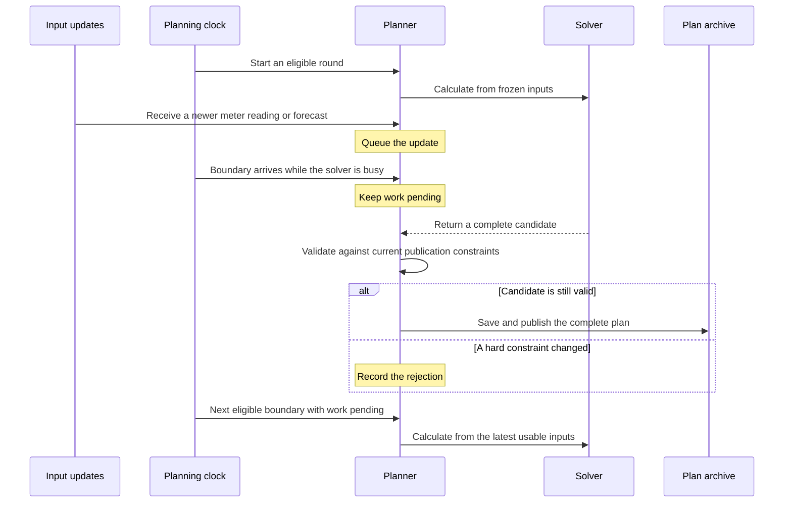

# EMS workspace and interactive time charts

The app owns the interface. The HA integration continues to expose native entities.
The shared navigation separates Energy, Insights and Settings. Energy contains
Planning, Appliances, EV charging, Thermal storage and Savings. Insights contains
Forecast quality and Planning performance. Settings contains Installation,
Appliances, Contract and Data storage.
Each destination has a decorative line icon and a visible text label. Group headings
remain visible on mobile. The active destination uses the existing palette, with
the same keyboard-accessible links on standalone and Home Assistant ingress pages.
One packaged HTML partial owns navigation across the page shells.
The original plan selector never activates an old plan. Historical data is rendered
from saved evidence without recalculating optimization or replacing measurements.

## Chart selection

Planning shows one installation energy balance with every battery's SoC,
effective prices and net EMS/reference grid exchange. Separate battery-converter
charts are omitted to keep the planning overview focused. Converter-level flow
details remain available in the selected-interval inspector. Savings retains
evaluated benefit and recorded import versus original advice and reference.
Available solar forecasts remain in the interval inspector and forecast chart.
Balance charts use actually planned DC production after curtailment/clipping.
Grid following is a regulation mode, not a fixed battery-power command.

**Battery plan** is a collapsed disclosure inside **Optimizer**. It reads per-device
`expected_flows.batteries` and original capacities and starting states from the
selected plan. Separate signed charge and discharge bars share a power axis and
use the same quarter projection as the installation balance. Each battery's SoC
line uses its original state endpoints and the right-hand 0 to 100% axis. Its
bars and line share a legend control keyed by device ID. Missing values remain
gaps. The chart follows the Planning time window and has its own power scale.
It is created when opened and is omitted when the original plan has no batteries.

Charging sources stack below zero. Discharge destinations stack above zero.
PV segments share the colors of the installation balance. Both grid directions
use grid blue. Discharge to own use has a distinct dark ochre. Matching routes
stack together across batteries. The battery SoC color identifies its line and
bar edges.

The original display-plan API returns `battery_flow_attribution` from frozen
flows, per native interval and battery. Each converter assigns local PV DC to
its battery demand first. At the shared AC boundary, PV supplies aggregate site
load before battery discharge supplies the remaining load. AC solar surplus
supplies remaining AC charging before grid import. Reserve any further solar
surplus against site export before attributing remaining discharge to grid export.
Each shared allocation is proportional to the corresponding AC contribution or
request. For a shared DC converter, local flows are apportioned using the DC
conversion factors. All contributions are expressed in terminal kWh and sum
to their recorded direction totals. Transfers and missing source or destination
evidence are displayed as **Other** where the terminal total is known.

Chart bars and tooltips display duration-weighted mean kW over their covered
quarter. The keyboard-operated interval inspector shows the original interval's
attribution in kWh. This display convention explains planned flows on a shared
AC bus. The optimizer, accounting and stored plan continue to use the original
validated flows.

## Signed interval balances

Interactive stacked balance bars always span UTC-aligned fifteen-minute blocks.
Presentation combines accounting fragments with duration-weighted mean **kW**.
Recorded hourly means become four equal bars, without claiming finer forecasts.
Internal sunrise, sunset, price and command boundaries remain exact in the model,
archive, price graphs and interval inspector. They never create extra balance bars.
Gaps, overlaps and unavailable physical evidence invalidate the affected quarter.
Partial horizon edges average only covered time. Tooltips identify that coverage,
so a full-width bar never claims energy before the plan starts or after it ends.
SoC retains its original timestamps and separate right axis fixed at
0–100%, calculated from the plan's frozen capacity and internal stored energy,
including initial and final states. Multiple batteries retain separate identities
and labels, including when they share a converter or a display name.

Time axes disable category-style end padding. The selected start and end map to
the plot edges on balance and line charts, including archived plans and the
six-hour, 24-hour and full-horizon controls. All balance bars have quarter widths.
Calendar charts share compact day headings, alternating pale backgrounds and
midnight separators. Day boundaries use the Home Assistant installation timezone,
including 23-hour and 25-hour daylight-saving days, independently of the browser.
Headings use Today or Tomorrow where space permits and compact dates on mobile.
The headings carry the weekday and date. Shared compact clock ticks show
installation time without timezone names. Date/time tooltips also omit timezone
names. Repeated autumn hours keep their actual timestamp positions even when
their displayed clock times match.
Full dates remain available as accessible labels. Clipped edge days occupy only
their visible time. Archived UTC daily savings retain UTC calendar boundaries.
Relative appliance-cycle charts retain their elapsed-time axis. Bands do not
fill missing series, change interval widths or alter stored evidence.

### Exact coverage at chart edges

The shared `chart_theme.js` owns numeric time-axis bounds for all chart builders.
Linear x axes use data bounds and disable category offsets. Explicit day, plan,
recorded-cycle and selected-window bounds remain authoritative. Automatic bounds
end at the original first and last timestamps instead of rounding out to a tick.
Category energy bars retain their end spacing so the first and last bins are not
cut in half. An empty or single-instant series retains the renderer's finite
fallback range.

Forecast quality stores one point at each original interval midpoint. Its
interval renderer draws the beginning and ending of each covered run to the
recorded interval boundaries, clipped to the selected day. For example, the
00:00–01:00 forecast covers the left edge of a complete local day even though its
inspection point remains at 00:30. A single available hour fills only that hour.
Null values and absent intervals break the line. Alternative forecasts and
irradiance references use their own coverage. No values, timestamps, tooltip
indices, daily totals or accuracy calculations are added or changed.

| Chart family | Edge and missing-coverage rule |
| --- | --- |
| Planning balances, forecasts, grid exchange and prices | Preserve the selected plan window and original interval or state boundaries. |
| Savings and realization | Preserve the selected evaluation window and explicit unavailable periods. |
| Forecast quality | Cover recorded forecast intervals, including clipped edge hours and 23-hour, 25-hour and half-hour DST days. Leave missing first or last hours empty. |
| Thermal storage | Align the planned time window to both edges. Temperature points remain recorded end states. Do not invent an initial state. |
| Appliance profiles and recorded cycles | Use original elapsed or recorded times. Category energy bars keep complete bins. Recorded context and missing measurements remain visible. |
| Planning performance | Daily attempts retain the complete selected day. Detail plots end at the last recorded sample, with no invented sample before the first observation. |

Check both the axis pixels and the visible stroke when testing interval lines.
Correct scale bounds alone cannot detect a half-interval gap between the plot
edge and the first or last midpoint. Check resize and visibility changes too.

Planning day headings expose energy summaries on hover, focus and tap. Integrate
each visible balance series in kWh over its covered duration, clipped to the
selected range and installation-local day. Preserve the chart's signs and omit
SoC percentages. A gap, overlap or unavailable interval makes that series' total
unavailable. Partial days state their actual coverage. Canvas redraws preserve
heading nodes so an open summary does not destroy keyboard focus. Summaries do
not change archived plans or trigger optimization.

Without battery, self-consumption and OEP share the union of their visible signed
stack extrema, with the existing ten-percent clearance and identical ticks.
Recalculate together after window, plan, visibility and size changes. SoC and
converter-specific charts do not enlarge that comparison scale.
The original forecast chart uses green for household demand and yellow
for available solar. Both forecast lines have at least 3:1 contrast against the
white plot background. Their labels distinguish forecasts from planned balance flows.
The signed balance palette below remains unchanged.

| Flow | Sign | Color / boundary |
| --- | --- | --- |
| Used solar: DC | Positive | Green, hybrid DC input |
| Used solar: AC | Positive | Dark green, separate PV inverter AC output |
| Grid import / converter AC supply | Positive | Blue, AC boundary |
| Battery discharge | Positive | Red, DC terminals |
| Household demand | Negative | Amber, AC consumption |
| Grid export / converter AC output | Negative | Cyan, AC boundary |
| Battery charge | Negative | Purple, DC terminals |
| Conversion losses | Negative | Gray, converter and battery DC converter |
| Battery SoC | Separate axis | Dark colored lines, percent of nominal capacity |

At the installation boundary, used solar DC + used solar AC + grid import + terminal discharge
equals household demand + grid export + terminal charge + conversion losses.
The selected-interval inspector uses the same conservation equation for each
battery converter's local solar, AC input/output and connected batteries. Thus it reveals direct DC
charging versus AC-fed charging. AC supply may originate from the grid or
another inverter. The graph never invents a unique solar/grid attribution on a
shared AC bus. These details cover each battery-connected inverter,
including standalone battery converters and shared hybrids.

Separate nonhybrid PV inverters with no attached battery contribute their archived
AC export once per inverter, even when several PV sources share it. Their losses
fall outside the displayed boundary. Hybrid identity is retained in the no-battery
reference. Older battery-linked converters retain their DC interpretation.
Validate the original all-DC evidence before projection, then validate the mixed
balance. Converter inspector groups retain their original local DC boundary.
See the [worked balance](../users/read-your-plan.md#worked-balance-one-hour).

Losses are calculated from archived physical evidence and efficiencies, never
from a residual chosen to force visual balance. For inverter efficiency `eta`,
loss is `AC_import * (1-eta) + AC_export * (1/eta-1)`. For each battery DC
converter efficiency `eta_dc`, add `terminal_charge * (1/eta_dc-1) +
terminal_discharge * (1-eta_dc)`. Internal battery storage losses are already
reflected in SoC. Terminal charge/discharge bars do not count them again.
These are display calculations only. Solver inputs, commands, archives and
financial evaluation remain unchanged.

Every complete interval balances to zero within a named 0.00001 kWh display
tolerance. Missing, non-finite or inconsistent physical evidence produces an
explicit warning and missing bars, including for older incomplete archives.
No missing value becomes zero. The complete balance applies when all flow
series are visible. Hiding a series intentionally hides part of that balance.
Finite solver noise within 0.0000001 kWh of zero is displayed as zero,
matching the independent physical validator's per-flow allowance.
Material negative physical energy is rejected. Archived numbers stay unchanged.
The net grid comparison and financial charts are not conservation diagrams.
They remain separate to avoid mixing the simulated reference with EMS flows.

The Planning overview keeps costs and their breakdown beside each scenario.
**Understand this plan** owns original assumptions and selected interval commands.
It does not duplicate them in whole-horizon energy, battery, solar or repricing tables.
The evidence projection shows forecast model and quality without a technical forecast
version label. Original snapshot version metadata and financial API evidence remain intact.

Planning reads only the stored fields required by its selected view, before
decoding large archive payloads. Repeated simulations reuse one app-local result
only after rereading and validating the same frozen input contents. Current
contract valuation remains a separate fresh read. An archived reference is
physically verified before reuse. A newly computed no-battery reference supplies
its own flows without another replay. Original numbers and displayed values are
unchanged. See [archive validation and reuse](PLAN-ARCHIVE.md).

Once a plan identity is selected, its plan and simulation reads start together.
The original chart renders without waiting for simulations. An early simulation
failure remains separate from original-plan availability. Stale selections cannot
publish either response, and a failed original read cancels its speculative
simulation read. Evidence still loads only when its disclosure needs it.

Planning, Installation, Contract, Forecast quality and Activity join concurrent
public session reads with their same-origin workspace shell. Each consumer gets
its own response body. Cancelling one consumer does not cancel the shared read.
The underlying request has a five-second deadline and is removed when settled.
Every consumer also bounds its own wait by that shared deadline. An expired
pending record is replaced even when its originating child document disappeared
before settling the fetch. Cleanup removes only the same pending record, so an
old completion cannot remove a newer read.
No completed metadata, credential, failed response or cross-origin request is
cached. Later version and source-name checks still fetch fresh metadata.

These pages preload their known eager module dependencies using the same frozen
content-addressed URLs as ordinary imports. Immutable browser caching is retained.
An explicit browser `no-cache` request can still force a network read. That alone
does not establish an application cache defect.

HTTP responses expose standard `Server-Timing` durations with fixed metric names.
`app` covers event-loop dispatch through response preparation. Planning adds
`archive`, `scenarios` and `json` for the corresponding awaited operations.
These spans include worker admission and execution. They do not distinguish SQL
execution from worker queueing, measure delay before event-loop dispatch, proxy
latency, network transfer or browser painting. Cached responses retain their
original header. Metrics contain no paths, plan/source identities, timestamps,
credentials or exception messages, and no timing history is persisted.

Planning renders the original optimizer chart immediately with its available
bounds. Each synchronous rendering stage then applies the selected windows and
legend visibility before computing the shared scenario extrema once. When the
simulations arrive, the complete group receives one batch update. Same-plan
refreshes join the initial stage instead of starting a nested range update.
The batch skips charts whose rendered data, dataset visibility, scale configuration,
dimensions and resulting shared bounds are unchanged. In-place data changes are
detected too. Each completed update records its rendered inputs against that chart
instance, including native resize updates. This state is discarded with the chart.
Redraw decisions and rendering use the same axis-bound calculation.
Batch extrema are temporary and are cleared even when a chart update fails.
Invalidate a chart's rendered-input record before attempting an update. A failed
draw can already have applied new shared bounds without changing that chart's own
inputs. Only successful rendering records those inputs again, ensuring a retry.
Time-window, data and legend changes can expand or shrink the shared scale.
The separate SoC percentage axes do not enter that calculation.

The shared value-axis plugin refreshes a peer only when a shared value-axis bound
has changed. Updating unchanged bounds must not redraw the other scenarios.
Every chart retains its own datasets, visibility and window. Changed bounds,
legend toggles and resizing still synchronize the scenario scales. Separate SoC
and unrelated chart scales retain their existing behavior.

## Interaction and accessibility

Chart.js 4.5.1 is bundled locally, with its MIT notice, without CDN requests or
an additional frontend framework. Hover/tap gives timestamp and values. Native
HTML tooltips use separate label, right-aligned tabular-number and unit columns.
Long labels wrap without shifting individual values. All source text is rendered
as text, and the popup remains inside the viewport.
checkbox legends work with a keyboard. The 6-hour, 24-hour and full-horizon
controls apply to every planning graph. A keyboard/touch interval inspector
explains commands, solar permission, prices and market-rate provenance at that
instant. Battery series are keyed by immutable device ID, never by the display name.
Only duplicate names receive a readable ordinal. Unique HA device names stay
unchanged. Native source resolution stays explicit. Repeating hourly forecasts
does not claim quarter-hour prediction detail. Selected interval values remain accessible through the keyboard-operated inspector.
The [price timeline and control grid](PRICE-TIMELINE-AND-CONTROL-GRID.md) uses
quarter-hour control throughout the 48-hour horizon. Billing rows preserve any
exact boundaries within each control quarter.

Axes use actual UTC instants with local display dates and elapsed time spacing.
Aggregated day/month evaluation bins retain UTC calendar labels. Missing coverage
breaks lines. Missing advice never becomes a zero target or zero benefit. Long
period totals and benefit bins cover the full selection. The realization chart
explicitly identifies its bounded first day of detail. Existing financial error,
version-selection and stale-response guards remain in place.

## Scheduling ownership

The app's live timer checks UTC clock boundaries independently of HA reports and
browser polling. On each quarter-hour boundary it builds a fresh planning snapshot
when inputs are usable. On the intermediate five-minute boundaries it does so only
when a request is pending. For example, a new price or deviation at 00:01 is
eligible at 00:05. Several updates produce one calculation with the newest
available inputs. An empty 00:10 is skipped. At 00:15, one regular round also
consumes any pending request.

Material defaults are 1000 W grid-power error or 5 percentage points of battery
capacity relative to the interpolated published trajectory. Expected SoC motion
is therefore not a deviation. Forecast updates, appliance feedback, newly usable
EV charging work and readiness recovery can also leave requests pending. A
calculation in progress finishes. If it overlaps a due boundary, the latest
inputs are considered at the next eligible boundary, even if the solver finishes
in between. If the scheduler wakes after a missed quarter, or state access or
preparation runs past the boundary minute, the request also stays pending. The
first ready plan and explicit configuration, resume or replan actions can still
start when idle. Hard input invalidation and publication safety checks remain
immediate. Ordinary sensor captures and measurement freshness
deadlines are never solve timers. Each submission logs its reason and elapsed
time since the previous submission. The performance chart records actual start
times, including worker and event-loop scheduling delays.

The clock decides when pending work can run. The final check decides whether a
completed calculation can publish with the current constraints.

Effective-price revision hashing coalesces adjacent segments with the same rates,
source, published/forecast kind, native resolution and contract period. Moving
lead-time bucket boundaries or control-grid splits therefore do not masquerade
as new prices. Original segmented tariff evidence remains unchanged in each plan.
Real rate, source-preference and contract changes still create a new revision.

Published commands expire at the next UTC quarter boundary plus five minutes of
recalculation grace, bounded by plan coverage (at most 20 minutes).
Fresh input admission still uses each measurement's age limit. The snapshot
separately retains real forecast/provider expiry, which also bounds commands.
The first billing interval's end is a scheduling boundary, not provider expiry. The old coupling
between a captured measurement's deadline and command lifetime would make
quarter-hour planning leave unavailable gaps. Missing required current inputs
still revoke commands promptly. HA automations/equipment retain physical safety.
An expired plan is never extended merely to avoid an unavailable state.

Vendored asset: `web/public/chart.umd.min.js`, upstream npm `chart.js@4.5.1`
(`dist/chart.umd.min.js`), SHA-256
`48444a82d4edcb5bec0f1965faacdde18d9c17db3063d042abada2f705c9f54a`.
The adjacent `chart-LICENSE.txt` is packaged and served locally. Updating this
asset is a normal pinned dependency change requiring browser regression checks.

## Current prices without a plan

Price inputs shows the original rates used by the selected plan, including when
an older plan is selected. Without an available plan, the same graph explicitly
shows a preview from current cached spot prices and the latest saved import/export
rules. The purple line is the total potential export rate including eligible
bonus, before the annual volume cap. It is available without a plan, household/PV
forecasts or a confirmed annual export baseline. Saving a bonus then opening or
refreshing Planning updates this preview. It does not change frozen plan inputs.
Plan selection switches all original inputs together. New prices or contract
changes do not rewrite the displayed plan's saved rates.

A non-quarter boundary such as 07:19 can be an exact sunrise/bonus-window edge.
It is not necessarily a market-source timestamp. Native provider resolution is
preserved and hourly forecasts are not given invented quarter variation. The
axis remains aligned to 15-minute ticks. Outside a paid window the total export
line equals the base export rate. Unknown evidence remains a gap with a reason.
Regression coverage includes microsecond daylight boundaries and unknown location,
so browser rounding cannot create an apparent missing tariff.

Daylight bonus eligibility uses complete minutes. The shared solar-window policy
rounds sunrise up to the next whole minute and sunset down to the preceding whole
minute. An already exact minute is unchanged. Boundary generation and bonus-rate
evaluation use this same policy. Ordinary 15-minute market prices remain unchanged.
Old immutable plans retain their original precise boundaries. Their chart uses the
recorded end timestamp, avoiding false gaps when legacy microsecond timestamps are
rendered at browser millisecond precision.

Value-axis bounds use visible data, including signed stack totals.
The three planning comparisons share time windows and kW-axis extrema across their
group. Changes to the visible range, legend or size update all three together.
Other charts retain their own value-axis bounds. Unrestricted ends retain
ten percent of the displayed axis height as clearance. Physically nonnegative
consumption, production, appliance power/energy and forecast-quality charts have
a fixed zero lower bound and only upper clearance. Signed balances, net power,
prices and savings retain their negative domain. SoC remains fixed at 0–100%.
