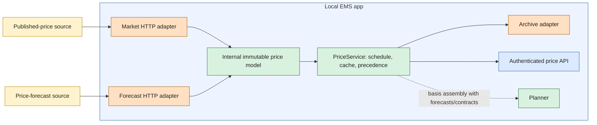

# Market-price inputs

The price-input boundary implements PRICE-01/02 and HORIZON-02/05/06. It provides production HTTP adapters, a provider-independent internal price model, composition, persistent normalized source versions, automatic refresh and an authenticated price-status API. Forecasting, contract formulas and device onboarding have separate owners. See [installation planning](INSTALLATION-PLANNING.md) for their composition and readiness requirements.

## Boundaries

| Component | Responsibility |
|---|---|
| `prices/model.py` | Immutable `PricePoint`, `PriceSeries`, `PriceSlice`, `PriceTimeline` and source protocols. Currency/kWh, interval kind, native resolution, original source version and issue/receipt/expiry timestamps |
| `prices/service.py` | Source-neutral scheduling/cache orchestration, semantic change detection, coverage and source diagnostics |
| `prices/selection.py` | Pure matched-evidence and stable daily selection policy behind a typed storage port |
| `prices/storage/adapters/selection_store.py` | SQLAlchemy atomic evidence/assessment storage for SQLite, PostgreSQL, MariaDB and MySQL |
| `prices/adapters/` | Separate Nord Pool, EnergyPriceForecast and Epex modules. Shared `JsonClient` and parsing. Immutable archives in the shared SQL document store |
| `prices/bootstrap.py` | Composition root choosing adapters and owning the shared HTTP session |
| App | Runtime lifecycle and authenticated `GET /v1/prices`. No provider JSON or source-specific calculations |
| Planner/contracts | Consume typed prices together with demand/PV forecasts, physical configuration and independently evaluated contract rules. Wholesale price is not an effective import/export tariff |

Provider classes implement typed ports. Do not introduce a universal provider base class or pass dictionaries across the boundary. Replacing a provider changes its adapter and composition root. Source IDs in provenance are opaque identities, not application branching conditions.

## Combining prices

Use final published prices wherever they cover the requested market area/currency. Fill the remaining intervals with unexpired forecasts. For forecast overlaps, use the per-area/lead-bucket preference, with immediate availability fallback. Within equal preference, newer issue time wins (receipt when issue time is genuinely absent). Published prices always lead, including beyond 24 hours. See [forecast selection](PRICE-FORECAST-SELECTION.md) for matched MAE evidence, stable switching, the 72-hour valuation tail and Active price sources display. Never mix currencies or bidding areas, extrapolate missing values or turn a missing price into zero. Negative prices are valid.

Return a contiguous usable prefix of the requested rolling 48-hour window. A gap ends usable coverage: report `shortened_horizon`, or `unavailable` for a gap at the start. Both provenance and native resolution remain on each resulting interval. An hourly forecast remains an hourly forecast even when published quarters split its displayed coverage. The API does not label repeated forecast values as genuine quarter-hour predictions.

This source timeline is separate from the planner's 96 quarter-hour plus 24 hourly steps. Future projection must preserve underlying price/contract subintervals: a coarse planning step cannot change billing or hide nonlinear eligibility boundaries. No raw wholesale price is silently assigned as both retail buy and sell price.

## Fetching is not replanning

Every planning round reads the latest usable cached inputs. Fetching a source is independent of quarter-hour planned transitions and PLAN-15's five-minute ordinary-recalculation bound. A new plan does not imply another network request. This increment does not change the existing planner cadence or automatically shorten command validity to a source's polling interval.

The following automatic market policy is confirmed. The scheduler checks due work every 30 seconds. Those checks do **not** perform network requests every 30 seconds.

| Moment | Action |
|---|---|
| Startup | Load normalized cache. Fetch today's prices immediately only when absent/incomplete. Fetch tomorrow when its publication time has passed and it is absent/incomplete. |
| 13:05, `Europe/Amsterdam` | Request tomorrow's published prices. |
| Not yet complete or request failed | Retry no sooner than 30 minutes after the previous attempt started. Keep retrying at that interval until complete. |
| Complete | Stop missing-day retries. |
| 16:05 | One additional tomorrow-price correction check. A failed correction retries at 30-minute intervals. |
| Forecast source startup | Fetch each configured, market-compatible forecast source immediately, independently of planning. |
| Forecast source whose previous attempt succeeded | Fetch each source again no sooner than 60 minutes after that attempt started. This applies to Energy Price Forecast EU, Epex Predictor and Jeroen.nl where available. |
| Forecast source whose previous attempt failed | Retry that source no sooner than 30 minutes after that attempt started. Keep usable cached data within its original expiry. |
| Installation price-source status | Read the OEP cache again 30 seconds after the previous screen refresh completes. This does not fetch provider prices. |

The screen shows the market area without an update-frequency claim. The status
polling interval is not the price-fetch interval. Hourly fetching also does not
guarantee hourly publication of a new provider forecast. Preserve the distinction
between the provider's issue time and OEP's receipt time.

The source policy uses the Amsterdam timezone, not the host timezone. Delivery-day bounds support 23/25-hour DST days. Do not require exactly 96 samples. A restart may repeat the one correction check because attempt/correction markers are runtime state. Cached data and original issue times persist. This costs an extra read, not loss of history or new optimization when values are unchanged.

Source content changes, new coverage, native resolution changes and transitions from forecast to published change the semantic price version. A new receipt or model issue timestamp alone, with identical prices/classification/coverage, does not. `refresh()` reports changed content or changed usable coverage: recovery from an expired forecast must remain visible even when the recovered numerical prices are equal. Accepted source versions remain immutable. An identical fetch can update runtime receipt/issue evidence without changing the semantic version. Persisted source content uses its original archive receipt.

## Provider translation and checked evidence

- **Nord Pool public Data Portal:** request one date/area in EUR. Require matching date/area, `DayAhead`, `Final` status and complete delivery-day coverage before accepting the response. Convert EUR/MWh to EUR/kWh once. Preliminary/partial/malformed responses do not replace good cached prices.
- **Energy Price Forecast EU:** request `forecast_only`, native resolution, base prices and 48 hours. Accept EUR/kWh forecast entries for the requested bidding area, retaining native resolution and the model's actual `source.firestore.updated_at`. The integration uses public access without a provider-key setting. The fixed 48-hour horizon does not enable paid forecast features.
- Forecast maximum issue age is provisionally six hours when the optional model issue timestamp exists. Without that undocumented field, preserve `issued_at=None` and bound response age to one hour using the schema's `generated_at`. Do not describe response creation as model issuance. An unknown model age remains unknown. Repeated receipt of the same response does not extend its deadline. These freshness bounds concern when a forecast may be used, not how far into the future its delivery intervals extend. Tune against observed provider operation. Polling is not a provider update guarantee.
- HTTP responses are bounded to 2 MB and 20 seconds. Redirects are refused. No provider authorization header is added. Known HTTP/schema/availability failures become source issues. Unexpected programming faults are logged. Valid cached data remains available within its own coverage/freshness. The separate installation Bearer token protecting the local app/HA connection is unchanged.

The Nord Pool adapter normalizes final 15-minute EUR/MWh intervals. The forecast adapter requires `EUR/kWh` in both the response and each forecast entry and preserves native interval resolution. The [forecast provider schema](https://energypriceforecast.eu/openapi/integration-api.json) describes response fields and timestamp metadata. Validate schema and access conditions when updating either adapter. Supported response formats do not establish forecast accuracy or service availability.

The public endpoints are not a commercial data entitlement. Nord Pool redistribution/access rights and the forecast service's product/commercial conditions remain release admission work. The sampled forecast metadata reported private non-commercial access. Building an open-source adapter does not grant commercial use. No subscription, licence acceptance or paid service was activated.

Sources: [Nord Pool publication time](https://www.nordpoolgroup.com/en/trading/transition-to-15-minute-market-time-unit-mtu/faq/faq-premium-container/will-the-publication-time-of-results-change-after-the-sdac-15-minute-mtu-go-live/), [forecast integration documentation](https://energypriceforecast.eu/en/homey-electricity-price-co2-forecast/), [forecast product access](https://energypriceforecast.eu/en/api-for-business/).

## Running and observing

Normal `--live` startup reads the market area from the saved app-owned contract and opens these adapters automatically. The Contract page prefills an area only from an unambiguous HA country. `--market-area NL` remains a fixed-area developer override. Areas must be explicit. Country is not always bidding area. Other market currencies are rejected rather than converted without an exchange-rate contract. The EUR-only admission boundary is not a claim of complete European provider coverage.

The installation uses an explicit bidding zone, not an arbitrary geographic region: for example `NL`, `DK1`/`DK2`, `SE1`–`SE4` and `NO1`–`NO5`. Nord Pool's `GER` and the forecast provider's `de` both translate to the internal `DE-LU` identity. Those aliases belong only to their adapters. Responses for another zone are rejected. No country-average fallback is allowed. These zone-translation tests do not assert that each provider supplies EUR forecasts for every listed zone. A changed area filters incompatible cached series from the working set and reports the condition without stopping the app. Unreadable cached evidence similarly reports `cache_unreadable` without inventing prices or deleting archives.

HA onboarding prefills a known single-area country, such as the Netherlands, from the optional HA country metadata. In a multi-area country, country/timezone alone is insufficient. Coordinate-based determination would require maintained trustworthy bidding-zone boundaries. No such lookup is invented. The user confirms the bidding area once on the [Contract page](CONTRACT-PRICES.md#contract-page), where it remains editable. Saved contracts drive normal live startup. The bootstrap argument is only an explicit developer override.

`GET /v1/prices` uses the same installation authentication as other routes: Bearer token or trusted HA ingress. Without a configured price runtime it returns `not_configured`. Otherwise it exposes coverage/status, semantic version, source issues and normalized intervals with source versions. It never fetches synchronously in response to a dashboard poll. Cached source versions and pointers use the `prices` document namespace in the active SQL database. Historical versions are retained when the working set advances. Forecast assessments use the same database. Follow [consistent backup and recovery](PLAN-ARCHIVE.md#backup-and-recovery), including the external server database when configured. Copying a legacy prices directory is insufficient.

**A live app still needs PV/demand forecasts, device limits and effective contract prices to publish an optimized plan.** The price runtime does not substitute fixture forecasts or reinterpret bare market prices as a supplier contract. [Contract assembly](CONTRACT-PRICES.md), [demand forecasting](DEMAND-FORECASTING.md) and [solar forecasting](SOLAR-FORECASTING.md) now supply these independent inputs. Required configuration, source coverage and measurements must be valid. Original plan records remain unchanged. No historical plan is recalculated. The overview displays the original spot and effective import/export prices retained with each plan, independently of newer source data.

## Bounded composition and cache recovery

Each normalized response contains 1–512 ordered, non-overlapping intervals of at least 15 minutes. The current working set contains at most eight source versions. Historical archives are not subject to that working-set limit. Provider arrays and cache reference lists are checked before constructing source objects. The boundary sweep sorts at most P interval boundaries and compares at most one active interval per source, costing O(P log P + P*S) for P points and S sources. This avoids repeatedly scanning every point for each boundary on the shared event loop. Oversized or denser sources are rejected explicitly. The 48-hour quarterly/hourly sources fit comfortably inside these bounds.

A successful durable save clears a previous cache diagnostic. Existing content-addressed archives are checked before reusing their references. Corrupt historical bytes are preserved and cannot masquerade as a repaired cache. Null, array or scalar archive JSON is an unreadable cache, not an app-startup exception. Invalid forecast object types become sanitized source issues while accepted prices remain unchanged.

Acceptance owns its storage thread through completion. Cancellation waits for that writer before returning, so shutdown does not release ownership while the SQL transaction is still active. If cancellation arrives during a write, the database may contain the committed new cache while the closing service still has its previous in-memory tuple. Restart validates and loads the durable cache normally. This does not activate a plan or recalculate historical plans.
