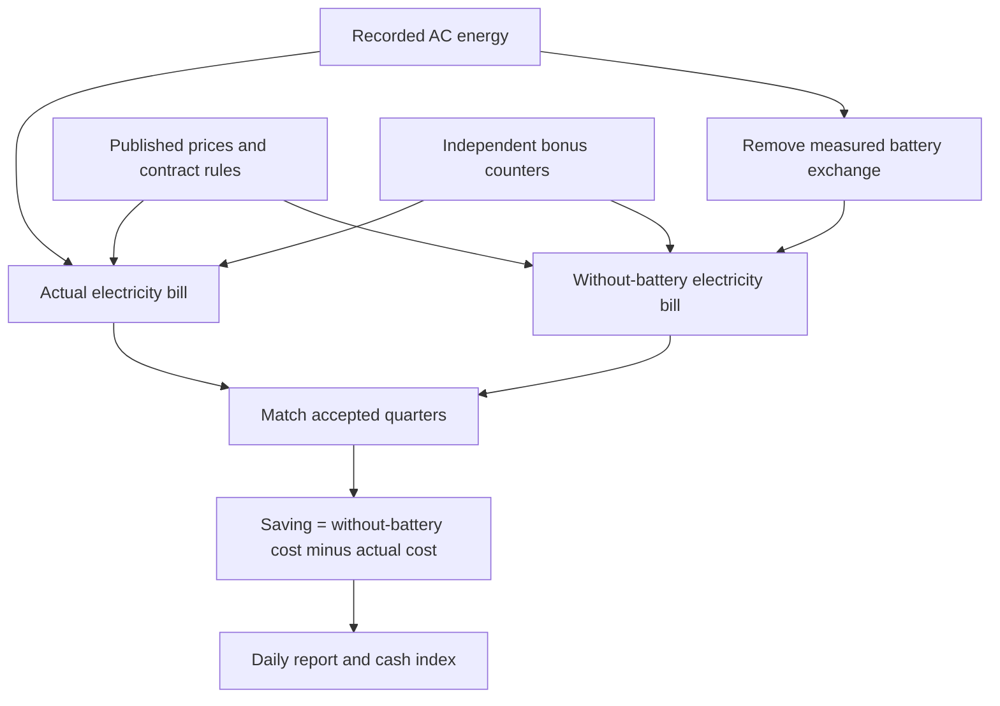

# Settlement and measured battery savings

The app owns measured settlement. Home Assistant transfers bounded Recorder
energy evidence through the existing integration. No solver, physical device
control, separate database or executable contract language is introduced.

## Calculation boundaries

Planning and Savings answer different questions:

| View | Basis |
| --- | --- |
| Planning | Original future forecasts and tariffs, with economic cost including battery wear and terminal inventory valuation. |
| Savings | Recorded AC grid and battery flows, with net electricity cash cost compared against the same measured home and solar without storage. |

Planning's independent self-consumption and without-battery forecasts remain in
`forecast.py`, `reference.py` and `scenarios.py`. `windows.py` provides read-only
costs for timezone-aware subperiods of an original plan. A different chart window
does not optimize again or change original valuation curves, prices or bonus
chronology. Whole-plan evidence remains separate from selected-period amounts.

Measured Savings uses `measured-battery-cash-v1`. It runs no continuous battery
simulation and needs no historical SoC, original physical forecast, wear rate or
terminal valuation. It does require frozen, disjoint AC measurement bindings,
published prices and dated contract rules.

## Cash calculation flow



## Measured reconstruction

`accounting.measured_cash_flows` computes household demand from the frozen signed
energy terms. Subtracting measured AC solar yields the no-battery net exchange.
Its difference from recorded net grid exchange removes the measured battery
contribution. A positive difference first reduces recorded gross export and then
adds import. A negative difference first reduces import and then adds export.
Zero difference preserves both recorded gross directions, including quarters
that imported and exported at different times.

No extra inverter, DC or cell efficiency is applied to these already normalized
AC meters. There is no reconstructed battery stock. Missing or contradictory
meter evidence invalidates its interval, not later valid intervals. Raw meter
evidence is never replaced with forecasts or current readings.

This is a quarter-energy reconstruction, not independently measured alternate
reality. Within-quarter sequencing is unknown. Actual solar curtailment, hybrid
conversion/clipping and flexible-load timing are retained rather than simulated
away. The result measures the battery's electricity cash contribution and does
not isolate every effect of energy management.

## Cash and bonus accounting

`bill` splits quarters at published-price, dated-contract, bonus-window and reset
boundaries. Partial splits use uniform energy rates and retain estimated quality.
For each side:

```text
electricity cost = purchase - export income - bonus
saving = without-battery electricity cost - actual electricity cost
```

Only quarters accepted for both sides enter the headline and both displayed
costs. Their separately accepted scenario totals are audit evidence and must not
be subtracted when coverage differs. Zero remains distinct from unavailable.
Negative savings remain negative. Investment costs, wear and inventory-value
changes are excluded. Initial or externally introduced battery energy can affect
cash costs when discharged. Its economic value is not credited or debited here.

The two sides retain independent chronological gross-export bonus usage. A
confirmed actual export anchor may establish actual usage, or their original
common opening before divergence. It cannot repair a later unknown no-battery
allowance. Meter gaps invalidate dependent usage until valid evidence or a real
contractual reset establishes it. Zero export or a zero bonus rate may still
produce an exact payment without establishing unknown usage. Missing prices do
not erase independently established gross export progress.

`HistoricalBonuses` retains bounded native hourly-statistics recovery, confirmed
reference provenance and compatible aggregate-meter identities. It never grants
a fresh allowance merely because a view or provisional day starts.

DC solar meters cannot establish measured AC production behind a hybrid converter.
These intervals retain actual energy and costs but do not contribute a matched
without-battery comparison. They are never relabelled as measured AC solar or
silently converted using forecast efficiency. The public issue explains this boundary.

## Intake and daily processing

`runtime.py` owns capture requests, immutable receipt and recovery cursors.
`daily.py` owns one completed local day per background round. Blocking reads and
writes run off the HTTP event loop under the existing settlement mutation lock.
The app lock is held only while borrowing immutable configuration snapshots.
Slow billing does not hold plan publication or HA snapshot reads.

Capture begins after the first recorded publication at the next complete UTC
quarter. Requests wait for the existing Recorder delay and contain at most one
day/96 intervals. Actual source/configuration changes split capture at their
recorded activation boundaries. The bridge reads native five-minute or hourly
statistics with kWh normalization and counter-reset handling. It does not query
Recorder SQL. It no longer reads or reconstructs historical SoC for Savings.
Capture also freezes available original currency and market-area metadata. A known
identity mismatch with the contract excludes monetary coverage without discarding
measured energy. Older frames use retained compact metadata for this guard.
New frames retain empty battery endpoint maps for the existing wire/archive
contract. Older frames, including `estimated_soc` evidence, remain readable.

Each valid interval is accepted independently. Sparse replies include aware
`scanned_until`, so an unavailable interval cannot stop later capture. Frame,
forward cursor and recovery cursor writes share one transaction. Conflicting
replacement evidence is rejected. Recovery rotates through provisional gaps and
never rewinds forward progress or resets financial state.

Daily windows follow the HA timezone and actual DST elapsed time. The current day
is not evaluated. Three complete local recovery days follow each day. Finalization
occurs at D+4 local midnight, after finalized predecessors. Upgrade recovery and
configuration/timezone pause safeguards remain. Only provisional reports may be
updated. Missing raw evidence remains explicitly missing at closure.

## Durable evidence and historical policies

`oep_savings_days` retains the compact report, original policy, recovery/finalization
metadata, meter totals and original evidence. New reports contain actual and
without-battery cash breakdowns, a `cash` comparison on matching quarters and a
checkpoint with independent `cash_counters`. There is no reference stock,
inventory trajectory or self-consumption continuation in new reports.

`oep_savings_cash_days` is a portable indexed projection of matching cash totals.
It references the original day, commits with that report, shares its immutable
closure and participates in every database transfer. Period totals and daily or
monthly chart bins are read from one repeatable snapshot. They never aggregate
legacy economic/reference columns into the new cash basis.

The overview also returns `cash.breakdown.actual` and
`cash.breakdown.without_battery`, each containing `purchase`, `sale` and `bonus`,
or null when comparable component evidence is incomplete. One bounded SQL
aggregate joins the matched index to existing normalized day columns in the same
read snapshot. Only days with positive matched coverage contribute. Every such
day must have all components and scenario coverage equal to matched coverage.
Matched quarters are a subset of each scenario's accepted quarters, so equal
coverage proves the same time. A broader actual scenario cannot explain a
narrower matched net total. The query covers the entire selected range without
loading raw quarters or bounded daily payloads. Finalized evidence and the
existing monetary comparison remain unchanged.

Finalized legacy reports and their tables are retained without reinterpretation
or destructive migration. `GET /v1/evaluations` and explicit revision reads retain
access to already stored interval evaluations. These readers cannot create new
legacy evaluations. Expired quarters, missing bonus usage and missing original
facts are not invented to backfill the new policy. The current UI explains when
a selected historical period has no new-policy comparison.

See the [data dictionary](DATABASE-SCHEMA.md) for columns, signs and payloads.
All tables use the app-owned active engine and shared SQLAlchemy schema.

## Read-only interface and calendar control

Savings shows one cash amount, its two matching costs, a signed daily chart and
a collapsed Savings breakdown and calculation help. The breakdown uses only
backend-verified comparable components. Amount labels above bars and date labels
at actual bin centers reduce density to fit the available width, while full
values and dates remain available through tooltips and keyboard inspection.
Missing data, loading and failed reads never show a
zero or a stale previous period's amount. Chart values remain keyboard accessible.
Large historical tables and the continuous-simulation controls are removed.

`period-selector.js` owns the shared Energy-style trigger, previous/next buttons,
presets and custom-calendar dialog. `display.js` formats calendar labels using HA
locale preferences. Its owners provide authoritative bounds and retain their
own fetching, ordering and validation. Forecast quality, Activity and Planning
performance use single-day mode. Their evidence and chart semantics do not
change. Planning performance uses backend `retention.min_day/max_day`, never a
second browser-clock retention calculation. An unavailable preset, arrow target
or calendar day is disabled. Custom selections undergo the same bounds check.

Data storage accepts inclusive ISO `start` and `end` dates, while existing named
period queries retain their contract. Its backend supplies the first retained
date and current installation-local date. Invalid, reversed or future ranges
receive owned validation guidance. Planning's existing relative future-horizon
controls remain separate from historical calendar filtering.

The native modal preserves focus, Escape dismissal and background inertness.
Closing an unconfirmed selection leaves the page filter unchanged. Refreshes
bound stale selections to newly confirmed availability and reread that range.
Authentication, ingress prefixes, immutable plans and device commands are
unchanged. No third-party UI package or runtime font request is required.

Capture batches stop at changes to either the measured bindings or the historical market and currency. Older frames without identity use retained plan metadata. The day calculation reads bounded activation chronology once and reuses each original market context, rather than querying the plan for every quarter. If that metadata is unavailable, identity stays unresolved. Published prices alone cannot prove the historical installation market. Missing or mismatched identity excludes the quarter from cash while retaining its measured energy. A missing price preserves each independently known export allowance counter.

The overview cash response explicitly identifies `aggregation` as `day` or `month`. The calendar returns `has_completed_days: false` with null bounds until the first eligible day completes.
