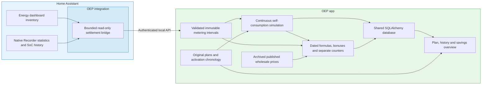

# Settlement, continuous reference and visual overview

The savings service implements UI-01–18 and the associated storage/benefit boundary.
It does not change the selected planning strategy, enable another optimizer, or
claim that a counterfactual is measured or that every saving was caused by OEP.

## Planning period costs

`savings/windows.py` owns read-only costs for arbitrary timezone-aware subperiods
of an original plan. `GET /v1/plans/{plan_id}/comparison?start=...&end=...` returns
only the covered period, scenario amounts and issues. The authenticated route
performs no writes or optimization and runs financial replay off the event loop.
The original comparison without query parameters retains its whole-plan contract.

Import, export and wear follow original interval mean flows. Interior battery
endpoints are linearly interpolated in stored kWh. Both endpoints use the same
original terminal valuation curves, including their reserves and useful-volume
caps. No new tariffs or valuation curves are derived for a different view.
Chronological bonus settlement includes all earlier original export. A cap
reached within a partially selected interval credits its earliest exported energy.
Independent missing scenarios remain unavailable and cannot fabricate a benefit.
A window outside the plan has no coverage, rather than a zero economic cost.

The frontend chooses a time range and formats server-owned amounts. Its latest
plan starts at the current UTC quarter, while linked or historical plans retain
their original start. Captions state actual covered boundaries. The full-period
button states available hours instead of assuming that every retained or expired
plan has 48 remaining hours. Versioned range reads clear stale totals and cannot
replace a newer selection. Whole-plan evidence and corrected-contract tables keep
their explicitly separate original-plan scope.

## Ownership and flow

The planner remains responsible only for future plans. `savings/reference.py`
owns deterministic physical self-consumption. `accounting.py` owns independent
settlement. `daily.py` owns completed-day replay, recovery and immutable daily closure.
`runtime.py` retains capture validation and the legacy interval-evaluation reader/replay.
Native HA
and SQLAlchemy objects stay in their adapters. No second database or executable
contract language is introduced. Settlement mutations use a dedicated lock. The
app lock is held only while taking immutable configuration snapshots. Slow
financial replay cannot hold plan publication or HA snapshot reads. HA capture
validation/transport failures remain isolated from plan acceptance, with retry
backoff retained until the request changes. After historical transfer, synchronization
rechecks newer pause/resume/closed intent before accepting an older snapshot.
Pending capture reuses one immutable binding projection per plan rather than
reconstructing its full archive on every HA poll.

## Measured evidence and coverage

Comparison starts after the first newly recorded plan publication, at the next
complete quarter. Earlier original plans remain readable. Activation times for
older development installations are not invented. The bridge waits ten minutes
for completed Recorder intervals, requesting at most one day/96 intervals at a
time. Physical configuration changes split capture at their recorded activation
time and retain the corresponding original measurement bindings.

The bridge reads Energy's grid import/export channels, the disjoint AC household
balance channels and recorded per-battery SoC endpoints. It uses native Recorder
APIs with kWh conversion, never Recorder SQL or current SoC as a historical value.
Five-minute sum endpoints supply quarter deltas and handle cumulative-meter
resets. Missing data stays missing. Where only long-term hourly sums survive,
linear interpolation is explicitly `estimated_hourly`. Interpolation of a
configuration boundary is `estimated_boundary`. Neither is labelled exact data.
An unavailable or unknown historical SoC spanning at most one hour can be
reconstructed only when valid percentage readings before and after agree and
both configured battery charge/discharge cumulative sums prove no energy moved
throughout the enclosing five-minute boundaries. Missing counters, active
battery flows, changed SoC, invalid readings and an absent return sample still
block capture. Current SoC never substitutes for historical evidence. Such
frames are `estimated_soc`, including when their energy also uses hourly
reconstruction. Every non-recorded quality remains estimated downstream.
A negative counter delta no greater than `1e-9` kWh (one micro-Wh) is treated
as unit-conversion roundoff and normalized to zero. Larger decreases and
nonfinite values remain invalid. Capture logs the first blocked boundary and
the missing or invalid source, then retries without skipping that boundary.
Sub-quarter tariff/window splits also retain an estimate flag because the
measured interval total does not reveal its internal power profile.

Only the measurements needed for billing, independent household reconstruction,
battery value/wear and the reference are retained. Raw HA history is not copied.
Each frame includes original sums/deltas, battery endpoints, quality, source
bindings, initial counter evidence and location. Capture retries are idempotent.
Conflicting replacement evidence is rejected instead of silently rewriting it.
Gaps remain missing during the recovery window. At finalization, their explicit
missing ranges survive in the daily report. Unknown simulated stock and counters
remain unknown for later days. Actual billing and independently recoverable
without-battery intervals do not require inventing reference stock.

## Reference policy

`self-consumption-v1` uses the same installation, initial measured stored energy,
reserves, conversion efficiencies and physical power limits as the EMS scenario.
It stores surplus solar energy and discharges only against household demand.
It never performs price-driven grid charging, battery export or PV curtailment.
PV overflow is exported even at negative export prices. Without a battery it
reduces to direct self-consumption and surplus export.

Local hybrid DC charging accounts for conversion advantages and clipping. Shared
converter capacity is consumed once. Stable battery-ID order makes simultaneous
choices reproducible without introducing a second financial optimizer. A
reference exceeding an unavoidable hard grid bound is reported as unavailable,
not silently curtailed to make the comparison look valid.

During planned PV curtailment, measured curtailed production is not the available
PV baseline. Use retained available-production model evidence and label it
estimated. This is a modelled counterfactual, not proof of uncurtailed production.
Meter definitions must respect the existing AC household-balance contract. Raw
DC energy cannot be inserted into that balance as AC energy.

Both scenarios inherit the same reliably established remaining bonus budget.
Thereafter their stored energy and all-export bonus counters evolve independently.
Date selection never resets or synchronizes either state. Missing initial counter evidence or evidence that is ambiguous after a reset
blocks the affected evaluation. It does not grant a new
annual allowance. Counter resets and price/time/daylight conditions use the same
tested contract primitives, including the HA location for daylight windows.

## Costs and corrections

For each nonoverlapping evaluated interval:

* Net electricity cost = import cost − export income − bonuses.
* Economic cost = net electricity cost + wear − change in battery inventory value.
* Financial benefit = reference economic cost − actual EMS economic cost.
* Avoided gross import = reference import kWh − actual EMS import kWh.

Negative benefits and extra imports remain visible. Realized EMS costs use
measurements, not the predicted EMS flows. Remaining battery energy uses the
existing bounded valuation curves for both scenarios and is explicitly not cash.
Recorded end value becomes the next interval's start value, so period selection
cannot create repeated intermediate valuation credits. Added/removed energy and
capacity corrections are separate zero-acquisition-cost inventory movements.
They do not enter grid flows, bonus counters, cycles or EMS savings.

Published wholesale prices are retained in an indexed projection when normalized
price versions are saved/loaded. Forecast prices never settle actual costs.
Every evaluation retains its selected published source version, effective retail
formulas, bonus seed evidence, policy version, plan identity and evaluation time.
Provisional completed days are recalculated chronologically from the preceding
daily checkpoint. Corrected published prices, contracts and confirmed bonus seeds
can update those provisional reports. Finalized days are immutable. The daily
worker does not replay years of finalized quarters after a contract correction.
Legacy interval evaluation versions remain separately readable while their
temporary evidence remains. They are not the default daily archive.
A missing published price delays evaluation without an actionable
fault notification. Persistent configuration/data errors are reported separately.
Daily publication and price acceptance use the same dedicated mutation lock.
A newly accepted correction is visible to a later provisional-day pass. It cannot
race an in-progress final publication. The original legacy interval evaluator
also retains its price recheck before committing an interval.

New expected comparisons start self-consumption and OEP at the same measured
battery stock and the same initial bonus budgets frozen in the plan. They use
the same start, horizon, physical installation, tariffs and external forecasts.
Their economic cost difference is the expected extra saving from choosing OEP
now, including remaining battery value. Negative savings remain visible.
Historical metering gaps cannot block this future comparison. Original archived
continuous-start forecasts retain their original outcomes and interpretation.
This common forecast start never changes historical settlement or its counters.

Contract corrections also reprice frozen expected EMS and reference flows in
bounded batches of twenty plans. Original wholesale knowledge, times and physical
quantities stay unchanged. The original terminal-price evidence is reused with
corrected effective tariffs. These are new expected valuations, not actuals or
new optimal plans. Publish a separate success-only valuation pointer and retain
the previous result on failure. The UI shows the original, the latest successful
correction and any pending/failed correction independently.

Publication, explicit pause/resume and plan revocation are recorded separately
from solver generation time, atomically with app state. Advice history integrates
the succession of active, enabled, unexpired plans. Missing advice is not zero
power and never implies that the user executed an automation.

## Storage and indexed queries

All data uses the active SQLAlchemy engine: SQLite by default, PostgreSQL,
MariaDB or MySQL optionally. New tables join the shared schema and complete
backend transfer automatically. Connection settings, tokens, certificates and
technical logs remain outside it. The new tables are created additively. Existing
plan contexts and activation identities are backfilled before plan thinning is
eligible. Existing daily backfill receives three complete recovery dates after
upgrade before old detail can expire. No database reset is performed.

* Activation chronology: primary key on normalized UTC activation time.
* Meter frames: primary key on normalized UTC interval start.
* Evaluations: primary key `(revision, start)`, with retained JSON evidence and
  numeric cost/energy columns for portable SQL aggregation.
* Published prices: `(area, currency, start)`. A separate
  committed ingestion-event index `(area, currency, sequence)` serves correction detection.
  The sequence belongs to the single app writer. Receipt timestamps are not
  correction cursors. Backend transfer retains this ordering without a server sequence reset.

Daily period totals and chart bins are aggregated in SQL. Periods up to 366 days
use local daily bins. Longer selections use local monthly bins, retaining UTC
start/end instants. At most 366 daily detail reports enter one response. The UI
uses 25-row Previous/Next pagination and asks for a shorter selection to inspect
later details. Unavailable comparisons remain null. Zero is a measured/evaluated
zero, never a substitute for missing coverage. Mixed-currency periods are rejected.

`oep_savings_days` permanently retains per-scenario totals, coverage seconds,
estimated seconds, missing ranges/reasons, opening/closing battery stock/value,
installation snapshots, original/current contract identities, price source
versions, method versions and independent continuation. Smart-planning, actual
versus without-battery, and self-consumption versus without-battery benefits each
sum only pairwise matching accepted quarters. Different scenario coverages must
not be compared by subtracting their unmatched total costs.

Reports also retain opening bonus seed evidence and external battery inventory
movements. Display responses overlay current Home Assistant Energy names through
retained source identities without rewriting finalized evidence. Changing the
Home Assistant timezone after daily history exists pauses automatic processing.
Existing calendar identities remain intact instead of being silently reassigned.
The worker exposes this as an expected pause needing attention, with an instruction
to restore the original Home Assistant timezone. Processing and maintenance resume
automatically after restoration. While paused, thinning and other worker maintenance
remain blocked and existing results stay readable. No generic failure traceback is
generated for this owned condition.

Each daily calculation shares one short-lived context lookup across frame accounting
and active advice. Every distinct plan is decoded at most once during that replay.
The next replay reads fresh hash-verified context. Missing or corrupt evidence remains
unavailable rather than falling back to a previous replay's cached values.

The current local day is excluded. For day D, recovery covers the three complete
dates D+1, D+2 and D+3. Closure is at local midnight D+4, calculated with
`core/calendar.day_window`, rather than 72 elapsed hours across DST. Earlier
unfinalized days must close first. Partial and unavailable scenarios close with
their missing coverage. Publication, checkpoint and capture-cursor advancement
share one transaction. This allows ingestion to move past an expired gap without
filling that gap or resetting simulated state.

Maintenance expires bounded raw frames, legacy interval evaluations and detailed
historical plan payloads only behind a hash-verified finalized checkpoint.
The boundary installation/advice context and active plan remain protected.
Permanent daily totals and control ownership do not depend on full original
plans. Complete plan retention and lossless compression follow the
[archive policy](PLAN-ARCHIVE.md#retention-and-payload-representation).

## User interface and API

Open **Plan and savings** from installation setup. HA OS uses the existing
authenticated ingress session. Standalone users use the administration token.
The same responsive workspace offers original plan versions and expectations,
then completed-day Savings with three scenario costs, coverage, provisional/final
state and disclosed recovery details. Retained day-plan links open original
expectations without replaying financial history. Original plans are read-only.
The current plan's charts advance at each quarter boundary while retaining the
original archived data. The page checks for a newly published plan every 15
seconds and refreshes its charts when one becomes available. A deliberately
selected historical plan stays selected. Hidden pages pause these reads and
check again when visible. The refresh button remains available for a manual
reload without activating an old plan.

* `POST /v1/settlement`: integration-only bounded, version-matched capture.
* `GET /v1/savings?start=…&end=…[&revision=…]`: authenticated stored period results.
* `GET /v1/plans/{plan_id}/comparison`: original expectations, reference and separate contract valuation.
* `GET /v1/evaluations[?before=…]`: bounded evaluation-version pagination.
* `/overview`: public static shell. All private data retains API/ingress authentication.

Existing plan-history pagination is reused. Charts use the locally bundled
Chart.js asset. No second dashboard, extra user-created helpers, physical
automation or new source selection is needed.
Independent numeric oracles belong in the maintained savings tests. Simulated app and HA checks do not establish physical execution or measured household savings.

## Interactive workspace

See [EMS visualization](EMS-VISUALIZATION.md) for the Planning/Savings/Installation navigation, interactive locally bundled charts, keyboard inspection and the quarter-hour scheduling policy. Original evidence tables remain available as details.

## Price/publication coordination

The app composition root supplies one mutation lock to settlement capture,
financial processing/repricing and price-cache acceptance. PriceService holds
that lock only for the drained durable cache write and in-memory publication.
Provider fetching and candidate validation stay outside it. The financial worker
can therefore finish its price-cursor publication before a correction is retained.
The barrier is separate from the live state lock: plan publication and HA reads
remain independent. The offline test-price service follows the same write rule.
A controlled integration test suspends provider fetching, then financial
publication, and proves that fetches/HA reads remain free while retention waits.

The expected reference comparison is optional enrichment of a validated plan.
Missing documents, I/O failures and database read failures mark that comparison
unavailable without blocking plan publication. Unexpected failures retain a
traceback in the shared runtime log. Normal pending-reference states remain
readiness information. This does not suppress failures saving the actual plan.

The HA coordinator applies and projects a received pause, revocation or validated
plan before awaiting optional settlement capture/upload. Slow Recorder reads
therefore cannot postpone a stop decision that has already arrived. Financial
completion never reapplies an older response over newer local user intent.

## Physical progress during financial outages

`physical.py` owns measured-frame reconstruction and stock transitions shared by
settlement and the independent reference. A daily checkpoint retains physical
continuation separately from financial reference/counter readiness. Valid physical
frames still advance when prices or bonus evidence prevent billing. Financial
replay reuses the same resolved physical frame rather than running a second
dispatch. Physical and monetary readiness remain distinct after restart and
cross-backend transfer. The older `physical-reference.json` and interval replay
remain readable for legacy evidence. They are not the new daily worker's cursor.

Known exports advance each scenario's bonus usage even when its settlement price
is missing. Missing prices cannot create fresh allowance. Simulated counters may
share actual opening evidence only at the original common start. A genuine reset
can establish a new period, but a later backdated rule cannot borrow actual usage.
Actual hardware inventory changes are accounted independently of reference stock.
Valuation preserves the physical movement evidence retained in the daily report.

Archive maintenance failures have separate sanitized, deduplicated diagnostics
and recovery messages. They do not mark successful financial processing as failed.
Unexpected financial processing failures defer maintenance for that worker round.

The first complete measured quarter after initial publication supplies the common
initial stock. An exactly aligned publication preserves that same quarter.
Thereafter no date selection, contract change, financial outage or finalized gap
synchronizes the reference to actual SoC. Missing physical coverage remains unknown.

A missing, late or aggregate bonus seed can prevent financial settlement without
preventing physical advancement. Historical settlement still requires measured
channels, battery endpoints and original installation context. An interval gap
stops historical progression at the last valid checkpoint. The future plan's
common measured start is independent of this checkpoint.
`/v1/snapshot.savings_status.physical_issue` distinguishes physical failures from
financial `issue`. The recovery below separately handles later seeds and repairs
a financial baseline only with sufficient historical evidence.

## Historical bonus opening balances

Historical billing sums the exact physical export members retained with each
measurement interval. The synthetic aggregate source ID is an identity, never
a sensor to look up in individual meter readings. Each member is checked so a
reset cannot be hidden by another meter increasing.

A confirmed seed recorded after the first unsettled interval is backdated by
subtracting contiguous recorded export deltas. Whole intervals use reset-aware
Recorder deltas. An anchor inside an interval uses its component meter readings
only when the following boundary proves that no member reset in that interval.
No uniform split is used to invent the anchor. A gap, changed membership,
inconsistent endpoint or negative reconstructed usage keeps the budget unknown.
The confirmation and immutable measurements remain unchanged.

When that historical period has no matching seed, the app automatically requests
native HA hourly statistics from its reset boundary to the completed hour around
the old interval. The existing bounded history bridge transfers all export
members and their final readings. The app validates complete coverage and derives
the opening volume. A separate bridge prevents optional historical work from
blocking control or current-budget initialization. Requests are bound to the
contract, current confirmation revision and frozen historical export bindings.
Old, invalid or incomplete replies cannot overwrite current confirmations.

`GET /v1/snapshot` exposes `settlement_bonus_request`. Authenticated
`POST /v1/settlement/bonus-history` accepts the existing compact kWh hourly format
with a 1 MiB body limit. Derived historical books use the shared SQLAlchemy engine
and the `savings-bonus-counters` document namespace. Current planning books remain
in `bonus-counters`. Both transfer with the complete database on every backend.
Backdating reads at most 96 frames per page, scans at most the existing 9000-hour
history bound and caches at most 64 derived seeds. This work runs off the HTTP
loop under the settlement mutation lock. Missing history remains explicit and
physical reference progression remains independent.
Historical cache updates retain prior periods within the shared 64-seed limit.
The newly requested periods always take precedence over optional cached periods,
so an old replay cannot be stuck repeatedly requesting an immediately evicted
seed. A reset not aligned to a whole UTC hour cannot be reconstructed exactly
from hourly statistics. It exposes a manual-baseline requirement and does not
issue an unusable automatic hourly request.
