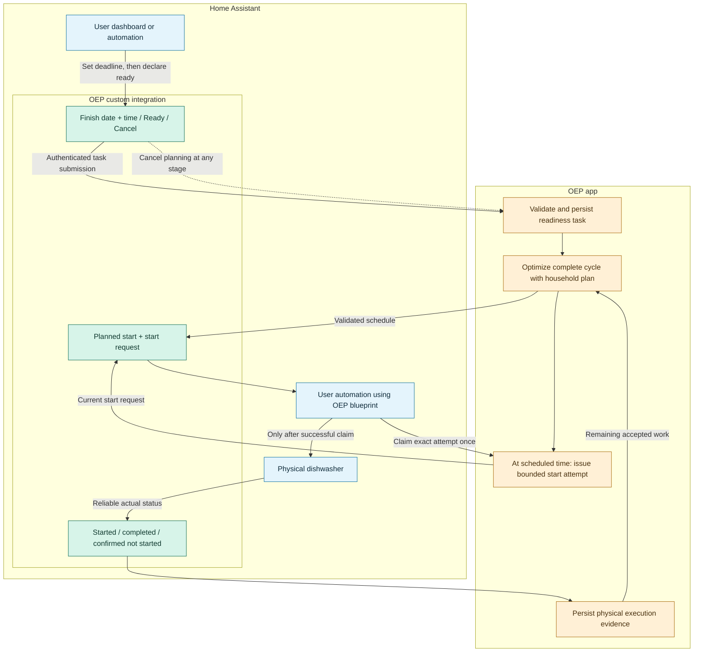

# Shiftable appliances

Phase 2 builds on Energy-owned individual consumer forecasting. It adds complete
cycle scheduling and mandatory physical feedback. It does not add a dishwasher
driver. The app owns learning, tasks, attempts and optimization. The integration
publishes facts and forwards authenticated actions. User automations own equipment.

## From dashboard intent to physical execution

The app's **Energy → Appliances** workspace shows only selected appliances with
permission to shift complete cycles. Its task controls and cycle-profile selector
exclude non-shiftable devices and charging meters. Without permitted appliances,
the page shows an explanation and links to **Appliances settings** and
**Forecast quality**, instead of deadline fields or empty cycle charts.
**Appliances settings** retains all available consumer configuration. Both
shiftable and non-shiftable selected consumers remain available to forecasting
and daily comparisons in **Forecast quality** when their evidence is available.

The virtual device exposes native HA controls alongside its sensors:
**Finish date** (`date`), **Finish time** (`time`), **Ready for planning** (`button`) and **Cancel planning** (`button`). Add these to an
HA dashboard using native entity controls. No input helpers are needed. Selecting a
date or time only saves draft intent in the app database. Pressing the button explicitly
states that the loaded appliance is ready. The deadline must be in the next seven
days. No start is inferred from the button press or from a historical usage pattern.

**Cancel planning** withdraws the task at any stage, including requested, running
or unknown execution. It immediately removes future start authorization and the
next plan omits that task's remaining cycle. Original historical plans and the
attempt's physical evidence remain intact. Cancellation never means the machine
has stopped or completed: the user's HA automation decides how to respond.

The integration publishes **Task status = Cancelled** and emits
`open_energy_planner_appliance_cancelled` on an observed transition of the same
task. Event fields are `device_id`, `task_id`, optional `attempt_id` and
`previous_status`. No historical cancellation event is replayed merely by loading
the integration. A user may, for example, trigger an automation to stop equipment,
clear an external queue, or take no physical action. Late correlated feedback may
record what happened, but never reopens cancelled planning. New readiness is a new
explicit user decision, not an automatic retry of uncertain execution.

The separate date/time rows fit narrow HA device cards. Partial or invalid drafts
remain editable but cannot enable Ready for planning. The app resolves local
fields using the HA timezone. At the autumn clock change it selects the first
future occurrence. A nonexistent spring clock time remains invalid. Existing
complete deadline values remain usable. The old combined HA widget is retired.

General permission to shift complete cycles remains an installation choice in the
app. These controls appear only on permitted Energy-owned appliances. Readiness
requires a usable learned or manual cycle profile and a future deadline. While a task is unresolved, both
controls are unavailable: changing a draft must never silently change an accepted
task's deadline or authorize a second cycle. Completed or cancelled work releases
the controls. An expired draft must be updated before another submission.

The planned start is information. Only a valid current attempt plus a successful
one-time claim authorizes the automation's physical action. Missing confirmation
becomes **Start not confirmed** and blocks retries. **Not started** is accepted
only after positive assurance that delayed execution cannot still happen.

Automations may alternatively call `open_energy_planner.appliance_ready` with their
own deadline and stable request ID. This bypasses the dashboard draft, not the
app's task/permission/deadline validation. The app's Appliances page is another
client of the same readiness operation. All paths share one authoritative task.

## Setup and first-cycle learning

1. Configure the appliance's cumulative energy meter and optional power sensor in Home Assistant Energy.
2. Select the appliance in **Settings > Appliances** and save. Both sensor bindings remain Energy-owned.
3. Explicitly allow shifting complete cycles and save. Forecast quality remains read-only analysis.
4. Run the appliance normally. OEP detects complete cycles from fine power/energy history. Two cycles admit a learned profile. Until then, optionally enter only duration and kWh as a manual fallback. No start/end entry or detection thresholds are required.
5. Create an automation from **Open Energy Planner appliance execution**, installed
   at `blueprints/automation/open_energy_planner/appliance.yaml` with the integration.
   Choose the virtual device, immediate physical start action and reliable actual
   started/completed triggers. No helpers or user-written templates are needed.
6. From a user automation, call **Appliance ready** with the device, a stable request
   ID and an absolute finish-before deadline including timezone. Ready time defaults
   to now. The app also offers the same explicit readiness action in Appliances.

Readiness is not inferred from historical usage. Repeating an identical readiness
request returns the same task. Reusing its ID with different data is rejected.
Only one open planning task is permitted per appliance. Explicit user cancellation
can close it at any stage. This never cancels a physical action.

The Recorder adapter uses supported raw-history and native five-minute-statistics
interfaces, never SQL. Fine cumulative observations must cover the entire completed
cycle, with no reset, unavailable reading or gap over one quarter. Hourly totals
cannot reconstruct a phase profile. Watt-hour units are normalized inside HA.
One average profile records quarter-hour mean AC watts, conservative duration,
total kWh, sample count and measured/synthetic provenance. Different durations are
zero-padded when averaging, preserving mean cycle energy. Incomplete or coarse
cycles do not update the model. Automatic detection supplies learning evidence independently of execution feedback.
The blueprint reports physical outcomes and does not submit a second learning copy.
The legacy completed-cycle API remains for existing clients only.

## Forecast boundary and optimization

Task readiness additionally requires usable individual/residual consumption history.
Consumer model workers retain the ordinary historical weekday/hour component and
residual baselines alongside ML challengers. An explicit runnable task changes the
measurement boundary: its ordinary device forecast is replaced by the cycle profile,
and remaining household plus non-task consumers use those historical baselines.
This is not automatic activation of an unapproved ML challenger. Frozen baseline
inputs and the boundary-specific model identity accompany every task plan.

HiGHS receives immutable `ApplianceWork` records as part of `InstallationProblem`.
Each candidate is one absolute UTC quarter-aligned start and the full consecutive
profile. Energy is integrated across exact planning/billing overlaps. Only task
windows are refined to quarter boundaries, including actual phase boundaries for
already running work. Other coarse forecast hours remain coarse. This preserves
heater peaks and shared grid/converter constraints, rather than diluting a peak
over an hour. Nominal 120-step plans can therefore have additional segments.

Within the existing common solver deadline, reserve recovery retains its priority,
then a proved admission stage maximizes the number of feasible complete tasks.
Cost or corrected-consumption optimization follows, preserving that admission count.
An unproved admission solve cannot publish a candidate. A task that cannot fit gets
**Deadline not achievable** and no start command, while unrelated planning continues.
The independent validator checks task identities, contiguous profile energy, start
alignment, deadlines, fixed actual starts, AC conservation and all physical/cost limits.

Once started, actual start is fixed. Later rounds include only remaining cycle
consumption. Price changes never interrupt it or create another start. The average
duration has an initial five-minute finish allowance. Start confirmation lasts at
most two minutes and never beyond the latest allowed start or plan expiry. These
named defaults require practical equipment validation. They are not universal
physical guarantees.

## Execution authority and recovery

| State / observation | App behavior |
| --- | --- |
| Scheduled | Retain the start time, task profile and accepted plan identity. |
| Due and valid | Persist a distinct bounded start attempt. |
| Blueprint receives request | Claim that exact attempt through the app immediately before physical execution. A repeated claim fails. |
| Started | Record actual start and preserve remaining work through replanning/restart. |
| Completed | Close the task. Automatic cycle learning remains independent. |
| Not started | Require explicit assurance that all queued/delayed execution of that attempt is prevented. Close only the attempt. Replan the same task when feasible. |
| Confirmation expires | Withdraw the request, persist **Start not confirmed**, notify in HA and block retries. Execution remains unknown. |
| Late true start | Reconcile the exact unresolved attempt without reactivating its expired command. |
| Duplicate event | Identical task/attempt/event/time evidence has no second effect. |
| Stale or contradictory event | Reject it. Never apply it to another task or attempt. |

The request event may be repeated while unclaimed, including after reconnect. The
durable one-time claim prevents duplicate starts even when HTTP responses are lost.
The claim response carries `result.authorized`, the exact `task_id` and
`attempt_id`, and `expires_at`, the earlier of plan validity and attempt expiry.
Persistence and transport delays never extend this lease. The integration checks
strict authorization, matching identities and remaining validity after syncing.
The supplied blueprint checks the returned deadline again immediately before
the physical action. Custom automations must preserve this final admission check
and use immediate, non-queued start actions without intervening waits.
An expired response does not prove nonexecution or authorize a retry.
An uncertain claimed attempt is not automatically replayed after HA/app restart.
Explicit cancellation closes its planning task while retaining execution evidence.
Completing or cancelling a request never means physically stopping a running cycle.
Missing completion feedback cannot authorize another run. Pause and plan expiry
remove authorization while retaining execution evidence.

The optional blueprint failure path sends a cancellation action only for the exact
unknown attempt, then requires a positive cancellation trigger before **Not started**.
Without that trigger it remains unknown. User-selected actions may contain queues
outside HA. OEP cannot revoke them by clearing an entity. Blueprint runs are parallel
so status feedback is not blocked behind a waiting physical action. The app remains
the single transition authority. Trigger-group mapping uses HA's flattened trigger
index, so users need not edit IDs inside supplied trigger selectors.

## User-visible evidence

The existing virtual consumer gains **Task status**, **Planned start**, **Planned completion**,
**Expected cycle duration**, **Start request** and **Average cycle energy** when shifting is enabled.
Duration and planned completion use the accepted task's frozen cycle profile while a task exists.
Completion is unknown until a start is scheduled. Actual completion remains separate feedback. Source and task/attempt IDs
are inspection attributes. Users do not copy them into helpers. Labels are English,
with separate enum translations rather than changing internal values.

Appliances shows readiness, learned profile, deadline, schedule and timestamped
execution evidence. The planning balance adds a separately colored scheduled-load
series. Interval inspection includes the corresponding cycle timing and energy.
Expected reference comparisons start an acknowledged unstarted cycle immediately,
using the same profile. Already running work retains its actual start. An unserved
task is not presented as a financial saving. Historical measured self-consumption
accounting retains its existing measured-load reference and does not separately
claim realized appliance-shifting benefit.

## Acceptance and test laboratories

Independent solver scenarios use the explicitly specified powers
`1800, 80, 80, 0, 80, 1200, 80, 0 W` over two hours: **0.83 kWh**. This is synthetic
data, not a default dishwasher profile. Pauses do not close a run. Test profile
arithmetic, unique cheapest start, infeasible peak limits, mixed intervals, remaining
work, task replacement and lifecycle/restart uncertainty separately.

The existing lab fixture adds **Test dishwasher** to Energy and seeds native fine
history with completed synthetic daily cycles. Historical grid balance includes it
once. Test-only start, cancel, options and advance actions exercise queues, failure,
missing status and low-power pauses. Cancellation and progress are durable. Explicit
accelerated fixture progress avoids waiting two wall-clock hours in acceptance.
Short accelerated runs are not valid training samples for a normal two-hour cycle.
Normal product code has no clock override or simulator action.

Full acceptance must exercise the normal app/solver, real HA integration, shipped
blueprint and fixture actions in the persistent Docker developer environment. A passed profile or
state-machine unit test alone is not full-chain proof. Record scenario outcomes,
timings, task/attempt identity, meter difference and restart observations. Run shared
storage contracts on SQLite, PostgreSQL, MariaDB and MySQL, plus desktop/mobile UI.

Late physical feedback for a cancelled task remains recordable after a new task
is submitted: exact task/attempt/source correlation updates only the historical
task archive and immutable feedback snapshot, never the replacement planning task.

## Rollback boundary

Do not run a pre-cancellation implementation against the updated database. Older
feedback handling can reopen a cancelled task and is not a supported reader of
these cancellation records. For recovery, stop the app and appliance-start
automations first. Restore a consistent, matching app/integration/database backup
or keep the current cancellation-aware build. Reconcile physical execution and
withdraw queued starts before explicitly authorizing new planning. Restoring data
does not authorize an old start request. No in-place downgrade or converter for
unreleased development state is provided.

## Automatic learning and explicit estimates

The [automatic learning contract](APPLIANCE-LEARNING.md) supersedes any initial
setup instruction requiring cycle start/end entry. Select a device from Energy.
OEP reuses its power/energy bindings, detects complete cycles from fine history
and uses a learned average after two samples. Until then, enter only duration
and kWh in Appliances settings. Missing power is reported there. The estimate
stays saved after automatic learning takes over. The supplied execution blueprint
retains physical feedback but no longer submits a second copy for learning.
The legacy completed-cycle API remains available for existing clients.
