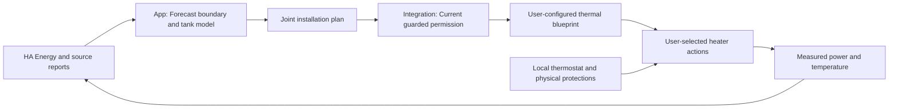

# Thermal storage: Electric boiler

The first thermal application is a water tank with a fixed-power resistive electric
heater. It shares the installation optimizer with PV, batteries, EV charging and
appliance cycles. It does not implement heat pumps, room-temperature control,
stratified tanks or brand-specific hardware drivers.

## Configuration and authority

1. Open **Settings > Appliances > Electric boilers** and choose **Add electric boiler**.
2. Select an unassigned device by its display name in the shared Home Assistant
   Energy chooser, then check its consumption meter.
3. Select the temperature entity independently from the Home Assistant catalogue.
   A `water_heater` entity may provide `current_temperature`.
4. Check the selected electrical power sensor. Select one explicitly if Energy
   defines no device power link.
5. Complete the boiler limits and hot-water assumptions described below, then
   save the configuration.

The consumption meter and explicit device power link are selected together.
Changing the Energy device applies its power link or clears the previous one.
Manual overrides survive source refresh. Sensor readings support Celsius or
Fahrenheit. Electrical power supports W or kW. The UI uses kW for the heater
rating and stores whole watts.

An already added consumption device, charge point or boiler cannot be selected
again. The server rechecks ownership under the settings lock before writing,
while preserving edits to the same existing appliance and meter.

The virtual device uses the Energy display name, falling back to the Home
Assistant device or sensor name when necessary.

The shared Appliances category navigation also opens consumption/cycle and EV
configuration. Each editor keeps its existing authenticated API, stable IDs,
SaveBar, version checks and retained drafts. A category change is blocked while
settings are dirty or a write is active.

**Energy > Thermal storage** keeps measured temperature/power, original planned
heating/temperature charts and service deficits. Its explicit daily actions set
the comfort target or pause/resume thermal planning through `/v1/thermal/intent`.
They never submit replacement source or physical-model configuration. Evidence
refresh preserves an unapplied comfort value. A rejected request retains input
and reports the failure. Selecting another store updates its title, comfort,
permission, evidence and chart immediately from the known snapshot. A delayed or
failed refresh cannot leave controls showing one store while targeting another.
Use current target restores the cached saved value before refreshing it.
Physical start/stop remains in HA automations.

Declare tank volume in litres, minimum comfort and maximum planning temperatures,
ambient temperature, standing-loss coefficient in W/°C, and expected hot-water heat
draw for each local clock hour. These 24 values describe thermal kWh per elapsed
hour. They are explicit assumptions, not measured water use or trained forecasts.
A repeated daylight-saving hour uses its rate twice. A skipped hour has no elapsed
duration. The Home Assistant installation supplies the only timezone.

At least one heat-draw value must be positive before enabling a store. A meter
cannot simultaneously represent an EV charge point or a shiftable appliance.
Ancestors and children cannot both be subtracted from the household boundary.
The component prediction and its original baseline must both be fresh and cover
the entire horizon. Otherwise OEP retains the original household forecast and
withholds thermal planning. It never substitutes zero for missing measurements.
If a boiler exclusion fails, preparation retries the existing EV/appliance chain
without that thermal exclusion. Independently complete EV work remains eligible
while the boiler stays in the household baseline. Required household-boundary
evidence must still be complete.
An unrelated selected consumer with too little history remains in the residual
household baseline. It does not hide ready boiler or EV forecasts. The composite
household challenger stays unavailable until all selected components are ready.

## Heat balance and priorities

For volume `V`, effective heat capacity is `C = V * 4.186 / 3600` kWh/°C. Each
segment of duration `h` uses the exact lumped constant-rate balance:

```text
exponent = loss_W_per_C * h / (1000 * C)
decay = exp(-exponent)
gain = (1 - decay) / exponent       # gain = 1 when exponent = 0
T_end = ambient + (T_start - ambient) * decay
        + (heater_AC_kWh - served_thermal_draw_kWh) * gain / C
served_thermal_draw_kWh = declared_thermal_draw_kWh - unmet_draw_kWh
0 <= unmet_draw_kWh <= declared_thermal_draw_kWh
unmet_draw_kWh > 0 implies T_end = 0
```

Resistive conversion efficiency is fixed at one. The model does not claim that a
single temperature describes tank stratification or usable tap-water volume.
This constant-capacity water model excludes freezing. Surroundings must be at
least 0 °C and no higher than the configured maximum or 60 °C. These bounds
ensure that passive cooling cannot force an otherwise idle store outside its
hard temperature range. Hardware frost protection remains independent.
Temperature stays between zero and the configured maximum. Heating is either
zero or the configured rating. Decisions share a UTC quarter even when price or
other device boundaries split that quarter. Existing battery control groups
remain intact.

The optimizer first minimizes unserved thermal draw. It then minimizes integrated
comfort shortage. It then minimizes
the ending-stock shortage before admitting appliance work, maximizing EV service
and optimizing the chosen financial or consumption strategy. The ending target
is `max(initial temperature, minimum comfort temperature)`. This conservative
first policy prevents an apparent benefit from emptying the tank at the horizon
edge. It can retain more heat than an economic terminal heat valuation would.
Unserved draw, comfort and ending-stock deficits are visible separately in the UI.
An impossible draw remains an explicit shortfall instead of making unrelated
electrical planning infeasible.
Unserved draw is permitted only when the model's heat inventory is exhausted.
It cannot be chosen to postpone an earlier withdrawal and preserve comfort for
later. This is an aggregate sensible-heat model, not a tap-flow, cold-inlet or
mixing model. Usable tap-water volume is not inferred from it.

A dispatch lead of the solver's full time budget plus one publication minute,
rounded up to a whole minute, prevents a newly published command from pretending it
heated during elapsed time. A candidate finishing after that boundary is rejected.
The latest fresh temperature initializes the model at capture, with the original
HA report time retained separately. Elapsed history is not replayed. Passive
losses and declared draw continue immediately after capture, including during
the new-start lead. A heater already measured running may continue immediately
without a recurring three-minute interruption at every rolling round. Only new
starts wait for the publication boundary. Independent validation recomputes physical balances,
electrical intake, temperature bounds, identities and quarter controls before
publication.

## Home Assistant execution



The integration exposes temperature, measured and requested heating, planned
power, predicted temperature, comfort shortage, enabled intent and a minimum
comfort control. No extra HA helpers are needed. Actual electrical operation is
distinct from an OEP request. Neither OEP nor the integration calls physical
heater services directly.

Use the installed thermal blueprint and select the physical start and stop
actions. Missing, unavailable, disabled or unsafe permission selects stop.
Context mismatch, missing Energy membership, invalid temperature or power, and a
temperature at the configured maximum withdraw permission locally, including
during app connection failure. Valid unchanged HA states remain usable regardless
of their original report age. The app requires a current integration capture
within five minutes for new planning. Existing commands retain their independent
plan validity and boundary timers, including during an app outage. These timers
withdraw expired commands. They do not request periodic solver runs.
Normal planning follows UTC quarters and the existing early-round throttle.

The boiler's thermostat, over-temperature protection and hygiene programme remain
authoritative. OEP is not a safety controller and must not bypass them.

## Persistence, references and verification

Configuration lives in the existing `planning` SQL document namespace. The mutable
`thermal-state.json` pointer has immutable `thermal-state-<digest>.json` revisions.
Writes archive the replacement transactionally before publishing it in memory.
Restart restores configuration, never fresh telemetry or heater permission.
Unreadable saved configuration cannot be overwritten through the editor.
Original plans retain the complete configuration, source reports, declared draw
profile, temperatures and electrical flows. Backend transfer includes these
documents and archives through the existing transfer mechanism. No new SQL table
or column is required.

Battery references hold the OEP thermal schedule fixed. Their savings compare
battery strategies with identical boiler service. They do not prove savings
caused by thermal scheduling itself.

Regression coverage includes independent heat arithmetic, hard limits, comfort
priority, horizon stock, joint PV/battery/EV/appliance dispatch, incomplete source
coverage, persistence and stale observations. HA tests execute the blueprint
against the simulated boiler. Browser tests cover desktop and mobile settings,
unsaved drafts and interactive charts. Storage contracts run on SQLite,
PostgreSQL, MariaDB and MySQL.

Both persistent laboratories add only the simulated boiler and its Energy
consumer. The fixture retains cumulative electricity and tank temperature in its
own store. Existing configuration, source IDs and history remain intact. New
simulated idle prehistory belongs only to the new boiler meter. Heater permission
is cleared on restart. The live grid incorporates the boiler's measured
electricity exactly once.
