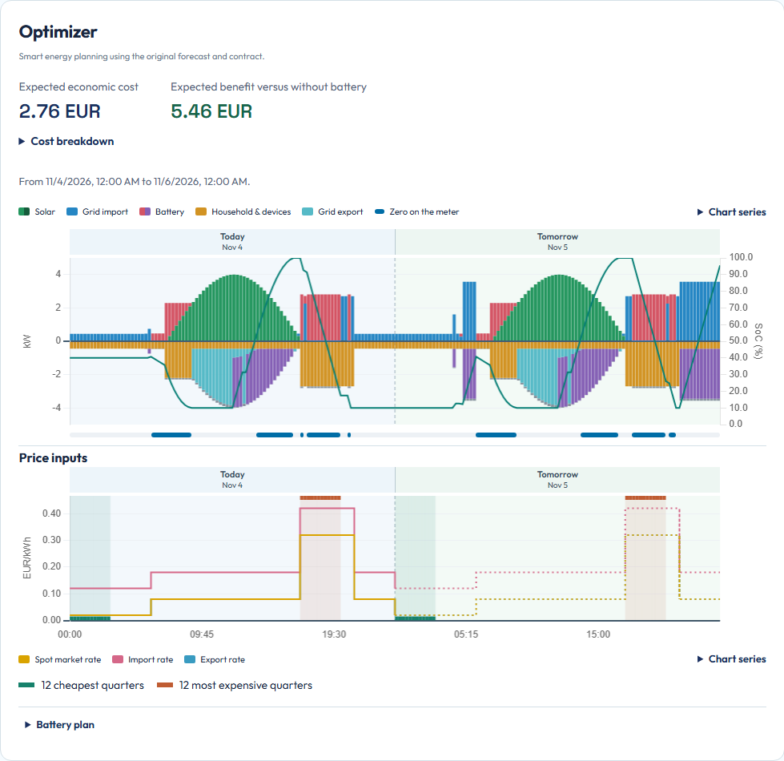

# Your energy, understood.

Understand what OEP plans, configure the inputs it needs and learn how to read the result. Choose the user route for operating the app or the developer route for changing it.

[Set up your first plan](users/first-plan.md){ .primary }

OEP is a development preview targeting Home Assistant 2026.11 or newer. The
[installation guide](users/install.md) explains the custom Marketplace repository
for the integration and the separate planner app repository. Both require a
published tested release. A separate synthetic demo is optional.

<figure><figcaption>Follow the energy through a complete example day. These are synthetic inputs in the actual app, not physical execution or measured savings.</figcaption></figure>

## Use OEP

Follow this route in order the first time. Each guide explains what to do, what the result means and how to recognize success.

1. [How OEP works](users/how-oep-works.md): Measurements, forecasts, constraints, checked plans and virtual commands.
2. [Before you start](users/before-you-start.md): Availability, units and Home Assistant Energy prerequisites.
3. [Install OEP](users/install.md): Add the Marketplace and app repositories and install the matching components.
4. [Set up your first plan](users/first-plan.md): Work through the Home Assistant wizard, contract and first result.
5. [Connect Home Assistant](users/home-assistant.md): Connection details, virtual-device groups and recovery.
6. [Configure OEP](users/configuration.md): Return to installation, strategy, prices, contract and optional appliances.
7. [Read your plan](users/read-your-plan.md): Energy balances, the three scenarios and original evidence.
8. [Understand Savings](users/savings.md): Coverage, measured operation, simulated references and costs.

Return to [forecast quality](users/forecasts.md), [appliance requests](users/appliances.md), [data preservation](users/data-storage.md) and [troubleshooting](users/troubleshooting.md) as needed. The [glossary](users/glossary.md) explains unfamiliar energy and planning terms.

## Explore an optional demo

The [standalone demo](users/demo.md) uses synthetic inputs without Home Assistant. The [persistent laboratory](development/USER-TEST-ENVIRONMENT.md) adds simulated Home Assistant devices for integration tests. Choose these only when you want a separate test environment. They are not the normal setup route.

## Develop OEP

Start with [the contributor's development guide](development/README.md). It separates an editing checkout from a persistent numbered installation and explains the smallest relevant checks. The [Dev Container provisioning page](https://patrickvorgers.github.io/open-energy-planner/provisioning/) helps prepare the isolated environment.

Then use the [architecture overview](development/ARCHITECTURE-OVERVIEW.md) to find an owner and the [reference library](development/REFERENCE-INDEX.md) to locate detailed contracts. [Contributing](../CONTRIBUTING.md) and [CI stages](development/CI-STAGES.md) explain signing, review, selected suites and merge evidence.

## Read each result in its own context

A forecast is a prediction. A plan is checked advice. Home Assistant acceptance is receipt of that advice. Physical execution requires the user's own automation/controller and feedback. Savings uses retained evidence and a simulated reference, so it is not proof of a measured alternative household or a guaranteed investment return.

Missing values stay unknown. Older plans remain historical records when a new calculation fails. See [release boundaries](../design/FIRST-RELEASE-SCOPE.md) for what is implemented, what is still proposed and what remains to be accepted for a product release.
