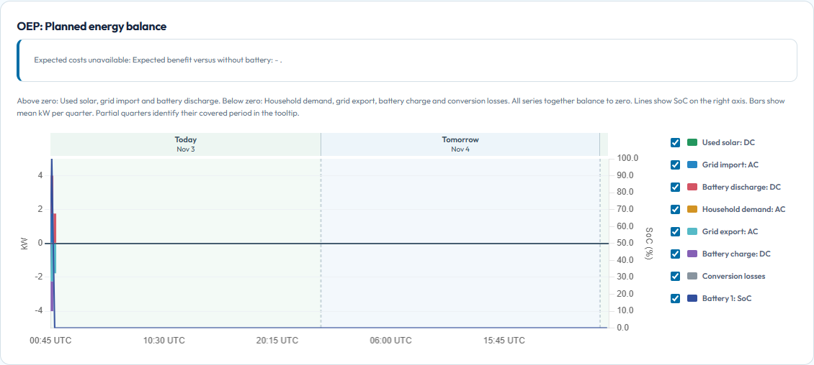

# Your energy, understood.

Learn how Open Energy Planner turns your Home Assistant energy data into a local, checked plan. Start with a safe demo, then explore your own installation.

[Try your first plan](users/first-plan.md){ .primary }

OEP is a development preview. The repository is public. Public HACS installation and a complete product release are not available yet.

<figure><figcaption>A real plan from the local synthetic demo. Forecasts and proposed actions are not proof that a physical device followed them.</figcaption></figure>

## Start with a clear path

- **Understand before you connect**

    Check what you need, what OEP can currently do and which parts are still development work. [Before you start](users/before-you-start.md).

- **See a plan with sample data**

    Run the actual planner on your computer without a Home Assistant connection or physical device commands. [Try your first plan](users/first-plan.md).

- **Connect an isolated Home Assistant**

    Use the verified installation path, review detected meters and understand the boundary between a plan and device control. [Connect Home Assistant](users/home-assistant.md).

## Make sense of the result

A plan combines consumption and solar forecasts, electricity prices and your installation limits. OEP checks the result before publishing it. Start with [reading your plan](users/read-your-plan.md), then explore [prices](development/CONTRACT-PRICES.md), [appliances](development/SHIFTABLE-APPLIANCES.md) and [forecast quality](development/FORECAST-QUALITY.md).

Missing measurements stay unknown. Predictions stay separate from measured history. [Savings](development/SAVINGS.md) explains which comparisons are estimates and which use retained measurements.

## Build on the same foundation

Developers use the same maintained guides as the product. Start with the [development guide](development/README.md), then read the [architecture](../design/TECHNICAL-DESIGN.md), [CI stages](development/CI-STAGES.md) and [contribution rules](../CONTRIBUTING.md).

## Need a hand?

Use [troubleshooting](users/troubleshooting.md) for a missing plan, connection problem or incomplete input. The first product release still has [separate acceptance gates](../design/FIRST-RELEASE-SCOPE.md). A successful demo does not establish support for your physical installation.
