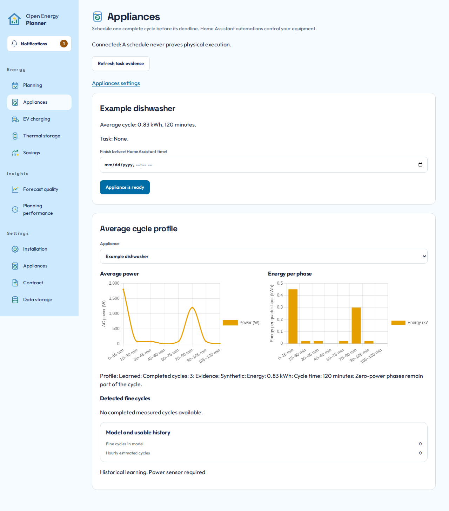

# Appliances and daily requests

Use **Settings > Appliances** to configure what a device is and what OEP may plan. Use its **Energy** page for today's request. Forecasting, scheduling permission and physical execution are separate choices.

## Choose the right category

| Category | Configure | Use each day |
|---|---|---|
| Consumption and cycles | Energy consumer, weather sensitivity, cycle-shifting permission and any manual fallback | **Energy > Appliances** for cycle evidence, readiness and deadline |
| EV charging | Vehicles, charge points, permitted assignments, power limits and charging assumptions | **Energy > EV charging** for sessions, target and departure |
| Electric boilers | Source, temperature/power measurements, tank model and planning permission | **Energy > Thermal storage** for comfort and pause/resume |

Home Assistant Energy owns consumer meters and their relationships. Do not select a total and one of its child meters as independent loads, or reuse the same consumption source for multiple controlled categories. OEP needs a disjoint household boundary to avoid double counting.

## Schedule a complete appliance cycle

1. Configure the appliance's energy and power measurement in Home Assistant Energy.
2. Select it under **Settings > Appliances** and save its forecast membership.
3. Enable complete-cycle shifting only when the appliance can be started through a suitable automation.
4. Inspect its cycle evidence under **Energy > Appliances**. Complete detected cycles establish a learned profile. A manual duration and energy estimate can serve as an explicitly labelled fallback before enough evidence exists.
5. Load and prepare the appliance, choose the finish date/time and explicitly declare it ready.
6. Inspect task status and the proposed start. A deadline alone does not declare readiness or start equipment.

*Cycle energy and duration explain the work being scheduled. The readiness action declares that this loaded appliance may be planned. The pictured values and device are synthetic.*

The planned start is information. Physical execution needs the supported claim-and-feedback automation flow. Missing start confirmation remains uncertain execution rather than permission to retry. **Cancel planning** opens a confirmation before removing future planning authorization. It does not prove that the appliance stopped physically. See the [execution contract and blueprint](../development/SHIFTABLE-APPLIANCES.md#from-dashboard-intent-to-physical-execution) before wiring equipment.

Removing a consumption appliance asks for confirmation and applies the removal
immediately. Its Home Assistant source and history remain available. An open
cycle must be resolved before removal is permitted.

## Prepare EV charging

Add/Edit fetches matching Home Assistant sources on demand, including cars that
are not configured yet. **Refresh Home Assistant sources** updates the choices
without discarding your draft. The same action is available for electric boilers.
If the integration is disconnected, the previous choices and edits remain visible.
Reconnect it and use the action again. Cancel restores the saved configuration.
A refresh stops waiting after about a minute and allows you to retry. If Home
Assistant returns no sources, the page says so and keeps your unsaved inputs.
Check the integration and its exposed sources before refreshing again.

Configure the vehicle's usable battery capacity, SoC source and charging limit separately from the charge point. The point needs its own consumption/power source, connection evidence, allowed vehicles and declared control capability.

When adding a vehicle, choose its **Home Assistant integration**, then its
**Home Assistant device**, then **Vehicle state of charge**. The integration
uses its recognizable Home Assistant name, rather than an account title. If
several accounts or instances belong to that integration, an extra
**Home Assistant integration instance** choice appears before the device.
After choosing the integration, one suitable device or sensor is selected automatically. Multiple
suitable choices require an explicit selection. Nothing is saved until **Save**.
The integration itself always needs your selection when adding a vehicle, even
when only one integration is available.

Only devices with a compatible SoC sensor are offered. Service/API devices and
humidity sensors are excluded. The sensor must report `%`. Its battery device
class may be absent. Helpers without a registered device remain available under
**Sources without a Home Assistant device**. The selected device supplies the
vehicle name, with the configured integration title as fallback when needed.
Changing to another integration, account or device clears an incompatible draft
sensor and selects its replacement only when exactly one suitable sensor remains.
Cancel restores the saved configuration. Refresh retains numeric edits and an
explicit sensor choice.
If a chosen integration, account or device disappears during refresh, its selection
stays visible as unavailable. Refresh again or explicitly choose a replacement.
The vehicle is never silently linked to a different account or car.

When adding a charge point, choose **Charge point** and then select the device
from the shared Home Assistant Energy list. The list shows Energy display names
and supports searching by name or meter ID. The selection supplies both its
consumption meter and the **device power consumption** sensor configured in
Home Assistant Energy. No device-registry or integration choice is required.
Meters without a registered device are included.

The same Energy chooser is used by ordinary appliances and electric boilers.
**Available** shows unassigned devices. **Already added** and **All sources**
show assigned devices as disabled, regardless of their appliance category.
Finish or cancel this choice before editing type-specific details. Cancelling
does not add a device or save settings. To change an assigned device, use its
existing editor. Names never determine whether two sources are the same device.

If Home Assistant has no device power consumption link, choose the power sensor
explicitly. A manual power override is allowed and survives source refresh.
Choosing another Energy meter applies that device's defined power link or clears
the old power choice when there is no link. The physical connection sensor and
vehicle assignment are never inferred. Use **Find connection sensor** to search
compatible sensors and helpers across integrations by device name, sensor name
or entity ID. Refresh updates the Energy list without discarding edits.
A removed meter remains visible as unavailable until you choose a replacement.
It cannot be saved while absent from Home Assistant Energy.
**Vehicle connected** must be On
while physically plugged in, including when charging is paused. Charging-active,
door and fault sensors do not prove a connection. No source is chosen for you.
Save settings only after checking the sources and limits. Cancel restores the
confirmed configuration.

Removing a vehicle or charge point opens a confirmation naming that device and
explaining the retained history. **Cancel** or Escape keeps the configuration
unchanged. Confirming removal stages it in the editor. Choose **Save settings**
to apply it, or **Cancel** in the editor to restore the saved configuration.

A connected plug proves presence, not vehicle identity. Explicitly identify the connected vehicle through the supported Home Assistant control or an automation that genuinely knows it. A previous session's assignment does not authorize a later connection.

Set the desired SoC and departure under **Energy > EV charging**. A one-off departure overrides the daily departure until that instant. Home Assistant's timezone applies. The planner recalculates required energy from the current SoC and reports a shortfall when the target cannot be reached under the admitted limits. V2G is not supported by this charging model.

See [EV charging contracts](../development/EV-CHARGING.md) for supported capability modes, losses, session identity and the automation blueprint.

## Prepare thermal storage

The supported thermal model is a fixed-power resistive electric water heater.
Under **Settings > Appliances > Electric boilers**, choose **Add electric boiler**
and select an available device from the same Energy chooser. Its Energy meter
and configured device power sensor are selected together. Then configure the
temperature measurement, volume, temperatures, standing losses, electrical
heating rating and expected hourly heat draw. A missing power link requires an
explicit power source. Already assigned appliances cannot be added again.

Removing a boiler requires confirmation and then **Save settings**. Cancel in
the dialog keeps it unchanged. Cancel in the editor restores the saved model.

The hourly draw values are assumptions, not measured hot-water use. This model does not implement heat-pump or room-temperature control. A heat pump can still be an individually forecast consumer without becoming an electric boiler.

Use **Energy > Thermal storage** to inspect temperature, proposed heating and any comfort/service shortfall. Daily comfort requests and pause/resume do not replace the saved physical model. Independent hardware protection remains necessary. See [thermal storage contracts](../development/THERMAL-STORAGE.md).

## Check the outcome

After any daily request, confirm the intended device and saved/requested state. A failure must retain your input. An accepted request is not evidence of physical completion. Use the device's real status and the supported execution feedback to establish what happened.

**Next:** [Read your plan](read-your-plan.md), or [understand evaluated savings](savings.md).
