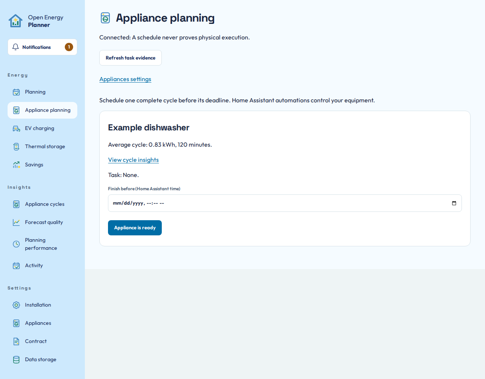
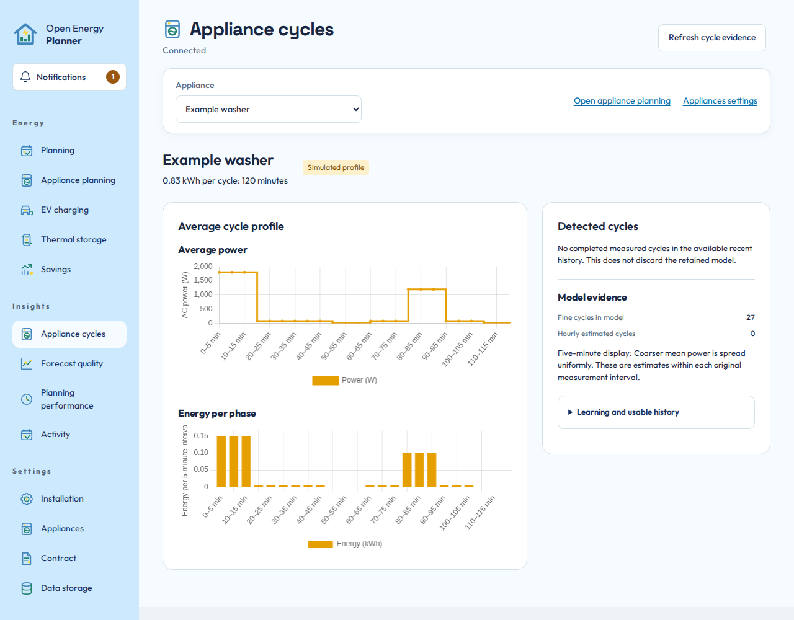

# Appliances and daily requests

Use **Settings > Appliances** to configure what a device is and what OEP may plan. Use its **Energy** page for today's request and **Insights > Appliance cycles** to understand learned cycle behaviour. Forecasting, scheduling permission and physical execution are separate choices.

## Choose the right category

| Category | Configure | Use each day |
|---|---|---|
| Consumption and cycles | Energy consumer, weather sensitivity, cycle-shifting permission and any manual fallback | **Energy > Appliance planning** for readiness, deadline and task status |
| EV charging | Vehicles, charge points, permitted assignments, power limits and charging assumptions | **Energy > EV charging** for sessions, target and departure |
| Thermal | Space heating by area, named hot-water applications, and electric-boiler tank settings | **Energy > Thermal storage** for supported electric-boiler comfort and pause/resume |

Home Assistant Energy owns consumer meters and their relationships. Do not select a total and one of its child meters as independent loads, or reuse the same consumption source for multiple controlled categories. OEP needs a disjoint household boundary to avoid double counting.

## Configure thermal applications

Choose **Thermal > Add application**. Use one Home Assistant area per space heating
application, or enter a name for domestic hot water. A space heating application
can forecast from the Energy consumption meter alone. If you link a climate
entity under **Temperature and target**, the picker lists entities from the
selected area first. A central thermostat can be in another area.

Use **Edit settings** to add or remove heat sources. The space heating picker
starts with devices from the selected area. **Show devices from all areas**
includes a centrally located source, such as an outdoor heat pump. **Save settings**
commits the application and source edits together. Cancel restores saved settings.
Space heating consumption uses outdoor temperature and available recorder history.
Removing a source from an application leaves its ordinary consumption forecast
available under **Consumption and cycles** once it has no remaining thermal binding.

An Energy meter can be linked to several thermal applications and contributes
one electricity forecast. For a shared source, a Home Assistant automation can
use `select.select_option` on its **Reported operating mode** entity. Report
the observed application on changes and refresh the report within five minutes
even when the mode is unchanged. Use **Unknown** when the source cannot be
attributed to one application.
The editor shows unknown consumption when an entire metered hour cannot be
attributed from consistent reports. Attribution covers up to 30 days. If the
source reaches its storage limit, the editor shows totals from the first full
hour supported by the retained reports and displays that starting time. The
meter's full electricity history still contributes to forecasting. Updating the
reported mode never controls physical equipment.

For example, this automation reads an existing heat pump mode on each change
and every three minutes. Replace the example entity IDs, mode values and
application names with those in your installation.

```yaml
alias: Report the shared heat pump mode to OEP
triggers:
  - trigger: state
    entity_id: sensor.heat_pump_mode
  - trigger: time_pattern
    minutes: "/3"
actions:
  - action: select.select_option
    target:
      entity_id: select.heat_pump_reported_operating_mode
    data:
      option: >-
        {{ {'space_heating': 'Living room', 'hot_water': 'Hot water'}
           .get(states('sensor.heat_pump_mode'), 'Unknown') }}
```

**Allow scheduling** records permission per source. For space heating with
permission, enter **Maximum preheating** and select a thermostat. The settings
show the current usable thermostat target, preheating limit and readiness.
Space heating currently runs in forecast-only mode. The app saves your permission
for future scheduling. Existing supported fixed-power electric boilers continue to
use their own thermal plan, volume, limits, measured power and hourly heat draw.

## Schedule a complete appliance cycle

1. Configure the appliance's energy and power measurement in Home Assistant Energy.
2. Select it under **Settings > Appliances** and save its forecast membership.
3. Enable complete-cycle shifting only when the appliance can be started through a suitable automation.
4. Inspect its cycle evidence under **Insights > Appliance cycles**. The first complete detected cycle establishes a provisional profile. Hourly history supplies an initial estimate, refined with available five-minute history. Detected evidence stays saved after Home Assistant removes older fine history. With only hourly data, power is flat within each hour and each five-minute energy bar estimates one twelfth of that hour's consumption. Fine measurements refine that shape without losing the measured total. Profiles with irregular recorded phases preserve their actual durations. A manual duration and energy estimate can serve as an explicitly labelled fallback before enough evidence exists.
5. Open **Energy > Appliance planning**. Load and prepare the appliance, choose the finish date/time and explicitly declare it ready.
6. Inspect task status and the proposed start. A deadline alone does not declare readiness or start equipment.

[](../assets/appliance-request.png)

*Cycle energy and duration explain the work being scheduled. The readiness action declares that this loaded appliance may be planned. The pictured values and device are synthetic.*

The planned start is information. Physical execution needs the supported claim-and-feedback automation flow. Missing start confirmation remains uncertain execution rather than permission to retry. **Cancel planning** opens a confirmation before removing future planning authorization. It does not prove that the appliance stopped physically. See the [execution contract and blueprint](../development/SHIFTABLE-APPLIANCES.md#from-dashboard-intent-to-physical-execution) before wiring equipment.

Removing a consumption appliance asks for confirmation and applies the removal
immediately. Its Home Assistant source and history remain available. An open
cycle must be resolved before removal is permitted.

## Understand learned appliance cycles

Open **Insights > Appliance cycles** and choose an appliance in the toolbar above
the page content. This selection controls both the profile and its history. **View cycle insights**
on its planning card selects that same appliance directly. Followed cycle appliances
remain available here when complete-cycle shifting is disabled. EV and thermal
equipment use their own workspaces.

The selected appliance name, typical energy, duration and profile provenance appear
above the charts. **Average power** and **Energy per phase** describe the retained
planning model. They are stacked on the left on wide screens, with **Detected
cycles** on the right. On smaller screens, cycle history follows the charts.
No recent complete cycle does not mean the existing model has been lost.
The profile status distinguishes historical and manual estimates from a followed
profile. A short note explains any relevant limitation. Open **Learning
and usable history** for model cycle counts, processing progress, import coverage,
recency weights and explanations of the underlying measurements.
These details start collapsed and stay open during refreshes for the same appliance.
Profile limitations and uncertain measured activity remain visible outside them.

[](../assets/appliance-cycles.png)

[View the mobile layout.](../assets/appliance-cycles-mobile.png)

*This synthetic example shows a complete average profile, a running cycle and
eight recent completions. Learning details remain collapsed below the list.*

**Detected cycles** shows the eight most recent completed cycles, newest first.
Each row includes its start, completion, duration and energy without expanding it.
Start and completion each stay on one line. Taller profile charts give the power
and phase energy patterns more room beside the recent cycles.
A detected running cycle appears above the completed cycles with its start time
and energy measured so far. **Cycle in progress** means recent measurements
confirm ongoing activity. **Cycle detected** with **Current state unconfirmed**
means a start was observed, but recent power and energy measurements cannot
confirm whether that cycle is still running or has finished. An interrupted
measurement stream, including a restart during a cycle,
can cause this status even while the appliance continues running. The previously
observed start is retained, and new starts remain blocked until fresh evidence
confirms an idle appliance. Only complete accepted cycles refine the model.
The page refreshes automatically every five
minutes while visible. Live activity can therefore lag by up to five minutes.
The list reflects recent evidence, rather than every cycle ever used to train
the retained model. Limiting the display does not discard saved evidence.

Learning validates source coverage, counter continuity and physical limits.
It does not reject an otherwise valid cycle solely because its duration or
energy differs from previous cycles. Different appliance programs can have
different consumption. Historical statistics cannot establish continuous reporting.

## Prepare EV charging

Add/Edit fetches matching Home Assistant sources on demand, including cars that
are not configured yet. **Refresh Home Assistant sources** updates the choices
without discarding your draft. The same action is available for electric boilers.
If the integration is disconnected, the previous choices and edits remain visible.
Reconnect it and use the action again. Cancel restores the saved configuration.
A refresh stops waiting after about a minute and allows you to retry. If Home
Assistant returns no sources, the page says so and keeps your unsaved inputs.
Check the integration and its exposed sources before refreshing again.

Configure the vehicle's usable battery capacity, SoC source and charging limit separately from the charge point. The point needs its own consumption/power source, connection evidence, allowed vehicles and declared control capability.

When adding a vehicle, choose its **Home Assistant integration**, then its
**Home Assistant device**, then **Vehicle state of charge**. The integration
uses its recognizable Home Assistant name, rather than an account title. If
several accounts or instances belong to that integration, an extra
**Home Assistant integration instance** choice appears before the device.
After choosing the integration, one suitable device or sensor is selected automatically. Multiple
suitable choices require an explicit selection. Nothing is saved until **Save**.
The integration itself always needs your selection when adding a vehicle, even
when only one integration is available.

Only devices with a compatible SoC sensor are offered. Service/API devices and
humidity sensors are excluded. The sensor must report `%`. Its battery device
class may be absent. Helpers without a registered device remain available under
**Sources without a Home Assistant device**. The selected device supplies the
vehicle name, with the configured integration title as fallback when needed.
Changing to another integration, account or device clears an incompatible draft
sensor and selects its replacement only when exactly one suitable sensor remains.
Cancel restores the saved configuration. Refresh retains numeric edits and an
explicit sensor choice.
If a chosen integration, account or device disappears during refresh, its selection
stays visible as unavailable. Refresh again or explicitly choose a replacement.
The vehicle is never silently linked to a different account or car.

When adding a charge point, choose **Charge point** and then select the device
from the shared Home Assistant Energy list. The list shows Energy display names
and supports searching by name or meter ID. The selection supplies both its
consumption meter and the **device power consumption** sensor configured in
Home Assistant Energy. No device-registry or integration choice is required.
Meters without a registered device are included.

If OEP shows **Waiting for the charge-point forecast**, leave the settings as
saved. OEP retries automatically. If the notice persists, check **Consumption
and cycles** for forecast or history issues. If OEP shows **Charge-point meter
missing from Home Assistant Energy**, open **EV charging** settings to identify
the meter, add it to Home Assistant Energy and select **Refresh Home Assistant
sources** in OEP. Planning remains paused while OEP cannot separate the charge
point from household consumption.

The same Energy chooser is used by ordinary appliances and electric boilers.
**Available** shows unassigned devices. **Already added** and **All sources**
show assigned devices as disabled, regardless of their appliance category.
Finish or cancel this choice before editing type-specific details. Cancelling
does not add a device or save settings. To change an assigned device, use its
existing editor. Names never determine whether two sources are the same device.

Removing a charge point or electric boiler takes effect when you choose **Save
settings**. Its source then becomes **Available**, immediately and after reloading.
The settings and its individual forecast membership are saved together. **Cancel**
or a failed save retains both. Other configured appliances, Home Assistant sources
and retained measurement, model and request history are preserved.

If a source remains **Already added** after a removal made with an older version,
open **Settings > Appliances > Consumption and cycles**, select that source and
choose **Remove appliance…**. Confirm the removal, then add the charge point or
boiler again. This releases the leftover ordinary membership without deleting
Home Assistant sources or history. Only remove it if it is not deliberately used
as an ordinary appliance. The app cannot distinguish that deliberate selection
from an old leftover membership, so it does not silently reclaim either one.

The selected Energy device owns both the consumption meter and power sensor.
These fields are read-only. Correct **device power consumption** in Home Assistant
Energy, then refresh sources here. A missing power link must be configured there
before saving. Refresh adopts the configured power link without discarding your
other edits. To use another Energy device, remove the charge point and add the
intended device. Historical evidence remains retained. The physical connection sensor and
vehicle recognition are separate. Use **Find connection sensor** to search
compatible sensors and helpers across integrations by device name, sensor name
or entity ID. Refresh updates the Energy list without discarding edits.
A removed meter remains visible as unavailable until it is restored in Energy.
It cannot be saved while absent from Home Assistant Energy.
**Vehicle connected** must be On
while physically plugged in, including when charging is paused. Charging-active,
door and fault sensors do not prove a connection. No source is chosen for you.
Save settings only after checking the sources and limits. Cancel restores the
confirmed configuration.

**Find connection sensor** is an optional search filter, not another sensor
binding. **Vehicle connected** is the required selection. Helpers without a
registered Home Assistant device can also supply connection evidence. Fresh
discovered choices remain available when the settings page is reloaded.

For a charger that can only start and stop, select **On/off at fixed power**.
The point's maximum is an upper limit, not a required matching car rating.
For example, the same 11 kW point can charge a one-phase car limited to
3.68 kW at 3.68 kW and a three-phase car limited to 11 kW at 11 kW.
Set each vehicle's actual AC limit for the installation under **Vehicles**.
The minimum active power applies only to **Variable power** charging. In that
mode, a vehicle is excluded from planning when its maximum AC power is below the
point's minimum active power. Physical phase/current protection remains in the
charger and your Home Assistant automation.

Removing a vehicle or charge point opens a confirmation naming that device and
explaining the retained history. **Cancel** or Escape keeps the configuration
unchanged. Confirming removal stages it in the editor. Choose **Save settings**
to apply it, or **Cancel** in the editor to restore the saved configuration.

A single allowed vehicle is recognized automatically when plugged in. For several
cars, optionally choose each car's **Vehicle plugged in**, **Vehicle charging**
and **Vehicle location** sources. The app combines fresh signals, planned
expectation and maximum charging power. Location is optional. Exact coordinates
are not sent. A low charging rate does not identify a smaller car. If evidence
cannot distinguish cars, recognition waits and checks automatically as readings
change. The app does not ask you which car is connected.

A recognized arrival without a planned request automatically uses the saved
target and next default departure. Cancellation remains effective for that
connection, including after restarting the app.

If SoC updates stop, the last known measurement remains usable regardless of its
age. Measured charging energy for that car increases the estimate with estimated
charging losses. **Estimated SoC** shows the original measurement time. Driving
since that measurement is unknown, so an old value can overstate the charge and
stop planning too early. A new real SoC measurement corrects it automatically.
Meter resets and unproved energy jumps never add invented charge. A car that has
never supplied a SoC remains unavailable for planning.

Under **Energy > EV charging**, choose **Plan charging request** for the vehicle.
OEP prefills its saved target SoC and next departure. Change either value for this
request, then choose **Plan charging request** to save the complete request.
These overrides never change the vehicle defaults in Appliances settings.
Choose **Edit charging request** to change it or **Cancel charging request** to
stop it. Cancelled, completed and expired requests remain in **Request history**.
If OEP confirms a saved or cancelled request but cannot reload its latest status,
that confirmation remains valid. Use **Refresh charging evidence** to retry the
read. An actual rejected write keeps your edits. The history panel is marked
unavailable if it cannot reload after a saved change. Saved history is retained.
Native Home Assistant requests withhold EV permission while being sent. If a
reply is lost, permission remains withdrawn until current app state is reloaded.
Refresh vehicle status to check the saved request before retrying.
A read that does not finish within thirty seconds stops with recovery advice.
Refresh again when the connection is available. Your pending edits are retained.
If the reply to a write is lost, OEP cannot confirm its outcome. Check the saved
request before explicitly retrying. OEP never automatically repeats that write.

A request is one-off unless you enable **Repeat on selected weekdays** and select
its days. Selecting every day means daily repetition. Each occurrence uses the
same target and HA-local departure time. Completion or expiry creates at most
one following occurrence. Cancelling the current request also stops its repeating
schedule. Configuration alone never creates a request. A recognized arrival can
create one automatic request, while refresh and restart preserve its outcome.

Home Assistant's timezone applies. Nonexistent spring-forward times are rejected
for manual departures. Repeating departures skip that occurrence. The autumn
repeated hour has one scheduled occurrence. The planner recalculates energy from
the latest measured or estimated SoC and reports any shortfall. V2G is not supported.

In **EV settings**, a new vehicle opens **Vehicle basics** first. Connect its
Home Assistant battery sensor and enter the usable capacity and maximum AC
power. The other sections become available once those fields are complete.
You can then save with the default charging preferences. Saved vehicles show
a compact summary of each section. Open one to see its settings.

Under **Charging profile**, choose **Single-phase** or **Three-phase** under
**AC charging phases**. Use the mode the car uses at your
charge point. For each stage, enter the total AC power and the percentage that
reaches the battery. You can add, remove or restore the default stages. The
planner uses this curve to estimate the AC energy needed to reach your target.
Existing cars use their original curve until you select a mode.

See [EV charging contracts](../development/EV-CHARGING.md) for the measurements behind the default profiles, session identity and the automation blueprint.

### EV demand comes from the charging plan

OEP does not repeat historical charging sessions as expected future consumption
for configured charge points. It calculates the remaining battery energy from
the measured SoC, usable capacity and the active request's target SoC. Saved
vehicle target and departure are only defaults for a newly requested charge.
Home Assistant's **Plan charging request** button creates a one-off request with
those defaults. Native target/date/time controls edit that request. The
`open_energy_planner.ev_schedule` and `ev_cancel` actions support automations,
including explicit weekday repetition. See the developer contract for fields.

A fresh connection report, recognized vehicle and last-known or measured SoC are
required for a charging request. Without them, no EV charging is planned. OEP
does not predict the next arrival or invent a charging request from history.
Physical charging still belongs to your Home Assistant automation. Another
controller must follow the OEP plan if its timing is to match the forecast.
Real charging measurements continue to count in actual household consumption.

Once OEP recognizes a newly plugged-in car with energy to charge in the current
plan period, it requests a new plan without waiting for the usual five-minute
window.
Further charging and battery-level changes during that connection follow the
normal planning schedule. Unplugging withdraws Home Assistant's virtual charging
permission immediately. OEP can use the freed capacity in the next normal plan.

The household forecast excludes the configured charge-point components over
the entire horizon, including before charging starts and after departure. If
OEP cannot separate those components reliably, live planning pauses instead of
silently retaining historical EV demand. Check the configured Energy meter links
and consumption forecast readiness when the separation notice appears.

A measured charge-point power difference of at least 500 W lasting one minute
requests a replacement plan, subject to the normal five-minute limit between
early planning requests. OEP requires new measurement reports spanning that
minute. Re-reading an unchanged retained report does not prove that the
deviation continued. This detects unexpected charging and charging that
fails to start even when solar or the home battery masks the grid difference.
Missing power readings do not mean zero consumption. An unchanged deviation
requests one early round rather than a repeated retry. Normal quarter-hour
planning continues, and recovery or a changed session, setpoint or materially
different measured power allows a new deviation request.

The EV session shows recovery advice for sustained deviations. Check the car's
charge limit, charge-point status and Home Assistant automation. OEP cannot
identify the physical cause from power alone and never bypasses device safety.

#### Two cars sharing one charge point

Suppose both cars have a request to finish charging by 07:00 tomorrow. The plan
includes the plugged-in car once OEP recognizes it. OEP may pause and resume
charging while that car stays plugged in. The second car's request waits for
its own recognized connection. The planner does not schedule a switch between
cars or reserve a time for one.

When you unplug the first car and plug in the second, OEP can plan charging once
it recognizes the second car. The new plan uses the time remaining before 07:00
and shows a shortfall if the available time or charging power cannot reach the
target.

## Prepare thermal storage

The supported thermal model is a fixed-power resistive electric water heater.
Under **Settings > Appliances > Thermal**, choose **Add electric boiler**
and select an available device from the same Energy chooser. Its Energy meter
and configured device power sensor are selected together. Then configure the
temperature measurement, volume, temperatures, standing losses, electrical
heating rating and expected hourly heat draw. A missing power link requires an
explicit power source. Already assigned appliances cannot be added again.

Removing a boiler requires confirmation and then **Save settings**. Cancel in
the dialog keeps it unchanged. Cancel in the editor restores the saved model.

The hourly draw values are assumptions, not measured hot-water use. This model does not implement heat-pump or room-temperature control. A heat pump can still be an individually forecast consumer without becoming an electric boiler.

Use **Energy > Thermal storage** to inspect temperature, proposed heating and any comfort/service shortfall. Daily comfort requests and pause/resume do not replace the saved physical model. Independent hardware protection remains necessary. See [thermal storage contracts](../development/THERMAL-STORAGE.md).

## Check the outcome

After any daily request, confirm the intended device and saved/requested state. A failure must retain your input. An accepted request is not evidence of physical completion. Use the device's real status and the supported execution feedback to establish what happened.

**Next:** [Read your plan](read-your-plan.md), or [understand evaluated savings](savings.md).

## Cycle profile reliability

Learning starts with hourly history and available five-minute statistics.
The first complete cycle detected from hourly history gives an immediate
estimate. More cycles refine it. For an hourly estimate, the typical duration
is the lower middle of the detected lengths. The curve uses cycles within an
hour of that duration and preserves their weighted average energy. Longer and
shorter cycles remain in the history.

To detect a cycle, the planner looks for power above 10 W or 5 W above
the estimated standby level, whichever is higher. Standby is estimated
from the lowest tenth of the interval readings. The active period must
have quiet readings before and after it. That means one complete quiet
hour for hourly history or 30 quiet minutes for five-minute statistics.
Shorter pauses can remain inside a cycle. Missing readings and meter
resets interrupt detection.
Five-minute average power supplies the provisional shape, with the cycle's
energy total taken from the energy counter. Coarse counter updates are not
displayed as short power peaks.

Original measurement times refine the profile only after the planner has
continuously followed a complete cycle and its quiet boundaries. Reports may
be at most ten minutes apart. Repeated reports of the same value count as fresh.
A restart, an observation outage or stale reports interrupt this coverage.
Old Recorder history alone cannot prove that identical reports kept arriving.

A curve marked as not continuously followed remains available for inspection.
It cannot replace an existing good profile. Accepted profiles remain stored
after a restart. Once a followed profile is available, later provisional
statistics cannot distort its measured shape or energy.

## Learn one additional cycle profile

In **Appliances settings**, enable **Learn one additional cycle profile** for
an appliance that runs different programs regularly. The setting starts off.
The second profile appears only after two repeated patterns differ in duration
and energy and their early power can distinguish held-out completed cycles.
Until then the appliance uses its existing profile. Hourly estimates give
a starting profile. Recognition requires finer power measurements.

If both profiles are available, choose one when submitting readiness or leave
**Detect after start** selected. Before the start, planning uses the default
profile when no profile is chosen. Choose a profile explicitly when its duration
matters for the deadline. After the start, the planner compares fresh power
measurements with the two saved curves. When the power clearly distinguishes
them, it updates the expected remaining energy and duration. A chosen profile
stays selected. Recognition never starts, stops or confirms physical execution.

## Hand-started cycles

When recent measurements show that you started a cycle yourself, its learned
profile can supply the remaining consumption to the short-term plan at that
measured start time. It cannot be moved to a cheaper period. Expected appliance
consumption is adjusted through the same household balance, avoiding a second
copy of that remaining load.

A measured run never starts hardware or confirms an automation's execution.
Uncertain measurements keep ordinary forecasts and block duplicate starts.
If it interrupts a pending planned task, cancel that task before submitting new
readiness. Fresh quiet measurements clear unresolved measured activity. Physical
started/completed confirmation continues through your execution automation.
