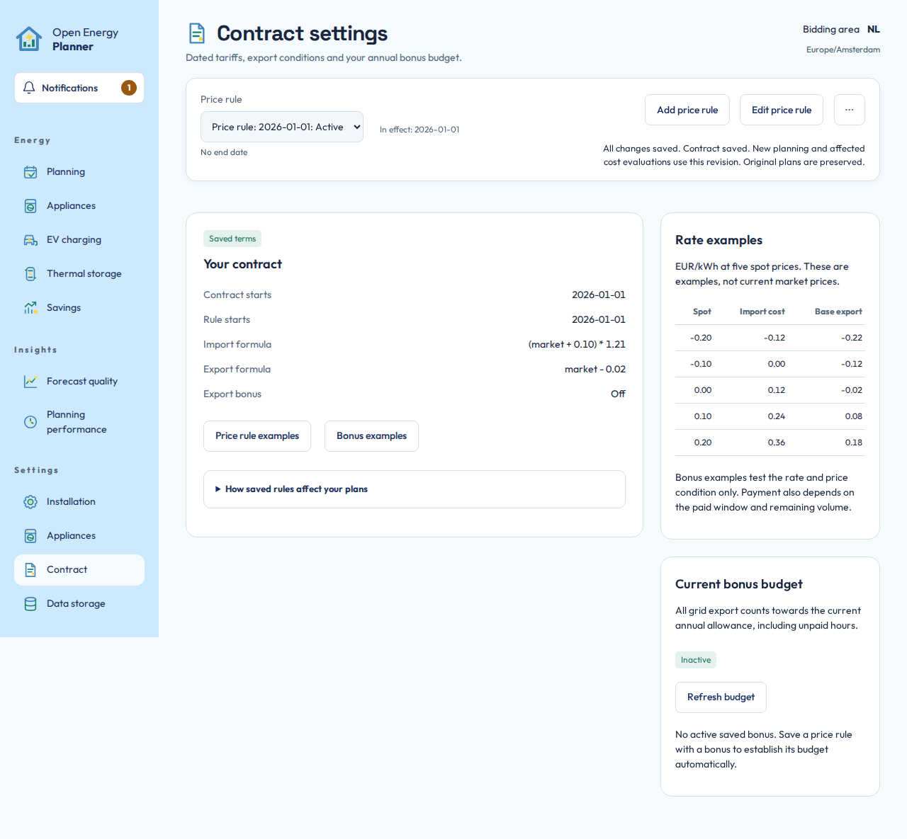

# Contract and prices

Your contract translates market prices into what grid imports cost and exports earn. Price sources supply market evidence. Configure both before interpreting expected costs. This guide describes OEP's supported marginal electricity calculation, not a complete supplier invoice.

## Keep three quantities separate

| Quantity | Meaning | Where to inspect it |
|---|---|---|
| Market price | Published or forecast electricity price before your contract formula | **Planning > Price inputs** |
| Effective import/export rate | Market price evaluated through the applicable dated formula | **Settings > Contract** and the price charts |
| Optional extra export bonus | Additional qualifying revenue with its own conditions and allowance | Contract bonus settings and **Bonus budget** |

Negative prices are valid inputs. An effective export rate can be negative, meaning export costs money for that interval. A favourable import price does not permit fictitious household consumption or charging beyond physical limits.

## Review the effective price rule

1. Open **Settings > Contract** and select the intended rule.
2. Check its start date and whether it is active, scheduled or superseded.
3. Choose **Edit price rule** to change it, or **Add price rule** to create a dated replacement.
4. Enter import and base-export formulas using the supported formula help. Check their units and what is already included.
5. Inspect the server-evaluated examples at negative, zero and positive market prices.
6. Save the contract and wait for confirmation.

*Read the formula together with the rate examples. The bonus is a separate column and must not also be embedded in the base export formula.*

OEP's [formula reference](../development/CONTRACT-PRICES.md#supported-formula-language) defines the actual supported syntax. Use [the worked Dutch contract examples](../development/CONTRACT-EXAMPLES-NL.md) to understand building blocks, then check them against your own contract. Opening an example does not change saved terms. Do not assume that annual netting, tax refunds, subscriptions or investment costs are included.

The Home Assistant timezone governs calendar dates. A future rule does not rewrite the original prices saved with an older plan.

## Add a bonus only when your contract requires it

Keep the base export formula and extra bonus separate. Review qualifying price conditions, allowed hours, annual volume cap and reset date. The **Bonus budget** panel shows the remaining allowance, used volume and opening evidence.

The **Include export bonus** switch and all bonus controls share one bordered panel.
The price condition, battery export protection, annual reset and paid window belong
to that bonus. Base import and export formulas remain outside the panel.
Each supplier tab in **Bonus examples** also explains battery export protection.
The Zonneplan example leaves this choice to your signed terms. The NextEnergy and
Budget Energie examples enable it for their described battery restrictions.

Home Assistant history normally establishes the opening volume. If complete history is missing, use manual confirmation only when the panel offers that recovery. Confirm the amount against the displayed **Opening as of** measurement date. Do not enter today's estimate against an older baseline.

Planned export does not consume the measured annual allowance. OEP evaluates proposed scenarios with separate counters. Changing a rule does not reset actual exported energy or create a new allowance automatically.

### Battery export protection

Enable **Prevent battery export during paid window** when your terms prohibit
using a battery to increase the bonus. During those hours, the planner allows
batteries to cover residual local demand but prevents discharge while the
installation exports. The restriction applies to all installation batteries,
while bonus allowance remains at the start of the planning interval, even at a
zero bonus rate. Once export exhausts the allowance, battery export is allowed
from the next interval. An annual reset or increased cap restores protection.
Your inverter or Home Assistant automation must enforce the same rule using
live measurements. This setting plans the restriction. It does not configure
or verify your physical equipment.

### Budget Energie example

Open **Bonus examples > Budget Energie** for the terms dated 20 October 2026.
Use `market` as the base export formula and
`0.30 * min(max(market, 0), 0.20)` as the separate extra rate. The twelve monthly
clock windows, 5,000 kWh allowance and battery restriction are listed there.
Copy your import formula from your signed terms. No 2027 import tariff is assumed.

For a contract that started on 1 June 2026, keep that **Contract starts** date
and add a price rule starting on 1 January 2027 with the bonus enabled.
The June rule has no bonus. Choose **Contract anniversary** for the annual reset.
The first allowance runs from 1 January to 1 June 2027. The next runs until
1 June 2028. Later versions within the same contract do not reset used volume.
There is no separate date for counting exports. The first bonus date starts it.
Check eligibility and subsequent supplier changes against your own terms.

## Inspect price sources

Open **Settings > Installation > Price sources**. Review source availability and the selected preference for each forecast lead bucket. **Automatic** is a source-selection choice. It does not mean a price forecast is guaranteed correct.

Published prices and forecast prices remain separate. On charts, solid and dotted segments identify the distinction. A source's current status is not proof that its prices cover the whole requested horizon. Missing coverage can shorten or block a plan rather than becoming zero-priced electricity.

If a preferred provider is unavailable, inspect the actual source and fallback shown by the screen. Provider fetching, screen refreshing and planning have separate schedules. Repeatedly refreshing the browser does not bypass provider access limits.

## Check the result

Return to **Planning**. **Price inputs** shows the original prices of the selected latest or historical plan. New market data and saved contract changes do not overwrite those frozen inputs. When no plan is available, the same graph is labelled **Current tariff preview** and uses current cached prices and saved rules. Contract repricing can evaluate the old flows under changed terms, but it does not make that old plan optimal under those terms.

**Next:** [Understand forecasts](forecasts.md), then [read your plan](read-your-plan.md).
