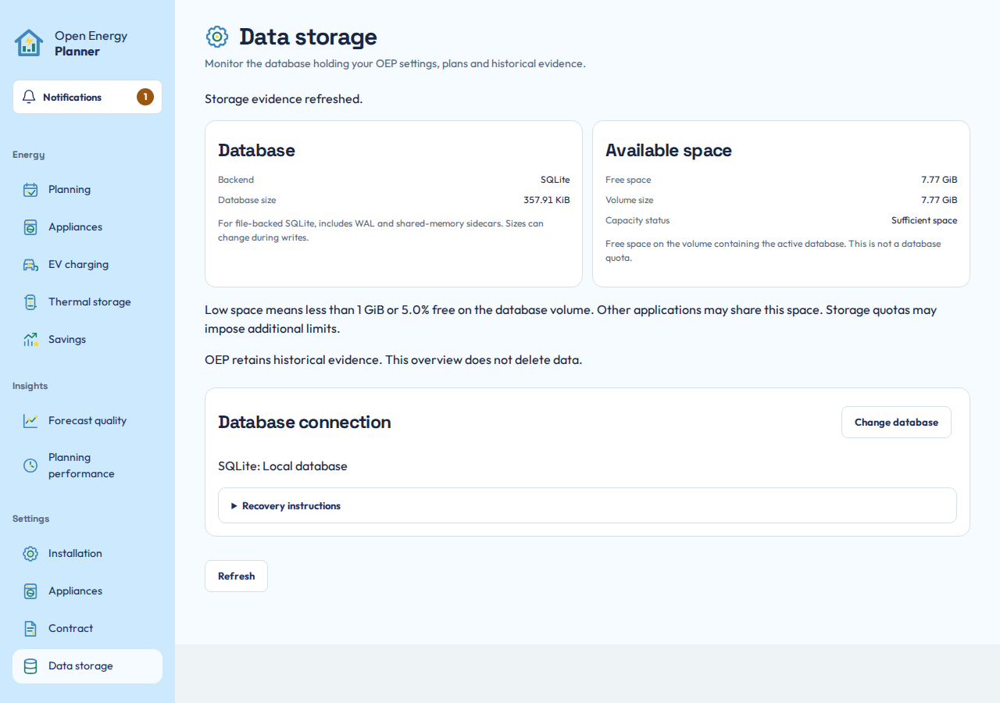

# Data storage and preservation

Open **Settings > Data storage** to inspect the database that holds OEP settings, original plans and retained calculation evidence. This is OEP's storage. It is separate from Home Assistant Recorder.

## Understand what is retained

The active database contains OEP configuration, rules, source/model versions, original plans and historical evaluations. SQLite is the default. PostgreSQL, MariaDB and MySQL are supported alternatives with their own server administration requirements.

Connection credentials and private bootstrap/recovery files remain outside the database. Preserve the complete OEP data directory as well as the active database when planning a backup. A database-only export is not automatically a complete installation backup.

## Inspect capacity

For local SQLite, the page can show database size and available volume space. It warns below 1 GiB or 5.0% free. External database server free space remains unknown. OEP's local free-space figure must not be read as that server's capacity.

*Check the active backend and the measurement scope. Unknown external capacity is not a measured zero and does not establish sufficient space.*

## Change database deliberately

Use this operation only with backups and authority over the destination database. Existing OEP tables at the destination may be replaced after explicit consent. A connection check alone does not start the migration.

1. Choose **Change database**.
2. Supply the intended destination and choose **Test connection**.
3. Review the destination identity and the existing-data warning.
4. Save the offered recovery instructions before starting.
5. Confirm replacement only for the intended destination, choose **Migrate database**, then review and confirm **Change database** in the dialog. Cancel or Escape leaves the migration unstarted.
6. Wait for copy, verification and application restart. Confirm the active database and retained history afterward.

Normal app work pauses while the runtime drains and the archive is copied. Closing a browser tab does not cancel the server-side operation. A temporary loss of HTTP does not prove migration failed.

## Respect the recovery boundary

Before the target is released for normal operation, the screen can offer restoration of the retained source. After release, new writes may exist on the target. Returning to the old source then requires another verified migration rather than changing connection files back.

If interrupted, reopen Data storage and follow its recorded recovery state. Do not delete journals, select an empty archive or manually restore an old connection to bypass the message. For administrator recovery, use [database maintenance and recovery](../development/STORAGE-MIGRATION-UI.md#user-experience-and-recovery).

Database migration transfers OEP tables. It does not move Home Assistant Recorder or operate equipment. Preserved source data is recovery evidence, not permission to run two writable OEP instances against the same installation.

**Next:** [Troubleshooting](troubleshooting.md), or [the technical archive guide](../development/PLAN-ARCHIVE.md).
