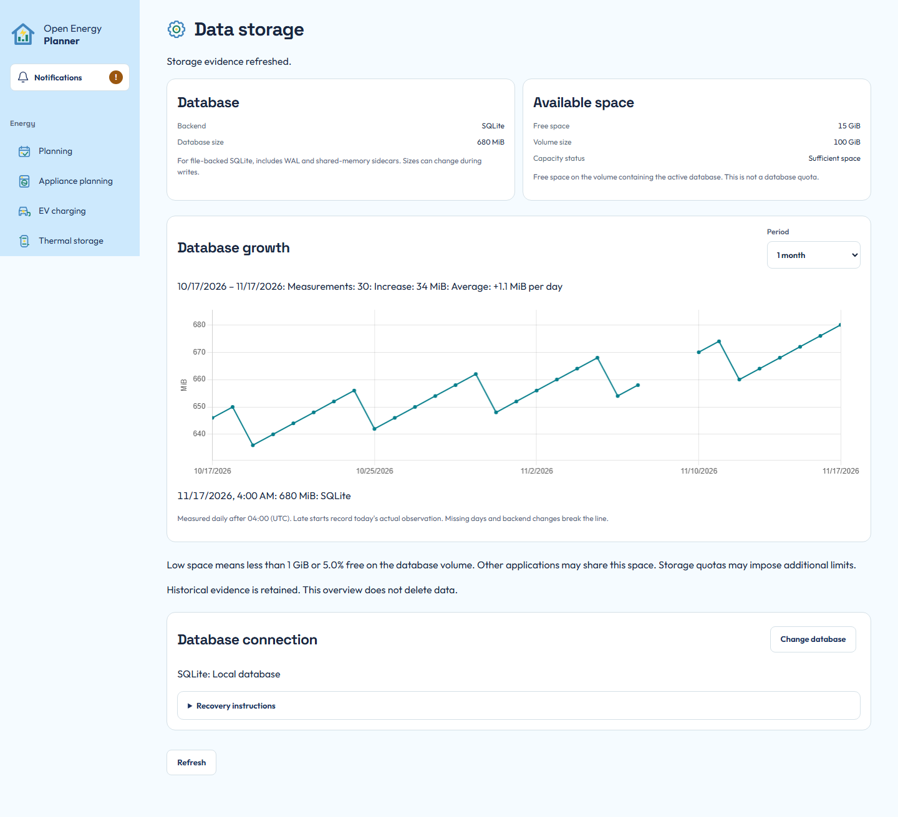
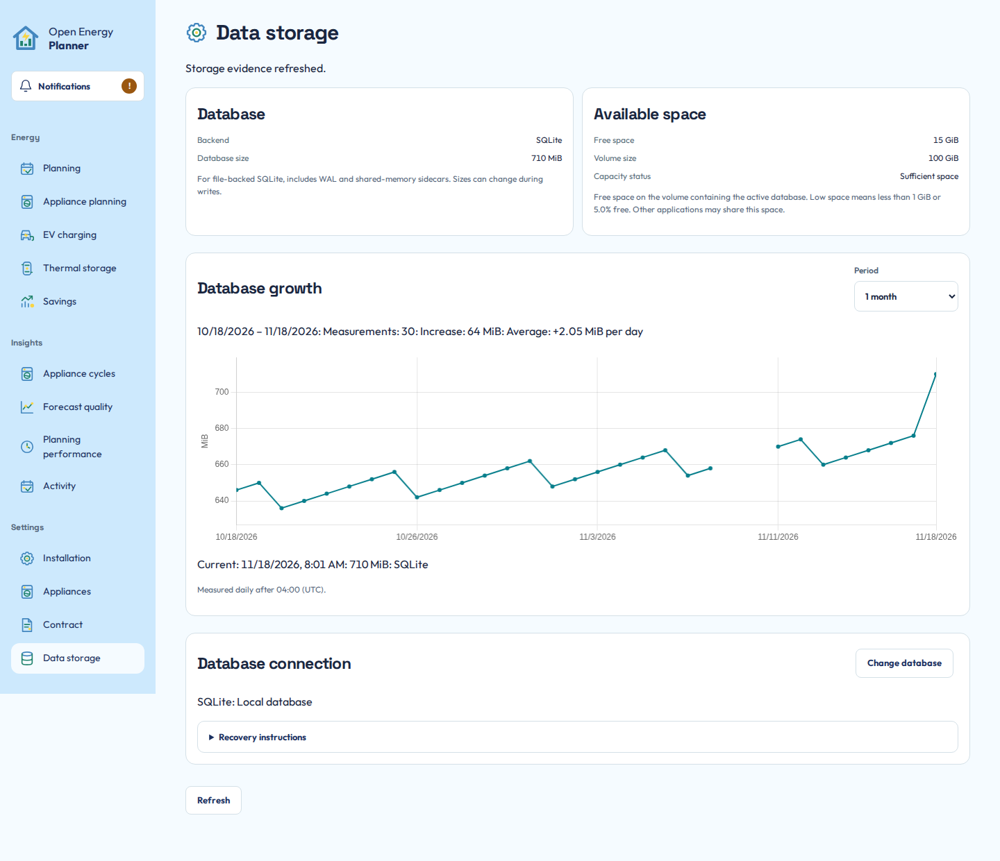

# Data storage and preservation

Open **Settings > Data storage** to inspect the database that holds OEP settings, original plans and retained calculation evidence. This is OEP's storage. It is separate from Home Assistant Recorder.

## Understand what is retained

The active database contains OEP configuration, rules, source/model versions, original plans and historical evaluations. SQLite is the default. PostgreSQL, MariaDB and MySQL are supported alternatives with their own server administration requirements.

Connection credentials and private bootstrap/recovery files remain outside the database. Preserve the complete OEP data directory as well as the active database when planning a backup. A database-only export is not automatically a complete installation backup.

### Plan history and daily Savings

Complete original plans are thinned automatically. The current active plan is always protected.

| Plan age | Complete original plans retained |
| --- | --- |
| Less than 24 hours | All publications, including ad-hoc recalculations |
| 24 hours to 3 days | The first publication in each UTC quarter-hour |
| 3 to 14 days | The first publication in each UTC hour |
| Older than 14 days | The first publication in each Home Assistant local calendar day |

Kept plans preserve their exact original contents. Thinning removes complete versions between those anchors. Separate activation and control evidence remains available, so pruning cannot falsely make an appliance appear uncontrolled in Forecast quality.

[Finalized daily Savings](savings.md#provisional-and-finalized-days) remain independent of full old plans. Temporary measurements and detailed calculation context expire only after their daily report and continuation are safely stored. Configuration, contracts and source/model archives have their own ownership. This policy does not change Home Assistant Recorder retention.

Large stored JSON is compressed without rounding or changing its meaning. Background maintenance handles existing records in small restartable batches. SQLite can reuse freed pages without reducing its displayed file size. A smaller live dataset therefore does not guarantee an immediate smaller database file. No blocking automatic file compaction is performed.

Keep a consistent backup before upgrading or downgrading. Older app versions cannot read the new compressed representation. Restoring the complete matching app/database backup is the rollback route. Expired original plan versions and temporary quarters cannot be recovered from compact daily totals.

## Inspect capacity

For local SQLite, the page can show database size and available volume space. It warns below 1 GiB or 5.0% free. External database server free space remains unknown. OEP's local free-space figure must not be read as that server's capacity.

[View the mobile Data storage screen.](../assets/data-storage-mobile.png)

*Check the active backend and the measurement scope. Unknown external capacity is not a measured zero and does not establish sufficient space.*

## Follow database growth

**Database growth** shows daily database size, with **1 month** selected by default.
On opening the page, the **Database size** card and graph show the saved daily
observations. The card uses the latest saved observation, including its backend
and estimation status. If it is older than the selected period, widen the period
to inspect that point. Without a saved observation the size is **Unknown**.
**Available space** still shows current volume capacity.

Choose **Refresh** to show the current database size in both the card and the
graph. That point is marked **Current**. The live view remains while changing
periods. Opening the page again returns to the saved daily view. Refresh never
overwrites or adds a saved daily observation.

Use **Period** to choose one week, three months, one year or all retained history.
The summary shows the change between the first and last available observation
and the average change per elapsed day. A decrease can reflect database
maintenance. It is not a prediction of when storage will run out.

The app records one measurement each day after **04:00 in the Home Assistant
installation timezone**, checked every minute. No browser page needs to be open.
Collection and the history window wait until the installation timezone is available. If the app starts
later, it records the current day at the actual observation time. Days while the
app was stopped remain gaps. After Refresh, today's live point can appear before the first
scheduled observation. Two available points are needed to calculate growth.

Hover a point or focus the chart and use the Left and Right arrow keys to inspect
its timestamp, size, backend and estimation status. Home and End reach the first
and last retained observation in the selected period. Unknown size never becomes
zero. When every size is unavailable, use **Observation** to inspect the recorded
timestamps, backends and estimation status. Refresh updates the view without
creating another daily point.

Measurements use the same scope as the capacity cards. SQLite includes WAL and
shared-memory sidecars, so file activity can change the total even when the
retained dataset shrinks. MariaDB and MySQL sizes are estimates. History moves
with the database when using **Change database**. Lines stop at a backend change
and growth is not compared across different backends.

## Change database deliberately

Use this operation only with backups and authority over the destination database. Existing OEP tables at the destination may be replaced after explicit consent. A connection check alone does not start the migration.

1. Choose **Change database**.
2. Supply the intended destination and choose **Test connection**.
3. Review the destination identity and the existing-data warning.
4. Save the offered recovery instructions before starting.
5. Confirm replacement only for the intended destination, choose **Migrate database**, then review and confirm **Change database** in the dialog. Cancel or Escape leaves the migration unstarted.
6. Wait for copy, verification and application restart. Confirm the active database and retained history afterward.

Normal app work pauses while the runtime drains and the archive is copied. Closing a browser tab does not cancel the server-side operation. A temporary loss of HTTP does not prove migration failed.

## Respect the recovery boundary

Before the target is released for normal operation, the screen can offer restoration of the retained source. After release, new writes may exist on the target. Returning to the old source then requires another verified migration rather than changing connection files back.

If interrupted, reopen Data storage and follow its recorded recovery state. Do not delete journals, select an empty archive or manually restore an old connection to bypass the message. For administrator recovery, use [database maintenance and recovery](../development/STORAGE-MIGRATION-UI.md#user-experience-and-recovery).

Database migration transfers OEP tables. It does not move Home Assistant Recorder or operate equipment. Preserved source data is recovery evidence, not permission to run two writable OEP instances against the same installation.

**Next:** [Troubleshooting](troubleshooting.md), or [the technical archive guide](../development/PLAN-ARCHIVE.md).
