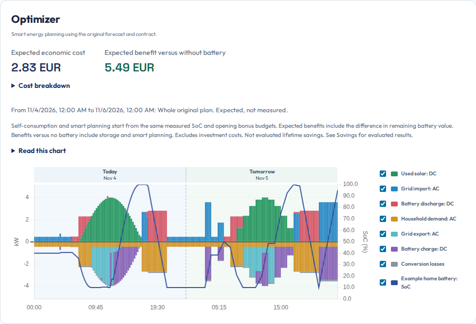

# Try your first plan

Run the actual planner with synthetic inputs on your computer. This route does not connect Home Assistant, change your installation or operate physical devices.

## Get the development preview

You need repository access, Git, Python 3.12 or later, and a terminal. If you already have a checkout, open a terminal at its root and skip the clone.

```console
git clone https://github.com/patrickvorgers/open-energy-planner.git
cd open-energy-planner
python -m venv .venv
```

Activate that environment. On Windows PowerShell:

```powershell
.venv\Scripts\Activate.ps1
```

On Linux or macOS:

```sh
. .venv/bin/activate
```

Install the pinned runtime and the local package without resolving its dependencies again:

```console
python -m pip install -r requirements.lock
python -m pip install --no-deps -e .
```

**Check:** installation finishes without an error. If cloning fails, check the public repository URL and your network access. If a native package has no compatible wheel, stop and use the [isolated developer environment](home-assistant.md). Do not change dependency versions to make the command pass.

## Start without Home Assistant

In the same terminal, run:

```console
python -m open_energy_planner.app --demo --host 127.0.0.1 --port 18765 --data .local/first-plan
```

Keep the terminal open. The app writes its demo database and its generated administration token only under `.local/first-plan`. Later starts with that directory reuse those local records. No external price or weather provider is requested by this command.

**Check:** the terminal reports that Open Energy Planner started. If the port is occupied, stop your own earlier demo or choose another unused port and use that port in the browser URL too.

## Open Planning

Open [the local Planning page](http://127.0.0.1:18765/overview#planning). Use this direct URL for the demo. The installation wizard requires Home Assistant mode and is not part of this route.

Open `.local/first-plan/administration-token` in a local text editor. Paste its contents into **Installation API token**, then choose **Connect**. This token grants access to this local app. Keep it out of screenshots, chat messages, Git and URLs. The standalone page holds it only until the page closes.

**Check:** the page shows **Connected: Historical views never change active commands.** If it does not, verify that you used the token from the directory belonging to this running app. If a token was already supplied through `OEP_API_TOKEN`, that environment value takes precedence over the generated file.

## Recognize the first result

Wait for the first calculation, then choose **Refresh overview**. Under **Original plan**, expect a planning window, a plan version and a generated timestamp. The synthetic demo normally shows **Status: Optimal** and a 48-hour planning window.

Start with the **Optimizer** chart, followed by **Battery self-consumption** and **Without battery: Baseline**. Use **Next 6 hours**, **Next 24 hours** and **Full horizon** to inspect the same plan at different scales. Tap or hover over the chart to read an interval.

[](../assets/planning-example.png)

The screenshot uses a richer synthetic teaching scenario with solar and household variation. The basic command-line demo is deliberately smaller: its first quarters illustrate charging cheaply and exporting later, with little activity afterward. Different synthetic input does not mean your installation is misconfigured.

**First success:** an original plan has a version and timestamp, the planned balance contains values, and changing the displayed horizon works. This establishes that the local planner and browser view work with synthetic inputs. It does not establish that your own installation is configured or that physical energy flowed as proposed.

If **No plan available** remains, use [the missing-plan checks](troubleshooting.md#no-plan-available). Do not fill missing measurements with zero to hide a warning.

## Stop and continue

Press Ctrl+C in the terminal to stop the demo. Your local demo records remain in `.local/first-plan`. Restart with the same command when needed. Nothing was installed into Home Assistant.

Continue with [reading the plan](read-your-plan.md). To explore the actual setup wizard, follow [Connect Home Assistant](home-assistant.md).
