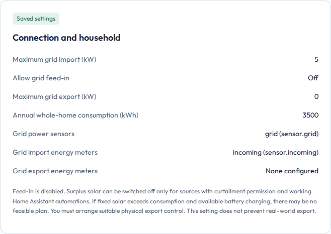
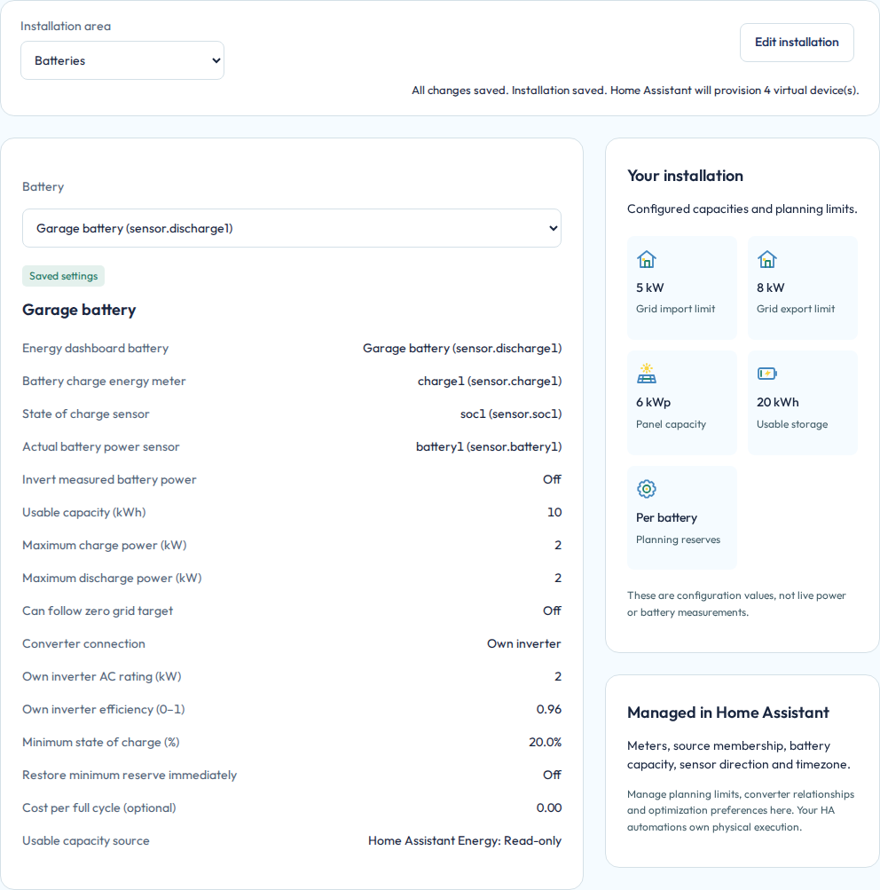
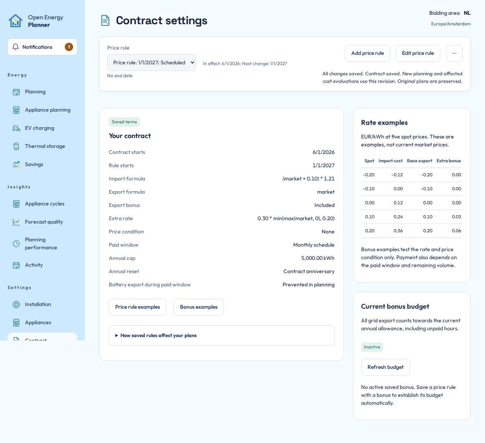
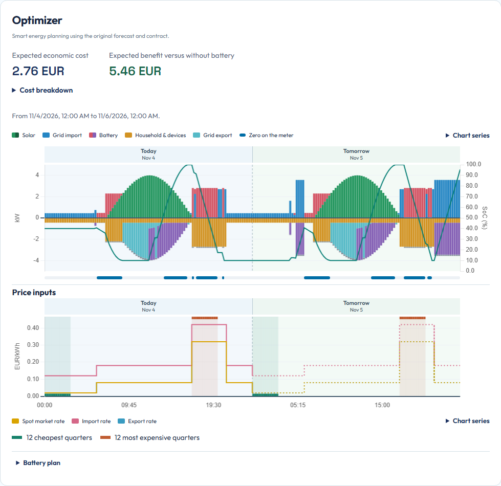

# Set up your first plan

Follow this route to install OEP, reuse your Home Assistant Energy configuration and obtain a plan for your own installation. You do not need a development environment or a Python demo to configure an installed app.

## 1. Install and open the matched app and integration

OEP targets Home Assistant 2026.11 or newer. Follow [Install OEP](install.md) to
add the custom Marketplace repository, install the integration and install the
matching planner through the separate app repository on AMD64 Home Assistant OS.
Both require a published tested release. Check availability in that guide before
continuing. A source checkout or an integration without its matching app cannot
replace this installation.

Once installed, start the app and open its Home Assistant ingress entry. Supervisor connects the components automatically. This route does not require copying an app token or a server address. A standalone deployment has its own [explicit pairing procedure](home-assistant.md#open-the-app).

**Check:** the app opens and the matching integration is connected. A token prompt inside trusted ingress is a connection problem to investigate.

## 2. Check the Home Assistant stage

Open **Settings > Installation**. An incomplete installation opens the five-stage wizard. An existing complete installation opens saved summaries instead. Choose **Edit installation** only for the values you need to change.

The **Home Assistant** stage reuses the sources you already selected in **Home Assistant Settings > Dashboards > Energy**. Check the detected grid import/export channels, each solar source and each battery. Review current readings and the available household history. If something is missing, correct its Energy configuration and use **Refresh Home Assistant data**. Do not recreate those meter identities in OEP.

Solar and batteries are optional. A source can be detected before its readings or history are ready. [Before you start](before-you-start.md#prepare-home-assistant-energy) explains energy counters, power directions and avoiding overlapping meters.

**Check:** the listed sources represent your installation, with no duplicated totals or missing required readings.

## 3. Confirm connection and household

| Field | What to enter or confirm |
|---|---|
| **Maximum grid import (kW)** | The permitted aggregate import limit for the whole connection. This is power, not annual energy. |
| **Allow grid feed-in** | Whether the plan may export. Disabling it stores a zero export limit. |
| **Maximum grid export (kW)** | Your permitted export limit when feed-in is allowed. It can differ from import. |
| **Annual whole-home consumption (kWh)** | Check the estimate from common complete meter history. If history is insufficient, confirm your own annual household estimate. |

*This synthetic example disables feed-in. It illustrates the fields, not recommended connection limits. Annual household use includes normal background consumption.*

Do not copy the screenshot's limits. With zero export, fixed solar surplus can make a plan impossible when consumption and storage cannot absorb it. [Connection settings](installation.md#connection-and-household) explains the physical assumptions.

**Check:** you have confirmed the permitted import/export limits and a credible household scale. Missing history has not become zero consumption.

## 4. Review solar production

For each detected production source, confirm its inverter relationship, capacity and panel geometry. **Tilt (°)** is panel inclination. **Azimuth (° clockwise from north)** describes direction. Use the actual array rather than assuming every roof faces south.

When Energy links supported Forecast.Solar panel metadata, the panel groups are read-only in OEP. Confirm them at their Home Assistant owner. Without that link, enter the required geometry in the app. Sources sharing a hybrid or standalone inverter share its physical capacity. Do not assign that capacity independently to every array.

Allow curtailment only when your own automation can switch that source. Price conditions alone do not create a physical control capability. Skip solar when none is installed.

**Check:** every solar source has the correct production boundary and physical relationship. See [Solar production](installation.md#solar-production) and [solar forecasts](forecasts.md#solar-production) for details.

## 5. Review batteries and save the installation

For each battery, confirm the Energy-owned usable capacity, SoC and power sources. Correct missing source configuration in Energy. In OEP, confirm charge/discharge power limits, reserve, conversion losses and its standalone or shared inverter connection. Optional wear cost and periodic calibration need your own deliberate values. Skip this stage if you have no battery.

*These synthetic ratings describe one example. A planning reserve does not replace your battery's protection settings.*

Inspect the final **Review** stage and choose **Save installation**. Advancing wizard stages does not save the complete installation. Wait for confirmation, then check the saved summary. Under **Planning strategy**, confirm **Minimize cost** or **Minimize consumption**. [Compare the goals](how-oep-works.md#choose-the-optimization-goal) before changing the default.

**Check:** the saved sources, topology, limits and goal match your intent.

## 6. Enter your contract and check price sources

Open **Settings > Contract**. Add or edit the applicable dated price rule. Enter the import and base-export formulas from your contract, check the evaluated examples and save. Keep an extra export bonus separate from the base export formula.

*Inspect negative, zero and positive market-price examples before saving. This is synthetic teaching data, not a supplier offer.*

If your contract includes a bonus, confirm eligibility, paid hours, volume allowance, reset date and any battery-export restriction. Check the opening-counter evidence. The [contract guide](contract.md) explains the supplied examples and recovery for incomplete history.

Under **Settings > Installation > Price sources**, check source availability and preference. Market prices and your effective contract rates are separate inputs.

**Check:** the rule's effective date covers the first plan, the formulas have the intended units and price coverage is available.

## 7. Add optional appliances

A first plan does not require every appliance to be configured. Add the equipment you want to follow under **Settings > Appliances**. Reuse detected Home Assistant devices and measurements, then confirm their physical capabilities and planning permissions.

Following consumption or enabling weather-sensitive prediction does not grant control permission. A cycle deadline or EV departure belongs on the relevant **Energy** page after setup. See [Appliances and requests](appliances.md).

## 8. Recognize your first plan

Open **Energy > Planning** and wait for the original plan. Confirm its generated time, version, selected strategy and expected installation sources. Check current warnings before interpreting the chart. Providers and usable input coverage can shorten the target 48-hour horizon. Missing live inputs are not silently replaced with demo values.

*Look for solar production, household demand and battery charging/discharging in the same balance. Your own plan will reflect your meters, forecasts and contract.*

**First success:** a current original plan is available with the intended inputs and strategy. Compare **Optimizer**, **Battery self-consumption** and **Without battery: Baseline**, then follow [Read your plan](read-your-plan.md). Predicted benefit is separate from [evaluated savings](savings.md).

If no plan appears, use the [missing-plan checks](troubleshooting.md#no-plan-available) and the named recovery action. Do not hide a missing sensor with zero. Historical measurements can improve forecasts over time, but sufficient history is not required for every startup estimate.

Physical operation is a separate step. OEP publishes virtual advice. Your own Home Assistant automations and controllers must implement it and enforce equipment protections. See [virtual-device sensors](virtual-device-sensors.md) before connecting those actions.

## Optional: explore separately

Use the [standalone demo](demo.md) only if you want to explore synthetic plans without Home Assistant. The [persistent laboratory](../development/USER-TEST-ENVIRONMENT.md) provides simulated Home Assistant devices for integration testing. Neither is a prerequisite for the installation route above.
