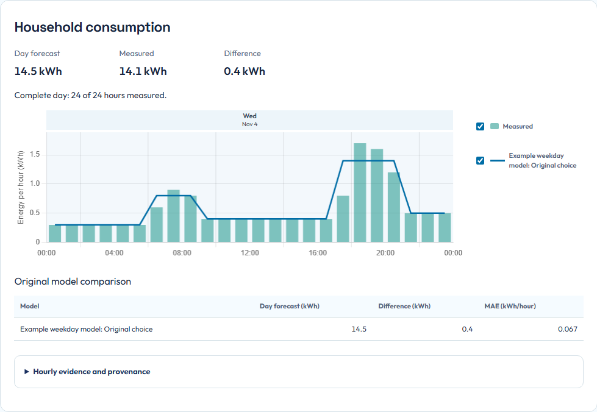

# Understand forecasts

OEP needs an expectation of household use, solar production and prices before it can plan. A forecast is an input to a decision. It is not a measurement, and a more detailed model is not automatically a better one.

## Household consumption

The household forecast starts from the configured energy boundary. Without sufficient usable history, an annual consumption estimate scales a provisional daily pattern. As suitable history becomes available, OEP can use weekday/hour patterns and evaluate a learned candidate.

The startup estimate includes the household's normal background use. There is no separate baseload value to add again. Selecting individual consumers can explain parts of the household total, but their consumption must not be counted a second time.

If a heat pump or another consumer is weather-sensitive, select that option under **Settings > Appliances** when appropriate. Weather sensitivity affects prediction. It does not authorize temperature control or cycle scheduling.

Unreliable history can be excluded from training without changing Home Assistant Recorder. Too little usable history keeps a simpler model available. A notification about substantial excluded history calls for checking overlapping or incorrectly signed Energy sources, not editing recorded values to match a prediction.

## Solar production

Solar forecasts combine the configured arrays, their orientation and tilt, inverter limits and weather inputs. Review these under **Settings > Installation > Solar production**.

When Home Assistant Energy links supported Forecast.Solar panel metadata to the production meter, those panel groups are read-only in OEP. The link supplies geometry, not automatic permission to change the physical inverter's rating. With a confirmed absent link, manual geometry can be edited. A temporary discovery failure must not be mistaken for removal of that ownership.

Available solar DC energy and measured inverter AC production are different quantities. Conversion losses, clipping, curtailment and hybrid battery flows can prevent a direct comparison. Do not infer forecast failure from two values that use different measurement boundaries.

## Read Forecast quality

Open **Insights > Forecast quality** and choose a day above the **Household**,
**Solar** and **Devices** tabs. The same day applies to all three views. Solar and
Devices each show one selected source at a time. The page compares the original
midnight forecast with received hourly measurements for that same Home Assistant
calendar day. Measured energy uses fill-only bars. The originally selected model
uses a solid line and retained same-issue alternatives use dashed or dotted lines.
The comparison table keeps the original choice separate from later model status.

*The prediction and measurement can have similar daily totals while differing around an evening peak. The chart makes that timing difference visible. These are synthetic teaching values, not measured forecast performance.*

Read the daily prediction, measured total and difference first. Then inspect the hourly chart. Missing measurements remain gaps. A running or incomplete day must not be interpreted as a scored full day. Clock-change days have their actual 23 or 25 hours.

Expand the metrics when you need them:

| Metric | What it helps you notice |
|---|---|
| Daily difference | Whether the predicted total was above or below the measured total |
| MAE | The average size of an hourly error, without positive and negative errors cancelling |
| Bias | Whether hourly predictions tend to be too high or too low |
| WAPE | Total absolute hourly error relative to measured energy, exposing timing errors hidden by daily totals |

A zero measured total has no meaningful relative percentage. Controlled appliance timing and some solar measurement boundaries can make an accuracy comparison ineligible even when values remain visible. Read the exclusion reason before comparing models.

## Compare irradiance separately

For Solar, optionally enable **Forecast irradiance** and **Satellite estimate**.
These use the right-hand W/m² axis, separate from production in kWh. Forecast
irradiance comes from the weather retained with the original prediction.
Satellite irradiance estimates sunlight from satellite observations. It is not
a sensor on your roof. The named DWD / EUMETSAT MTG source has approximately
20 minutes of provider delay and historical coverage from February 2026.
Actual availability depends on the response. Older or missing data stays unavailable.

**Satellite data complete through** identifies the last uninterrupted hour from
the selected day's start. A gap stops that marker even if later hours exist.
**Last fetched** only indicates when the app retrieved the observations.
Missing satellite hours do not affect the separate evaluation against measured
solar production. **Refresh evidence** retrieves newer observations without
replacing the original forecast. A failed satellite refresh retains available
observations with an explicit warning.

## Separate historical accuracy from the current model

**Current model and learning** describes the model available now. The chart retains the model that produced the selected day's midnight prediction. Refreshing evidence updates measurements and current readiness, not that original forecast.

Automatic model selection uses its own chronological comparison of simulated decisions. A lower descriptive prediction error alone does not activate a candidate. Simulated decision costs are not measured savings. For actual metering and retrospective evaluation, use [Savings](savings.md).

If a source or day is unavailable, check its specific reason in the page and [troubleshooting](troubleshooting.md). Developer details remain in [demand forecasting](../development/DEMAND-FORECASTING.md), [solar forecasting](../development/SOLAR-FORECASTING.md), [model selection](../development/MODEL-SELECTION.md) and [forecast quality contracts](../development/FORECAST-QUALITY.md).

**Next:** [Read your plan](read-your-plan.md).
