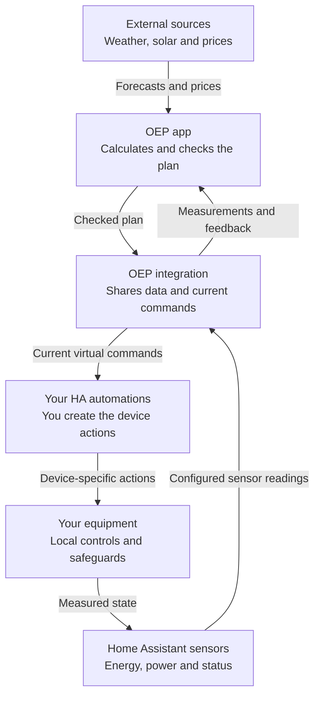

# How OEP works

OEP proposes when your installation should use, store, import or export electricity. It combines what is measured now with forecasts, your contract and the limits you confirmed. A plan describes the model's expected outcome. It is not a record of physical execution.

## See how the parts work together

The app calculates the plan. The Home Assistant integration makes its current
instructions available. Your own automations connect those instructions to your
equipment. Installing the app and integration alone does not operate your devices.

The arrows show information and commands, not electrical connections. Depending
on the configured provider, external data reaches the app directly or through
Home Assistant. The diagram groups those routes to keep the responsibilities clear.

| Part | What it does |
|---|---|
| **OEP app** | Combines measurements, forecasts, your contract and settings. Calculates and independently checks a plan, and displays planning and savings. |
| **OEP integration** | Sends configured Home Assistant measurements to the app, retrieves the plan and exposes the currently applicable virtual commands as entities and events. It does not run the optimizer. |
| **Your automations** | Translate virtual commands into the actions supported by your equipment. You create and maintain these automations or your own controller. |
| **Equipment and local controllers** | Carry out supported actions and retain their manufacturer and electrical safeguards. |
| **External sources** | Supply the weather, solar forecasts and prices selected for your installation. Their availability affects the inputs available for planning. |

For example, the app may plan battery charging during a cheaper period. The
integration exposes the applicable charging target at that time. Your automation
reads it and calls the supported action on your battery system. Later sensor
readings show what the equipment actually did. Publishing or receiving a command
alone does not prove that charging happened.

Start with the [virtual-device sensor reference](virtual-device-sensors.md) to
choose the signals for your automation. Follow [Keep control separate](home-assistant.md#keep-control-separate)
for the control boundary and [appliance guidance](appliances.md) for supported
readiness and execution feedback. Preserve local safety controls and handle
unavailable or expired instructions before connecting physical equipment.

## Follow one planning round

Planning opens before optional notifications and scenario comparisons finish.
The Optimizer appears as soon as its original plan is available. Collapsed
interval tables load when opened. Savings loads when you open that page, so its
financial history does not delay Planning. Public interface files are reused
from the browser cache and receive new addresses when the software changes.

1. **Measure the starting point.** Home Assistant supplies the configured Energy sources, current battery state and other required measurements.
2. **Look ahead.** Household demand, solar production and electricity prices describe the expected future. Published prices and predicted prices remain distinguishable.
3. **Apply your settings.** OEP uses the installation topology, equipment limits, contract dates, conversion losses and enabled planning permissions.
4. **Calculate and check.** The optimizer proposes a complete schedule. Independent arithmetic checks its energy balances, limits and costs before the app accepts it.
5. **Publish advice.** The integration exposes applicable virtual commands. Your Home Assistant automations and local controllers decide how to operate equipment.
6. **Compare with measurements.** Later observations inform new plans, forecast-quality comparisons and evaluated savings. They do not rewrite the original prediction.

The app performs the calculations. The Home Assistant integration exchanges data and exposes virtual devices. OEP does not need direct access to the Home Assistant database, and the integration does not run the native optimizer.

## Understand the installation boundary

The grid connection joins household demand, solar inverters, batteries and supported appliances. OEP models each battery separately. A shared hybrid inverter differs from separate solar and battery inverters because direct DC charging can avoid an AC conversion round trip.

| Input | Why OEP needs it | Where you check it |
|---|---|---|
| Energy sources and current readings | Establish what exists and the current physical state | Home Assistant Energy, then **Settings > Installation** |
| Equipment ratings and connections | Keep the proposed flows within modeled limits | **Settings > Installation** |
| Household and solar forecasts | Estimate demand and production before making decisions | Installation and appliance settings, then **Insights > Forecast quality** |
| Market prices and contract formulas | Translate electricity flows into expected cost | **Settings > Installation > Price sources** and **Settings > Contract** |
| Appliance permissions and requests | State what may be planned and what needs to be ready | **Settings > Appliances**, then the relevant **Energy** page |

Home Assistant Energy owns meter membership. OEP owns its planning settings. Selecting a source for forecasting does not give OEP permission to control it.

## Choose the optimization goal

The default **Minimize cost** goal minimizes expected economic cost, including effective electricity rates, configured battery wear and the change in stored-energy value.

**Minimize consumption** prioritizes grid import, including a correction for depleted starting battery stock, and then chooses the cheapest result among equally good import results. Export does not cancel import in this objective. The stock correction prevents an empty battery at the end from looking like free energy savings. It is accounting, not a command to refill the battery.

Mandatory reserve recovery and supported appliance service priorities can take precedence over either goal. A lower bill is therefore not the only condition a valid plan must satisfy. See [installation settings](installation.md#choose-the-planning-strategy) for changing the goal and [the technical strategy contract](../development/CONSUMPTION-STRATEGY.md) for the exact priorities.

## Distinguish the three planning scenarios

| Scenario on Planning | Question it answers |
|---|---|
| **Optimizer** | What does the chosen OEP strategy propose under the original inputs? |
| **Battery self-consumption** | What would the same batteries do by storing solar surplus and covering demand without price optimization? |
| **Without battery: Baseline** | What would the same household and solar forecasts cost without battery storage? |

Devices with **Allow shifting complete cycles** disabled retain the same forecast
consumption in every scenario, including weather-sensitive heat pumps and air
conditioners. Weather dependence does not grant shifting permission. Only an
explicit ready cycle, EV charging request or controllable thermal store can
receive a different reference timeline. A physically started appliance cycle
keeps its fixed start in every scenario.

Both battery scenarios compare their expected benefit with the same without-battery baseline. For new plans, the references charge vehicles as soon as permitted, start ready cycles at their earliest allowed time and maintain heating targets without price optimization. They retain the same service needs and physical limits. A reference that cannot provide comparable service has no monetary benefit. Earlier archived plans retain their original comparison policy. Historical Savings remains a separate measured battery-only comparison.

## Keep time and uncertainty in view

The target planning horizon is 48 hours when the required inputs cover it. Missing coverage can shorten it. The optimizer chooses a power setting for each quarter-hour across both days. The charts show energy balances in quarter-hour bars. Tariff and bonus changes within a quarter still apply at their exact times.

Home Assistant supplies the installation timezone. Calendar days can contain 23 or 25 hours around daylight-saving changes. Original timestamps, input versions and forecasts stay with each saved plan.

OEP replans as time moves and meaningful inputs change. A new calculation can fail while an older plan remains visible in history. That visibility does not extend its command lifetime. Missing measurements remain unknown rather than becoming zero. Notifications identify the affected source and the next recovery action.

Each calculation uses a fixed snapshot. Normal measurement changes do not restart a
usable calculation. Meaningful deviations are queued for a later round with the newest
inputs. Automatic rounds stay at least five minutes apart, including quarter transitions
and publication retries. Explicit requests, configuration changes and recovery of missing
required inputs can start sooner. Before publication, current measurements must still
support the remaining battery and EV commands until their expiry. A disconnected vehicle,
expired input or infeasible remaining command can therefore still prevent publication.

**Next:** [Prepare your installation](before-you-start.md), or [read a complete plan](read-your-plan.md).
