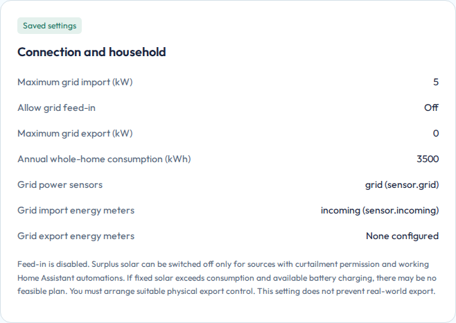
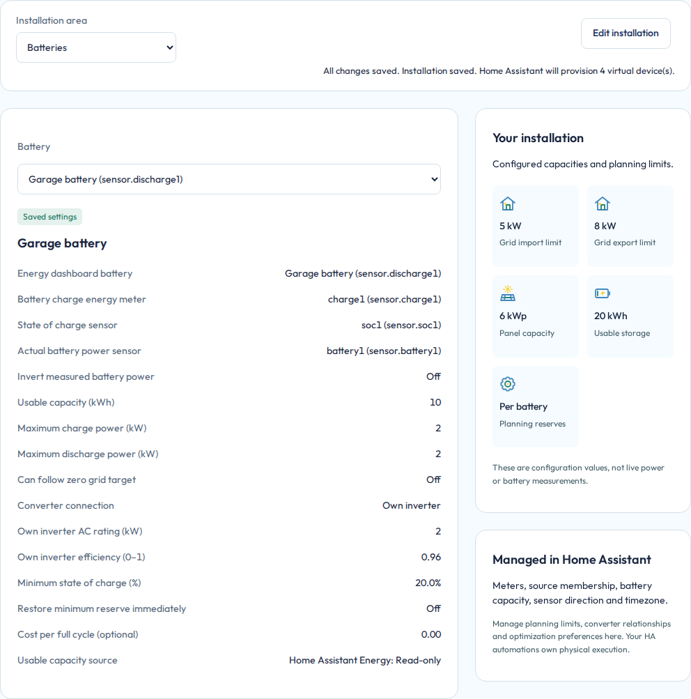
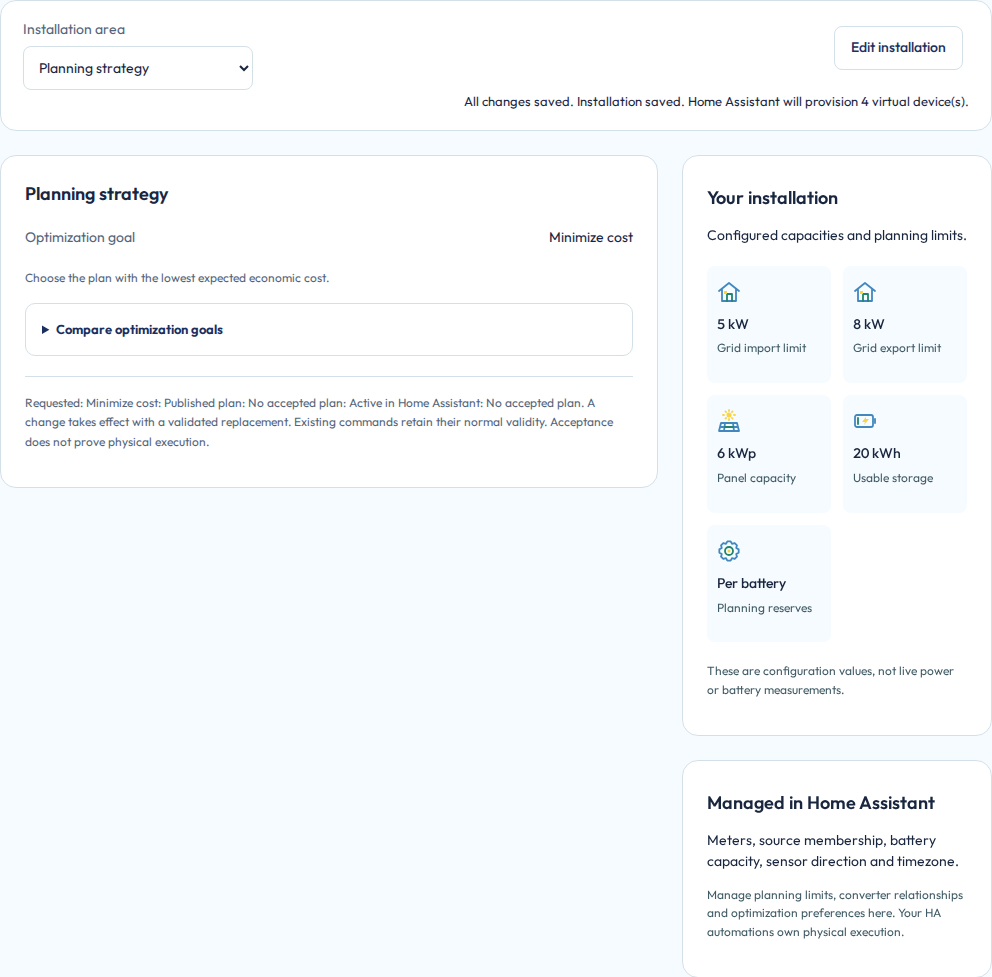

# Installation settings

Use **Settings > Installation** to describe the physical system OEP may plan. Home Assistant Energy supplies source identities. OEP adds the physical limits, connections and planning choices that Energy does not define.

## Complete the first installation

The first-run wizard has five stages: Home Assistant, connection and household, solar production, batteries, and review. Complete the detected installation, inspect the review, then choose **Save installation**. Merely advancing a stage does not save the whole installation.

If Energy is incomplete, correct it in Home Assistant and refresh discovery. Do not add replacement entity IDs in an unrelated OEP field. A configured meter may be discoverable before it has usable readings or history.

Large source lists are transferred in complete, bounded parts. The app keeps the
previous complete list if a refresh fails before the new list is published.
If the final acknowledgement is lost, the complete new list may already be
visible. There is no fixed configured-device maximum.
See [hardware sizing and calculation time](planning-performance.md#size-hardware-for-your-installation)
for the effect of a larger installation.

## Connection and household

Confirm **Maximum grid import (kW)** and **Maximum grid export (kW)** for the complete modeled connection. These are aggregate planning limits, not per-phase protection. Use the permitted limits for your equipment and connection rather than copying the example.

Household energy is reconstructed from the same measured boundary:

```text
grid imports + solar production + battery discharge
- grid exports - battery charging
= household consumption
```

OEP can estimate annual household use from a common complete history period. A shorter period is explicitly extrapolated and may have seasonal bias. With insufficient usable history, confirm **Annual whole-home consumption (kWh)** as a startup estimate. Empty history does not mean zero demand.

[](../assets/installation-connection.png)

*The limits describe the connection. The annual consumption figure describes household scale. They have different units and purposes. All displayed values are synthetic examples.*

## Solar production

Review every detected solar source. Confirm its physical properties and inverter relationship rather than treating a production meter as a complete panel model. OEP needs the correct production boundary and the properties required by the selected forecast route.

Sources sharing an inverter also share its capacity. A standalone solar inverter and a hybrid inverter with a battery have different energy paths. Do not assign an independent full inverter capacity to every source on one shared converter.

Permission to curtail production is explicit. A negative export price alone does not establish that your hardware can stop production. If OEP warns that fixed solar can exceed the export limit, review the ratings and real control capability. The planner does not silently assume a local export limiter.

## Batteries

Energy supplies each battery's usable capacity, state-of-charge source and normalized power links. Missing capacity, SoC or power configuration must be corrected there. OEP needs the battery's charging/discharging limits, reserve, conversion assumptions and connection to a standalone or shared inverter.

[](../assets/installation-battery.png)

*Usable capacity and SoC define the stored-energy basis. Power limits and reserve constrain what may be planned. Values in this image are examples, not recommended equipment settings.*

Review any suggested efficiency or rating against the manufacturer's information and your physical configuration. A planning reserve is not a battery-management-system protection setting. If the battery is below reserve, the measured value remains real. The optional reserve-recovery policy can prioritize restoring it within the modeled limits.

### Battery wear cost

Set **Cost per kWh (optional)** to your estimated wear cost in the contract currency per internal kWh discharged. Leave it at **0** to exclude wear from the economic comparison. This is an optional valuation, not a measured aging cost or a manufacturer warranty calculation.

For example, a rate of **0.02 EUR/kWh** and **5 kWh** removed from internal battery storage adds **0.10 EUR** wear. Charging is not charged again. A larger battery has the same cost for that same 5 kWh discharge. The reserve percentage does not change the rate.

Internal energy includes cell discharge losses. With 80.0% discharge efficiency, supplying 4 kWh at the battery terminal removes 5 kWh internally. When calculating actual costs from an AC discharge meter, inverter and DC losses are also accounted for before applying the same rate.

The saved summary and the original plan's **Starting conditions** retain the configured rate, including values such as **0.025** or **0.004**. Cost totals still show two decimals.

The optimizer, self-consumption reference, expected period costs and measured comparison use this same basis. The estimated value of remaining energy deducts its future discharge wear. Neither the without-battery baseline nor charging alone incurs battery wear.

Enable **Can follow zero grid target** only if your own controller or automation can implement that mode. It is a capability permission, not a promise of physically exact zero grid exchange.

### Periodic battery calibration

Select a battery and **Edit installation**, then optionally enable **Periodic battery calibration**. It is off by default. **Calibration interval (days)** is configurable from 1 to 180 whole elapsed days, with 14 as the default. **Calibration hold (hours)** defaults to 3 hours and accepts fractions. Save the installation explicitly. The planner schedules calibration only when this option is enabled. Leaving it off does not impose a periodic full-charge requirement.

The first deadline is 14 days after enabling with the default interval. Each completed calibration establishes the next deadline. The planner starts charging ahead of the deadline, allowing for configured charging power, converter and grid connection, the full hold and a quarter-hour margin. Calibration charging takes priority over price optimization. Electrical limits and local battery protections remain authoritative. Insufficient capacity or energy can leave calibration overdue. A deadline never permits exceeding those limits.

Completion requires a measured **100.0%**, followed by the configured continuous hold without measured active discharge. Natural absorption drift down to **98.0%** is allowed. A lower SoC, positive discharge power, missing SoC/power inputs or more than five minutes between captures restarts the hold after a new measured 100.0%. A natural full-charge hold can also satisfy the requirement. Before the first completion, a natural full charge starts a protected hold immediately, even before scheduled charging becomes due. After completion, remaining at 100.0% does not start repeated holds. Normal planning resumes until the next calibration charging window.

During required charging and the hold, proposed battery commands cannot actively discharge or use zero-grid following. After measured completion, a fresh plan resumes normal operation. Until that confirmation, the displayed future plan conservatively retains the hold. Your existing Home Assistant automation must execute the battery commands. This setting does not configure inverter charging voltage, BMS balancing or manufacturer calibration procedures.

Progress and the last completed time live in the active database and survive restart and database transfer. An unobserved offline period never counts toward completion. A predicted full battery in a plan does not count either. Reload Installation to see retained progress and the next deadline. An overdue calibration that is already holding shows both the missed deadline and when the current hold can finish. Disabling calibration clears its schedule and keeps valid timing choices. Incomplete or invalid timing entries return to saved values or defaults when calibration is turned off. Re-enabling, changing its interval/hold, or replacing its measurement identity or capacity starts a new schedule. Unrelated settings preserve measured progress. Only enable periodic full charging when appropriate for the battery manufacturer's instructions.

## Choose the planning strategy


Select **Planning strategy** in the installation area selector. The saved **Optimization goal** row shows **Minimize cost** or **Minimize consumption**. Open **Compare optimization goals** for the full explanation, then use **Edit installation** to change the choice.

[](../assets/optimization-goal.png)

*The selected goal is saved configuration. Home Assistant acceptance is separate status evidence and does not prove physical execution.*

The new choice requests a replacement plan. Requested, published and accepted strategies can temporarily differ. A failed replacement does not rewrite the old plan or extend its validity. See [how the goals differ](how-oep-works.md#choose-the-optimization-goal).

## Revisit a saved installation

Select the area or source you want to inspect before choosing **Edit installation**. Area changes are locked while editing or saving. Changing which source is displayed does not itself change the configuration.

After saving, check the saved summary and then **Planning**. If the setup cannot proceed, use [troubleshooting](troubleshooting.md). Developer contracts for source ownership, topology and validation remain in [Installation planning](../development/INSTALLATION-PLANNING.md) and [Energy mapping](../development/ENERGY-DASHBOARD.md).

**Next:** [Contract and prices](contract.md).
