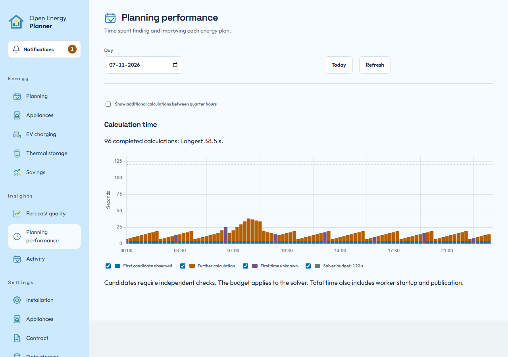

# Understand calculation time

Open **Insights > Planning performance** when you want to understand how long calculations took and what result they produced. It is a read-only history. Opening a calculation does not activate its plan or change solver settings.

## Inspect a day

1. Choose the **Day** in the Home Assistant timezone, or use **Today**.
2. Read **Calculation time** together with the **Calculations** list.
3. Enable **Show additional calculations between quarter hours** when you need to include intermediate rounds.
4. Open the calculation row for the relevant start time. The list provides the same detail access as the chart and works with the keyboard.

The list uses compact columns for time, result and duration. It shows up to 25
calculations per page in chronological order. Use **Next** and **Previous** to
move through the selected day. The page number shows your position. The chart
continues to show the whole day while you page through the list. Changing the
day, choosing **Today** or using **Refresh** opens the first page. Closing a
calculation returns to the same row and page. On phones, each row places its
result below the time and duration. Long results remain available in the detail
dialog.

The stacked bars separate the first observed financial candidate from further calculation time when both were recorded. An unknown first-candidate time produces a total-only bar. Missing historical progress cannot be reconstructed from the total duration.

*The first two bars separate the observed first candidate from further calculation. The third has no recorded first time. These are synthetic history records, not a solver benchmark.*

## Distinguish a candidate from a usable plan

The solver can find a candidate before it finishes improving it. That observation is not independent physical validation or publication. Read the outcome as well as the duration. A calculation can reach its time budget and still produce a checked usable plan, or finish without publishing one.

The solver budget applies to solver work. Total elapsed time can also include worker startup, preparation and publication. A total above the solver budget therefore does not by itself prove a timeout defect.

## Read plan improvement

The calculation dialog shows observed candidate costs and a best possible bound when available. **Remaining possible improvement** is a model-quality bound in currency and, where defined, a percentage. It is not percentage completed or an estimate of remaining seconds.

For example, a candidate cost of EUR 10.00 and a valid lower bound of EUR 9.80 leave at most EUR 0.20 improvement under that model. This does not promise the solver will find it. Costs include the stated stored-energy valuation and are not a supplier bill or measured savings.

Compare progress within one calculation. Two calculations can have different inputs, goals and horizons, so their costs are not directly comparable. A slow bar alone cannot identify the cause. Use the detail's strategy, interval count, preparation time, service priorities and outcome before reporting a problem.

On a phone, the calculation dialog fills the screen. Use **Close** to return to the same history. An absent progress sequence remains explicitly unavailable rather than becoming an invented improvement curve.

**Next:** [Read the resulting plan](read-your-plan.md), or [report a problem with useful context](troubleshooting.md#ask-for-help-safely).
