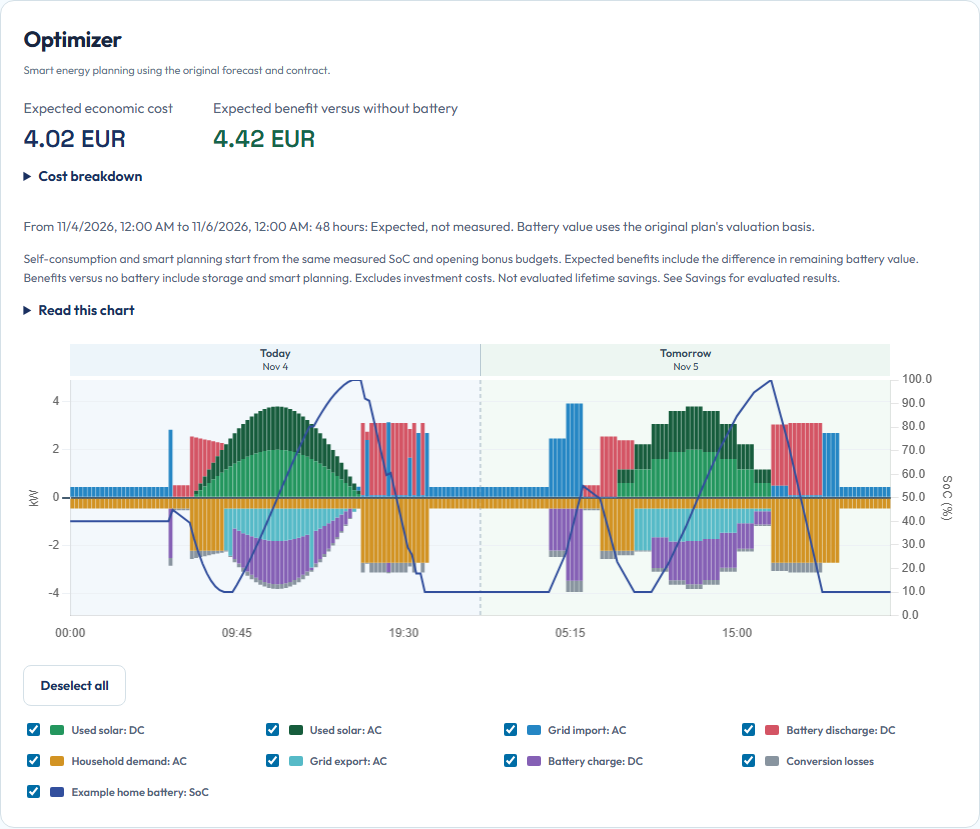

# Read your plan

Open **Energy > Planning** to inspect one original calculation. Begin with its version, generated time and strategy. Then follow the same energy through the three scenarios. The page explains proposed behavior, not proof that physical equipment followed it.

## Check which plan you are looking at

The latest retained plan is the default. **Plan version** lets you inspect history. A historical selection changes the view, not active commands. While the same plan refreshes, the previous complete view can remain visible with an explicit loading status. Choosing a different historical plan clears its predecessor's data until that selection loads.

The selected plan's graph, prices and interval values appear first. Its power scale initially follows the original plan. When the two simulations arrive, their visible flows join one shared scale update. The two simulation graphs and their cost comparisons follow without waiting for the detailed evidence. A simulation read failure leaves the selected plan usable and shows a retry message. Choose **Refresh overview** to retry. A plan opened through a direct link stays selected during this retry.

A valid older plan can remain in history after a later calculation fails. Its presence does not mean its commands are still applicable. Read the page's status and any source warning.

Charts redraw when their data, visibility, scale or dimensions change. Loading simulations does not redraw unchanged price and forecast charts.

For duration and solver-progress questions, use [Planning performance](planning-performance.md). A first solver candidate is not yet an independently checked published plan.

## Start with the three scenarios

| Chart | Read it as |
|---|---|
| **Optimizer** | The original plan under its selected goal, forecast, installation and contract |
| **Battery self-consumption** | The same installation storing surplus solar and covering demand without price optimization |
| **Without battery: Baseline** | The same household and solar forecasts without battery storage |

The scenarios share a time range, units and kW scale. The value-axis bounds combine visible data across all three charts, so the same bar height represents the same power. Zooming, toggling a series or resizing updates their shared scale. The baseline retains planned EV and thermal loads. Self-consumption aims for zero on the meter within physical limits, rather than guaranteeing it.

**Grid exchange comparison** shows the net grid power for these scenarios in W.
Its legend uses the same names and order as the three scenario charts above.
All three lines are solid. Positive power is import and negative power is export.

*Read the colored flows together with battery SoC. The example contains actual calculated flows from synthetic inputs. It is a teaching scenario, not a prediction for your household.*

## Read the energy balance

Above zero is supply to the modeled balance: used solar, grid import and battery discharge. Below zero is use: household demand, grid export, battery charge and conversion losses. These signs describe this chart's balance. They are not interchangeable with every device's command sign.

### Solar AC, Solar DC and conversion losses

The three scenario charts use the same measurement boundaries. Each solar series
has its own green color and legend switch.

| Series | Measurement point |
|---|---|
| **Used solar: DC** | Used PV energy at the hybrid inverter's DC input, before conversion |
| **Used solar: AC** | Used production at the AC output of separate solar-only inverters |
| **Battery charge / discharge: DC** | Battery terminals, after or before its DC converter |
| **Household demand / grid import / export: AC** | The shared AC bus and grid connection |
| **Conversion losses** | Hybrid or battery-inverter losses and battery DC/DC conversion inside these boundaries |

A separate solar inverter's DC-to-AC loss has already occurred before **Used solar: AC**.
It is excluded from the loss bar to avoid counting it twice. Hybrid inverter losses
remain included, as do any DC/DC losses on the direct route into the battery.
Actual losses follow the declared efficiencies. Internal battery storage losses
affect SoC rather than being deducted twice from terminal charge/discharge.

The complete displayed energy balance is:

**Solar DC + Solar AC + grid import + battery discharge = household base or remainder +
appliance demand + grid export + battery charge + conversion losses.**

#### Worked balance: One hour

This example assumes 90.0% hybrid DC-to-AC efficiency, lossless direct battery DC
conversion and no other appliance demand. Powers are constant, so 1 kW for this
hour equals 1 kWh.

| Route | Mean power | Where it appears |
|---|---:|---|
| Hybrid PV input | 2.0 kW | Solar DC supply |
| Direct DC charging from that input | 1.0 kW | Battery charge |
| Remaining hybrid PV converted to AC | 0.9 kW | Supplies the AC bus, not another solar bar |
| Hybrid conversion loss | 0.1 kW | Conversion losses |
| Separate solar inverter AC output | 1.8 kW | Solar AC supply |
| Household demand from the AC bus | 2.0 kW | Household demand |
| Remaining AC exported to the grid | 0.7 kW | Grid export |

The AC bus receives **0.9 + 1.8 = 2.7 kW**, supplying **2.0 + 0.7 = 2.7 kW**.
The chart receives **2.0 + 1.8 = 3.8 kW**, supplying
**1.0 + 2.0 + 0.7 + 0.1 = 3.8 kW**. The separate solar inverter's earlier
conversion loss sits outside this balance.

AC-fed battery charging can use the shared bus. The graph cannot uniquely assign
that energy to solar or the grid. The selected-interval converter details retain
their local DC solar and AC input/output boundaries. Available solar forecasts
remain DC inputs. Solver decisions, costs and original archived plans are unchanged.

The series together should balance around zero before hidden series and the
0.1-kW appliance display rounding. Bars show mean kW for their covered quarter. Battery lines use the separate SoC percentage axis. Tap or hover for the exact interval. A partial quarter has its actual covered duration rather than a fabricated full-quarter energy amount.

Use **Next 6 hours**, **Next 24 hours** or **Full period** (with its available duration). Day bands and date labels identify calendar boundaries in the installation timezone. The legend sits below the full-width chart, with aligned columns on wider screens and compact wrapping on phones. Toggle a series to inspect the others. Hidden or missing data must not be interpreted as a measured zero.

Hover over a date above any of the three scenario charts to see its energy totals.
You can also focus the date with the keyboard or tap it on a phone. Press Escape
or tap the date again to close the summary. Each visible energy flow is integrated
over its actual duration and shown in kWh. Supply remains positive and use
negative, matching the chart. Battery percentages are not added together.
Hidden series are omitted. Missing or inconsistent interval evidence produces
an unavailable total rather than a fabricated zero.

The summary follows the selected chart range. A partial day explicitly states
that its totals cover only the shown planned period and gives the exact start
and end. Calendar days use the installation timezone, including 23-hour and
25-hour days when the clocks change. These are scenario forecasts, not measured
daily production or consumption.

[Open the mobile chart example](../assets/planning-mobile.png) to see the stacked cost cards and legend below the same synthetic two-day plan. Open any guide figure at full size when its labels are too small on your screen.

## See individual appliances

The Optimizer, Self-consumption and Without battery charts show each separated
appliance in the consumption bars and legend. **Expected** is probable remaining
use. **Scheduled** is a concrete acknowledged cycle or charging session. Both
are estimates until measured. Each device has one legend entry. Its expected
use has striped bars and its scheduled use has solid bars in the same color.
Tap or hover over the balance to see both contributions separately. The legend
switch hides or shows both contributions together. Devices with the same name
remain separate devices.

An appliance is omitted from both bars and legend when its combined expected
and scheduled consumption is below **0.1 kW in every displayed quarter-hour bar**.
One bar at exactly 0.1 kW or above keeps the appliance visible. This is visual
rounding only. Original forecasts, calculations and costs retain all consumption.
The visible bars can therefore have a small imbalance from omitted device use.
Missing values remain unavailable, rather than being rounded to zero.
Changing the period updates the entries and preserves your checkbox choices.
Turning off an eligible appliance keeps its switch available so you can show it again.

Each of the three legends has a **Deselect all** button. After any series is
unchecked it becomes **Select all**. It controls only that chart's available
legend entries, including both contributions of each device and the battery
percentage line. It cannot reveal devices excluded by the rounding rule.

A scheduled cycle replaces its expected share rather than being added twice.
Other probable use remains. Reference charts execute acknowledged cycles at their
immediate reference starts, so their bars can differ from the optimizer's chosen
starts. EV and boiler service keep their existing comparison assumptions.

**Household base: AC** excludes separated appliances. **Household remainder: AC**
also contains selected devices that still lack enough usable history to separate.
An unavailable device is not shown as a measured zero. These expectations do not
authorize starting a device. Readiness and execution permission remain necessary.

## Read cost before benefit

Every scenario starts with **Expected economic cost**. Both battery scenarios then show **Expected benefit versus without battery** against the same baseline. A negative benefit means the scenario costs more than the baseline. An unavailable comparison stays unavailable.

Open **Cost breakdown** to see **Import cost**, **Export income** and **Bonus income** separately for each scenario. Net electricity cost is import cost minus export income minus bonus income. A negative income increases net costs. Missing amounts remain unavailable rather than becoming zero. The same breakdown shows battery wear and stored-energy value change. Economic cost includes wear and subtracts the value change. Stored-energy value is not cash received.

These amounts and their cost breakdown follow the selected chart period. The latest plan starts at the current quarter. Historical plans start at their original beginning. **Full period** shows the available duration, normally 48 hours for a new plan and less when part has elapsed or coverage is shorter. The caption gives the exact covered period. Empty or unavailable periods do not show a zero cost.

For original-cost periods, battery value change uses the stored energy at both ends and the original plan's fixed valuation basis. A successful full-plan contract correction instead supplies its own separately calculated inventory value. It retains the original physical flows. Changing the view does not fetch new prices or optimize another plan. Earlier export still consumes bonus room even when it is outside the selected period. These are alternative scenario expectations, not values to add together. The [Savings guide](savings.md) gives a worked comparison and explains the separate retrospective reference.

## Understand the forecast and price charts

Household demand and available solar describe original forecast inputs before the planner's decisions. Available DC solar and household AC demand use different measurement boundaries. Compare them with conversion and clipping in mind.

The **Price inputs** chart follows the selected latest or historical plan and shows its frozen prices. Newly received prices and changed contract rules appear when a new plan uses them. Without a plan, the same graph is explicitly labelled **Current tariff preview** and uses cached market prices with saved rules. Solid lines identify published prices and dotted lines identify forecast prices. A forecast price is not a later published settlement price. Conditional export bonus revenue can depend on eligibility and remaining allowance, so a preview rate is not a promise that every exported kWh earns it.

The price scale always includes zero. With nonnegative visible prices, its lower
bound is exactly zero. Negative prices receive clearance below the lowest
visible price equal to ten percent of the total axis height. If all visible
prices are negative, zero is the upper bound. Changing the time range or hiding
a series recalculates the scale without changing any prices.

See [contract and prices](contract.md) for formulas, dates and bonus interpretation, and [forecasts](forecasts.md) for how predictions are checked against measurements.

## Inspect an individual decision

Open **Understand this plan** to load whole-plan inputs, assumptions and source evidence. These details are fetched only when the panel is open. Expand **Selected interval details** and move the time selector to inspect the relevant interval. Clicking a plan chart point also opens the evidence panels. If the evidence read fails, close and reopen **Understand this plan** to retry. The graphs and original interval values remain available.

Check the measured starting stock, forecast inputs, physical limits, proposed command and expected result together. A reached limit is an observation. It is not proof that OEP evaluated every hypothetical alternative or that this limit caused the choice.

Within **Selected interval details**, expand **Detailed interval values** for the battery control mode, fixed power target when present, stored energy and solar production permission. The time selector works with the keyboard. These are planned commands, not confirmation that equipment followed them. Viewing them never sends a physical command.

The three scenario cards retain their **Cost breakdown**. For the full original plan, Optimizer and self-consumption default to the latest successful contract valuation when available. **Contract updated** shows its calculation time. Original economic costs and components remain inside **Cost breakdown**. Repricing does not optimize the plan again. Without battery retains its original contract basis, so a benefit comparing that baseline with corrected costs is unavailable.

Shorter or remaining periods retain the original contract rates and battery-value basis. Their captions identify that basis. **Open full original plan** returns to the complete horizon and its latest successful valuation. No corrected amounts are inferred for part of a plan. A later repricing failure retains the previous successful valuation and shows the failure separately. The original archive remains unchanged.

Forecast evidence shows the model and quality that were used. Technical forecast version identifiers are omitted from this user view.

## Keep units and commands straight

Power in kW is a rate. Energy in kWh is the amount across an interval. A steady 2 kW for one quarter is 0.50 kWh. OEP retains calculation precision even when a screen rounds the displayed value.

For a fixed stationary-battery target, positive W means discharge and negative W means charge at the battery DC terminal. Zero is a real idle target. A numeric value can be unknown because its mode has no fixed target, or unavailable because no usable command exists. Do not turn either state into zero in an automation.

**Next:** [Understand Savings](savings.md), [inspect forecast quality](forecasts.md#read-forecast-quality) or [resolve a warning](troubleshooting.md).

### A device appears in Forecast quality but not in the plan

Forecast quality preserves the original prediction recorded at midnight for
each selected day. The displayed model is that original choice. It does not
identify the model used by the current plan or prove that weather features
were used.

The planning overview displays the components of its selected saved plan.
Separate appliance predictions require enough usable household and device
history to reconstruct the remaining household consumption. Until that is
available, planning can retain the whole-house forecast while Forecast quality
still shows the original individual prediction. A saved plan does not change
when history is refreshed. Check the latest plan after the update completes.

Training uses all available Recorder years. Missing hours and the accumulated
counter jump across each gap are excluded. The next contiguous measured hour
remains usable. Invalid balances are excluded individually. Their absolute
count does not prevent training when enough usable coverage remains.
